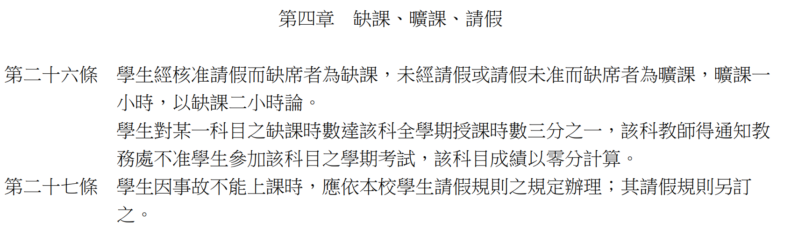

# 系統分析與設計（System Analysis and Design, SAD）課程介紹

| 項目 | 內容 |
|---|---|
| 學期（課號） | 115-1（IE226） |
| 學分數 | 3 學分 |
| 授課老師 | 呂卓勲 |
| Email | chohsunlu@saturn.yzu.edu.tw |
| Office Hour | 每週四 13:30–16:30 |
| 上課時間 | 每週三，第 2–4 節，共三小時 |
| 上課地點 | *待補* |
| 課程內容 | 以「系統分析與設計」為核心，採專題導向（Project-Based Learning）教學。學生透過實際案例分析、需求萃取、系統設計、文件撰寫與成果報告，建立資訊系統開發所需的分析與設計能力 |

## 課程預計進度表

18 週的主題、報告日期與繳交期限，見[「課程進度表」](Course-Schedule.md)。

## 學期配分比重

每個項目各自算出自己的成績，再依「學期比重」加權合計。兩份小組報告的成績由書面與口頭兩部分組成，其餘三項不再細分。

| 項目 | 學期比重 | 總分 | 書面 | 口頭 | 說明 |
|---|---|---|---|---|---|
| **期中小組報告** | 30% | 100 | 30% | 70% | 系統分析（Analysis）階段 |
| **期末小組報告** | 30% | 100 | 30% | 70% | 系統分析與修改建議階段 |
| **期末個人訪談** | 20% | 100 | — | — | 面對面口試，每人一次 |
| **個人學習與貢獻報告** | 15% | 100 | — | — | 個人書面，說明自己在兩份小組報告中的貢獻 |
| **出席狀況** | 5% | 100 | — | — | 只看曠課，計算方式見〈課堂規範〉 |
| 合計 | 100% | | | | |

完整公式與所有扣分規定，以[「成績計算規範」](Grading-Rules.md)為準；報告怎麼交，見[「報告規範」](Report-Rules.md)。

表上五項之外，另有 **額外投入加分**，最多在學期成績上加 3 分，加完仍以 100 分封頂。這是本課程唯一的加分機制，條件見[「額外投入加分」](Bonus-Rules.md)。

兩份小組報告原則上 **組內同分**，個人之間的差異由期末個人訪談與個人學習與貢獻報告反映。四個項目 **各自計分**，但少做一項，後面幾項的分數也會跟著往下掉，見[「報告規範」](Report-Rules.md)〈四個項目怎麼互相影響〉。

## 分組規範

期中與期末報告都以小組為單位。分組人數、分工紀錄、組員變動與組內衝突處理，見[「分組規範」](Group-Rules.md)。

最容易錯過的兩個日期：**分組名單最晚第三週（9/23）確定**、**組員變動申請最晚第 10 週（11/11）** 提出，逾期都不受理。個別同學缺席報告時的請假與補救，另見[「報告規範」](Report-Rules.md)。

## 報告規範

本節只把四個評分項目的概要說清楚：各自要做什麼、要交出哪些東西、時間怎麼安排。**完整規定不在這裡**，依你想知道的事情跳過去：

| 你想知道 | 去哪份文件 |
|---|---|
| 報告怎麼交、期限是哪一天、缺席與補救怎麼處理 | [報告規範](Report-Rules.md) |
| 遲交扣幾分、什麼情況直接 0 分、學期成績怎麼算 | [成績計算規範](Grading-Rules.md) |
| 書面要寫到什麼程度、口頭報告與訪談會問什麼方向 | [報告內容](Report-Contents.md)、[參考題庫](Question-Bank.md) |
| 每一項怎麼評分、等第怎麼換算 | [報告評量 Rubrics](Rubrics.md) |
| 有沒有範例可以參考 | 期中見[期中分析範例系統](../03-Midterm-Project-Example-Systems/README.md)，期末見[期末題目](../05-Final-Project-Topics/README.md)。**照結構寫，不要照內容抄** |
| 做得比要求更多能不能加分 | [額外投入加分](Bonus-Rules.md) |

> **上面每一份都請完整讀過。** 發生爭議時，老師依那些條文處理，不是依本節的概要。

### 期中與期末小組報告

兩份報告的題目由老師提供、各組抽籤決定，產出項目如下表。

| 報告 | 階段 | 題目來源 | 產出項目 |
|---|---|---|---|
| **期中小組報告** | 系統分析（Analysis） | 既有系統案例 | **九項**：1 問題與系統背景、2 使用者與利害關係人分析、3 現況流程分析、4 系統需求分析、5 功能分析與系統邊界、6 使用案例與系統互動分析、7 資料需求分析、8 系統環境與整體架構理解、9 現況問題與改善建議。必做的 UML 為使用案例圖、活動圖、循序圖三種 |
| **期末小組報告** | 系統分析與修改建議 | 既有的工廠管理系統，加上老師給的修改方向 | **兩大部分共 16 項**。第一部分「既有系統分析簡要報告」：1 系統背景與角色、2 現況流程、3 現況功能與需求、4 現況資料。第二部分「修改建議書」：5 變更申請、6 差異分析、7 影響分析、8 效益評估、9 修改後的需求與功能規格、10 資料變更、11 畫面設計、12 驗收標準與測試案例、13 作業與組織衝擊、14 資料轉換規則、15 上線切換與回復原則、16 需求追溯。必做的圖為使用案例圖、修改前後的活動圖、功能階層圖、ERD、修改後的循序圖與修改前後的畫面對照 |

期末的工廠情境，以及期末為什麼改成修改既有系統，見[「報告內容」](Report-Contents.md)〈二、期末小組報告〉。兩份書面報告的最後都要附 **分工紀錄**，組內怎麼維護見[「分組規範」](Group-Rules.md)。

**兩份清單以[「報告內容」](Report-Contents.md)為準**，各項要寫到什麼程度也在那份文件裡。

#### 題目怎麼分配

期中與期末的題目老師都會準備數個，**哪一組做哪一題，在課堂上當場公開抽籤決定**。**期中題目於第 3 週（9/23）分組名單確定後當堂抽**；**期末題目於第 10 週（11/11）發放題目說明書後當堂抽**。

抽籤使用老師開發的開源工具 Lucklet：<https://github.com/billy1125/lottery-game>。投影在螢幕上當場操作，全班一起看結果；程式碼公開，亂數由瀏覽器端產生，老師無法預先決定哪一組拿到哪一題。**抽到就是抽到，不重抽、不換題、不接受組間交換。**

各題的規模與難度會盡量拉平，但不可能完全一樣。評分規準（見[「報告評量 Rubrics」](Rubrics.md)）對全班相同，看的是你對自己那一題做得多完整。

#### 兩份報告請一起規劃

期中分析一套既有系統，期末再分析另一套並提出修改建議，兩份報告用的是同一套概念與方法。期中在第 9 週、期末在第 16 週，中間扣掉停課只剩五次上課，請不要等期中交完才開始想期末；分工方式、檔案命名、簡報模板與共筆規則，期中定好，期末直接沿用。

> **把期中與期末當成同一個專題的兩個階段，不要當成兩份不相干的作業。**

### 期末個人訪談與報告

本階段包含兩個獨立計分的項目，要交什麼與會問哪些題型，見[「報告內容」](Report-Contents.md)〈三〉〈四〉。

| 項目 | 形式 | 學期比重 | 概要 |
|---|---|---|---|
| **個人學習與貢獻報告** | 書面 | 15% | 說明你在期中與期末小組報告中的主要貢獻 |
| **期末個人訪談** | 面對面口試 | 20% | 老師從你們的書面報告抽題提問，依回答內容確認你是否真正理解系統分析與設計的流程 |

這兩項 **建立在兩份小組報告之上**。沒有完成小組報告的同學仍然可以參加，但分數會大幅受影響，見[「報告規範」](Report-Rules.md)〈四個項目怎麼互相影響〉。

這兩項彼此之間也一樣：各自計分，少做一樣不會讓另一樣自動歸零，但 **沒交個人報告，訪談就少了你自己整理過的素材；沒來訪談，個人報告寫的東西也沒有機會被驗證**。兩項合計 35%，放掉哪一項都很難補回來。

#### 訪談時間安排

全班人數光靠第 17、18 週兩次上課時段排不完，因此 **第 12 週（11/25）停課挪出的三小時，會以另外開放時段的形式還給訪談使用**。可選時間包含第 17 週（12/30）與第 18 週（2027/1/6）的上課時段，以及老師另行公告的非上課時段，**一律排在 12/30（三）及之後**。

時段以 **線上表單登記、同學自行選填**，表單 **自第 14 週（12/9）開放至第 16 週（12/23）截止**，連結公布於 LINE 群組。請儘早填寫，額滿的時段就會關閉。

**逾時未登記、登記後換時段、訪談當天未到，以及個人報告的期限怎麼跟著訪談日走，一律依[「報告規範」](Report-Rules.md)辦理。** 其中最容易吃虧的一條是：沒在期限內登記的同學，老師的安排結果不保證會在 12/25 前通知你，因此請一律以最早的訪談日反推，**在 12/25（五）23:59:59 前把個人報告交出來**。

### 小組與個人評分標準

報告的分數會由兩個方向去打：**內容分數** 看內容做得如何，四個評分項目各自的評量規準（Rubrics）與等第、分數的換算方式，依[「報告評量 Rubrics」](Rubrics.md)；**繳交扣分** 看有沒有按時交、檔案打不打得開，細節請見[「成績計算規範」](Grading-Rules.md)。

## AI 工具使用揭露

**其實，就算你的書面報告與檔案內容全部都用 AI 生成，老師也不介意。與其交出一份排版亂七八糟、前後語意不通、讓人讀不下去的報告，老師寧可你好好運用 AI，做出一份清楚完整的成果。**

不過，這不代表用了 AI 你就會比較輕鬆。評分重點不在於是否使用 AI，而在於你是否能理解、查核、修改並說明最終成果——老師將透過小組口頭報告與期末個人訪談確認你對內容的理解程度。

若使用生成式人工智慧協助撰寫、整理、繪圖、翻譯或修訂，應於報告中揭露下列事項：

| 項目 | 說明 |
|---|---|
| 使用工具 | 列出使用的工具，例如 ChatGPT、Claude、Gemini 或其他服務，並儘可能註明模型或版本 |
| 使用目的 | 說明使用 AI 的用途，例如架構發想、資料整理、翻譯潤稿、繪製圖表或產生範例資料 |
| 使用範圍 | 說明 AI 協助產出的章節、圖表、模型或其他內容 |
| 人工查核與修改 | 說明如何確認內容正確，以及人工做了哪些修正、補充或重新製作 |

使用 AI 不代表可以免除內容查核與說明的責任。若無法說明報告內容、圖表關係、設計依據或修改過程，仍會影響口頭報告與個人成績。

## 課堂規範

### 簽到與簽退

每週上課都要簽到與簽退。助教會在上課前 10–20 分鐘到教室讓同學簽到，第三堂課下課後則開放簽退，完整時間見下表。

| 項目 | 時間 | 說明 |
|---|---|---|
| 簽到 | 上課前 10–20 分鐘到上課鐘響後 20 分鐘內 | 超過時間後助教就會離開 |
| 簽退 | 第三堂課下課後 | 助教會在現場等候，沒有同學要簽退就會離開 |

如何計算曠課時數，請見下表：

| 狀況 | 備註 |
|---|---|
| 未簽到有簽退 | 曠課 1 小時 |
| 有簽到未簽退 | 曠課 1 小時 |
| 未簽到也未簽退 | 曠課 3 小時 |

> 請注意：簽到與簽退時間一到，助教就會立刻離開教室。請勿因個人因素干擾助教作業，違者依學校規定處理。

**出席狀況的公告與更正**：每週的點名結果，原則上於 **上課後的第一個星期一** 在 LINE 群組公告。對自己的出席紀錄有疑問，請 **最晚於下一次上課前** 告知老師；過了這個時間就不再更正，因為時間拖久了誰也想不起當天的狀況。本項公告進行至 **第 16 週（12/23）** 為止。

每週都花一分鐘核對，比學期末才發現曠課時數不對容易處理得多。

### 扣考規則

> **所謂扣考就是：不能參加期末小組報告、期末個人訪談與個人學習與貢獻報告，並且如果你的小組中有人被扣考，你那組就會少一個人。**

**扣考只依曠課時數認定**，依據是下方的學則，而本課程只看曠課、不算請假，比學則寬鬆。要注意這件事由 **老師依曠課時數逕行認定**，走的是出席這條線。**報告規範不會另外剝奪你參加任何一項的資格**，兩者是兩回事。

被扣考的實際後果是期末小組報告、期末個人訪談與個人學習與貢獻報告三項都無法進行，合計 65% 全部拿不到分數，學期成績不可能及格（已完成的期中成績仍然保留，算式見[「成績計算規範」](Grading-Rules.md)）。所以請不要曠課到這個地步。

學校已經將相關規定寫在學則裡面：

*圖片來源：元智大學學則*

3 學分的課全學期共 54 小時，學校規定缺課 18 小時就扣考，而學則的「缺課」把曠課、病假、事假通通算進去。本課程比學則寬鬆：

> **我只看曠課，曠課超過 18 小時（等於有六次沒來上課），將逕行扣考。**

要曠到這個程度其實很難，沒辦法來上課，請務必請假。

### 請假規定

- 請假請自行依學校規定申請，但請勿濫用各種假別……務必仔細思考有必要才請假
- 請假理由也麻煩不要太扯，以下這些都算：
  - 要去打工、打工班表已排好 🈲 🙅
  - 考駕照考了四、五次甚至更多 🚗 🛵
  - 老師我已經機票買好了，可以之後再補報告嗎？
  - 要去排演唱會周邊、心儀的偶像閃電結婚或退伍 👩‍🎤 🧑‍🎤
  - 我的鬧鐘壞了 ⏰️、昨晚熬夜打電動太睏了 🎮、我頭髮骨折，或任何太蝦 🦐 的理由……
- 若因故必須長期缺課，請務必先聯絡任課老師討論，不要自己先假設可以怎麼處理，以免造成無法挽回的結果

### 其他規範

- 上課禁止使用智慧型手機，使用電腦請務必用於本課程相關的事情，要追劇、打電動、看直播、聽音樂請回家
- 如果老師發現你玩得太過頭，不會罵人，但會請你離開教室，想好好上課再回來

## 成績有問題怎麼辦？

各項報告與訪談的分數，原則上都會在評分完成後 **一週內公告**，對分數有疑問請在 **老師指定的複查時間內** 提出。提出之前，先分清楚兩件事：**分數算錯了** 和 **分數不理想**，處理方式完全不同。

**分數算錯了**：誤植、加總錯誤、漏登某一項——隨時歡迎提出，老師會查、也會改。請在複查時間內聯絡老師，不用客氣，也不用先預設是「針對你」或「黑箱」，多數時候真的只是打錯字。

**分數不理想**：**請先自己對照〈小組與個人評分標準〉的評量規準（Rubrics）看一遍**，多數人的疑問看完就解開了——分數是照那份規準給的，不是憑印象。對照過還是有疑問，歡迎來問失分在哪，這對你下一份報告有幫助。但要先說清楚，**這是說明，不是議價**——分數不會因為你來問過就往上調，那對其他同學不公平。

還有一種情況要特別提醒：**依課程規範已判定為 0 分的部分**（書面缺交、逾最晚可繳交時間、無故缺席、被扣考等），**不在討論範圍**。這些規則第一週就公告、第二週也請你確認過，事後沒有補救管道，老師不會為個別同學開例外。

真正有用的做法是 **提早說**。修課過程中遇到困難——身體狀況、家裡的事、或真的跟不上進度——請在還來得及的時候讓老師知道，那時候能一起想辦法的空間最大。

> 被當掉不是天崩地裂，人生還很長，真的有困難早點讓老師知道，總比成績都送出去了才來求情好得多。

## LINE 群組

本課程所有公告事務於 LINE 上公告，請加入 LINE 群組。

> 請同學務必加入，免得漏掉重要訊息。每學期都有人拖到最後才加入，然後發現自己什麼都不知道，請不要當這種人。

為避免干擾同學，若有需要公告的事務，老師僅於上班時間週一至週五 09:00–16:00 公布；若遇緊急事務，也儘可能在晚間 9 點前公布。

同學有疑問，或只是想聊天，不在此限（也請注意同學之間應有的禮節）。

連結：[line.me/ti/g/TPRBF-K8P4](https://line.me/ti/g/TPRBF-K8P4)

## 課程教材

各章教材正文與投影片會在學期進行中陸續補上，一律放在課程的 GitHub 儲存庫，完整的文件清單見[「SAD 課程教材」](../README.md)。

## 老師的話

這幾份文件很長，但每一條都可能影響你的成績。請不要只在第一週聽老師講過一次就算了，找時間自己從頭到尾讀完一遍。課程規範不會因為你沒讀而不適用，學期中真的出狀況時，老師是依文件處理，不是依你記得的版本。

不過也要說另一面：**規則通常是為了處理例外而存在的。**

它們之所以這麼長，是因為要把「沒交、遲交、檔案打不開、人沒到、組員中途消失」這些狀況一條一條寫清楚。

反過來說，只要你照基本原則走「**準時交、到場報告、寫自己做過的事**」——這些條文有一大半跟你沒有關係，掌握重點就夠了。真的需要翻到那些細節的時候，通常表示事情已經出狀況了。

因此，**請同學不要花太多心思在「這個不想做、那個不想寫，有沒有辦法混過去？」** 你花在研究怎麼凹的時間，多半比把那份文件寫完還多，而且拿不到分數。同樣的力氣拿去把報告寫好、上台好好講、該訪談的時候到場，分數自然就有了。

如果你覺得有些規定不太能接受，歡迎直接跟老師聊聊，也許只是還沒說清楚。這些規範對全班一體適用，老師沒辦法為個別同學調整；如果談過還是覺得不合適，**趁加退選期間想清楚要不要繼續修這門課就好**，在還有選擇的時候做決定，總比整學期都不自在來得好。
