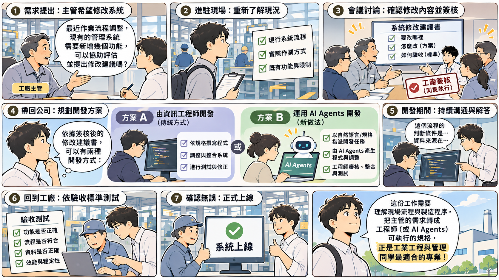

# 報告內容

這份文件把四個評分項目的報告必要內容列出：書面報告要有哪些內容、口頭報告要講到哪些項目、訪談會問哪幾種形式的題目、個人報告怎麼分節。

> **這份文件列出的必做項目都要完成。** 章節怎麼分、順序怎麼排可以依自己的題目調整，但每一項必做內容都要在報告裡找得到對應內容。

標示為 **可選** 的項目不做不扣分，做了也不加分。評分以 Rubric 作為評分，**內容要有，但格式可自由調整**。

本課程以工業管理系學生為主要對象，重點不是要求大家具備軟體工程師等級的程式設計或系統實作能力，而是訓練把現場問題轉換成結構化需求、流程、資料與系統設計，並能清楚說明各份文件之間的關聯。因此雖然需要參考程式碼，但不會叫你每行都要看懂，也沒有要求同學都要寫程式（但你願意實作會加分，見[「額外投入加分」](Bonus-Rules.md)）。技術細節只要求到足以支撐分析與設計決策的程度，不以複雜程式架構或實作技巧作為主要評量重點。

其餘的項目：

- 什麼時候交、交什麼檔案、缺席怎麼辦？見[「報告規範」](Report-Rules.md)。
- 怎麼給分？見[「報告評量 Rubrics」](Rubrics.md)。
- 怎麼計算學期成績？見[「成績計算規範」](Grading-Rules.md)。
- 有沒有額外加分項目？依修改建議實際修改系統可以加分，條件與額度見[「額外投入加分」](Bonus-Rules.md)。

## 這份文件怎麼用

以下分別就期中報告、期末報告、個人訪談與個人學習與貢獻報告分四節解說。

---

# 一、期中小組報告（分析階段）

## 撰寫要點

期中做的是「**系統分析**」：針對一套已經完成、假設可正常使用的既有資訊系統，從系統本身與現場流程反向推導它的問題背景、使用者、需求、流程、資料與整體結構。

期中不是在判斷「這套系統值不值得做」或「是否能做出來」，因為分析對象已經存在。

因此，期中的重點是「**看懂既有系統、建立一致的分析文件，並從分析結果指出現況問題與改善方向**」，並且著重於分析的 **完整性與文件之間的一致性**。

期中要分析的系統都不大，性質類似「**校園器材借用系統**」：使用者開瀏覽器操作，資料存在後端資料庫，是一套典型的主從式（client-server）網頁系統，沒有和其他系統耦合，也沒有複雜的資料流與結構。

## 範例報告參考

光看下面的清單可能不容易懂，所以另外準備了兩份文件，兩份都以同一套課堂範例系統為對象：

| 文件 | 是什麼 | 什麼時候看 |
|---|---|---|
| [系統分析範例報告](../02-Midterm-Project-Example-Reports/Analysis-Phase-Sample-Report.md) | 一份寫好的期中報告成品，只有內容、沒有解說 | 想知道「交出去的東西長什麼樣」時 |
| [系統分析範例報告說明](../02-Midterm-Project-Example-Reports/Analysis-Phase-Deliverables.md) | 上面那份報告的解說：每一項該有哪些欄位、為什麼要這樣寫、圖怎麼畫、方法出自教材哪一章 | 動筆寫某一項卻不知道該放什麼時 |

建議的用法是先翻範例報告看整體長相，動手寫某一項時再回頭查解說。

範例系統本身是一套跑得起來的完整系統，**程式碼與系統文件收在[期中分析範例系統](../03-Midterm-Project-Example-Systems/README.md)的 `SAD-Forum/`**，實際操作過再讀那兩份文件會清楚很多。

請注意：

- **範例寫得很精簡，那是為了讓你一眼看懂結構，不是篇幅標準。** 你的報告該寫多少就寫多少，不要照著範例的長度收尾。
- **範例用的是老師上課講解的案例系統，各組抽到的題目不一樣。** 角色、流程、資料表都得換成你那一題的內容，照抄不但看得出來，訪談被追問時也答不上來。

## 1.1 書面應包含的內容

書面最前面要有一張 **報告基本資料表**：課程、報告階段、分析對象、組別、組員姓名與學號、書面繳交日與口頭報告日。組員名單就寫在這裡，缺漏的人視同沒有參與。

下列九項全部都要完成，依分析推進順序排列。這些項目共同回答「這套既有系統為什麼存在、誰在使用、怎麼運作、管理哪些資料，以及目前哪裡可以改善？」九項之外，書面最後還要附一份 **分工紀錄**，見本節的「附錄：分工紀錄」。

1. **問題與系統背景**
   - 系統目的與使用情境。
   - 原本要解決的問題是什麼？
   - 這些問題中，系統實際處理了哪些？哪些仍靠人工或其他方式完成？
   - 你們是根據專案的什麼內容來推導系統要解決的問題與背景？
   - 怎麼從既有系統反推當初的問題，見教材[問題定義與現況分析](../01-Course-Materials/02-Problem-Definition.md)。

2. **使用者與利害關係人分析**
   - 誰是主要使用者？還有哪些人雖然不直接操作系統，卻會受它影響？
   - 各角色分別負責什麼工作、為什麼需要這套系統、最在意什麼？
   - 使用案例圖（Use Case Diagram），用來回答「誰要做什麼」；圖上每個參與者，都要能在前兩點的清單裡找得到。

3. **現況流程分析**
   - 目前這件事是怎麼完成的？從什麼事件開始、做到什麼狀態算結束？
   - 流程至少兩條：主要角色一條、次要角色一條。
   - 把流程畫成活動圖（Activity Diagram）；流程跨越多個角色時，用泳道標出每個動作由誰執行。
   - 除了一切順利的那條路，也要畫出重要的例外，例如：輸入錯誤檢核、審核不通過、逾期未歸還等等。
   - 活動圖上的每個動作，都要能對回第 2 項的使用案例或第 4 項的需求。

4. **系統需求分析**
   - 列出：
     - 功能需求（Functional Requirements）。
     - 非功能需求（Non-functional Requirements）。
   - 需求應可由既有系統功能、畫面、資料或流程找到依據，不以想像補出不存在的功能。

5. **功能分析與系統邊界**
   - 系統有哪些重要功能？這些功能可以歸成哪幾群？
   - 功能分解到「使用者做得完一件事」就停，不要拆到「按下確認鈕」這種操作步驟。
   - 哪些事情系統不做、留給人工或其他方式完成？這條界線就是系統邊界。
   - **可選**：若系統與其他系統或設備有資料往來，標出交界在哪一段。

6. **使用案例與系統互動分析**
   - 從重要使用案例中選擇 **1–2 個核心流程**，繪製循序圖（System Sequence Diagram, SSD）。
   - SSD 只把系統視為黑箱，重點是使用者與系統之間的訊息往返。
   - **可選**：程式物件、Controller、Service 或 Repository 等技術類別。
   - 能說明同一個使用案例在「文字敘述、活動圖、SSD」三者之間如何對應。

7. **資料需求分析**
   - 包括：
     - **ERD**（Entity Relationship Diagram，實體關係圖）：管哪些資料、彼此什麼關係。
     - **Schema 與主要資料表**：存成哪幾張表、主鍵與外鍵是哪幾欄。
     - **Data Dictionary（資料字典）**：每一欄存什麼、型別與長度、是否必填、值域、資料來源。
   - 三者要對得起來：ERD 的實體在 Schema 找得到表，Schema 的每一欄在資料字典找得到定義。
   - 怎麼找實體、怎麼正規化、值域怎麼寫，見教材[資料建模與資料庫設計](../01-Course-Materials/07-Data-Modeling.md)。
   - **可選**：索引、Trigger、Stored Procedure 等資料庫實作細節。

8. **系統環境與整體架構理解**
   - 說明系統使用在哪些裝置或工作環境中。
   - 畫出使用者端、應用系統、資料庫與外部系統之間的整體關係。
   - 這張圖怎麼畫、要標出哪些東西，見教材[系統環境與架構](../01-Course-Materials/08-System-Architecture.md)。

9. **現況問題與改善建議**
   - **既有系統之中老師會藏問題**。從前面八項分析中找出具體問題，而不是只列主觀感想，改善建議可分成流程、系統與組織三個層次。
   - 每一項改善建議應指出分析依據，例如來自哪個流程、需求、畫面、資料結構或角色問題。
   - 本階段只需要提出合理改善方向，不要求完成新系統設計。

第 9 項是「分析深度」的重要判斷材料：整份報告如果只描述現況、沒有根據分析結果提出問題與改善方向，代表仍停留在系統介紹，而沒有真正完成系統分析。

### 期中 UML 最低要求

期中必做的 UML 只有三種：

- **使用案例圖（Use Case Diagram）**：回答「誰要做什麼」。
- **活動圖（Activity Diagram）**：回答「事情怎麼做」。
- **循序圖（System Sequence Diagram）**：回答「使用者與系統怎麼互動」。

**可選**：概念類別圖（Conceptual Class Diagram）。對工管初學者而言，期中先把需求、流程與 ERD 串接一致，比再增加一張與 ERD 容易混淆的圖更重要。這張圖到期末同樣是可選。

### 附錄：分工紀錄

書面報告除了上面九項，**還要附一份分工紀錄**，放在文件最後當附錄，期中與期末各交一份。這是全組共同的紀錄，不是個人的。

至少要看得出下面四件事：

| 欄位 | 內容 |
|---|---|
| 工作項目 | 對得回九項中的哪一項，或哪一章、哪一張圖 |
| 負責人 | 寫名字。一項可以多人，但不要整份都寫「全體」 |
| 期間 | 哪一週做到哪一週 |
| 產出與佐證 | 交出了什麼（本報告的第幾章、哪一張圖），以及能佐證的東西是什麼（會議記錄、共筆頁面、檔案版本） |

**格式不限。** 表格、共筆截圖、專案管理工具匯出的畫面都可以，怎麼記由各組自己約定，見[「分組規範」](Group-Rules.md)的「分工紀錄是必做項目」。老師看的是這份紀錄能不能對回書面內容，不是它排得漂不漂亮。

**佐證只要摘要，不必通通放進報告。** 附錄裡寫清楚有哪些佐證、放在哪裡，再挑幾張最能說明分工的畫面截圖貼上去就夠了。資料量大或本來就印不出來的東西——簽到表、每週會議的錄音錄影、共筆全文——**給連結即可**，不用整批塞進 PDF。

給連結只有一個要求：**權限自己開好**。老師點開就要看得到，需要另外申請權限或連結已失效，等同這份佐證不存在，也不會另行通知你補。

兩個提醒：

- **每一章、每一張圖都要找得到負責人**；反過來，每一位組員都要出現在紀錄裡。
- **請隨進度記，不要最後一晚回想。** 訪談時老師會拿它對照你講的話，時間、順序與產出對不起來，個人項目的分數會受影響，見[「報告評量 Rubrics」](Rubrics.md)的「訪談查證的可對應性與一致性」。

分工紀錄與個人報告的〈附錄：個人貢獻證據〉不是同一份：這份記全組的工作分配，那份記你自己的產出與判斷歷程，見〈四、4.1 篇幅與佐證資料〉。

## 1.2 口頭要講到的項目

口頭報告講的就是 1.1 那九項，**沒有另一份內容要準備**。不需要逐頁照著文件念，應優先說明：系統背景、主要角色、關鍵流程、主要需求、資料結構、系統整體構想，以及你們從分析中發現的問題與改善方向。

**報告時間為每組 12–15 分鐘，另加 5–8 分鐘問答**。

---

# 二、期末小組報告（系統分析與修改建議）

## 撰寫要點

期末做的是「**系統分析與修改建議**」。

> 想像有一間工廠，幾年前委託你們公司開發了一套管理系統，現場每天都在用，運作也正常。但隨著作業方式改變，主管希望系統多做一些當初沒有規劃的事，於是依維護合約提出一份修改方向（新功能需求）。
>
> 你們是公司派去的系統分析師，進駐工廠現場。當年負責這套系統的同事已經離職，留下的文件也不完整，所以要先重新看懂這套系統現在怎麼運作，再把主管的修改方向整理成修改建議書，寫清楚要改哪裡、怎麼改、改完怎麼驗收。
>
> 建議書要和主管與資深員工逐項討論，**經工廠簽核後，後面的工作才能開始**：你們把建議書帶回公司，交給資訊工程師與程式設計師修改系統，開發期間由你們回答工程師的問題；系統改完後，你們再回到工廠，陪使用者照建議書裡的驗收標準逐項測試，確認沒問題才上線。
>
> 工程師照建議書寫程式，使用者照建議書驗收，建議書寫錯或寫得含糊，後面每一步都會跟著錯。這份工作要同時懂現場流程與製造程序，才能把主管的需求轉成工程師看得懂的規格，正是工管系同學最適合的工作。



*圖片來源：ChatGPT 生成，由作者審閱其正確性*

期末報告原本要重新設計一套系統，現在改成「**由老師提供一套既有系統，以及一項修改需求**」。「修改需求」指的是替這套系統加入新功能，不是修正錯誤。各組也不必自己寫程式。

既有系統的使用者與利害關係人還是同一批人，原有需求也都還在，流程與資料表大多已經存在。各組要做的不是設計新系統，而是在既有系統上加入新功能，並交代清楚「**哪些變了、哪些沒變、變了會牽動什麼**」。修改需求沒碰到的部分維持原樣。

「**系統分析與修改建議**」書面報告分成兩大部分，共 16 項，全部都要完成，逐項內容見〈2.1〉：

| 部分 | 回答的問題 | 項目 | 和其他部分的關係 |
|---|---|---|---|
| 第一部分：既有系統分析簡要報告 | 系統現在長什麼樣 | 第 1–4 項：系統背景與角色、現況流程、現況功能與需求、現況資料 | 期中分析的濃縮版；整理出的流程、需求編號與資料字典，是第二部分對照的基準 |
| 第二部分：修改建議書 | 要改成什麼樣、改完怎麼確認 | 第 5–16 項：從變更申請、差異分析、影響分析，到修改後的規格、資料、畫面與驗收，最後是上線切換與需求追溯 | 每一項變更都要指回第一部分的流程、需求編號或資料欄位 |

這正是系統分析師實際在做的事。書面報告要具體到別人能直接照著改：資訊人員看了就知道要動哪些畫面、欄位與規則，不必一再回頭跟你確認；就算交給 AI 改程式，也不會因為描述含糊而改錯。和實務不同的只有一點：期末每組只處理客戶提出的一項修改需求，實務上客戶一次提出十來項是常有的事。

## 期末為什麼改成修改既有系統

期末原本規劃的是「從零設計一套新系統」。期中報告之後，老師把方向調整成分析一套已經在用的工廠系統，再依老師給的修改需求提出修改建議。原因是好的設計要建立在把現況看懂的基礎上，而要把一套系統真正看懂，需要的功夫比原先預估的多，值得在期末再練一次。這也比較接近你們日後在工廠會遇到的情況：多數時候面對的是已經上線的系統，要回答的是「這裡該怎麼改」。

**這次調整也讓期末的分量比原本規劃的輕。** 從零設計要把整套系統想出來；修改既有系統，只需要交代改到的地方：

| 比較項目 | 原本規劃（從零設計） | 現在（修改既有系統） |
|---|---|---|
| 起點 | 只有需求說明，系統還不存在 | 系統已經可以執行，角色、流程與資料表大多已經存在 |
| 要做什麼改變 | 自己從需求推導 | 老師在修改需求提案書裡寫好了 |
| 資料設計 | 全部資料表從零推導 | 只寫要新增或修改的欄位與資料表 |
| 畫面 | 每個畫面都要做原型 | 只畫受修改影響的畫面，修改前後對照 |
| 架構圖、模組相依關係圖、概念類別圖 | 必做 | 不用做 |

產出項目從八項變成 16 項，看起來變多了，但大部分項目只寫與這次修改有關的部分，修改沒有碰到的地方維持原樣，不必重新設計。第一部分是期中做過的方法，只是篇幅縮小（見〈第一部分是期中的濃縮版〉）。

配分、報告日期與繳交期限都沒有變。**期中好好做過的組別，期末會比原本規劃的輕鬆，請安心準備。**

## 老師會提供的東西

每一題老師提供兩樣東西，都收在[期末題目](../05-Final-Project-Topics/README.md)資料夾：

| 提供的東西 | 內容 | 用在哪裡 |
|---|---|---|
| 既有系統 | 在自己電腦上就能執行的系統，含程式、附示範資料的資料庫檔，以及說明安裝啟動、帳號與畫面的 `README.md` | 操作過後整理成第一部分 |
| 修改需求提案書 | 系統現況、一項修改需求（CR-01）、修改時的限制與名詞解釋；需求的最後列出〈待小組決議的問題〉 | 第二部分的依據 |

**老師不提供分析結果，也不提供修改後的資料表、畫面與測試案例。** 流程圖、需求清單、ERD 與資料字典要自己從系統整理，〈待小組決議的問題〉也沒有標準答案。詳見[期末題目](../05-Final-Project-Topics/README.md)〈一、這些文件不會給你什麼〉。

## 範例報告參考

期末的範例報告以「**工廠訪客進出登記系統**」為對象。這是上課帶著大家做的示範題，**刻意不在抽籤的五題之中**。範例用到的材料都有提供，可以從系統、提案書一路對照到報告：

| 文件 | 是什麼 | 說明 | 你們要交的對應項目 |
|---|---|---|---|
| [期末範例報告](../04-Final-Project-Example-Reports/Final-Phase-Sample-Report.md) | 寫好的期末報告成品，16 項都有，只有內容、沒有解說 | 想知道交出去的東西長什麼樣、每一項要寫多細時看 | **必交**：期末書面報告 |
| [期末報告範本](../04-Final-Project-Example-Reports/Final-Phase-Report-Template.md) | 五題通用的章節骨架，每節一段引言與欄位佔位 | 開始寫報告時複製一份，把 `{}` 換成自己的內容；〈5.3〉的待決問題表在各題提案書的〈五、你要交出什麼〉 | **必交**：期末書面報告 |
| [系統分析完整報告](../04-Final-Project-Example-Reports/Visitor-System-Full-Analysis.md) | 同一套系統依期中報告標準的完整分析 | 和期末範例報告的第一部分對照，看簡要版留了什麼、省了什麼 |  |
| [修改需求提案書](../05-Final-Project-Topics/Change-Proposals/Visitor-System-Change-Proposal.md) | 範例報告依據的修改需求，格式和各組的提案書相同 | 相當於範例的題目。逐項對照範例報告，看提案書的需求細項怎麼寫進報告 |  |
| [專案檔（SAD-Visitor）](../05-Final-Project-Topics/Example-Systems/SAD-Visitor/README.md) | 範例報告分析的既有系統，可在自己電腦上執行 | 範例系統修改前的樣子 |  |
| [修改後專案檔（SAD-Visitor-Revised）](../05-Final-Project-Topics/Example-Systems/SAD-Visitor-Revised/README.md) | 依範例報告的修改建議改完的系統 | 範例系統修改後的樣子 | **可選**：系統修改實作（加分），條件見[額外投入加分](Bonus-Rules.md) |

先翻範例報告看整體長相，寫到某一項時，再回頭看範例同一項用了哪些欄位、寫到什麼程度。特別注意，範例報告處理了三項修改需求（CR-01、CR-02、CR-03），是上課講解用的。各組的實際提案書只有一項，因此分量不會這麼重。

**範例示範的是結構與詳細程度，不是答案。** 各組的系統與修改方向不同，變更需求、影響範圍、資料與畫面都要自己推導；範例〈5.3〉的決議也只是示範組的選擇，你們那一題的〈待小組決議的問題〉要自己決定並寫出理由。照抄看得出來，訪談被追問時也答不上來。

## 2.1 書面應包含的內容

書面最前面同樣要有 **報告基本資料表**，欄位見〈一、1.1〉，「分析對象」改填抽到的系統名稱；期中之後有組員異動的，在組員欄註明轉入或轉出時間。書面最後同樣要附 **分工紀錄**，見本節〈附錄：分工紀錄〉。

### 第一部分：既有系統分析簡要報告

這一部分是期中九項的簡要版，篇幅控制在期中報告的一半以內。第二部分要對照的流程、需求編號與資料表欄位完整保留，其餘可以縮減。

1. **系統背景與角色**
   - 系統目的與要解決的問題。
   - 角色與權限表：每個角色能做哪些事。
   - 使用案例圖（Use Case Diagram）。
   - 不操作系統但會受影響的人，列一行即可，不做完整的利害關係人分析。
   - 執行環境一句話帶過，各題架構相同（HTML + CSS + JS 畫面，一支 Node.js 小程式讀寫 SQLite 資料庫檔，本機端執行）。

2. **現況流程**
   - 與修改方向相關的現況（As-Is）活動圖 1–2 張，含主要例外；不要求主要、次要角色各一條。
   - 活動圖怎麼畫，見教材[行為建模](../01-Course-Materials/06-Behavioral-Modeling.md)。

3. **現況功能與需求**
   - 功能階層圖。
   - 帶編號的功能需求清單。第二部分講「改了哪一項需求」，都要指回這份編號。
   - 與修改方向相關的非功能需求。
   - 系統邊界：用一段文字說明系統不做什麼。
   - 需求與功能分解的寫法，見教材[系統需求分析](../01-Course-Materials/04-System-Requirements-Analysis.md)、[功能分析與模組設計](../01-Course-Materials/05-Functional-Analysis.md)。

4. **現況資料**
   - ERD、Schema，以及 **每一張資料表** 的資料字典。
   - 三者要對得起來：ERD 的實體在 Schema 找得到表，Schema 的每一欄在資料字典找得到定義。
   - 見教材[資料建模與資料庫設計](../01-Course-Materials/07-Data-Modeling.md)。

### 第二部分：修改建議書

依各題修改需求提案書裡的修改方向撰寫。

5. **變更申請**
   - 先用自己的話摘要修改需求提案書：現在發生什麼問題，工廠希望改成什麼樣子。
   - 把修改方向整理成正式的變更需求，每一項寫出編號、變更內容、理由與優先順序。
   - 變更需求要明確、可驗證，寫法和期中的需求相同。
   - 修改需求提案書〈待小組決議的問題〉列出的每一個問題都要回答，寫出小組的決議與理由。這些問題會決定後面的資料表、畫面與驗收怎麼寫，先想清楚再往下做，第二部分才不會前後矛盾。

6. **差異分析**
   - 修改前（As-Is）與修改後（To-Be）的活動圖對照。
   - 標出新增、刪除、改變的步驟。
   - 修改後出現新的使用案例或角色時，重新繪製修改後的使用案例圖，放在這一項，並標出新增的部分。

7. **影響分析**
   - 每一項變更需求會動到哪些流程、角色、畫面、資料表與欄位。
   - 以第一部分的流程、需求編號與資料字典為基準，逐項對照。

8. **效益評估**
   - 列出衡量指標（例如週期時間、錯誤率、人工時數）、修改前的估計值與修改後的目標值。
   - 不要求財務模型。

9. **修改後的需求與功能規格**
   - 新增、修改、刪除的功能需求與非功能需求，標明是哪一種。
   - 業務規則要寫清楚，不寫程式邏輯。
   - 1–2 張修改後的循序圖。

10. **資料變更**
    - 新增或修改的欄位與資料表，用資料字典的格式寫出定義。
    - 資料表有增減時，附上修改後的 ERD。
    - 不寫資料庫遷移程式。

11. **畫面設計**
    - 修改前的截圖與修改後的線框圖對照，標出新增或修改的欄位與按鈕；新增的畫面另外畫。
    - 畫面上的欄位要對回資料字典。
    - 修改方向涉及資料匯出或匯入的，寫出檔案的欄位與格式，見教材[系統介面與資料交換設計](../01-Course-Materials/11-System-Interface-and-Data-Exchange.md)。
    - **用什麼工具畫都可以，不評美術。** 看的是有哪些欄位與按鈕、欄位從哪來、按下去會發生什麼事，手繪的線歪了不扣分。見教材[使用者介面設計](../01-Course-Materials/12-UI-Design.md)。

12. **驗收標準與測試案例**
    - 每一項變更需求至少一個測試案例，寫出前置條件、操作步驟與預期結果。

13. **作業與組織衝擊**
    - 要修訂的作業標準（SOP）、要受訓的角色、要協調的部門。

14. **資料轉換規則**
    - 舊資料怎麼處理，只寫業務規則（例如「舊單據一律視為已結案」），不寫轉換程式。

15. **上線切換與回復原則**
    - 用一段文字寫出原則：何時切換、新舊是否並行、出現什麼狀況就退回舊版。

16. **需求追溯**
    - 放在最後一節：每一項變更需求 → 流程 → 資料 → 畫面 → 測試案例。
    - 追溯鏈怎麼做、交件前怎麼自我檢查，見教材[系統設計規格與追溯](../01-Course-Materials/13-Design-Specification.md)。

第 7 項是評「分析或設計深度」的主要材料，第 16 項是「文件間一致性與可追溯性」最直接的證據。

### 期末必做的圖

- 第一部分：使用案例圖、現況活動圖、功能階層圖、ERD。
- 第二部分：修改前後的活動圖對照、修改後的循序圖、修改前後的畫面對照；出現新的使用案例或角色時，加上修改後的使用案例圖；資料表有增減時，加上修改後的 ERD。

### 第一部分是期中的濃縮版

第一部分的四項都是期中做過的方法，差別只在篇幅，各項縮減到什麼程度見上面的清單：

| 期末項目 | 由期中哪幾項濃縮 |
|---|---|
| 1 系統背景與角色 | 1 問題與系統背景、2 使用者與利害關係人分析 |
| 2 現況流程 | 3 現況流程分析 |
| 3 現況功能與需求 | 4 系統需求分析、5 功能分析與系統邊界 |
| 4 現況資料 | 7 資料需求分析 |

期中第 9 項（現況問題與改善建議）不做，因為修改方向由老師提供；期中第 6 項（循序圖）移到第二部分第 9 項，畫修改後的版本。

第二部分的需求、活動圖、循序圖、資料字典與畫面，方法也和期中相同，只是對象換成修改後。第一次接觸的只有變更申請、影響分析、效益評估、驗收、作業衝擊、資料轉換與上線切換，這幾項不需要程式或資料庫知識，多半是工管熟悉的流程改善與現場管理。

期中做得紮實，第一部分會快很多。期中定好的分工方式、檔案命名、畫圖方式與共筆規則，期末直接沿用。

### 期末技術深度原則

期末每位學生都要做到「能把修改方向轉成一致、可驗收的修改規格」，但不要求寫程式。程式架構、API 與資料庫遷移程式這類「程式要怎麼改」的內容，不列入必做。

**可選**：

- 依第二部分的新需求實際修改既有系統，例如用 Claude Code 這類 AI 開發工具。這是加分項目，條件見[「額外投入加分」](Bonus-Rules.md)。
- 狀態機圖，適合異常單、盤點單、保養單這類有明確生命週期的單據。
- 概念類別圖、CRUD 矩陣。

**可選項目一項都不做，必做項目也不會因此扣分。** 但選擇做就要做對，而且要能在個人訪談中說明：畫一張自己講不出所以然的圖，比不畫更糟。

### 附錄：分工紀錄

**期末書面一樣要附**，欄位與格式見〈一、1.1〉的「附錄：分工紀錄」。期末重記一份，涵蓋第 10 週到繳交當天，不沿用期中那份。

期中之後有 **組員異動** 的組別，把異動時間與工作接手情形一併寫進去。人力減少時，老師會依異動時間、剩餘人力與實際完成情況調整對報告完整性的期待，判斷依據就是這份紀錄，見[「分組規範」](Group-Rules.md)的「人力減損」。

## 2.2 口頭要講到的項目

口頭要講的就是 2.1 那 16 項，依下面三個主題的順序報告：

| 主題 | 要講什麼 | 對應書面 |
|---|---|---|
| 一、既有系統分析 | 系統背景與角色、現況流程、現況功能與需求、現況資料，簡短帶過 | 第一部分第 1–4 項 |
| 二、要改什麼、會牽動什麼 | 修改需求怎麼變成變更需求、小組對〈待小組決議的問題〉的決議、修改前後的流程差異、會影響哪些流程、角色、畫面與資料、預期效益 | 第二部分第 5–8 項 |
| 三、改成什麼、怎麼驗收 | 修改後的需求與規格、資料與畫面怎麼改、怎麼驗收，以及作業衝擊、舊資料處理、上線切換與需求追溯 | 第二部分第 9–16 項 |

重點放在主題二與主題三。兩個主題都要講出怎麼對回第一部分的流程、需求編號與資料欄位，證明整份文件前後一致。

**報告時間與問答長度和期中相同**，見〈一、1.2〉。

---

# 三、期末個人訪談

訪談沒有固定題庫，題目從你那一組的書面報告與你自己的個人報告裡抽。為什麼這樣出題、準備的方式是什麼，見[「參考題庫」](Question-Bank.md)。

下面四類是 **題型示意**，用來讓你知道問題會長什麼形狀。

### 基礎理解題

- 這個系統主要解決什麼問題？
- 系統的主要使用者有哪些？
- 你們如何決定系統邊界？
- 哪一項是功能需求？哪一項是非功能需求？
- 這次修改動到了哪些角色？哪些角色沒有受影響？

### 文件解讀題

- 請解釋這個使用案例中的主要參與者。
- 為什麼這兩個實體之間是一對多關係？
- 這張活動圖的判斷節點代表什麼？
- 這張循序圖中，為什麼這個模組要先查詢資料再回傳結果？
- 這張修改前後的活動圖，差在哪幾個步驟？

### 追溯題

- 請選擇一項變更需求，指出它動到哪一段流程、哪一個資料表、哪一個畫面，以及用哪一個測試案例驗收。
- 這個畫面中的欄位，在資料庫中儲存在哪一個資料表？
- 這個功能如果移除，哪些文件需要一起修改？
- 這項變更上線後如果出問題，你們的回復原則是什麼？

### 反思題

- 這次修改目前最大的風險是什麼？
- 哪一項修改最受到現場限制影響？
- 你們曾經修改過哪一項需求或設計？原因是什麼？
- 若再多兩週，你會優先改善哪一部分？

---

# 四、個人學習與貢獻報告

個人報告與小組書面報告分開：小組報告呈現「系統成果」，個人報告呈現「個人如何參與、學到什麼、如何修正理解」。

## 4.1 篇幅與佐證資料

篇幅 **至少 2,000 字或 5 頁**，上限不設。這個下限其實不高：只要你真的參與過，把自己負責的段落、當時的判斷、遇到的問題與後來怎麼修正寫清楚，通常寫著寫著就超過了。寫不滿，多半不是篇幅的問題，而是可以寫的事情本來就不多。

請附上能證明貢獻的資料，例如工作分配表、會議記錄、共筆、檔案版本紀錄、模型草稿或修訂前後對照。呈現方式與小組那份相同：**摘要為主，量大的東西給開好權限的連結**，見〈一、1.1〉的「附錄：分工紀錄」。**這份跟小組書面報告的〈附錄：分工紀錄〉不是同一份**：那份記全組哪一項由誰負責，這份記你自己實際做了什麼、當時怎麼判斷、改過幾版。兩份可以互相對照，不能互相取代——只把小組那份複製過來，「貢獻證據」這一項拿不到分。

## 4.2 應包含的內容

下面七節加一份附錄都要有。章節名稱可以自己調整，內容要找得到。

```markdown
# 個人學習與貢獻報告

## 1. 小組專題與系統概述

## 2. 個人負責工作
- 負責項目
- 工作時間
- 使用工具
- 與其他成員的協作方式

## 3. 主要工作成果
- 完成的文件
- 完成的圖表
- 修改紀錄與檔案版本

## 4. 問題與解決歷程
- 遭遇的問題
- 分析方式
- 曾考慮的方案
- 最終決策與理由

## 5. 專業概念應用
- 問題與需求分析
- 使用案例、活動圖與循序圖
- ERD 與資料設計
- 系統環境與架構
- 變更需求、差異與影響分析
- 畫面設計
- 驗收標準與測試案例
- 作業衝擊、資料轉換與上線切換
- 文件追溯與一致性

## 6. 個人學習反思
- 原本不理解的內容
- 修正後的理解
- 目前仍不足的能力

## 7. 團隊合作反思

## 附錄：個人貢獻證據
```

---

# 五、這些內容怎麼被評分

本文件只講「要有什麼」，不講「幾分」。每一項內容對應到哪一個評量面向、各等第怎麼判定，一律見[「報告評量 Rubrics」](Rubrics.md)；遲交、檔案問題與缺交的扣分，見[「成績計算規範」](Grading-Rules.md)。

評分時特別重視三件事：

1. **分析或設計是否有深度**：不是只把名詞填滿，而是能說明判斷依據與原因。
2. **文件是否一致且可追溯**：同一項需求在使用案例、流程、資料、畫面與驗收之間不能互相矛盾。
3. **修改建議是否符合工業現場情境**：修改方案要考量人員、設備、流程、資料與環境限制，而不是只追求技術上看起來複雜。
