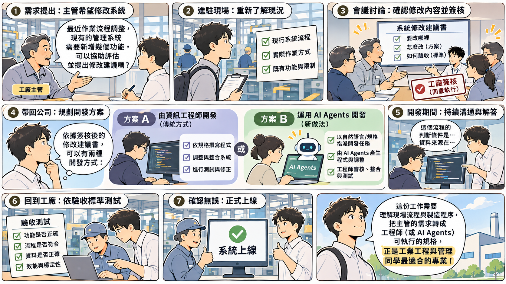

# 報告內容：期末報告、個人訪談與個人報告

## 系統分析與設計（IE226）115-1

授課教師：呂卓勲

本課程教材：[GitHub](https://github.com/billy1125/system-analysis-and-design)

---

## 這份投影片只是總覽

> **列出的必做項目都要完成，章節名稱與順序可以自己調整。**

- 標示 **可選** 的項目不做不扣分，做了而且正確可以加分
- 做了可選項目或清單以外的東西，書面最前面放一張 **額外項目對照表**，老師只認表上的項目
- 不要求寫程式，技術細節只要求到足以支撐分析與設計決策
- 完整條文以 `Report-Contents.md` 為準；繳交見 `Report-Rules.md`，給分見 `Rubrics.md`

---

# 一、期末小組報告：系統分析與修改建議

期末不是從零設計一套新系統。老師提供一套工廠已經在用的系統，加上一項修改需求，你們要先看懂它現在怎麼運作，再把需求寫成修改建議書。

這一節依序說明你們扮演的角色、期末為什麼改成修改既有系統、書面報告的兩大部分與 16 項內容、老師會提供什麼，以及口頭報告怎麼安排。

---

---

## 你們是派駐工廠的系統分析師

- 工廠幾年前委託你們公司開發這套系統，現在主管依維護合約提出新功能需求
- 當年的負責人已經離職，文件不完整，要先重新看懂系統
- 建議書經工廠簽核後，工程師才照著改程式
- 系統改完，你們再陪使用者照建議書驗收

---

## 期末要交代的是「變了什麼？」

> **老師提供一套既有系統，以及一項修改需求。**

- 「修改」是加入新功能，不是修正錯誤，也不必自己寫程式
- 使用者、原有需求、流程與資料表大多已經存在
- 要交代清楚 **哪些變了、哪些沒變、變了會牽動什麼**
- 修改需求沒碰到的部分維持原樣

---

## 期末為什麼改成修改既有系統

> **好的設計，要建立在把現況看懂的基礎上。**

- 期末原本規劃從零設計一套新系統，期中報告之後調整成修改既有系統
- 把一套系統真正看懂，需要的功夫比原先預估的多，值得在期末再練一次
- 日後在工廠，多數時候面對的是已經上線的系統，要回答的是「這裡該怎麼改」

---

## 分量比原本規劃的輕

| 比較項目 | 原本規劃（從零設計） | 現在（修改既有系統） |
|---|---|---|
| 起點 | 系統還不存在 | 系統已經可以執行 |
| 要做什麼改變 | 自己從需求推導 | 提案書裡寫好了 |
| 資料設計 | 全部資料表從零推導 | 只寫新增或修改的部分 |
| 畫面 | 每個畫面都要做原型 | 只畫受影響的畫面 |
| 架構圖、模組相依關係圖、概念類別圖 | 必做 | 不用做 |

配分、報告日期與繳交期限都沒有變。

---

## 書面報告：兩大部分，共 16 項

| 部分 | 回答的問題 | 項目 |
|---|---|---|
| 第一部分：既有系統分析簡要報告 | 系統現在長什麼樣 | 第 1–4 項 |
| 第二部分：修改建議書 | 要改成什麼樣、改完怎麼確認 | 第 5–16 項 |

第一部分整理出的流程、需求編號與資料字典，是第二部分對照的基準。第二部分的每一項變更，都要指回第一部分的流程、需求編號或資料欄位。

---

## 建議書要具體到別人能直接照著改

> **資訊人員看了就知道要動哪些畫面、欄位與規則。**

- 不必一再回頭跟你確認
- 交給 AI 改程式，也不會因為描述含糊而改錯
- 和實務不同的只有一點：期末每組只處理一項修改需求，實務上客戶一次提出十來項是常有的事

---

## 老師會提供的東西

| 提供的東西 | 內容 | 用在哪裡 |
|---|---|---|
| 既有系統 | 可在自己電腦上執行的程式、附示範資料的資料庫檔、`README.md` | 第一部分 |
| 修改需求提案書 | 系統現況、一項修改需求（CR-01）、修改時的限制、名詞解釋、〈待小組決議的問題〉 | 第二部分 |

**老師不提供分析結果，也不提供修改後的資料表、畫面與測試案例。** 〈待小組決議的問題〉沒有標準答案。

---

## 範例報告：工廠訪客進出登記系統

上課帶著大家做的示範題，**刻意不在抽籤的五題之中**。

- **期末範例報告**：16 項都有的成品，看每一項要寫多細
- **系統分析完整報告**：同一套系統依期中標準的完整分析，和範例報告的第一部分對照，看簡要版省了什麼
- **修改需求提案書**：相當於範例的題目，格式和各組相同；逐項對照範例報告，看需求細項怎麼寫進報告
- **專案檔** 與 **修改後專案檔**：範例系統修改前後的樣子，後者對應可選的系統修改實作（加分）

---

## 範例示範的是結構，不是答案

> **範例的決議只是示範組的選擇，你們的題目要自己決定並寫出理由。**

- 範例處理了三項修改需求，是上課講解用的；各組的提案書只有一項，分量不會這麼重
- 變更需求、影響範圍、資料與畫面都要自己推導
- 先翻範例看整體長相，寫到某一項再回頭看範例同一項寫到什麼程度
- 照抄看得出來，訪談被追問時也答不上來

---

## 第一部分：既有系統分析簡要報告

篇幅控制在期中報告的一半以內，第二部分要對照的流程、需求編號與資料欄位完整保留。

1. **系統背景與角色**：系統目的、角色與權限表、使用案例圖
2. **現況流程**：與修改方向相關的現況活動圖 1–2 張，含主要例外
3. **現況功能與需求**：功能階層圖、帶編號的需求清單、系統邊界
4. **現況資料**：ERD、Schema，以及每一張資料表的資料字典

---

## 第二部分：要改什麼、會牽動什麼

5. **變更申請**：寫成正式的變更需求，**提案書〈待小組決議的問題〉每一題都要回答**
6. **差異分析**：修改前後的活動圖對照，標出新增、刪除、改變的步驟
7. **影響分析**：每一項變更會動到哪些流程、角色、畫面、資料表與欄位
8. **效益評估**：衡量指標、修改前的估計值與修改後的目標值

---

## 第二部分：改成什麼、怎麼驗收

9. **修改後的需求與功能規格**：標明新增、修改或刪除，寫清楚業務規則，附 1–2 張循序圖
10. **資料變更**：新增或修改的欄位與資料表，用資料字典的格式寫
11. **畫面設計**：修改前截圖對照修改後線框圖，欄位要對回資料字典
12. **驗收標準與測試案例**：每一項變更需求至少一個測試案例

---

## 第二部分：怎麼上線、怎麼追溯

13. **作業與組織衝擊**：要修訂的 SOP、要受訓的角色、要協調的部門
14. **資料轉換規則**：舊資料怎麼處理，只寫業務規則
15. **上線切換與回復原則**：何時切換、新舊是否並行、什麼狀況退回舊版
16. **需求追溯**：變更需求 → 流程 → 資料 → 畫面 → 測試案例

第 7 項是分析深度的主要材料，第 16 項是文件一致性最直接的證據。

---

## 期末必做的圖

- **第一部分**：使用案例圖、現況活動圖、功能階層圖、ERD
- **第二部分**：修改前後的活動圖對照、修改後的循序圖、修改前後的畫面對照
- 資料表有增減時，加上修改後的 ERD

畫面設計用什麼工具畫都可以，**不評美術**。看的是有哪些欄位與按鈕、欄位從哪來、按下去會發生什麼事。

---

## 第一部分是期中的濃縮版

| 期末項目 | 由期中哪幾項濃縮 |
|---|---|
| 1 系統背景與角色 | 1 問題與系統背景、2 使用者與利害關係人分析 |
| 2 現況流程 | 3 現況流程分析 |
| 3 現況功能與需求 | 4 系統需求分析、5 功能分析與系統邊界 |
| 4 現況資料 | 7 資料需求分析 |

第一次接觸的只有變更申請、影響分析、效益評估、驗收、作業衝擊、資料轉換與上線切換，多半是工管熟悉的流程改善與現場管理。

---

## 技術深度：不要求寫程式

> **可選項目一項都不做，必做項目也不會因此扣分。**

- 可選：依新需求實際修改既有系統，例如用 Claude Code 這類 AI 開發工具（加分）
- 可選：狀態機圖、概念類別圖、CRUD 矩陣
- 選擇做就要做對，而且要能在個人訪談中說明

---

## 附錄：分工紀錄

期末重記一份，涵蓋第 10 週到繳交當天，不沿用期中那份。

- 至少看得出 **工作項目、負責人、期間、產出與佐證**
- 每一章、每一張圖都找得到負責人，每一位組員都出現在紀錄裡
- 佐證只要摘要，量大的東西給連結，**權限自己開好**
- 期中之後有組員異動的，把異動時間與工作接手情形寫進去

---

## 口頭報告：依三個主題的順序

| 主題 | 對應書面 |
|---|---|
| 一、既有系統分析，簡短帶過 | 第 1–4 項 |
| 二、要改什麼、會牽動什麼 | 第 5–8 項 |
| 三、改成什麼、怎麼驗收 | 第 9–16 項 |

重點在主題二與主題三，都要講出怎麼對回第一部分的流程、需求編號與資料欄位。每組報告 12–15 分鐘，另加 5–8 分鐘問答。

---

# 二、期末個人訪談

訪談沒有固定題庫，題目從你那一組的書面報告與你自己的個人報告裡抽。

下面四類題型用來讓你知道問題會長什麼形狀，是方向不是考古題。準備方式見 `Question-Bank.md`。

---

## 訪談的四類題型

- **基礎理解題**：這次修改動到了哪些角色？哪些角色沒有受影響？
- **文件解讀題**：這張修改前後的活動圖，差在哪幾個步驟？
- **追溯題**：選一項變更需求，指出它動到哪一段流程、哪一個資料表、哪一個畫面、用哪一個測試案例驗收
- **反思題**：哪一項修改最受到現場限制影響？若再多兩週，會優先改善哪一部分？

---

# 三、個人學習與貢獻報告

小組報告呈現系統成果，個人報告呈現你個人如何參與、學到什麼、如何修正自己的理解。兩份分開交，彼此不能取代。

這一節說明篇幅、佐證資料，以及報告要包含的七節與附錄。

---

## 篇幅與佐證資料

> **篇幅至少 2,000 字或 5 頁，上限不設。**

- 附上能證明貢獻的資料：工作分配表、會議記錄、共筆、檔案版本、修訂前後對照
- 摘要為主，量大的東西給開好權限的連結
- 這份和小組的〈附錄：分工紀錄〉不是同一份：那份記全組誰負責什麼，這份記你自己做了什麼、怎麼判斷、改過幾版
- 只把小組那份複製過來，「貢獻證據」這一項拿不到分

---

## 個人報告的章節（一）

1. **小組專題與系統概述**
2. **個人負責工作**：負責項目、工作時間、使用工具、協作方式
3. **主要工作成果**：完成的文件與圖表、修改紀錄與檔案版本
4. **問題與解決歷程**：遭遇的問題、分析方式、曾考慮的方案、最終決策與理由

章節名稱可以自己調整，內容要找得到。

---

## 個人報告的章節（二）

5. **專業概念應用**：需求、流程與資料，變更、差異與影響分析，畫面、驗收、上線切換與文件追溯
6. **個人學習反思**：原本不理解的、修正後的理解、仍不足的能力
7. **團隊合作反思**

最後附上 **附錄：個人貢獻證據**。

---

# 四、這些內容怎麼被評分

這份投影片只講「要有什麼」，不講「幾分」。每一項內容對應哪一個評量面向、各等第怎麼判定，見 `Rubrics.md`；遲交、檔案問題與缺交的扣分，見 `Grading-Rules.md`。

---

## 評分特別重視三件事

> **不是把名詞填滿，而是說得出判斷的依據。**

- **分析是否有深度**：能說明判斷依據與原因
- **文件是否一致且可追溯**：同一項需求在使用案例、流程、資料、畫面與驗收之間不能互相矛盾
- **修改建議是否符合工業現場情境**：考量人員、設備、流程、資料與環境限制，不是只追求技術上看起來複雜

---

## 本章重點回顧

- 期末是在既有系統上加入一項新功能，交代哪些變了、哪些沒變、變了會牽動什麼
- 書面 16 項全部要做：第一部分 4 項看懂現況，第二部分 12 項寫出修改與驗收
- 〈待小組決議的問題〉每一題都要回答，範例的決議不能照抄
- 訪談題目從小組書面與個人報告裡抽，個人報告至少 2,000 字或 5 頁

---

# 謝謝

完整條文見 `Report-Contents.md`。
