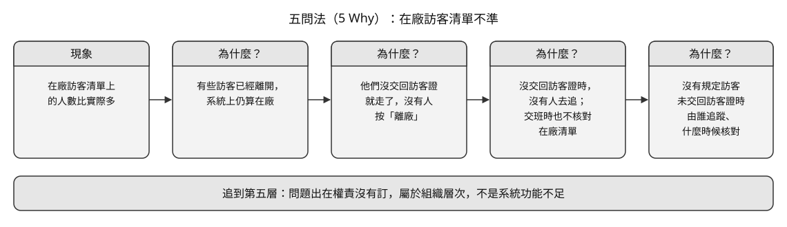
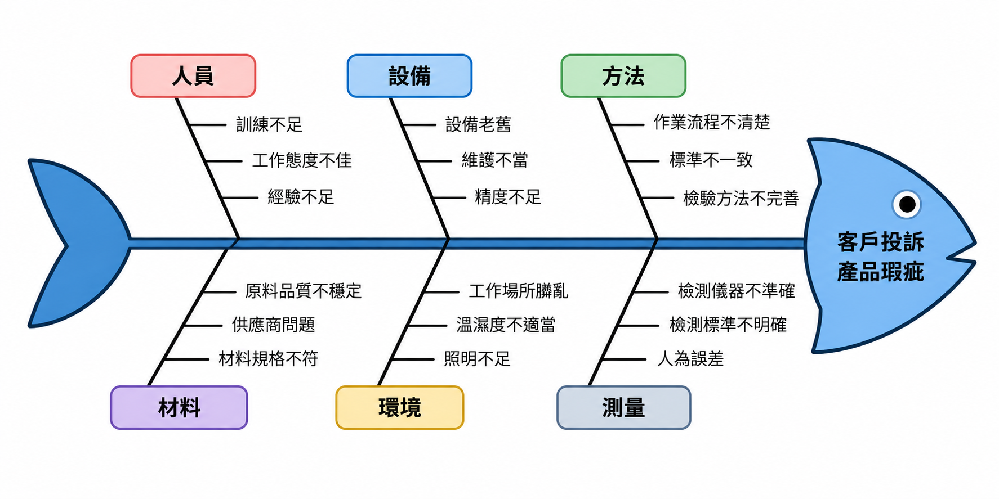
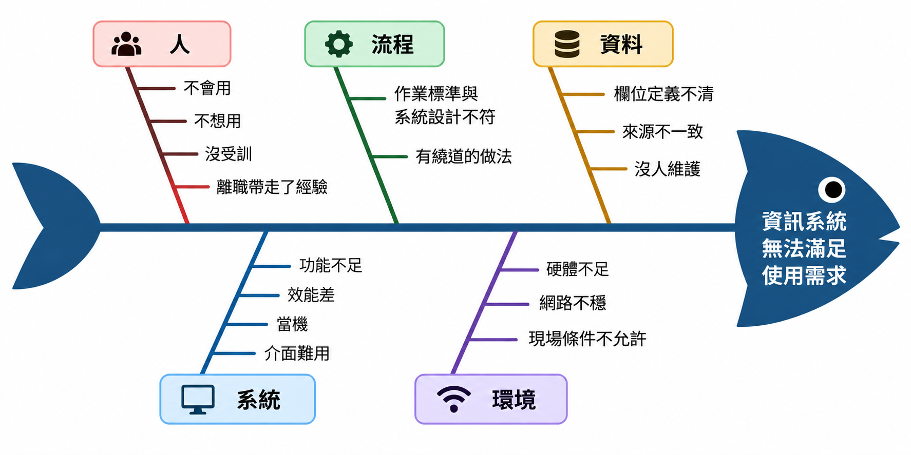

# 問題定義與現況分析

## 系統分析與設計（IE226）115-1

授課教師：呂卓勲

本課程教材：[GitHub](https://github.com/billy1125/system-analysis-and-design)

---

## 把選單點過一遍，不是分析

最容易的起手式是打開系統、把每個選單點過一遍，照畫面順序寫成報告，但這樣是不夠的。

一套系統之所以被做出來，是因為有某個問題要解決。

> **看不出系統背後的問題，你就只是在幫使用手冊換句話說。**

---

## 本章在期中報告的位置

本章處理期中報告的第一項與最後一項：**問題與系統背景**、**現況問題與改善建議**。

開頭問「當初要解決什麼問題」，結尾答「解決得如何、還剩什麼沒解決」。中間各章的分析，都是為了讓結尾那個答案有憑有據。

---

## 本章可以先放著，之後再回來

- **第六、七節請等其他分析全部做完再寫**
- 第五節之前可以在專案初期動筆，但會跟著後面的分析不斷修改
- 一開始寫不出來沒關係，等其他分析有了眉目再回頭補

---

## 本章的例子

- 一律取自期末示範系統「工廠訪客進出登記系統」的現行版（`SAD-Visitor`）
- 分析結果對照同一套系統的「系統分析完整報告」，照期中九項寫成，以下簡稱「訪客系統報告」

---

# 一、問題定義要回答什麼

建置一套資訊系統，是解決管理或實務工作上問題的手段，所以分析要從問題開始。

本節先說明問題定義與現況分析的關係、它如何帶出後面的分析，再列出一份問題定義必須交代的四件事，最後處理分析既有系統時特有的處境：系統已經存在，問題要反推。

---

## 功能介紹不等於問題

多數報告的開頭只交代系統是做什麼的，例如「本系統讓大門櫃台登記訪客進出、收發訪客證」。

更該說清楚的是它解決了什麼問題：

- 沒有這套系統之前，哪件事做不好？
- 誰因此多花時間或出錯？

> **答得出這一點，才說得出這套系統存在的理由。**

---

## 現況分析的產出是問題定義

> **問題是現況與期望之間的落差。**

只說「訪客證管理很亂」，看不出問題在哪。

要寫出訪客證目前怎麼發、怎麼收、遺失時查不查得到最後在誰手上，落差才看得見。

說不出現況哪一段出錯，就等於還沒定義出問題。

---

## 問題定義帶出後面的分析

問題沒講清楚，需求從哪裡來、功能該不該做、做完算不算成功，都沒有依據。

| 從問題推出 | 要做的分析 | 章節 |
|---|---|---|
| 受問題影響的人 | 重要使用者與利害關係人 | 使用者分析 |
| 問題發生的那段作業 | 要看的流程 | 使用者分析 |
| 解決問題需要系統做到的事 | 要確認的需求 | 系統需求分析 |

---

## 問題定義需要交代四件事

| 要交代的 | 回答的問題 | 白話文 |
|---|---|---|
| 現況 | 目前這件事是怎麼運作的 | 現在大家是怎麼做的？ |
| 問題 | 現況哪裡不夠好、造成什麼損失 | 哪裡容易卡住、誰容易出包？ |
| 目標 | 導入系統後要達成什麼 | 做完之後要變成什麼樣子？ |
| 範圍 | 這套系統負責到哪裡 | 哪些事歸它管、哪些不是？ |

---

## 四件事之間有因果

> **沒有現況就看不出問題，沒有問題就推不出目標，沒有目標就界定不了範圍。**

最常見的斷點在第二格：直接寫「本系統可以提升生產效率」，卻從來沒說現況的效率為什麼不好、不好在哪一段。

---

## 既有系統的特殊處境：要反推

一般的專案是先有問題、才有系統。期中報告與期末報告第一部分相反：**系統已經在那裡了，你要從它回推當初的問題。**

要回推的是整套系統在回答的問題：**它為什麼要存在。**

---

## 從系統留下的線索反推

| 系統上看到的 | 可以推出的問題 |
|---|---|
| 登入後首頁就是在廠訪客清單與人數 | 最常要回答「廠內現在有哪些外人」 |
| 每筆來訪綁一張訪客證，使用中不能再發 | 進廠的人要對得到身上那張證 |
| 來訪紀錄不能刪，可依日期與關鍵字查詢 | 進出紀錄要留下來，事後查得到 |
| 只有接待員與管理員有帳號 | 服務的是大門櫃台的管制 |

> **線索合起來，才看得出這套系統在服務什麼需求。**

---

## 推不出來的部分要說清楚

有些設計確實推不出理由：舊系統遺留、某位主管的要求，或連設計者自己都忘了。

> **推不出來就寫推不出來，並說明需要什麼資訊才能確認。**

例如：`employees.department` 是自由文字而非選單，看不出是刻意保留彈性，還是沒考慮到部門名稱要統一，需訪談開發者才能確認。

---

## 分得清查到的與推測的

硬掰一個理由，訪談被追問時答不出來。

分析報告的可信度，來自你分得清「我查到的」和「我推測的」，而不是把每一格都填滿。

老師並不期望你找出所有大小問題，也沒有一套資訊系統能解決所有問題。

---

# 二、從既有系統反推問題與目標

反推不必憑空想像。系統的功能、資料與限制都留下了線索，只要知道去哪裡找。

但系統反映的是當初想解決的問題，不一定是現在實際的問題。本節也說明為什麼要拿系統去對照真實的使用情境。

---

## 三個切入點

- **看功能**：哪一塊是主體？來訪登記與在廠、離廠是主體，其他功能都在支撐它
- **看資料**：資料怎麼掛在一起？訪客、受訪員工、訪客證、接待員都掛在來訪紀錄底下
- **看限制**：誰能做什麼？使用中的證不能再發、仍在廠內的訪客不能再登記

> **誰能做什麼、誰不能做什麼，看得出這套系統要服務誰。**

---

## 對照現場，不要只看系統

在廠清單顯示了受訪員工的分機，只看系統會以為「通知受訪員工」已經處理了。

但接待員要自己打分機請受訪員工出來接人；受訪員工沒接電話怎麼辦，系統沒有規範。

> **系統只處理了顯示分機這一步，打電話與找不到人時的處理都還靠人工。**

---

## 沒有真實現場怎麼辦

實際到現場觀察，得到的問題定義最準確。

本課程的題目都是模擬情境，現場的使用情況可以自行假設，或找類似場域的資料作為參考。

但再精密的假設、再完整的書面資料，都比不上親自到現場走一趟、和相關人員談一談。

---

## 從問題推回目標

目標是問題的反面，但要寫得比「解決那個問題」更具體。

| 現況與問題 | 推出的目標 |
|---|---|
| P-02 沒有即時的在廠訪客名單 | 任何時點都說得出廠內有哪些訪客 |
| P-03 訪客證的去向沒有紀錄 | 任一張證都查得到配給哪一筆來訪 |
| P-04 回頭訪客每次都要重填資料 | 輸入手機號碼就帶出資料 |

只做到一半的目標，就是第九項的線索：訪客沒登記離廠就走，P-02 的目標就做不到（I-01）。

---

# 三、把抱怨變成問題陳述

期中與期末報告沒有真實的使用者，你聽不到有人抱怨。這時可以想像自己是使用者，會在哪裡卡住、對什麼不滿；不確定時也可以直接問老師。

聽到的抱怨多半是症狀。本節用 5 Why 往下追、用魚骨圖往旁邊擴大，最後把問題寫成可以被檢驗的陳述。

---

## 症狀不是問題

> **症狀是被感受到的現象，問題是造成現象的機制。**

| 症狀 | 問題 |
|---|---|
| 在廠人數好像不太準 | 在廠只看離廠時間是否為空，沒交回訪客證就走的人會一直算在廠 |

「系統很難用」「資料常常對不起來」指不出要改什麼；問題陳述要能著手。

---

## 用 5 Why 往下追

---

## 追到第五層，性質就變了

這不是系統功能不足，是權責沒有訂清楚。

> **只寫「系統應該增加離廠提醒功能」解決不了問題，提醒跳出來之後還是沒有人去追。**

「五」不是硬性規定，追到能著手處理就停。但至少要追到第二層，停在第一層通常還是症狀。

---

## 石川圖（魚骨圖）

5 Why 是往下深挖一條線，石川圖（Ishikawa Diagram）是往旁邊擴大，避免只盯著一個方向。

名稱來自發明者、日本品管學者石川馨，又稱魚骨圖或特性要因圖。

製造業慣用 4M（人、機、料、法）分類，資訊系統要換一組。

---

## 用石川圖（魚骨圖）擴大範圍

---

## 資訊系統的魚骨圖

| 分類 | 這一類的問題長什麼樣 |
|---|---|
| 人 | 不會用、不想用、沒受訓、離職帶走了經驗 |
| 流程 | 作業標準與系統設計不符、有繞道的做法 |
| 資料 | 欄位定義不清、來源不一致、沒人維護 |
| 系統 | 功能不足、效能差、當機、介面難用 |
| 環境 | 硬體不足、網路不穩、現場條件不允許 |

問題全部集中在「系統功能不足」，通常代表分析只做了一層。

---

## 資訊系統的魚骨圖範例

---

## 可以被檢驗的問題陳述

> **一條問題陳述要寫出：誰受影響、發生什麼、造成什麼後果。**

❌ 訪客進出紀錄不準確。

✅（假設量測過）訪客多未經櫃台登記即離廠，在廠清單與實際人數每日相差五到八人；消防演練時點名作業平均延誤十五分鐘。

後果帶數字，就知道要量什麼，改善之後也驗證得了。

---

## 沒有數字時

反推出來的問題陳述手上沒有量測數字，數字可以省，但「誰受影響」與「造成什麼後果」仍然要寫：

✅ 訪客證的去向沒有紀錄，訪客證遺失時，管理員查不出最後在誰手上。（P-03）

至少寫出頻率與範圍：一週發生幾次、影響幾個人、涉及多少筆資料。

---

# 四、目標要能驗收

「提升效率」「加強管理」「優化流程」這類目標出現在報告裡，等於什麼都沒說，因為沒有任何方法能判斷它達成了沒有。

本節說明怎麼把目標寫到可以驗收，並為每個目標配上有現況值的成功指標。這一節主要是期末報告的內容。

---

## 為什麼要寫目標

期中分析已上線的系統，不必訂目標；期末第 8 項效益評估要替每一項修改訂出指標與目標。

| | 回答什麼 |
|---|---|
| 問題陳述 | 現況哪裡不對 |
| 目標 | 改到什麼程度才算解決 |

> **問題是現況與期望狀態的落差，目標就是把期望狀態寫下來。**

少了目標，設計時無法比較方案，交付時也無法判斷做完了沒有。每個目標都要對得回一條問題，並以現況當起點。

---

## 不能驗收的目標等於沒寫

> **系統上線半年後，有沒有辦法拿出證據說這個目標達成了？**

| 無法驗收 | 可以驗收 |
|---|---|
| 提升報到效率 | 回頭訪客輸入手機號碼後不必重填任何一欄 |
| 加強個資保護 | 來訪紀錄查詢結果不顯示完整身分證字號 |
| 提高資料正確性 | 交班核對後，在廠清單中非今日報到的紀錄為 0 筆 |

---

## SMART 與成功指標

SMART：具體、可衡量、可達成、相關、有時限。最常漏的是可衡量與有時限。

替訪客系統報告〈9.2〉的建議訂指標，寫成五欄：

| 指標 | 怎麼量 | 現況值 | 目標值 | 對應問題 |
|---|---|---|---|---|
| 交班後非今日報到的在廠筆數 | 交班核對時計算 | 無法直接得知，至少 1 筆 | 0 筆 | I-01 |
| 查詢結果顯示完整證號的比例 | 顯示筆數 ÷ 總筆數 | 100% | 0% | I-03 |

期末第 8 項效益評估同樣五欄，最後一欄改成對應的變更需求。

---

## 沒有現況值，就沒有改善幅度

「現況值」那一欄是關鍵，也是最常空白的一欄。

量不到現況值時要寫明，交代目前知道多少。

目標三到五個就夠。挑選的判準是回到問題陳述：**哪幾個問題造成的損失最大，就針對那幾個訂目標。**

---

# 五、問題定義書怎麼寫

問題定義書是期中報告第一項的產出。前面找到的現況、問題與範圍，要整理成一份讀者能快速掌握系統概要的文件。

本節列出建議的結構，並說明範圍為什麼一定要寫「不做什麼」。

---

## 建議的結構

| 段落 | 內容 |
|---|---|
| 系統概述 | 什麼系統、誰在用、在什麼場域 |
| 現況說明與問題陳述 | 怎麼進行；三到五條問題 |
| 系統做了哪些、哪些仍靠人工 | 兩欄對照，逐項列出 |
| 分析範圍 | 涵蓋哪些、不涵蓋哪些 |
| 判斷依據 | 推論從系統的哪些地方看出來 |

「目標與成功指標」期中不必寫；期末寫在第 8 項效益評估。

---

## 三個段落要特別注意

- **判斷依據**：期中特有。從哪個功能、哪張表、哪個限制看出來的，訪談最容易被追問
- **系統做了哪些、哪些仍靠人工**：右欄「沒有這個功能」的格子，是第九項改善建議的第一批候選
- **結構不是固定格式**：重點是讓利害關係人或開發人員讀完能很快掌握系統概要

完整範例見訪客系統報告〈1. 問題與系統背景〉。

---

## 範圍要寫「不做什麼」

只寫「本次分析涵蓋六個子系統的全部功能」不夠，要補上不涵蓋的部分與理由：

- 系統的安裝與啟動方式：屬於維運，不影響使用者的作業方式
- 版面樣式與色彩配置：不涉及功能與資料
- 密碼雜湊的演算法：屬於實作細節

> **寫下不做什麼，讀者才知道你是確認過不需要，而不是漏掉了。**

---

# 六、系統分析完成後再回頭找出其他問題

本節〈六、系統分析完成後再回頭找出其他問題〉與下一節〈七、改善建議怎麼提〉，請在其他各項分析全部完成之後再寫。它們是期中報告的第九項，也是整份報告最能看出分析深度的地方。

改善建議最常見的失分，是前面八項認真做完，最後一項卻寫出「介面可以更美觀」「建議加入 AI 功能」這類與前面無關的使用心得。

---

## 改善建議要從自己的分析裡長出來

> **合格的建議必須指得出來自哪一份分析。**

| 分析產出 | 會浮出的問題 |
|---|---|
| 利害關係人清單 | 某個利害關係人沒有任何功能對應到他 |
| 流程圖（活動圖） | 資料輸入兩次、審核關卡沒有實質作用 |
| 需求清單 | 有需求找不到功能、有功能對不到需求 |
| 功能清單與系統邊界 | 界外的「系統不做」是否真的不需要 |
| ERD 與資料字典 | 欄位沒有值域、同一件事存在兩個地方 |

---

## 把兩份產出擺在一起

有一類問題不在任何單一產出上。

停用訪客證的流程寫著「之後不出現在下拉選單」，資料字典寫著「使用中」由來訪紀錄推導，兩件事各自都對。

照著實測一次，停用一張使用中的證，系統沒有提示，在廠清單照樣顯示（I-09）。

> **交叉比對找出來的問題，價值比單一產出上看得到的高得多。**

---

## 挑出值得寫的

| | 影響大 | 影響小 |
|---|---|---|
| **改法明確** | 優先寫，是報告的主體 | 一句話帶過 |
| **改法不明** | 值得寫，說明還需要什麼資訊 | 不必寫 |

右下角那一格要克制，塞滿小問題會稀釋真正重要的那幾條。

範例見訪客系統報告〈9.1〉與〈9.3〉。

---

# 七、改善建議怎麼提

改善建議不是只有「系統要加什麼功能」一種。同一個問題，往往在流程、系統與組織三個層次都有處理的餘地。

本節說明三個層次、一條建議必須包含的四個部分，以及期中的建議該停在哪裡。

---

## 三個層次

| 層次 | 處理什麼 | 例子 |
|---|---|---|
| 流程 | 順序、分工與規則 | 接待員交班時核對一次在廠清單 |
| 系統 | 功能、資料、介面 | 標示非今日報到的紀錄；補登時可填實際離開時間 |
| 組織 | 權責、訓練、規範 | 訂定訪客未交回訪客證時由誰追蹤 |

三個層次針對同一個問題 I-01（訪客系統報告〈9.2〉建議一）。

> **只寫系統層次的報告，分析深度一定不夠。**

---

## 不要把問題推給使用者

5 Why 那個例子：沒有人負責追蹤未交回的訪客證，加再多功能也解決不了，要處理的是權責，屬於組織層次。

反過來，也不要把所有問題都推給「使用者習慣不好」。

現況流程裡看似不合理的動作，往往有沒被說出口的理由。

---

## 改不動的問題，仍然要試著提

實務上有三個層次都改不動的問題：預算不允許、受法規或上級規定限制、牽涉的單位不歸系統管。

課程練習的重點是學會從三個層次找處理方式，不是判斷能不能執行：

- 先假設預算與權責不構成限制，把建議寫出來
- 再註明它實際上可能卡在哪裡

> **寫得出卡點，訪談被追問時也答得出來。**

---

## 每條建議要接得回去

| 部分 | 範例：建議三，修改要留紀錄 |
|---|---|
| 建議 | 新增修改紀錄；規定哪些情況可以修改 |
| 針對的問題 | I-04 修改直接覆蓋原值，查不出誰改的 |
| 依據 | `visits` 只有 `updated_at`；NFR-04 不得刪除 |
| 預期效果 | 來訪紀錄可追溯，「不得刪除」真正發揮作用 |

> **「依據」是分數的關鍵，它證明建議來自分析。**

---

## 扎實的依據是交叉比對

第 7 項：「在廠」只由 `check_out_at` 是否為空推導，沒有時間上限；第 3 項〈3.2〉：沒交回訪客證時，離廠流程不會被觸發。

兩者合起來，忘了登記的紀錄永遠算在廠。第 4 項 FR-14：離廠時間不可修改，補登寫不進實際時間。

指得出三份文件的具體位置，訪談被問「怎麼發現的」，答得出一條完整的推論路徑。

---

## 期中到此為止

改善建議只要提出合理的方向，**不必也不應該寫成修改規格**。

修改後的資料表、畫面與驗收標準，是期末修改建議書的工作。

> **期中要證明的是：你看懂了這套系統，看得出它哪裡可以更好，而且說得出憑什麼。**

範例見訪客系統報告〈9.2 改善建議〉。

---

## 本章重點回顧

- 系統已經存在時，從它留下的線索反推整套系統在服務什麼需求
- 症狀不等於問題；5 Why 往深處挖，魚骨圖往旁邊擴大
- 目標要能驗收，指標要有現況值
- 推不出來的部分要誠實標示，分清查到的與推測的
- 改善建議要接得回分析，而且不是只有加功能一途

---

## 下一章

本章界定了要解決的問題與範圍，但還沒有回答「這套系統是給誰用的」。

下一章「使用者分析」從人開始：找出利害關係人、了解他們怎麼工作，並把這些整理成使用案例。
