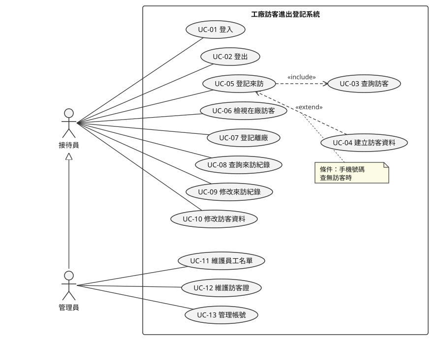
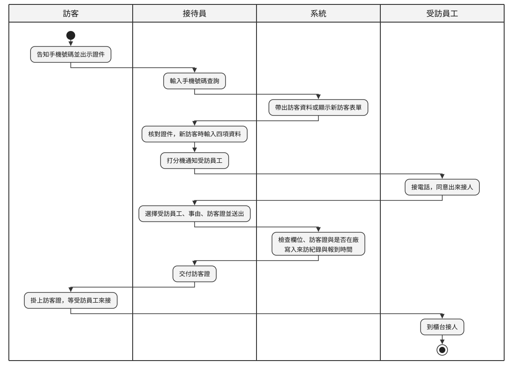
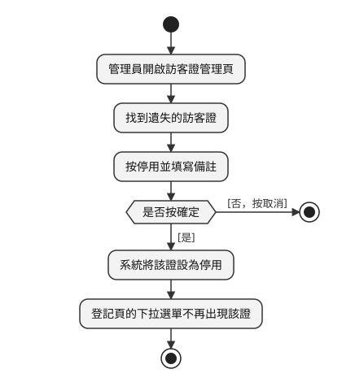
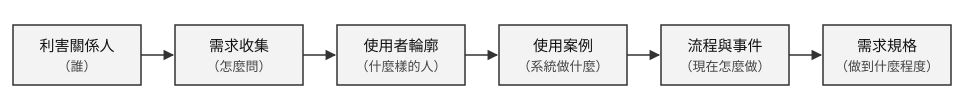

# 使用者分析

多數失敗的資訊系統，並不是程式寫壞了，而是一開始就搞錯了「誰要用、用來做什麼」。一套訪客登記系統若只問過廠務主管、沒問過大門的接待員，很可能做出一個報表漂亮但門口大排長龍的系統；若只問過接待員、沒想到工安與環安人員，緊急疏散時最需要的在廠訪客名單，就只會留在櫃台那台電腦上。你在分析階段的第一項工作，因此不是畫系統架構，而是把「人」與「事」看清楚。

本章處理分析階段的第一個區塊——使用者分析。內容依你實際執行的順序展開：先找出誰會受這套系統影響（利害關係人分析），決定用什麼方法向他們蒐集資訊（需求收集方法），再刻畫出這些人的輪廓（使用者分析）。人確認之後，把「誰需要系統幫他做什麼」用一張圖固定下來（使用案例圖），最後看這些事現在是怎麼一步步做完的（流程分析）。順序不能顛倒，因為後一項的正確性完全建立在前一項之上。

本章從頭到尾使用同一套系統：期末示範系統「工廠訪客進出登記系統」的現行版（`SAD-Visitor`）。它是一間中型電子零件廠大門接待櫃台用的系統，訪客到廠時由接待員登記並發給訪客證，離開時登記離廠並收回訪客證；管理員負責維護員工名單、訪客證與帳號。訪客與受訪員工都不操作系統，系統也不連接任何外部系統。

這套系統已經在用，分析它的方式和期中報告相同：從系統反推誰在用、怎麼用。分析的結果寫在同一套系統的[「系統分析完整報告」](../04-Final-Project-Example-Reports/Visitor-System-Full-Analysis.md)，以下簡稱「訪客系統報告」，本章主要用到它的〈2. 使用者與利害關係人分析〉與〈3. 現況流程分析〉。訪談、觀察這類要到現場才做得到的方法，本章以「如果能到這家工廠的大門實地了解」為前提說明。

> **延伸閱讀**：本章談的是這些分析要怎麼做，各組實際要繳交哪些文件、格式與最低標準，見[「系統分析範例報告說明」](../02-Midterm-Project-Example-Reports/Analysis-Phase-Deliverables.md)。

> **必讀標記**：標題後加註 🔴 期中必讀 的小節，是期中小組報告九項產出直接會用到的內容；加註 🔵 期末必讀 的，是期末報告直接會用到的。判準與成品的樣子，期中見[「系統分析範例報告說明」](../02-Midterm-Project-Example-Reports/Analysis-Phase-Deliverables.md)與[「系統分析範例報告」](../02-Midterm-Project-Example-Reports/Analysis-Phase-Sample-Report.md)，期末見[「期末範例報告」](../04-Final-Project-Example-Reports/Final-Phase-Sample-Report.md)。未標記的小節仍屬課程範圍，只是報告不會直接產出。

## 一、為什麼分析要從人開始

### 1.1 沒有一套資訊系統與人無關

資訊系統是給人用的。這句話聽起來像廢話，卻是整個分析階段的出發點。

有人會反問：全自動的系統呢？無人搬運車自己決定路線、視覺檢測設備自己判定良品與不良品、批次程式在半夜自己跑完月結——過程中確實沒有人動手。但把時間軸拉開來看，是人決定要自動化哪一段、自動到什麼程度、判定標準怎麼設、出狀況時誰接手、結果報給誰看。**自動化取消的是人的操作動作，取消不了人的目的。** 檢測設備替代的是原本站在產線上目視挑件的作業員，它服務的仍是「不要把不良品出給客戶」這件事，而這是人訂下的目標。

再往上一層看，資訊系統本身不創造價值。它把資料從一個地方搬到另一個地方、算出一個數字、擋掉一個錯誤動作——這些事之所以有意義，是因為某個人接下來要據此做決定或採取行動。沒有人接手，系統的輸出就只是硬碟裡的一堆位元。

所以判斷一套系統該不該存在、能不能存在下去，判準不在技術做不做得到，而在 **它是否符合人的需要與期望**。做得出來卻沒有人需要的系統，上線後會被繞過去；做得到但與使用者期望不合的系統，會被抱怨、被消極抵制。兩者最後都是同一個結局——停用，或是變成一套「大家都在用另一套 Excel 私下作業」的空殼。系統的價值由使用它的人給定，不是由它的功能數量給定。

這就是分析階段必須從人開始的根本原因：**你要判斷一套系統該做成什麼樣子，只能回到那些需要它的人身上去問。**

### 1.2 從人開始的三個理由

[系統分析](https://zh.wikipedia.org/wiki/系統分析)的目的，是把一個含糊的期待——「我們想要一套能即時看到生產進度的系統」——轉換成開發人員做得出來、使用者也真的願意用的具體描述。這個轉換的第一道關卡是 **需求來源**：需求不會自己浮現，它附著在人身上，附著在這些人每天實際執行的作業裡。

從人開始有三個理由。第一，**需求的正確性取決於問對人**。工廠裡的訪客管理，廠長關心的是稽核時交得出紀錄，工安與環安人員關心的是疏散時點得出人，接待員關心的是尖峰時段門口會不會塞住。你只問廠長，就只會得到報表需求，做出來的系統在大門一定卡住。

第二，**同一件事在不同人眼中是不同的問題**。「訪客管理很亂」對工安與環安人員而言是在廠名單不準，對總務而言是訪客證遺失時查不出最後在誰手上，對受訪員工而言是訪客到了只能等接待員來電。三種說法指向三組不同的功能，而它們未必都在這次專案的範圍內。你在分析階段要做的正是把它們攤開來，再決定做哪些。

第三，**願不願意用，決定系統的成敗**。資訊系統的效益來自持續被使用，而使用者是否配合，取決於新做法相對於舊做法是不是真的比較省事。這個判斷你只能從理解使用者的實際工作情境得到，無法從技術規格推導。

也因為需求來自人，需求收集過程中的典型困難幾乎都是溝通問題而非技術問題：不同使用者對同一功能的要求互相衝突、客戶認為開發者理應已具備該行業的知識而略去不談、使用者說不清楚自己要什麼、訪談雙方對同一個詞的理解不同。本章介紹的各項工具，本質上都是在降低這幾類誤差。

## 二、利害關係人分析 🔴 期中必讀

**[利害關係人](https://zh.wikipedia.org/wiki/利害關係人)（Stakeholder）是指任何直接或間接受到系統成敗影響、或能影響系統成敗的個人或團體。** 注意這個定義比「使用者」寬：不會碰鍵盤的人也可能是關鍵利害關係人。以訪客登記系統為例，受訪員工沒有帳號、不碰系統，但訪客到了，他只能等接待員打分機來通知。你在分析階段沒想到他們，就看不出「通知受訪員工」這件事完全在系統之外。

### 2.1 找出利害關係人 🔴 期中必讀

實務上依下列順序展開，越後面找到的人越容易被漏掉：

| 步驟 | 做法 | 在訪客登記系統中找到的對象 |
|---|---|---|
| 分析專案文件 | 從組織圖、作業流程書、專案立案文件中找出相關單位與職務；若無文件可參考則直接進入下一步 | 系統 `README.md` 寫明的接待員（大門警衛）與管理員（總務人員），以及不登入系統的受訪員工與訪客 |
| 腦力激盪 | 召集專案團隊，針對文件未涵蓋的受影響範圍進行討論 | 工安與環安人員：緊急疏散時要清點在廠訪客 |
| 客戶分析 | 訪談客戶或目標對象，每訪談一位就追問「這件事還牽涉到誰」 | 負責採購訪客證的總務人員：訪客證遺失要補購 |
| 製作表單 | 列出前三步得到的利害關係人清單，逐一說明其受專案影響的方式 | 見訪客系統報告〈2.1〉〈2.2〉 |

最後一欄「受影響的方式」你不可省略。只寫「工安與環安人員」沒有分析價值，寫成「工安與環安人員——緊急疏散時需要在廠訪客名單，但名單只在櫃台電腦上」才構成後續需求的線索。

期中報告分析的是一套已經存在的系統，沒有立案文件也沒有人可以訪談，上表的四個步驟要換成另一種問法：把作業流程從頭走一遍，逐一問 **誰輸入資料、誰查看資料、誰維護系統、誰為結果負責**。四個問題各自對應一群人，答得出來就找得齊。

找齊之後要分成兩張表，不要混在同一張裡：

| 表 | 收哪些人 | 該有的欄位 |
|---|---|---|
| 使用者 | 會直接操作畫面的人 | 角色、使用目標、主要需求、權限範圍、最在意什麼 |
| 利害關係人 | 不碰畫面、但會影響系統或被系統影響的人 | 利害關係人、是否操作系統、受影響的方式 |

利害關係人那張表的「是否操作系統」欄看起來多餘，作用是逼你正視答「否」的那幾列。**不碰系統卻被系統影響的角色最容易被漏掉，而漏掉他就等於漏掉他那一整組功能。** 訪客登記系統的工安與環安人員是典型例子：他不登記來訪、不發訪客證，但緊急疏散時要靠在廠訪客名單清點人數。`SAD-Visitor` 的名單只在櫃台那台電腦上（訪客系統報告〈8.2〉），他沒有任何取得名單的管道，「把在廠名單交到疏散現場」這一整組功能也就無聲無息地缺席了。

訪客系統報告〈2.2 利害關係人〉的訪客那一列也是如此：訪客不操作系統，但姓名、手機與完整身分證字號都被存進系統，持護照的外籍訪客連身分證字號欄位都填不進去。這一列到了報告最後，就成了〈9.1〉的現況問題 I-03 與 I-05。

### 2.2 利害關係人的分類

找齊之後要分類，因為不同類別的人需要投入的溝通程度不同。最基本的分類是依 **所在位置** 與 **職能** 交叉切分：

| | 操作類型 | 管理類型 | 技術類型 |
|---|---|---|---|
| **內部（internal）** | 接待員、管理員、受訪員工 | 工安與環安人員、總務人員、廠長 | （報告中沒有） |
| **外部（external）** | 來送貨、維修、開會的訪客 | 訪客所屬的公司 | （報告中沒有） |

技術類型兩格是空的。`SAD-Visitor` 裝在櫃台的一台電腦上，沒有備份機制（訪客系統報告〈8.2〉），報告裡也找不到由誰維護系統。分類表上的空格正好提醒你追問：系統壞了找誰？

另一種分類方式是依「能影響專案」與「被專案影響」區分為直接與間接利害關係人。實務上更常用的是把 **影響力** 與 **受影響程度** 當成兩個維度，交叉後得到四種處置方式：

| | 受影響程度低 | 受影響程度高 |
|---|---|---|
| **影響力高** | 維持滿意：定期告知進度即可，例如廠長 | 密切管理：全程參與需求確認，例如維護員工名單、訪客證與帳號的管理員 |
| **影響力低** | 最低限度關注：例如訪客所屬的公司 | 充分告知：需求要問、決策不必參與，例如大門接待員 |

要特別注意左下與右下的差別。接待員影響力低但受影響極大——每一位訪客的查詢、登記、發證與離廠都經過他們的手，早上八點多還常有好幾位訪客同時到（訪客系統報告〈2.1〉）。這一格的人最常被跳過，也是系統上線後抗拒最強的來源。

### 2.3 用 RACI 釐清權責

需求確認階段常見的僵局是「大家都有意見，但沒有人能拍板」。[RACI 責任分配矩陣](https://zh.wikipedia.org/wiki/責任分配矩陣) 用來把這件事講明白：

| 代號 | 角色 | 含義 |
|---|---|---|
| R | 責任者（Responsible） | 實際執行工作的人 |
| A | 當責者（Accountable） | 最終負責正確完成可交付成果、並負責簽核的人，每項工作只能有一位 |
| C | 事先諮詢者（Consulted） | 事前徵詢意見的對象，通常是領域專家，雙向溝通 |
| I | 事後告知者（Informed） | 需要隨時了解進展的人，單向告知 |

以訪客系統報告〈9.2〉建議一的組織層次「訂定訪客未交回訪客證時由誰追蹤」為例：管理員是 R（起草規定），核准規定的廠長是 A（簽核定案），接待員與工安與環安人員是 C（提供現場收證與疏散清點的意見），受訪員工是 I。矩陣裡「A 只能有一位」這條限制最有價值——它強迫你在動工前就找出那個能做決定的人。

### 2.4 小結：利害關係人是哪些人？

利害關係人不等於操作系統的人。**只要會影響系統，或會被系統影響，就是利害關係人**，不管他碰不碰畫面。大致可以分成三種：

| 類型 | 訪客登記系統 |
|---|---|
| 會操作系統的人 | 接待員、管理員 |
| 不操作系統，但會影響系統的人 | 決定系統要不要修改的廠長 |
| 不操作系統，但被系統影響的人 | 訪客、受訪員工、工安與環安人員 |

同一個人在哪一列，取決於系統怎麼設計。`SAD-Visitor` 由接待員代為登記，訪客就列在「不操作系統，但被系統影響的人」。如果要把事前預約納入系統、讓受訪員工自己登入建立預約，受訪員工就會移到「會操作系統的人」那一列。

分析時最容易漏掉的是後兩種。本節介紹的四個步驟、四個問題、兩張表、兩種分類與 RACI，都是用來把這三種人找齊、整理清楚的方法，可以依情況選用。

## 三、需求收集方法

找出利害關係人之後，你要決定用什麼方法向他們取得資訊。方法的選擇取決於對象是誰：

| 來源 | 主要調查對象 | 主要方法 |
|---|---|---|
| 內部 | 利害關係人 | 質化（qualitative）方法為主，以訪談為核心 |
| 外部 | 終端使用者 | 量化（quantitative）方法為主，以問卷調查為核心 |

這個分工的道理在於人數與目的不同。內部利害關係人數量有限但每個人的資訊量大，需要深入挖掘；外部使用者人數眾多但每個人的資訊量小，需要的是分布與比例。

**質化方法** 用於理解「為什麼」，適合需求還不明確的階段：

| 方法 | 適用時機 | 在訪客登記系統中的應用 |
|---|---|---|
| 訪談 | 需要深入理解個別對象的想法 | 訪談接待員，問受訪員工沒接電話時實際怎麼處理 |
| 觀察 | 對象說不清楚、或說的與做的不一致時 | 站在大門口看訪客實際怎麼離開、有沒有交回訪客證 |
| 文件分析 | 需要掌握既有規則與資料格式 | 讀系統的 `README.md`、資料表結構與種子資料 |
| 焦點團體討論 | 需要讓不同角色當場對焦衝突 | 找接待員、管理員、工安與環安人員共同確認在廠名單要準到什麼程度 |
| 個案研究 | 需要參考同業做法 | 研究同業導入訪客管理系統的成效與踩過的坑 |

其中 **觀察** 在工廠場域的價值特別高。訪談時接待員可能會說「訪客離開都會交回訪客證」；但 `SAD-Visitor` 的種子資料裡，11/2 報到的陳俊宏到現在仍顯示在廠（訪客系統報告〈3.2〉）。說的和資料對不上時，要到大門看訪客實際怎麼離開，才知道系統必須面對的真實條件。

**量化方法** 用於確認「有多少、多嚴重」，適合需求方向已定、要驗證普遍性的階段，包括調查（問卷）、相關分析與實驗。例如統計來訪紀錄中報到超過一天、離廠時間仍為空的筆數占全部來訪的比率，得到的數字既能說明問題有多嚴重，也能作為改善後的比較基準。

實務上兩類方法搭配使用：先以質化方法發現問題與假設，再以量化方法驗證其普遍程度。

**本節的方法，期中與期末報告不一定都用得到。** 這是本課程的限制：兩次報告的題目都沒有真實的現場，也沒有真的使用者可以訪談或發問卷。期中分析的是既有系統，能用的主要是文件分析，資料來源是系統的原始碼、`README.md` 與 `document/` 底下的系統文件。期末拿到的是一套可執行的既有系統與一份修改需求提案書，能用的同樣以文件分析為主：實際操作系統、讀系統的 `README.md` 與提案書；現場怎麼運作、使用者怎麼想，多半只能依提案書的情境推想。

## 四、使用者分析 🔴 期中必讀 🔵 期末必讀

利害關係人回答的是「誰被影響」，使用者分析進一步回答「這些人是什麼樣的人、在什麼情境下操作系統」。同樣是使用者，特性差距可能很大：接待員整天守在櫃台，尖峰時段要一邊核對證件、一邊打分機、一邊操作系統；管理員只在員工異動、訪客證遺失或帳號變動時才需要操作，而且系統只裝在櫃台那台電腦上，他得走到櫃台才能用（訪客系統報告〈8.2〉）。你忽略這個差距，設計出來的系統就會只適合其中一種人。

### 4.1 使用者分群 🔴 期中必讀 🔵 期末必讀

分群的依據不是職稱，而是 **與系統互動的方式**。判斷方法很直接：不同族群人使用的功能不同、操作頻率不同、或所處環境不同，你就該把他們分成不同的族群。

例如，訪客登記系統的分群結果如下，後兩群不操作系統，但一樣要列出來：

| 使用者群 | 使用頻率 | 操作情境 | 主要關切 |
|---|---|---|---|
| 接待員 | 每位訪客進廠、離廠各一次 | 大門接待櫃台的桌上型電腦；早上八點多常有好幾位訪客同時到 | 動作要快，尖峰時段不能排隊 |
| 管理員 | 員工異動、訪客證遺失、帳號變動時 | 同一台櫃台電腦，其他地點無法使用 | 員工名單與訪客證的資料正確 |
| 受訪員工 | 不操作 | 自己的座位，看不到系統 | 訪客到了要有人通知 |
| 工安與環安人員 | 不操作，緊急疏散時需要名單 | 不在櫃台 | 拿得到正確的在廠訪客名單 |

這張表直接對應到後續的需求。接待員那一列的「尖峰時段不能排隊」，在訪客系統報告裡就是 NFR-03「來訪登記應在單一頁面完成，不換頁」；工安與環安人員那一列的「不在櫃台」，對照〈8.2〉名單只在櫃台電腦上，就是一個沒有被滿足的需求。

使用者分群適合在分析時先整理出來，但是不一定要全部都放進報告。建議放進報告的是系統需要優先滿足的對象，並且整理出他們的需求，後續推導介面與非功能需求時也會用到。期中報告的角色表另外要求兩欄：**主要需求** 與 **權限範圍**，回答的是「這個角色需要系統提供什麼、可以做到哪裡為止」。訪客系統報告〈2.1 使用者〉寫成：

| 角色 | 使用目標 | 主要需求 | 權限範圍 | 最在意 |
|---|---|---|---|---|
| 接待員 | 讓訪客快速登記進廠，並掌握廠內有誰 | 查詢與建立訪客、登記來訪、登記離廠、查詢與修改來訪紀錄、修改訪客資料 | 不能維護員工名單、訪客證與帳號 | 尖峰時段要快，早上八點多常有好幾位訪客同時到 |
| 管理員 | 維護系統的基本資料 | 接待員的全部需求，加上員工名單、訪客證與帳號的維護 | 全部功能；不能停用自己或修改自己的角色 | 員工名單與訪客證的資料正確 |

**「權限範圍」這一欄要正反兩面都寫**：可以做什麼寫一半，不能做什麼寫另一半。「不能」那半句才是真正有價值的部分。它是需求的來源，接待員的「不能維護員工名單、訪客證與帳號」，在報告裡就是 FR-04「選單依角色顯示可用功能」；它也是後續找出系統問題的入口，權限規則與流程的後置條件對不上的地方，通常就是一個沒被發現的漏洞。

管理員那一列分號後面的兩條「不能」合起來，保證系統中永遠至少有一個可用的管理員：管理員停用不了自己，也不能把自己改成接待員。這兩條在報告裡是 FR-18，實測時對自己操作，系統會分別顯示「不能停用自己的帳號」與「不能修改自己的角色」。

期末報告第一部分的角色表照既有系統實際的角色寫，只要三欄：角色、使用目標、權限範圍；不操作系統但受影響的人列一行即可，不做完整的利害關係人分析，要求見[「報告內容」](../00-Course-Introduction/Report-Contents.md)〈二〉第 1 項。[「期末範例報告」](../04-Final-Project-Example-Reports/Final-Phase-Sample-Report.md)〈1.2〉把上表的「主要需求」與「權限範圍」併成一欄，只留這三欄，再把訪客、受訪員工、工安與環安人員寫成一行。

### 4.2 人物誌

本小節是補充內容。使用者與利害關係人表寫完之後，如果還需要更具體的人物圖像，可以再用人物誌補強。期中與期末報告都不要求人物誌，各組自行決定要不要放。

**[人物誌](https://zh.wikipedia.org/wiki/人物誌_(使用者體驗))（Persona）是把某一群使用者的共同特徵，濃縮成一個具體、有名字的虛構人物。** 它的作用不是增加文件厚度，而是讓團隊討論設計時有共同的判準：與其爭論「系統畫面使用者看得懂嗎？」，不如問「如果有一個符合這個人物誌的真人他看得懂嗎？」。

一份人物誌通常包含兩類內容：

| 類別 | 項目 |
|---|---|
| 基本輪廓 | 姓名、人口資料、簡介、獲得消息的管道 |
| 使用行為 | 使用情境、目標、行為模式與使用偏好、痛點與困難 |

基本輪廓讓人物看起來像真人，使用行為才是推導需求的依據，後者不能省。以訪客登記系統的核心使用者為例：

> **黃志成，52 歲，大門接待員，年資 15 年**
>
> 高職畢業，負責大門日班，對常來的供應商幾乎都叫得出名字。平常用智慧型手機看影片與通訊軟體，但不太打字。有老花眼，看太小的字會比較辛苦。
>
> **目標**：讓訪客快速登記進廠、不要發錯訪客證、交班時在廠清單對得起來。
>
> **困難**：早上八點多常一次來好幾位訪客，他要一邊核對證件、一邊打分機找受訪員工；受訪員工沒接電話時，訪客就站在櫃台前等。他不反對用系統，但擔心「輸錯了會不會被追究」。
>
> **使用偏好**：習慣照固定順序操作，不喜歡畫面跳來跳去。
>
> **獲得消息的管道**：交接班、同事口耳相傳。

這份人物誌對應的是使用者表上的接待員，目標與困難都對得到表上的使用目標與最在意的事。描述裡最有價值的是「擔心輸錯會被追究」。它不是介面問題，而是會直接影響資料品質的組織問題：擔心被追究的人，輸錯了會傾向自己悄悄改掉。`SAD-Visitor` 正好允許這麼做——修改來訪紀錄直接覆蓋原值，查不出誰改的、原本是什麼（訪客系統報告〈9.1〉I-04）。這類線索要從具體的人身上才看得出來。

人物誌一般為每個主要使用者群各做一份，總數控制在三到五份，做太多會失去焦點。其中要指定一份為 **主要人物誌**，不同人物誌的需求衝突時以它為優先。訪客登記系統的主要人物誌是這位接待員：系統裡每一筆來訪都是接待員登記的，他不登記，整套系統就沒有資料。

**報告裡一旦放了人物誌，每一份都必須對應到使用者表或利害關係人表上的某個角色**，內容也要和表上的使用目標、權限範圍、最在意的事對得起來。人物誌不是自由創作，不能憑空編一個和系統無關的人物，也不能寫出和角色表矛盾的特徵。對不上表的人物誌，放了只會讓報告前後不一致。

## 五、使用案例圖 🔴 期中必讀 🔵 期末必讀

使用者與利害關係人確認之後，下一步是用 UML 標準的使用案例圖，把「誰要用系統做什麼」畫出來。

**[使用案例圖](https://zh.wikipedia.org/wiki/用例圖)（Use Case Diagram）是 [統一塑模語言](https://zh.wikipedia.org/wiki/统一建模语言)（Unified Modeling Language, UML）中用來描述「誰能用這個系統做什麼」的圖。** 它刻意不描述系統內部怎麼運作，只呈現外部使用者與系統之間的互動，因此是分析階段最適合拿去和不懂技術的使用者確認需求的一張圖。

UML 是一套畫系統圖的標準符號，由 Object Management Group（OMG）制定與維護。標準的用處在於同一個符號在誰手上都代表同一個意思：分析人員、使用者與工程師看同一張圖，不會各自解讀。本課程用到的使用案例圖、活動圖與循序圖，都是 UML 的圖。

這是期中報告要求的三張圖裡的第一張，回答「誰要做什麼」。另外兩張依序回答「事情怎麼做」（活動圖）與「使用者與系統怎麼互動」（循序圖），都以本節的產出為起點——使用案例圖上的每一個橢圓，都是後續兩張圖的題材來源。

### 5.1 四個構成元素 🔴 期中必讀 🔵 期末必讀

| 元素 | 圖示 | 含義 |
|---|---|---|
| 參與者（Actor） | 人形符號 | 與系統互動的角色，可以是人，也可以是其他系統或設備 |
| 使用案例（Use Case） | 橢圓 | 系統提供的一項完整功能，執行完後參與者應得到一個有意義的結果 |
| 系統邊界（System Boundary） | 方框 | 框內是本系統負責的範圍，框外是環境 |
| 關係 | 連線 | 參與者與使用案例的關聯，或使用案例之間的關係 |

**參與者是角色而非個人。** `SAD-Visitor` 的種子帳號有陳警衛與林警衛兩位接待員，他們對系統做的事完全相同，在圖上就是同一個參與者「接待員」；王總務多了維護員工名單、訪客證與帳號的能力，才另成一個參與者「管理員」。反過來，同一個人若在不同時候扮演兩種角色，在圖上就是兩個參與者。這個判準能大幅簡化圖面。

參與者也包含非人的對象。`SAD-Visitor` 沒有這類參與者：它不連接任何外部系統或設備，員工名單由管理員手動維護（訪客系統報告〈5.3〉）。如果要把與人資系統同步納入系統，人資系統就會以參與者身分畫在邊界之外，代表員工名單來自外部、不是本系統產生。工廠裡另一類常見的非人參與者是 [企業資源規劃](https://zh.wikipedia.org/wiki/企业资源计划)（Enterprise Resource Planning, ERP）系統，多數廠內系統都要向它取得基礎資料。

找出參與者可從下列問題著手：誰使用系統的主要功能（主要角色）？誰需要靠系統完成日常作業？誰負責維護與管理系統以確保正常運作（次要角色）？系統要與哪些硬體設備或其他系統互通？哪些人或單位對系統產生的結果有興趣或受其影響？

### 5.2 使用案例的命名與粒度 🔴 期中必讀 🔵 期末必讀

使用案例的名稱一律寫成 **動詞加受詞**，且必須是從參與者角度看得懂的一件完整的事：

| ✅ 適當 | ❌ 不適當 | 為什麼 |
|---|---|---|
| 登記來訪 | 資料輸入 | 太籠統，看不出做什麼 |
| 檢視在廠訪客 | 按下查詢鈕 | 這是操作步驟，不是完整目的 |
| 登記離廠 | 離廠管理 | 名詞化，看不出參與者做了什麼 |
| 修改來訪紀錄 | 資料庫寫入 | 這是系統內部實作，不是使用者的目的 |

名稱之外還要決定 **粒度（granularity）**。粒度指的是一個項目切得多粗或多細——同一件事可以描述成一個大項目，也可以拆成十個小項目，粒度講的就是你選在哪一個層次描述它。粒度切得太粗，一個使用案例包山包海，看不出系統實際提供什麼；切得太細，圖上會出現一堆操作步驟。

順帶一提，「粒度」原本是材料與地質領域描述顆粒大小的名詞（如粒度分布），中文資訊領域拿它來翻譯 granularity，是循日語技術文件的用法而來——日文以「粒度（りゅうど）」形容一件事被切分得多細，這個講法後來進入中文的軟體工程用語。理解字面意思會比較好記：把一塊石頭磨成粗砂或細粉，材料沒變，變的是顆粒的大小，而在分析文件裡變的是描述的層次。

粒度的判準是 **完成之後，參與者能不能就此離開系統去做別的事**。「登入」單獨存在時不符合這個判準——沒有人登入只為了登入。而「登記來訪」符合：登記完、交付訪客證，接待員就轉頭去處理下一位訪客了。

這條判準有兩個例外，分析既有系統時一定會遇到。**被 «include» 進來的使用案例不受此判準約束**：「查詢訪客」沒有人會為它本身而來，但它是每次登記來訪都必經的一步，抽出來畫才看得出登記這件事實際做了幾件事。**作為權限前提的使用案例也不受約束**：一套區分角色的系統裡，「登入」是其他所有使用案例的入口，圖上不畫它，未登入者與登入者的界線就無處可標。判準要擋掉的是「按下確認鈕」這種操作步驟，不是這兩類。

從角色出發找使用案例時，可以逐一自問：這個角色需要從系統獲得什麼功能？他需要讀取、產生、刪除、修改或儲存哪些資訊？系統中發生的事件需要通知他嗎？他需要通知系統某件事嗎？

### 5.3 三種關係 🔴 期中必讀 🔵 期末必讀

使用案例之間有三種標準關係，實務上前兩種最常用：

| 關係 | 標記 | 用途 | 例子 |
|---|---|---|---|
| 包含 | «include» | 必定執行的步驟，抽出來單獨描述，多個使用案例共用時也避免重複 | 「登記來訪」包含「查詢訪客」：登記一定先輸入手機查詢 |
| 延伸 | «extend» | 只在特定條件下才發生的選擇性行為 | 手機號碼查無訪客時，「建立訪客資料」才延伸「登記來訪」 |
| 一般化 | 空心三角箭頭 | 一般與特殊的關係，可用於參與者或使用案例 | 「管理員」是「接待員」的特殊化，具備接待員的全部能力，再加上維護員工名單、訪客證與帳號 |

兩者的差別在於 **必要性與方向**：«include» 的目標一定會被執行，箭頭從主案例指向被包含的案例；«extend» 的目標不一定會被執行，箭頭反過來從延伸案例指向被延伸的主案例。你拿不準時，優先使用 «include»；過度使用 «extend» 會讓圖面變得難懂。

一般化在期中最常用到，也最常畫錯，三件事要記住：

- **子角色不重畫父角色的連線。** 管理員既然一般化自接待員，圖上就不要再把管理員連到接待員的每一個使用案例，只連他自己多出來的那三個。初學者最常見的錯誤是兩邊都連，接待員的八條連線在管理員身上再畫一次，圖面變亂，而且看不出管理員究竟多了什麼能力。
- **一般化可以串成多層。** 三個角色的能力逐層累加時——乙具備甲的全部能力再多一些，丙又具備乙的全部能力再多一些——就畫成「甲 ← 乙 ← 丙」一條鏈，比讓每個角色各連一次清楚得多。`SAD-Visitor` 只有兩個角色，只用到一層。
- **不畫一般化也不算錯**，代價是重複的連線要老實畫出來。角色只有兩三個、共用的功能又不多時，直接畫反而好讀。

三種關係在 `SAD-Visitor` 的使用案例圖上都用到了，圖見〈5.4〉。修改後多出角色或使用案例時怎麼重畫，是期末的工作，見[「修改需求與變更規格」](09-Change-Specification.md)〈四、差異分析〉。

### 5.4 訪客登記系統的使用案例圖 🔴 期中必讀



*本圖由作者自製*

這張圖取自訪客系統報告〈2.3 使用案例圖〉，畫的是 `SAD-Visitor` 現行版的 13 個使用案例。圖中「管理員」指向「接待員」的空心三角箭頭表示一般化：管理員可以做接待員能做的所有事，另外還能維護員工名單、訪客證與帳號。**邊界之外只有接待員與管理員兩個參與者**：系統不連接任何外部系統，受訪員工與訪客也不操作系統，所以不畫在圖上，改列在利害關係人表。前面講過的幾條規則，在這張圖上都用到了：

| 規則 | 在訪客系統的圖上 |
|---|---|
| 子角色不重畫父角色的連線（〈5.3〉） | 管理員一般化自接待員，只連自己多出來的 UC-11 維護員工名單、UC-12 維護訪客證、UC-13 管理帳號 |
| 被 «include» 的使用案例不受粒度判準約束（〈5.2〉） | UC-03 查詢訪客被 UC-05 登記來訪包含 |
| «extend» 只在特定條件下發生（〈5.3〉） | UC-04 建立訪客資料延伸 UC-05，圖上註明條件「手機號碼查無訪客時」 |
| 權限前提的使用案例不受粒度判準約束（〈5.2〉） | UC-01 登入單獨畫出，標出未登入與已登入的界線 |

### 5.5 使用案例敘述 🔴 期中必讀

回頭看〈5.4〉那張圖，「UC-05 登記來訪」這個橢圓上只有四個字。看圖的人答不出三件事：接待員要填哪些東西、哪些情況系統會擋下來、登記完之後系統裡留下了什麼。圖負責呈現全貌與範圍，這些細節則由 **使用案例敘述** 承載——把圖上一個橢圓展開成文字。

UML 並未規定敘述的格式，但歸納各家做法，完整版本應包含下列項目。**期中報告的使用案例敘述建議寫出這 8 個欄位：編號與名稱、主要參與者、前置條件、觸發、主要流程、例外流程、後置條件、對應需求**，次要參與者有才寫，其餘項目可以不寫：

| 項目 | 說明 | 期中報告 |
|---|---|---|
| 編號與名稱 | 便於後續追溯。編號寫成 `UC-01`、`UC-02`，兩位數固定寬度，一經指定就不再更動，見〈七〉 | ✅ |
| 簡要描述 | 一兩句話說明這個使用案例做什麼 | 不必寫 |
| 主要參與者 | 誰發起。來源是〈四〉整理出來的角色 | ✅ |
| 次要參與者 | 誰協同或被影響。來源同上 | 有才寫 |
| 利害關係人與目標 | 各方期待從中得到什麼。來源是〈二〉的利害關係人清單 | 不必寫 |
| 前置條件 | 執行前系統必須處於什麼狀態 | ✅ |
| 觸發 | 啟動這個使用案例的事件 | ✅ |
| 主要流程 | 一切順利時的步驟順序 | ✅ |
| 例外與替代流程 | 失敗、異常或其他走法。期中只要求例外流程 | ✅ |
| 後置條件 | 執行完成後系統的狀態或達成的效益 | ✅ |
| 對應需求 | 這個使用案例涵蓋哪幾條功能需求與非功能需求。這一欄要等[「系統需求分析」](04-System-Requirements-Analysis.md)把需求編號整理出來才填得上，所以是最後回頭補的 | ✅ |

敘述的詳略分為簡略（brief）、中等（medium）、詳細（detail）三種形式。專案初期以簡略或中等方式描述即可，需求收集告一段落後再展開為詳細版本。撰寫時要把系統當作黑箱，只描述參與者做什麼、系統回應什麼，不涉及內部如何實作，也不描述按鈕與畫面配置。

這些欄位寫出來的樣子見訪客系統報告〈6.1 UC-05 登記來訪〉與〈6.2 UC-07 登記離廠〉，那兩份寫的是詳細版本。

上表這些欄位你不寫下來，開發人員只能自行猜測，而猜錯的代價要到驗收時才會顯現。

上表的「主要流程」與「例外流程」兩欄，本課程建議同學在期中報告照下面的寫法。其實 UML 本身沒有這樣要求，但這樣寫你們會更好理解，也可以直接拿來對照第 6 章：

| 欄位 | 建議的寫法 |
|---|---|
| 主要流程 | 每一步都編號，並寫明主詞是參與者還是系統 |
| 例外流程 | 每一個例外都掛在主要流程的步驟編號上，寫成 `4a`、`4b` 的形式 |

會這樣建議，是因為這兩欄之後要拿去對照[「行為建模」](06-Behavioral-Modeling.md)的活動圖與循序圖：主要流程對應循序圖的箭頭，例外流程對應活動圖的判斷節點。格式不一致就對不起來。以下分別說明。

**主要流程要編號，而且每一步都寫明主詞是參與者還是系統**。以訪客系統報告〈6.1〉的 UC-05 登記來訪為例：

> **主要流程**：1. 接待員請求來訪登記頁　2. 系統回傳在職員工清單與可用訪客證清單　3. 接待員送出訪客資料與來訪資訊　4. 系統檢查欄位　5. 系統檢查訪客證已啟用且未被使用　6. 系統檢查訪客不在廠內　7. 系統寫入來訪紀錄　8. 系統回傳登記完成與訪客證編號

寫明主詞不只是排版習慣。每一步都分得出是誰在動作，這份敘述才有辦法直接轉成後面兩張圖；寫成「驗證登入資料」這種看不出主詞的句子，轉不過去。

> **這裡先照著寫就好，理由第 6 章會看到**：主詞決定的是循序圖上箭頭的方向——主詞是參與者的那幾步，箭頭從參與者指向系統；主詞是系統的那幾步，箭頭反過來。

**例外流程要掛在主要流程的步驟編號上**，寫成「數字加小寫字母」的形式。數字是它發生在主要流程的第幾步，字母是同一步的第幾個例外：

> **例外流程**：4a 必填未填或格式錯誤　5a 訪客證已停用　5b 訪客證已在使用中　6a 訪客仍在廠內

對照上面的主要流程就看得懂這組編號：`4a` 的 `4` 指的是第 4 步「系統檢查欄位」，`5a`、`5b` 與 `6a` 分別掛在第 5、6 步的檢查上。主要流程沒有第 2 步的例外，就不會出現 `2a`。同一步有兩種擋下來的理由時，用 `a`、`b` 分開。例如程式在第 5 步有兩則訊息：「訪客證已停用」與「訪客證已在使用中」，所以分開寫成 `5a` 與 `5b`。

例外抓得齊不齊，決定了這個使用案例有沒有被想清楚。每一個編號都是一種系統要處理的情況，漏掉一個，就是有一種狀況上線後沒人管。

> **這裡先照著寫就好，理由第 6 章會看到**：這組編號會決定活動圖上要畫幾個判斷節點，第 5 步寫成 `5a` 與 `5b` 兩個例外，圖上該處就分出兩個判斷。交件前拿敘述的例外編號與活動圖對一次，少一個就是漏了一種情況。

### 5.6 使用案例圖常見的畫法錯誤 🔴 期中必讀

| 錯誤 | 症狀 | 修正方向 |
|---|---|---|
| 把流程圖畫成使用案例圖 | 橢圓之間用箭頭串成先後順序 | 使用案例圖不表達時間順序，順序寫在使用案例敘述的流程裡 |
| 粒度過細 | 出現「輸入訪客證號」「按下確認」等橢圓 | 合併成一個對參與者有意義的完整目的 |
| 把系統內部功能畫進去 | 出現「寫入資料庫」「產生流水號」 | 刪除，這些屬於設計階段 |
| 參與者用人名或部門名 | 出現「陳警衛」「總務課」 | 改成角色名稱 |
| 邊界不明 | 沒畫方框，分不清哪些是本系統的責任 | 補上系統邊界，這是釐清專案範圍的關鍵 |

使用案例圖在專案中最實際的用途，往往不是描述功能，而是 **界定範圍**：方框之內是這次要做的，方框之外不做。客戶事後要求增加功能時，這張圖就是你討論範圍變更的依據。

> **延伸閱讀**：系統邊界怎麼判定、界外的對象有哪幾類、範圍外清單怎麼寫，見[「功能分析」](05-Functional-Analysis.md)〈二、系統邊界〉。

## 六、流程分析 🔴 期中必讀 🔵 期末必讀

使用案例圖畫出了誰要用系統做什麼，接著要看這些事現在是怎麼一步步做完的。**流程分析是把工作拆解成一連串有順序的活動，標示出每個活動由誰執行、需要什麼輸入、產出什麼結果。** 流程裡需要系統協助的活動，都應該在使用案例圖上找得到對應；找不到，就代表圖上漏了。

### 6.1 現況流程與目標流程 🔴 期中必讀 🔵 期末必讀

流程分析一定要區分兩種流程：

- **現況流程（AS-IS）**：目前實際運作的方式，包含所有臨時補丁與私下變通。
- **目標流程（TO-BE）**：導入系統或修改系統後預期的運作方式。

先畫現況、再設計目標，順序不能省略。原因是現況流程裡那些看似不合理的動作，往往藏著沒被說出口的限制。`SAD-Visitor` 的現況流程中，接待員查好訪客資料後，還要打分機通知受訪員工，受訪員工同意出來接人，接待員才選訪客證送出（訪客系統報告〈3.1〉步驟 5）。只看系統，這通電話像是可以交給系統自動通知的人工步驟；但它同時確認了受訪員工今天真的在、也願意見這個人。如果要把通知受訪員工納入系統、改成自動發通知，就要先想清楚這層確認由誰補上，否則系統擋人的能力反而會比現在更差。

現況流程也是效益評估的基準。「導入後可省下每天一小時的抄寫時間」這種說法，只有在現況流程被記錄下來之後才成立。

期中報告的分析對象是一套已經在運作的系統，這時的「現況流程」指的是 **系統目前實際的行為**，不是系統以外的紙本作業。你要走的是畫面上跑得出來的那條路，包含它在每一個關卡擋下你的方式。期中不畫 TO-BE。期末的 TO-BE 是依修改需求改完之後的流程，用【新增】【改變】標出和現況不同的步驟，畫法見[「修改需求與變更規格」](09-Change-Specification.md)〈四、差異分析〉。

### 6.2 流程的四個要素 🔴 期中必讀 🔵 期末必讀

描述任何一道流程，至少要交代四件事：

| 要素 | 說明 | 訪客進出流程中的例子 |
|---|---|---|
| 活動 | 一個有明確起訖的動作 | 查詢訪客、登記來訪、交付訪客證、登記離廠 |
| 角色 | 執行該活動的人或單位 | 訪客、接待員、受訪員工 |
| 觸發與流向 | 什麼事件啟動流程，活動之間的先後與分支 | 訪客抵達大門櫃台後啟動；手機號碼查無訪客時，先建立訪客資料 |
| 資訊 | 每個活動需要的輸入與產生的輸出 | 輸入手機號碼、受訪員工、事由與訪客證，輸出報到時間與報到登記人 |

其中最容易漏掉的是 **分支**。多數人描述流程時只講一路順暢的走法，但真正會讓系統上線後出問題的，往往是例外分支：受訪員工沒接電話怎麼辦？持護照的外籍訪客沒有身分證字號怎麼辦？訪客沒交回訪客證就走了怎麼辦？這三個問題，訪客系統報告分別在〈3.1〉〈9.1〉I-05 與〈3.2〉找到，而且系統都沒有處理。這些你在流程分析階段就要問出來。

期中報告的流程分析，除了上述四要素，還規定了一組固定的文字欄位。**先把每條流程寫成這個格式，再畫成圖**，順序顛倒過來的話，圖上一定會缺東西：

```text
流程名稱：
主要角色：
觸發事件：
前置條件：
主要步驟：
例外情況：
完成後狀態：
```

四要素裡沒有、這裡卻多出來的是 **前置條件** 與 **完成後狀態**：流程開始前系統必須處於什麼狀態，跑完之後又變成什麼狀態。它們是後續交叉比對時最好用的兩欄。舉例來說，停用遺失訪客證的流程，完成後狀態寫著「該證之後不出現在登記的下拉選單」，你就可以去試：如果停用的是一張還在訪客身上的證，系統會怎樣？試出系統沒有任何提示，那就是一項分析發現。

數量上至少要兩條流程：**主要角色一條、次要角色一條**。只寫主要角色那一條，等於只證明了系統的正常路徑跑得動。期末第一部分不受這條限制，只畫修改需求提案書提到的 1–2 條流程，見[「報告內容」](../00-Course-Introduction/Report-Contents.md)〈二〉第 2 項。

文字寫好之後，再把它畫成圖。圖是什麼、怎麼畫，見〈6.3〉與〈6.4〉；訪客系統報告的兩條流程從文字到圖的完整過程，見〈6.5〉。

### 6.3 用活動圖畫出流程 🔴 期中必讀 🔵 期末必讀

**[活動圖](https://zh.wikipedia.org/wiki/活动图)（Activity Diagram）是 UML 中描述流程步驟與走向的圖。** 它和一般的流程圖長得很像，差別在於它能用泳道標示每個動作由誰執行（見〈6.4〉）。期中報告的流程圖用的就是它。

畫期中的流程只需要四種符號：

| 符號 | 畫法 | 含義 |
|---|---|---|
| 起始節點 | 實心圓 | 流程的起點，一張圖只有一個 |
| 動作 | 圓角方框 | 一個有明確起訖的步驟，寫成動詞加受詞 |
| 判斷節點 | 菱形 | 依條件選一條路走，每條出線都要標示條件 |
| 結束節點 | 內含實心圓的空心圓 | 流程的終點，可以有多個 |

畫法是把〈6.2〉的文字欄位逐欄轉過去，不必另外構思：

| 文字欄位 | 在圖上畫成 |
|---|---|
| 主要步驟 | 由上而下的一串動作，順序照抄 |
| 例外情況 | 判斷節點；條件不成立的那條出線，接一個「顯示：訊息原文」的動作 |
| 完成後狀態 | 走到結束節點之前的最後幾個動作 |

例外處理完要接回哪裡，要自己判斷：使用者改一改就能成功的（欄位沒填、選到已在使用中的訪客證），箭頭拉回輸入的那個動作；再怎麼改都沒用的（權限不足、該訪客仍在廠內），直接走向結束節點。

畫完之後拿文字的例外情況逐條對圖：**每一個例外都要在圖上找得到判斷，找不到就是漏了。** 符號的完整清單、平行工作的畫法與常見錯誤，見[「行為建模」](06-Behavioral-Modeling.md)〈二、活動圖/泳道圖〉。

### 6.4 用泳道圖表達跨角色流程 🔴 期中必讀

當流程牽涉多個角色時，適合用 **[泳道圖](https://zh.wikipedia.org/wiki/泳道圖)（Swimlane Diagram）** ——把圖面切成數條並排的「泳道」，每條代表一個角色，活動畫在執行者的泳道內，跨泳道的箭頭就代表工作的移交。泳道圖不是另一種圖，而是加上泳道的活動圖。



*本圖由作者自製*

上圖是訪客系統報告〈3.1〉泳道表的內容，只畫一路順暢的走法，例外的判斷留給〈6.5〉的活動圖。泳道圖的分析價值在於 **箭頭跨越泳道的次數**。每一次跨越都代表一次交接，而交接正是延遲、遺漏與資訊失真最容易發生的地方。上圖中接待員「打分機通知受訪員工」要跨到受訪員工的泳道，受訪員工同意了再跨回來，接待員才選訪客證送出，一來一回就是兩次交接。這兩次交接都不經過系統，系統只在畫面上顯示分機號碼；受訪員工在開會、在產線上沒接電話時，訪客就站在櫃台等，怎麼處理也沒有規範。

上圖分析的是既有系統，所以 **「系統」自己就是一條泳道**：使用者送出動作之後，接手做檢核、寫入與回應的是系統，那些動作要畫在系統那一條裡，不能混進使用者的泳道。跨進系統泳道的箭頭代表責任從人移交給系統，跨出來的箭頭則代表系統把結果交還給人。

反過來說，流程只有「使用者」與「系統」兩方時可以不加泳道，每個動作是誰做的一看就知道。要不要加泳道，看的是文字欄位裡有沒有次要角色。上圖的流程有訪客與受訪員工兩個次要角色，所以加了泳道。

### 6.5 訪客系統報告的兩條流程 🔴 期中必讀

訪客系統報告〈3. 現況流程分析〉寫了三條流程，這裡拿主要角色與次要角色各一條來看：接待員的〈3.1 來訪登記與發證〉與管理員的〈3.3 管理員停用遺失的訪客證〉。兩條都是先照〈6.2〉的格式寫文字，再照〈6.3〉〈6.4〉的方法畫成圖。

**來訪登記與發證：泳道交代分工，活動圖交代判斷。** 文字寫成：

> **主要角色**：接待員
> **次要角色**：訪客、受訪員工（皆不操作系統）
> **觸發事件**：訪客抵達大門櫃台
> **前置條件**：接待員已登入
> **主要步驟**：輸入手機查詢訪客 → 帶出或建立訪客資料 → 打分機通知受訪員工 → 選擇受訪員工、事由與訪客證 → 送出 → 發給訪客證
> **例外情況**：查無訪客、欄位格式錯誤、訪客證已停用、訪客證已被使用、該訪客仍在廠內
> **完成後狀態**：建立一筆來訪紀錄，報到時間為送出當下，訪客證綁定這筆來訪

這條流程有兩個次要角色，誰做什麼已經用〈6.4〉的泳道圖交代。泳道圖只畫一路順暢的走法，五個例外要另外畫成活動圖：


*本圖由作者自製*

| 文字欄位 | 在圖上變成什麼 |
|---|---|
| 主要步驟 | 由上而下的動作，順序與文字相同 |
| 例外情況 | 「查無訪客」是三向分支「是否查到訪客資料」的一支；「欄位格式錯誤」拆成新訪客的「格式是否正確」與來訪資訊的「必填是否齊全、隨行人數是否 0 到 20」兩個判斷；其餘三個各對應一個判斷 |
| 例外的處置 | 格式錯誤、必填不齊、訪客證已停用或已被使用，改一改就能成功，顯示訊息後回到輸入；該訪客仍在廠內，怎麼改都沒用，要先替前一筆補登離廠，所以直接結束 |
| 完成後狀態 | 最後的「寫入來訪紀錄與報到時間」與「顯示登記完成與訪客證編號」 |

文字列了五個例外，圖上卻有六個判斷，這不是對不上：一個例外可以拆成幾個判斷，但每一個例外至少要有一個判斷。

**管理員停用遺失的訪客證：不帶泳道的活動圖。** 文字寫成：

> **主要角色**：管理員
> **觸發事件**：發現某張訪客證遺失
> **前置條件**：管理員已登入
> **主要步驟**：開啟訪客證管理頁 → 找到該證 → 按「停用」→ 填寫備註 → 系統更新狀態
> **例外情況**：在備註視窗按「取消」，不停用
> **完成後狀態**：該證的啟用旗標為 0，之後不出現在登記的下拉選單

這條流程只有管理員與系統兩方，畫成不帶泳道的活動圖：



*本圖由作者自製*

| 文字欄位 | 在圖上變成什麼 |
|---|---|
| 主要步驟 | 由上而下的五個動作，順序與文字相同 |
| 例外情況 | 「按取消」是判斷「是否按確定」的否，直接結束 |
| 完成後狀態 | 最後的「登記頁的下拉選單不再出現該證」 |

這條流程唯一的判斷是管理員自己要不要取消，系統本身沒有任何檢查，這就值得懷疑。這條流程的完成後狀態，正好示範了〈6.2〉說的交叉比對：拿「之後不出現在登記的下拉選單」去試一張正在使用中的訪客證，實測把 `V-05` 停用，系統沒有提示，在廠清單上張家豪的訪客證仍顯示 `V-05`，離廠也照常登記。這就是訪客系統報告〈9.1〉的現況問題 I-09。

### 6.6 從事件到事件表

流程畫出來之後，需要一個機制把它轉成系統要處理的項目，這個機制是 **事件**。**事件是在特定時間或地點發生、可以描述且值得注意的特定事情。** 你只要列得出「什麼事發生時系統需要做出回應」，就等於掌握了系統要做哪些事。

事件分三類：

| 類型 | 說明 | 訪客登記系統中的例子 |
|---|---|---|
| 外部事件（External event） | 發生在系統外部、由參與者啟動 | 訪客抵達大門櫃台；訪客交回訪客證 |
| 暫時事件（Temporal event） | 到了特定時間，系統自動處理，不需外部觸發 | 現行系統沒有。如果要把每天核對未離廠的訪客交給系統，就會出現「每日交班時，列出報到日期不是今天、仍未離廠的紀錄」 |
| 狀態事件（State event） | 系統內部達到某種狀態而必須處理，與時間無關 | 現行系統沒有。例如某張訪客證出現「停用但仍在訪客身上」的組合時發出提示（訪客系統報告〈7.7〉狀態表第四列） |

`SAD-Visitor` 只有外部事件，因為它一律由使用者在畫面上操作，系統不主動做任何事（訪客系統報告〈8.1〉）。另外，不是每個狀態都需要事件去標記。「在廠」沒有欄位，由離廠時間是否為空推導（〈7.1〉），所以登記離廠之後，不必再觸發一個「更新在廠狀態」的事件；同理，「報到日期不是今天、仍未離廠」比較日期就推得出來，不必另設暫時事件去標記。

尋找事件有三種角度可以交叉使用：依類型逐類尋找、依利害關係人的目標逐項對應、依參與者需要的服務逐項展開。

找到事件後要判斷合併與拆分。**若數個動作總是同時或固定接續發生，視為單一事件** ——「訪客抵達大門櫃台」可涵蓋查詢訪客、選擇受訪員工與訪客證、寫入報到時間，不必拆成三個。**若動作發生時間各自獨立但性質相近，可合併為一個事件** ——訪客證的新增、停用、啟用都屬資料異動，合併為「訪客證資料異動」即可，對應的使用案例是 UC-12 維護訪客證。

把事件與其對應的使用案例編列成表格，就是 **事件表（event table）**：

| 事件 | 類型 | 觸發者 | 系統回應 | 對應使用案例 |
|---|---|---|---|---|
| 訪客抵達大門櫃台 | 外部 | 接待員 | 寫入來訪紀錄與報到時間，該訪客證不再出現在可用清單 | UC-05 登記來訪 |
| 訪客交回訪客證 | 外部 | 接待員 | 寫入離廠時間與離廠登記人，訪客證回到可用 | UC-07 登記離廠 |
| 發現訪客證遺失 | 外部 | 管理員 | 將該證設為停用 | UC-12 維護訪客證 |
| 每日交班（現行系統沒有） | 暫時 | 系統 | 列出報到日期不是今天、仍未離廠的紀錄 | 找不到對應的使用案例 |

事件表的目的是核對使用案例圖有沒有漏掉系統作業。最後一列就是這種情況：「每天核對未離廠的訪客」這件事需要做（訪客系統報告〈9.2〉建議一），使用案例圖上卻找不到對應的橢圓，代表它現在只能靠人工。通常一個事件對應一個使用案例，但相關或接續的多個事件也可以合併到同一個使用案例中。完成後你要用下列問題檢核：哪些事件重複、可合併或該拆開？事件是否涵蓋所有利害關係人的目標？所有使用案例合起來是否涵蓋整體系統功能？有沒有功能被遺漏？

事件名稱建議寫成「觸發狀態（動詞）＋處理的作業（名詞）」，使用案例名稱則建議寫成「事情（名詞）＋處理方式（動詞）」，以最清楚明白為原則。

## 七、各項分析如何串接 🔴 期中必讀

本章的各項工具並非互不相干的文件，而是一條有明確傳遞關係的鏈：



*本圖由作者自製*

- 利害關係人清單 **決定要訪談誰**，漏掉一類人，就漏掉一整批流程。
- 需求收集方法 **決定資訊的品質**，只靠訪談會得到「應該怎麼做」，加上觀察才會得到「實際怎麼做」。
- 使用者分群與人物誌 **決定參與者的劃分**，並提供後續介面設計與非功能需求的依據。
- 使用案例圖 **界定系統的範圍**，接著逐一展開成可驗證的需求條目。
- 流程與事件表 **回頭核對使用案例圖**：凡是需要系統協助才能完成的活動，都應該對應一個使用案例；純人工的活動（例如接待員目視核對證件上的照片）則留在系統邊界之外。

你反過來檢查也同樣有效：使用案例圖上每個參與者，都應該能在利害關係人清單中找到對應；清單上每位主要使用者，也都應該至少對應一個使用案例。對不上的地方，不是圖畫錯了，就是有人被漏掉了。

串接得起來的前提是編號一致。期中報告的各項產出各有一組編號，跨文件互相引用時只認編號、不認名稱：

| 編號 | 代表什麼 | 出現在哪一項 |
|---|---|---|
| UC-xx | 使用案例 | 使用案例圖、使用案例敘述 |
| FR-xx | 功能需求 | 功能需求清單 |
| NFR-xx | 非功能需求 | 非功能需求清單 |
| F-xx | 功能 | 功能階層圖、功能清單 |
| P-xx | 反推出來的原本問題 | 問題與系統背景 |
| I-xx | 分析後找到的現況問題 | 現況問題與改善建議 |

編號一經指定就不要再改，因為別的表格已經在引用它了。功能清單上的一列會同時掛著「對應需求 FR-06、NFR-02」與「對應使用案例 UC-03」，你改動任何一個編號，都得回頭修改所有引用它的地方。**編號一律用固定寬度的兩位數**，FR-6 與 FR-06 混著用，交件前搜尋核對時會漏掉一半。

> **延伸閱讀**：使用案例接下來如何展開成功能需求與非功能需求，以及如何彙整為系統需求規格，見[「系統需求分析」](04-System-Requirements-Analysis.md)。

## 八、學習重點總結

讀完本章後，你應該能夠理解以下核心概念，並將其應用於工業場域的思考與決策：

**需求附著在人身上**

系統需求不會自動出現在文件裡，它存在於每天執行該項作業的人的工作習慣中。這決定了分析的起手式必須是找人、問人、觀察人，而不是先畫架構圖。在工廠場域，這意味著你要走到大門口站十分鐘，看接待員尖峰時段怎麼一邊核對證件一邊打分機、受訪員工沒接電話時怎麼處理、訪客離開時到底有沒有交回訪客證。

**影響力與受影響程度是兩件事**

大門接待員通常沒有決策權，卻是受系統影響最深的一群人；高階主管則相反。你把這兩個維度分開評估，才不會把溝通資源全放在會議室裡而忽略了現場。系統上線後最常見的失敗——「大家都不用」——幾乎都源自於這一格的人在分析階段沒有被認真對待。

**質化與量化方法回答的是不同問題**

訪談與觀察回答「為什麼會這樣」，問卷與統計回答「有多普遍、多嚴重」。只做前者會把個別意見誤當成全體需求，只做後者則會得到一堆數字卻不知道背後的原因。實務上的標準做法是先質化發現問題，再量化驗證規模，兩者的產出共同構成專案立案的依據。

**使用案例圖的價值在於界定範圍**

在專案實務中，這張圖被翻出來的時機多半是客戶要求追加功能的時候。系統邊界方框把「這次要做的」與「這次不做的」畫成一條看得見的線，讓範圍變更成為一個可以攤開來討論的決策，而不是無聲無息地壓垮時程的暗流。

**現況流程的不合理處往往有隱藏的理由**

目標流程不是把現況流程裡的人工步驟直接刪光。那些看似多餘的人工檢核、重複謄寫，可能承擔著沒有被寫進作業標準的品質把關功能。你改動任何一個步驟之前，先問清楚它現在為什麼存在，是流程分析最核心的紀律。

**事件是流程與系統功能之間的轉換器**

流程描述的是人怎麼工作，使用案例描述的是系統要提供什麼，兩者之間需要一個橋樑，而事件正是這個橋樑：問「什麼事情發生時系統必須有所反應」，答案就是系統的功能清單。外部、暫時、狀態三種事件類型提供了逐類盤點的檢查表，能有效降低功能遺漏——尤其是最容易被忘記的暫時事件（定時結算、定期通知）與狀態事件（超過門檻的警示）。

> **銜接提示**：本章處理的是「誰要用、要用來做什麼」，下一章[「系統需求分析」](04-System-Requirements-Analysis.md)接著處理「系統要做到什麼程度才算合格」，把使用案例展開成可驗證的功能需求與非功能需求。

## 參考文獻

- Alexander, I. F., & Beus-Dukic, L. (2009). *Discovering requirements: How to specify products and services*. Wiley.
- Bittner, K., & Spence, I. (2003). *Use case modeling*. Addison-Wesley.
- Booch, G., Rumbaugh, J., & Jacobson, I. (2005). *The unified modeling language user guide* (2nd ed.). Addison-Wesley.
- Cockburn, A. (2001). *Writing effective use cases*. Addison-Wesley.
- Constantine, L. L., & Lockwood, L. A. D. (1999). *Software for use: A practical guide to the models and methods of usage-centered design*. Addison-Wesley.
- Cooper, A. (2004). *The inmates are running the asylum: Why high-tech products drive us crazy and how to restore the sanity*. Sams Publishing.
- Cooper, A., Reimann, R., Cronin, D., & Noessel, C. (2014). *About face: The essentials of interaction design* (4th ed.). Wiley.
- Davenport, T. H., & Short, J. E. (1990). The new industrial engineering: Information technology and business process redesign. *Sloan Management Review*, *31*(4), 11–27.
- Dennis, A., Wixom, B. H., & Roth, R. M. (2018). *Systems analysis and design* (7th ed.). Wiley.
- Dumas, M., La Rosa, M., Mendling, J., & Reijers, H. A. (2018). *Fundamentals of business process management* (2nd ed.). Springer. https://doi.org/10.1007/978-3-662-56509-4
- Fowler, M. (2003). *UML distilled: A brief guide to the standard object modeling language* (3rd ed.). Addison-Wesley.
- Freeman, R. E. (1984). *Strategic management: A stakeholder approach*. Pitman.
- Goguen, J. A., & Linde, C. (1993). Techniques for requirements elicitation. In *Proceedings of the IEEE International Symposium on Requirements Engineering* (pp. 152–164). IEEE. https://doi.org/10.1109/ISRE.1993.324822
- Hammer, M. (1990). Reengineering work: Don't automate, obliterate. *Harvard Business Review*, *68*(4), 104–112.
- Jacobson, I., Christerson, M., Jonsson, P., & Övergaard, G. (1992). *Object-oriented software engineering: A use case driven approach*. Addison-Wesley.
- Kendall, K. E., & Kendall, J. E. (2019). *Systems analysis and design* (10th ed.). Pearson.
- Larman, C. (2004). *Applying UML and patterns: An introduction to object-oriented analysis and design and iterative development* (3rd ed.). Prentice Hall.
- Mitchell, R. K., Agle, B. R., & Wood, D. J. (1997). Toward a theory of stakeholder identification and salience: Defining the principle of who and what really counts. *Academy of Management Review*, *22*(4), 853–886. https://doi.org/10.2307/259247
- Nielsen, J. (1993). *Usability engineering*. Academic Press.
- Object Management Group. (2017). *OMG unified modeling language (OMG UML), version 2.5.1*. https://www.omg.org/spec/UML/2.5.1/
- Pruitt, J., & Adlin, T. (2006). *The persona lifecycle: Keeping people in mind throughout product design*. Morgan Kaufmann.
- Rumbaugh, J., Jacobson, I., & Booch, G. (2004). *The unified modeling language reference manual* (2nd ed.). Addison-Wesley.
- Sharp, H., Finkelstein, A., & Galal, G. (1999). Stakeholder identification in the requirements engineering process. In *Proceedings of the 10th International Workshop on Database and Expert Systems Applications* (pp. 387–391). IEEE. https://doi.org/10.1109/DEXA.1999.795198
- Sommerville, I. (2016). *Software engineering* (10th ed.). Pearson.
- Yourdon, E. (1989). *Modern structured analysis*. Yourdon Press.

---

*本章可作為分析階段第一份產出——使用者與流程分析報告——的撰寫依據。建議的延伸練習是：選一項你熟悉的校內或工讀場域作業（例如系辦公室的借用申請、便利商店的補貨作業），完成利害關係人清單、一份主要人物誌與一張使用案例圖，再畫出 AS-IS 泳道圖與事件表，並檢查圖上每個參與者是否都能在清單中找到對應。*
