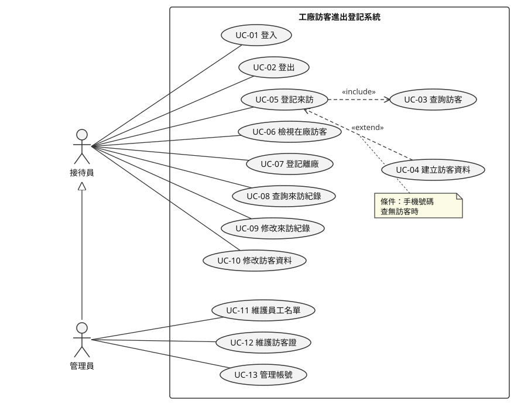
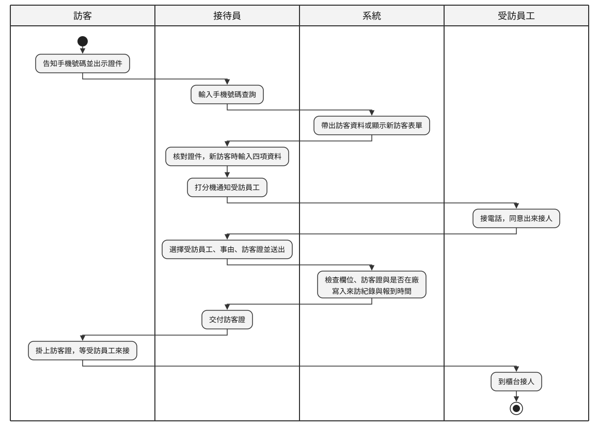
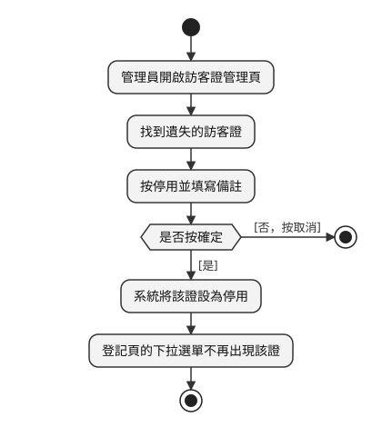

# 使用者分析

## 系統分析與設計（IE226）115-1

授課教師：呂卓勲

本課程教材：[GitHub](https://github.com/billy1125/system-analysis-and-design)

---

## 系統失敗，常常不是程式寫壞

多數失敗的資訊系統，是一開始就搞錯了「誰要用、用來做什麼」。

- 只問主管、沒問接待員：報表漂亮，門口卻大排長龍
- 只問接待員、沒想到工安與環安人員：疏散時要的在廠名單只在櫃台電腦上

> **分析階段的第一項工作，是把「人」與「事」看清楚。**

---

## 本章的順序

1. 利害關係人分析：誰會受系統影響
2. 需求收集方法：用什麼方法問
3. 使用者分析：這些人是什麼樣的人
4. 使用案例圖：誰要用系統做什麼
5. 流程分析：這些事現在怎麼一步步做完

順序不能顛倒，後一項建立在前一項之上。

---

## 本章的例子

- 期末示範系統「工廠訪客進出登記系統」的現行版 `SAD-Visitor`
- 接待員登記訪客進出、收發訪客證；管理員維護員工名單、訪客證與帳號
- 訪客與受訪員工不操作系統，系統也不連接任何外部系統

分析結果對照同一套系統的「系統分析完整報告」，照期中九項寫成，以下簡稱「訪客系統報告」。

---

# 一、為什麼分析要從人開始

資訊系統是給人用的。這句話聽起來像廢話，卻是整個分析階段的出發點：系統要做成什麼樣子，只能回到需要它的人身上去問。

本節先說明為什麼沒有一套系統與人無關，再列出從人開始的三個理由。

---

## 全自動的系統也和人有關

無人搬運車、視覺檢測設備、半夜自己跑的月結批次，過程中確實沒有人動手。

但要自動化哪一段、判定標準怎麼設、出狀況誰接手，都是人決定的。

> **自動化取消的是人的操作動作，取消不了人的目的。**

---

## 系統的價值由人給定

- 做得出來卻沒人需要：上線後被繞過去
- 做得到但不合期望：被抱怨、被消極抵制
- 兩者的結局都一樣：停用，或大家改用 Excel 私下作業

> **系統的價值由使用它的人給定，不是由功能數量給定。**

---

## 從人開始的三個理由

| 理由 | 例子 |
|---|---|
| 需求的正確性取決於問對人 | 只問廠長，只會得到報表需求 |
| 同一件事在不同人眼中是不同問題 | 「訪客管理很亂」：工安是名單不準，總務是證找不到，受訪員工是只能等電話 |
| 願不願意用決定成敗 | 新做法不比舊做法省事，現場就會繞過系統 |

> 需求來自人，需求收集過程中的典型困難幾乎都是溝通問題而非技術問題

---

# 二、利害關係人分析

利害關係人比「使用者」的範圍寬：不會碰畫面的人，也可能是關鍵的利害關係人。受訪員工沒有帳號、不碰系統，但訪客到了，他只能等接待員打分機來通知。

本節說明怎麼找出利害關係人、怎麼分類、怎麼釐清權責，最後整理利害關係人到底是哪些人。

---

## 利害關係人是誰

> **只要會影響系統，或會被系統影響，就是利害關係人。**

不管他碰不碰畫面。

---

## 找出利害關係人的四個步驟

| 步驟 | 訪客系統找到的對象 |
|---|---|
| 分析專案文件 | `README.md` 寫明的接待員、管理員，以及不登入的受訪員工與訪客 |
| 腦力激盪 | 工安與環安人員：疏散時要清點在廠訪客 |
| 客戶分析 | 採購訪客證的總務人員：訪客證遺失要補購 |
| 製作表單 | 逐一寫出每個人受影響的方式 |

越後面找到的人，越容易被漏掉。

---

## 期中：沒有人可以訪談怎麼辦

期中分析既有系統，沒有立案文件，也沒有人可以訪談。把作業流程從頭走一遍，逐一問四個問題：

| 問題 | 訪客系統的答案 |
|---|---|
| 誰輸入資料？ | 接待員（訪客、來訪、離廠）、管理員（員工、訪客證、帳號） |
| 誰查看資料？ | 接待員、管理員；工安與環安人員需要卻看不到 |
| 誰維護系統？ | 基本資料由管理員維護；系統本身由誰維護，報告中沒有 |
| 誰為結果負責？ | 接待員與管理員，各自負責自己登記與維護的資料 |

---

## 找齊之後分成兩張表

| 表 | 收哪些人 | 欄位 |
|---|---|---|
| 使用者 | 會直接操作畫面的人 | 角色、使用目標、主要需求、權限範圍、最在意什麼 |
| 利害關係人 | 不碰畫面，但影響系統或被影響的人 | 利害關係人、是否操作系統、受影響的方式 |

---

## 「是否操作系統」答「否」的那幾列

> **不碰系統卻被系統影響的角色最容易被漏掉，漏掉他就漏掉他那一整組功能。**

- 工安與環安人員：疏散時要靠在廠名單清點，名單卻只在櫃台電腦上
- 訪客：完整身分證字號被存進系統；持護照的外籍訪客無法建檔（I-03、I-05）

---

## 利害關係人的分類：所在位置 × 職能

| 所在位置 | 職能 | 訪客系統的對象 |
|---|---|---|
| 內部（internal） | 操作類型 | 接待員、管理員、受訪員工 |
| 內部（internal） | 管理類型 | 工安與環安人員、總務人員、廠長 |
| 內部（internal） | 技術類型 | （報告中沒有） |
| 外部（external） | 操作類型 | 來送貨、維修、開會的訪客 |

技術類型是空的：系統沒有備份機制，也找不到由誰維護。空格提醒你追問系統壞了找誰。

---

## 利害關係人的分類：影響力 × 受影響程度

| | 受影響程度低 | 受影響程度高 |
|---|---|---|
| **影響力高** | 維持滿意：廠長 | 密切管理：管理員 |
| **影響力低** | 最低限度關注：訪客所屬的公司 | 充分告知：大門接待員 |

右下這一格最常被跳過，也是上線後抗拒最強的來源。

---

## 用 RACI 釐清權責

| 代號 | 角色 | 例：訂定未交回訪客證時由誰追蹤 |
|---|---|---|
| R | 實際執行的人 | 起草規定的管理員 |
| A | 簽核負責的人，只能有一位 | 核准規定的廠長 |
| C | 事前諮詢的人 | 接待員、工安與環安人員 |
| I | 事後告知的人 | 受訪員工 |

「A 只能有一位」強迫你在動工前找出能做決定的人。

---

## 小結：利害關係人是哪些人

| 類型 | 訪客系統 |
|---|---|
| 會操作系統的人 | 接待員、管理員 |
| 不操作系統，但會影響系統 | 決定系統要不要修改的廠長 |
| 不操作系統，但被系統影響 | 訪客、受訪員工、工安與環安人員 |

最容易漏掉的是後兩種。本節的方法都是用來把這三種人找齊的。

---

# 三、需求收集方法

找出利害關係人之後，要決定用什麼方法向他們取得資訊。方法的選擇取決於對象是誰，也取決於你想知道的是「為什麼」還是「有多少」。

本節介紹質化與量化兩類方法，最後說明本課程報告能用到哪些。

---

## 質化方法：理解「為什麼」

| 方法 | 在訪客系統中的應用 |
|---|---|
| 訪談 | 問接待員受訪員工沒接電話時實際怎麼處理 |
| 觀察 | 看訪客實際怎麼離開、有沒有交回訪客證 |
| 文件分析 | 讀 `README.md`、資料表結構與種子資料 |
| 焦點團體 | 找接待員、管理員、工安與環安人員確認名單要多準 |
| 個案研究 | 研究同業導入訪客管理系統的做法 |

---

## 觀察比訪談更接近實際

接待員可能會說：「訪客離開都會交回訪客證。」

但種子資料裡，11/2 報到的陳俊宏到現在仍顯示在廠。說的和資料對不上，就要到大門看。

> **只靠訪談會得到應該怎麼做，加上觀察才會得到實際怎麼做。**

---

## 量化方法：確認「有多少、多嚴重」

- 包括問卷調查、相關分析與實驗
- 例：統計報到超過一天、離廠時間仍為空的來訪占全部來訪多少
- 數字能說明問題多嚴重，也能當改善後的比較基準

先以質化方法發現問題，再以量化方法驗證規模。

---

## 本課程的限制

兩次報告都沒有真實現場，也沒有真的使用者可以訪談或發問卷。

| 報告 | 能用的方法 |
|---|---|
| 期中 | 以文件分析為主：原始碼、`README.md`、`document/` 系統文件 |
| 期末 | 以操作系統、讀 `README.md` 與修改需求提案書為主；現場情境依提案書推想 |

---

# 四、使用者分析

利害關係人回答「誰被影響」，使用者分析進一步回答「這些人是什麼樣的人、在什麼情境下操作系統」。整天守在櫃台、尖峰時段一邊核對證件一邊打分機的接待員，和偶爾才維護員工名單與訪客證的管理員，需要的完全不同。

本節先做使用者分群與角色表，再介紹可選做的人物誌。

---

## 分群依據是與系統互動的方式

> **分群不依職稱，依與系統互動的方式。**

下列任一項不同，就分成不同族群：

- 使用的功能
- 操作頻率
- 所處環境

---

## 訪客系統的使用者分群

| 使用者群 | 使用頻率 | 操作情境 | 主要關切 |
|---|---|---|---|
| 接待員 | 每位訪客進、離廠各一次 | 櫃台電腦，尖峰時段好幾位同時到 | 動作要快 |
| 管理員 | 員工、訪客證、帳號變動時 | 同一台櫃台電腦 | 基本資料正確 |
| 受訪員工 | 不操作 | 自己的座位 | 訪客到了有人通知 |
| 工安與環安人員 | 不操作，疏散時要名單 | 不在櫃台 | 拿得到正確名單 |

---

## 分群表會變成設計約束

- 接待員「動作要快」→ NFR-03：來訪登記在單一頁面完成，不換頁
- 工安與環安人員「不在櫃台」→ 名單只在櫃台電腦上，是一個沒被滿足的需求

分群表適合分析時先整理，不一定要放進報告。

---

## 放進報告的是角色表（1/2）

| 角色 | 使用目標 | 主要需求 |
|---|---|---|
| 接待員 | 讓訪客快速登記進廠，並掌握廠內有誰 | 查詢與建立訪客、登記來訪與離廠、查詢與修改來訪紀錄、修改訪客資料 |
| 管理員 | 維護系統的基本資料 | 接待員的全部需求，加上員工名單、訪客證與帳號的維護 |

---

## 放進報告的是角色表（2/2）

| 角色 | 權限範圍 | 最在意 |
|---|---|---|
| 接待員 | 不能維護員工名單、訪客證與帳號 | 尖峰時段要快，早上八點多常有好幾位訪客同時到 |
| 管理員 | 全部功能；不能停用自己或修改自己的角色 | 員工名單與訪客證的資料正確 |

出處：訪客系統報告〈2.1 使用者〉。

---

## 權限範圍要正反兩面都寫

> **可以做什麼寫一半，不能做什麼寫另一半，分號後面那半句才是重點。**

- 接待員「不能維護員工名單、訪客證與帳號」→ FR-04 選單依角色顯示
- 管理員「不能停用自己或改自己的角色」→ FR-18，保證永遠至少有一個可用的管理員

權限規則與流程對不上的地方，通常就是一個漏洞。

---

## 期末第一部分的角色表

照既有系統實際的角色寫，只要三欄：角色、使用目標、權限範圍；不操作系統但受影響的人列一行。

「期末範例報告」〈1.2〉把上面角色表的「主要需求」與「權限範圍」併成一欄，再把訪客、受訪員工、工安與環安人員寫成一行。

---

## 人物誌（補充，可選做）

人物誌是把一群使用者的共同特徵，濃縮成一個有名字的虛構人物。

- 期中與期末報告都不要求，各組自行決定要不要放
- 作用是讓團隊討論設計時有共同判準
- 與其爭論「系統畫面使用者看得懂嗎？」，不如問「如果有一個符合這個人物誌的真人他看得懂嗎？」。

---

## 人物誌範例：黃志成，52 歲，大門接待員

- **背景**：年資 15 年，負責大門日班，不太打字，有老花眼
- **目標**：訪客快速進廠、不要發錯訪客證、交班時在廠清單對得起來
- **困難**：早上八點多好幾位訪客同時到；擔心「輸錯了會不會被追究」
- **偏好**：照固定順序操作，不喜歡畫面跳來跳去

怕被追究的人，輸錯了會自己悄悄改掉；系統修改來訪紀錄正好不留原值（I-04）。

---

## 放了人物誌，就要對得上表

> **每一份人物誌都必須對應到使用者表或利害關係人表上的某個角色。**

- 內容要和表上的使用目標、權限範圍、最在意的事一致
- 不能憑空編一個和系統無關的人物
- 對不上表的人物誌，只會讓報告前後不一致

---

# 五、使用案例圖（重點）

使用者與利害關係人確認之後，下一步是用 UML 標準的使用案例圖，把「誰要用系統做什麼」畫出來。它不描述系統內部怎麼運作，是最適合拿去和不懂技術的使用者確認需求的一張圖。

這是期中三張圖的第一張，後面的活動圖與循序圖，都以它上面的每一個橢圓為題材。

---

## UML 是什麼

UML（Unified Modeling Language，統一塑模語言）是一套畫系統圖的標準符號，由 Object Management Group（OMG）制定與維護。

同一個符號在誰手上都代表同一個意思，分析人員、使用者與工程師看同一張圖，才不會各自解讀。

本課程用到的使用案例圖、活動圖與循序圖，都是 UML 的圖。

---

<style scoped>
table {
  font-size: 0.95em;
}
</style>

## 四個構成元素

| 元素 | 圖示 | 含義 |
|---|---|---|
| 參與者（Actor） | 人形 | 與系統互動的角色，可以是人或其他系統 |
| 使用案例（Use Case） | 橢圓 | 系統提供的一項完整功能 |
| 系統邊界 | 方框 | 框內是本系統負責的範圍 |
| 關係 | 連線 | 參與者與使用案例、或使用案例之間的關係 |

---

## 參與者是角色，不是個人

- 陳警衛與林警衛對系統做的事完全相同，就是同一個參與者「接待員」
- 王總務多了維護基本資料的能力，才另成一個參與者「管理員」
- 非人的對象也可以是參與者，例如外部系統；訪客系統沒有任何對外介接，圖上只有兩個人形

---

## 使用案例的命名

名稱寫成 **動詞加受詞**，從參與者角度看得懂的一件完整的事。

| ✅ 適當 | ❌ 不適當 | 為什麼 |
|---|---|---|
| 登記來訪 | 資料輸入 | 太籠統 |
| 檢視在廠訪客 | 按下查詢鈕 | 是操作步驟 |
| 登記離廠 | 離廠管理 | 看不出做了什麼 |
| 修改來訪紀錄 | 資料庫寫入 | 是系統內部實作 |

---

## 粒度：切多粗、切多細

> **判準：完成之後，參與者能不能就此離開系統去做別的事。**

- 「登記來訪」符合：交付訪客證，就轉頭處理下一位
- 例外一：被 «include» 的使用案例，例如「查詢訪客」
- 例外二：作為權限前提的使用案例，例如「登入」

---

## 三種關係

| 關係 | 用途 | 例子 |
|---|---|---|
| «include» | 一定會執行的步驟 | 「登記來訪」包含「查詢訪客」 |
| «extend» | 特定條件下才發生 | 查無訪客時，「建立訪客資料」延伸「登記來訪」 |
| 一般化（空心箭頭） | 一般與特殊 | 管理員是接待員的特殊化 |

---

## 一般化的三件事

- **子角色不重畫父角色的連線**，只連自己多出來的使用案例
- **一般化可以串成多層**：甲 ← 乙 ← 丙，能力逐層累加；訪客系統只有一層
- **不畫一般化也不算錯**，代價是重複的連線要畫出來

---

## 訪客系統的使用案例圖



---

## 讀這張圖

- 管理員一般化自接待員，只連多出來的 UC-11～UC-13
- UC-05 登記來訪 «include» UC-03 查詢訪客；UC-04 建立訪客資料 «extend» UC-05
- 邊界外沒有任何系統；受訪員工與訪客不操作，不畫在圖上

出處：訪客系統報告〈2.3 使用案例圖〉。

---

## 圖上看不出來的三件事

「UC-05 登記來訪」這個橢圓上只有四個字。看圖的人答不出來：

- 接待員要填哪些東西？
- 哪些情況系統會擋下來？
- 登記完之後系統裡留下了什麼？

圖呈現全貌與範圍，這些細節由 **使用案例敘述** 承載。

---

## 使用案例敘述的欄位

| 期中報告 | 欄位 |
|---|---|
| ✅ 建議（8 欄） | 編號與名稱、主要參與者、前置條件、觸發、主要流程、例外流程、後置條件、對應需求 |
| 有才寫 | 次要參與者 |
| 不必寫 | 簡要描述、利害關係人與目標 |

---

## 使用案例敘述的寫法提醒

- 編號寫成 `UC-01`、`UC-02`，兩位數固定寬度，指定後不再改
- 對應需求要等第 4 章整理出需求編號才填得上，最後回頭補

把系統當黑箱，只寫參與者做什麼、系統回應什麼。範例見訪客系統報告〈6.1〉與〈6.2〉。

---

## 期中的敘述建議寫法（1/2）

「主要流程」與「例外流程」兩欄本課程建議同學照下面的寫法，UML 沒有要求——這兩欄之後要拿去對照第 6 章的活動圖與循序圖。

**主要流程要編號，每一步寫明主詞是參與者還是系統**（UC-05 登記來訪）：

1. 接待員請求來訪登記頁　2. 系統回傳在職員工清單與可用訪客證清單　3. 接待員送出訪客資料與來訪資訊　4. 系統檢查欄位　5. 系統檢查訪客證已啟用且未被使用　6. 系統檢查訪客不在廠內　7. 系統寫入來訪紀錄　8. 系統回傳登記完成與訪客證編號

---

## 期中的敘述建議寫法（2/2）

**例外流程掛在步驟編號上**：

4a 必填未填或格式錯誤　5a 訪客證已停用　5b 訪客證已在使用中　6a 訪客仍在廠內

---

## 例外編號怎麼讀

對照上一頁的主要流程：

- `4a` 的 `4`：發生在第 4 步「系統檢查欄位」
- 同一步有兩種擋下來的理由，用 `a`、`b` 分開：第 5 步把「已停用」與「已在使用中」分開寫，就是 `5a`、`5b`
- 第 1 到 3 步沒有例外，就不會出現 `1a`、`2a`、`3a`

每一個編號都是一種系統要處理的情況。漏掉一個，就是有一種狀況上線後沒人管。

---

## 使用案例圖常見的畫法錯誤

| 錯誤 | 修正方向 |
|---|---|
| 橢圓之間用箭頭串成順序 | 順序寫在敘述裡，圖不表達時間 |
| 出現「按下確認」等橢圓 | 合併成完整目的 |
| 出現「寫入資料庫」 | 刪除，屬於設計階段 |
| 參與者寫「陳警衛」「總務課」 | 改成角色名稱 |
| 沒畫系統邊界 | 補上方框 |

---

## 使用案例圖的價值在於界定範圍

> **方框之內是這次要做的，方框之外不做。**

訪客系統的方框裡沒有「事前預約」與「通知受訪員工」，這兩件事系統就不處理。

客戶事後要求增加功能時，這張圖就是討論範圍變更的依據。

---

# 六、流程分析

使用案例圖畫出了誰要用系統做什麼，接著要看這些事現在是怎麼一步步做完的。流程裡需要系統協助的活動，都應該在使用案例圖上找得到對應；找不到，就代表圖上漏了。

本節說明現況與目標流程的差別、流程的四個要素、活動圖與泳道圖，再拿訪客系統報告的兩條流程示範，最後用事件表回頭核對。

---

## 現況流程與目標流程

- **現況流程（AS-IS）**：目前實際運作的方式，包含私下變通
- **目標流程（TO-BE）**：導入或修改系統後預期的運作方式

接待員打分機通知受訪員工，看似可以交給系統自動通知，但這通電話同時確認了受訪員工今天在、也願意見這個人。

> **改動任何一個步驟之前，先問清楚它現在為什麼存在。**

---

## 期中的現況流程

期中分析的是已經在運作的系統。

- 現況流程指的是 **系統目前實際的行為**，不是系統以外的紙本作業
- 走畫面上跑得出來的那條路，包含每個關卡怎麼擋下你
- 期中不畫 TO-BE；期末的 TO-BE 是修改後的流程，標出【新增】【改變】

---

## 流程的四個要素

| 要素 | 訪客進出流程中的例子 |
|---|---|
| 活動 | 查詢訪客、登記來訪、交付訪客證、登記離廠 |
| 角色 | 訪客、接待員、受訪員工 |
| 觸發與流向 | 訪客抵達大門櫃台後啟動；查無訪客時先建立訪客資料 |
| 資訊 | 輸入手機號碼、受訪員工、事由與訪客證，輸出報到時間與報到登記人 |

最容易漏掉的是 **分支**：受訪員工沒接電話怎麼辦？訪客沒交回訪客證就走了怎麼辦？

---

## 期中的流程欄位：先寫文字，再畫圖

```text
流程名稱：
主要角色：
觸發事件：
前置條件：
主要步驟：
例外情況：
完成後狀態：
```

期中至少兩條流程：主要角色一條、次要角色一條。期末第一部分只畫修改需求提案書提到的 1–2 條。

---

## 活動圖是什麼

**活動圖（Activity Diagram）** 是 UML 中描述流程步驟與走向的圖，期中的流程圖用的就是它。

| 符號 | 畫法 | 含義 |
|---|---|---|
| 起始節點 | 實心圓 | 流程的起點，只有一個 |
| 動作 | 圓角方框 | 一個步驟，寫成動詞加受詞 |
| 判斷節點 | 菱形 | 依條件選一條路走 |
| 結束節點 | 內含實心圓的空心圓 | 流程的終點，可以有多個 |

---

## 文字欄位怎麼畫成活動圖

| 文字欄位 | 在圖上畫成 |
|---|---|
| 主要步驟 | 由上而下的一串動作，順序照抄 |
| 例外情況 | 判斷節點，否的出線接「顯示：訊息原文」 |
| 完成後狀態 | 走到結束節點前的最後幾個動作 |

例外處理完：改一改就能成功的，拉回輸入；怎麼改都沒用的，直接結束。

---

## 泳道圖：加上泳道的活動圖

- 每個角色一條泳道，誰做的動作就畫在誰的泳道
- 期中分析既有系統時，**「系統」自己就是一條泳道**
- 只有使用者與系統兩方時，可以不加泳道

接下來先看來訪登記的泳道圖，再看訪客系統報告的兩條流程怎麼從文字畫成活動圖。

---

## 來訪登記與發證：泳道圖



---

## 泳道圖要看跨越的次數

每一次跨越泳道，就是一次交接，也是延遲與遺漏最容易發生的地方。

- 接待員打分機跨到受訪員工，受訪員工同意後再跨回來：兩次交接都不經過系統
- 受訪員工沒接電話時，訪客就站在櫃台等，怎麼處理沒有規範
- 系統那條泳道只做檢查、寫入與回應

---

## 來訪登記與發證（文字）

- **主要角色**：接待員；**次要角色**：訪客、受訪員工（皆不操作系統）
- **觸發事件**：訪客抵達大門櫃台；**前置條件**：接待員已登入
- **主要步驟**：輸入手機查詢訪客 → 帶出或建立訪客資料 → 打分機通知受訪員工 → 選擇受訪員工、事由與訪客證 → 送出 → 發給訪客證
- **例外情況**：查無訪客、欄位格式錯誤、訪客證已停用、訪客證已被使用、該訪客仍在廠內
- **完成後狀態**：建立一筆來訪紀錄，訪客證綁定這筆來訪

---

## 來訪登記與發證（活動圖）


---

## 文字欄位怎麼變成圖

| 文字欄位 | 在圖上變成什麼 |
|---|---|
| 主要步驟 | 由上而下的動作，順序不變 |
| 例外情況 | 六個判斷，「欄位格式錯誤」拆成兩個 |
| 例外的處置 | 格式、必填、訪客證已停用或已被使用：回到輸入；仍在廠內：直接結束 |
| 完成後狀態 | 最後的「寫入來訪紀錄與報到時間」 |

> **每一個例外都要在圖上找得到判斷，找不到就是漏了。**

---

## 管理員停用遺失的訪客證

- **主要角色**：管理員；**觸發事件**：發現某張訪客證遺失
- **主要步驟**：開啟訪客證管理頁 → 找到該證 → 按「停用」→ 填寫備註 → 系統更新狀態
- **例外情況**：在備註視窗按「取消」，不停用
- **完成後狀態**：該證的啟用旗標為 0，之後不出現在登記的下拉選單

只有管理員與系統兩方，畫成不帶泳道的活動圖；唯一的判斷是管理員按不按取消，系統本身沒有任何檢查。

---

## 停用遺失的訪客證（活動圖）



---

## 完成後狀態是交叉比對的入口

訪客系統報告〈3.3〉的完成後狀態：「之後不出現在登記的下拉選單」。

拿這句去試一張使用中的訪客證：停用 `V-05`，系統沒有提示，在廠清單上張家豪的訪客證仍顯示 `V-05`。

> **系統本身不做任何檢查的流程，就值得懷疑；試出來的就是一項分析發現。**

---

## 三種事件

| 類型 | 訪客系統 |
|---|---|
| 外部事件 | 訪客抵達大門櫃台；訪客交回訪客證 |
| 暫時事件 | 現行系統沒有。若交給系統：每日交班時列出非今日報到、仍未離廠的紀錄 |
| 狀態事件 | 現行系統沒有。例如訪客證出現「停用但仍在訪客身上」時提示 |

系統一律由使用者操作，不主動做任何事，所以只有外部事件。

---

## 事件表：回頭核對使用案例圖

| 事件 | 類型 | 系統回應 | 對應使用案例 |
|---|---|---|---|
| 訪客抵達大門櫃台 | 外部 | 寫入來訪紀錄與報到時間 | UC-05 登記來訪 |
| 訪客交回訪客證 | 外部 | 寫入離廠時間，訪客證回到可用 | UC-07 登記離廠 |
| 發現訪客證遺失 | 外部 | 將該證設為停用 | UC-12 維護訪客證 |
| 每日交班（現行沒有） | 暫時 | 列出非今日報到的在廠紀錄 | 找不到 |

找不到對應使用案例的那一列，代表這件事現在只能靠人工。

---

# 七、各項分析如何串接

本章的各項工具不是互不相干的文件，而是一條有明確傳遞關係的鏈：從利害關係人、需求收集、使用者輪廓，到使用案例、流程與事件，最後展開成需求規格。

串得起來的前提是每一環都對得上，而且編號一致。

---

## 一條傳遞的鏈

- 利害關係人清單 **決定要訪談誰**
- 需求收集方法 **決定資訊的品質**
- 使用者分群與人物誌 **決定參與者的劃分**
- 使用案例圖 **界定系統的範圍**
- 流程與事件表 **回頭核對使用案例圖**

使用案例圖上每個參與者，都要能在利害關係人清單中找到對應。

---

## 編號一致

| 編號 | 代表什麼 |
|---|---|
| UC-xx | 使用案例 |
| FR-xx／NFR-xx | 功能需求／非功能需求 |
| F-xx | 功能 |
| P-xx／I-xx | 反推的原本問題／分析後的現況問題 |

> **編號一經指定就不要再改，而且一律用固定寬度的兩位數。**

---

## 本章重點回顧

- 需求附著在人身上，分析的起手式是找人、問人、觀察人
- 利害關係人包含不操作系統、卻影響系統或被系統影響的人
- 影響力與受影響程度是兩件事，影響力低、受影響高的那一格最常被跳過
- 使用案例圖的價值在於界定範圍，事件表回頭核對它有沒有漏
- 現況流程的不合理處往往有隱藏的理由

---

## 下一章

本章處理的是「誰要用、要用來做什麼」。

下一章「系統需求分析」接著處理「系統要做到什麼程度才算合格」，把使用案例展開成可驗證的功能需求與非功能需求。
