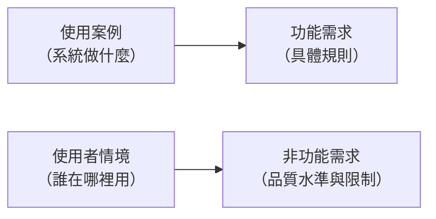

# 系統需求分析

「我們希望系統能即時看到生產進度」是一句期待，不是一項需求。它沒有說明「即時」是三秒還是三十分鐘、「進度」包含哪些欄位、資料由誰輸入、輸入錯了怎麼修正、同時有多少人查詢時系統還撐不撐得住。你不在分析階段回答這些問題，它們就會在開發階段由工程師各自猜測，最後在驗收階段發現系統實際狀況和使用者所想的有很大差異。

**本章介紹的是怎麼寫系統需求規格（System Requirements Specification, SRS）**——一份詳細描述並規範系統需求的文件，是系統分析最重要的產出，也是後續設計、開發與驗收的共同依據。

**這一章是系統分析中最重要的部分。** 前面問題定義與使用者分析的結果，都要落成一條條需求；後面的功能清單與使用案例敘述，都要回頭填「對應需求」。需求寫錯或寫漏，後面每一項分析都會跟著錯。

而且合約一定會依據雙方認定的需求書內容核對。你做的系統收不收得到錢，就看當初你和客戶談好的需求有哪些。分析不出合適的需求，客戶不滿意；不小心訂出一條模糊的需求，或是與實際差異過大、根本做不出來的需求，賠錢的是你。

系統需求分析要做的，就是把「期待轉換成 **可驗證** 的敘述」，再把這些敘述寫進 SRS。每一條需求都能在系統做出來之後，可以依照實際狀況標註「符合」或「不符合」，沒有第三種答案。SRS 的主體是兩份清單，本章也依此分成兩個主軸：

1. 功能需求回答「系統要做什麼」。
2. 非功能需求回答「要做到什麼程度、在什麼限制下做」。

前者決定系統有沒有用，後者決定系統能不能用。

> **前情提要**：本章假設你已完成[「使用者分析」](03-User-Analysis.md)所述的利害關係人、流程與使用案例分析。本章的例子取自工廠訪客進出登記系統 `SAD-Visitor`：一間電子零件廠大門櫃台現行的系統，原始碼在 `05-Final-Project-Topics/Example-Systems/SAD-Visitor/`。需求編號沿用同一套系統的[「系統分析完整報告」](../04-Final-Project-Example-Reports/Visitor-System-Full-Analysis.md)（FR-01 到 FR-18、NFR-01 到 NFR-06），以下簡稱「訪客系統報告」。

> **延伸閱讀**：需求清單在各組報告中的繳交格式與最低標準，見[「系統分析範例報告說明」](../02-Midterm-Project-Example-Reports/Analysis-Phase-Deliverables.md)〈三、4〉。

> **對應範例報告**：本章講的是期中第 4 項〈4.1 功能需求〉與〈4.2 非功能需求〉怎麼寫，分別對應本章〈二〉與〈三〉；成品見[「系統分析完整報告」](../04-Final-Project-Example-Reports/Visitor-System-Full-Analysis.md)與[「系統分析範例報告」](../02-Midterm-Project-Example-Reports/Analysis-Phase-Sample-Report.md)的第 4 章。這兩節的需求編號還會被〈5.2 功能清單〉與〈6.1〉〈6.2〉使用案例敘述的「對應需求」欄引用，對應本章〈5.2〉與〈1.3〉。期末第一部分只列與修改有關的需求，第二部分把修改方向寫成變更需求、再落回需求清單，見[「修改需求與變更規格」](09-Change-Specification.md)〈二〉〈三〉〈六〉。

> **必讀標記**：標題後加註 🔴 期中必讀 的小節，是期中小組報告九項產出直接會用到的內容；加註 🔵 期末必讀 的，是期末報告直接會用到的。判準與成品的樣子，期中見[「系統分析範例報告說明」](../02-Midterm-Project-Example-Reports/Analysis-Phase-Deliverables.md)與[「系統分析範例報告」](../02-Midterm-Project-Example-Reports/Analysis-Phase-Sample-Report.md)，期末見[「期末範例報告」](../04-Final-Project-Example-Reports/Final-Phase-Sample-Report.md)。未標記的小節仍屬課程範圍，只是報告不會直接產出。

## 一、從期待到需求 🔴 期中必讀

### 1.1 需求的五個級別

需求不是同一個層次的東西堆在一起。從最抽象到最具體，可分為五個級別：

| 報告要有 | 級別 | 回答的問題 | 訪客登記系統的例子 |
|---|---|---|---|
| ✅ | 商業需求（Business Requirements） | 公司為什麼要投資這個專案 | 發生緊急狀況時，要能確認廠內還有多少外人（P-02） |
| ✅ | 利害關係人需求（Stakeholder Requirements） | 各方各自期待得到什麼 | 工安與環安人員在緊急疏散時需要在廠訪客名單；接待員希望尖峰時段要快，早上八點多常有好幾位訪客同時到 |
| ✅ | 功能需求（Functional Requirements） | 系統要提供哪些能力 | FR-11 系統應列出所有在廠的訪客，並顯示在廠人數與隨行人數合計 |
| ✅ | 非功能需求（Non-functional Requirements） | 這些能力要達到什麼水準、受什麼限制 | NFR-03 來訪登記應在單一頁面完成，不換頁 |
| | 過渡需求（Transition Requirements） | 從現況切換到新系統需要什麼 | 系統取代紙本登記簿時，要先建好員工名單與 20 張訪客證的資料，並教會接待員操作 |

「報告要有」打勾的四個級別，是期中報告必定要寫出來的內容。上表前四列的例子取自[「系統分析完整報告」](../04-Final-Project-Example-Reports/Visitor-System-Full-Analysis.md)，分別寫在〈1.3 原本要解決的問題〉、〈2.1 使用者〉與〈2.2 利害關係人〉、〈4.1 功能需求〉、〈4.2 非功能需求〉，期中的[「系統分析範例報告」](../02-Midterm-Project-Example-Reports/Analysis-Phase-Sample-Report.md)也寫在同樣的位置。過渡需求那一列是示範，報告裡沒有這一級。

這個層級關係決定了兩件事。第一，**下層需求必須能追溯到上層**。一項功能需求若對應不到任何一項商業需求或利害關係人需求，你就要問它為什麼存在，那通常是有人「順便」加進來的。第二，**過渡需求最常被遺漏**。資料轉換、教育訓練、新舊系統並行期間的作業方式，這些工作在專案末期才發現時，往往已經沒有時間與預算可以安排。

### 1.2 需求工程的四個階段

處理需求的整套過程稱為 **[需求工程](https://zh.wikipedia.org/wiki/需求工程)（Requirements Engineering, RE）**，分四個階段：

| 階段 | 工作內容 | 產出 |
|---|---|---|
| 需求收集 | 確定並蒐集來自不同來源的需求資訊 | 訪談紀錄、觀察筆記、問卷統計 |
| 需求分析 | 提煉、研判與審查已收集的資訊，找出其中的錯誤、矛盾、遺漏或不足 | 需求清單、使用案例、分析模型 |
| 需求描述 | 以標準格式描述系統需求 | 系統需求規格（SRS） |
| 需求驗證 | 審查需求是否正確且完整地表達使用者的需要，並取得客戶確認 | 經簽核的 SRS |

四個階段不是一次走完的直線，而是反覆疊代：驗證時發現遺漏，就退回收集；分析時發現矛盾，就再訪談一次。上一章的工作屬於前兩個階段，本章則集中在「描述」與「驗證」——把已經理解的需要，寫成能被檢查的文字。

### 1.3 使用案例與需求的關係 🔴 期中必讀

上一章畫出的使用案例圖界定了系統範圍，但它本身還不是需求規格。兩者的分工是：

以 UC-05「登記來訪」這個使用案例為例，展開後會得到一組功能需求（FR-06 到 FR-10：新訪客要填哪些欄位、受訪員工從哪裡選、訪客證怎麼檢核、仍在廠內的訪客能不能再登記），以及非功能需求（NFR-03：整個登記在單一頁面完成）。**一個使用案例通常展開成 5 到 15 條功能需求**。你只展開出一兩條，多半是使用案例的 **粒度**（granularity，指一個項目切得多粗或多細）切得太細；展開出五十條，則是那個使用案例應該再拆分。

## 二、功能需求 🔴 期中必讀 🔵 期末必讀

**功能需求描述系統必須提供的行為：在什麼條件下、接收什麼輸入、執行什麼處理、產生什麼輸出。** 判斷一項敘述是不是功能需求，最簡單的方法是問：它描述的是「系統會做的一件事」嗎？

### 2.1 功能需求的來源 🔴 期中必讀 🔵 期末必讀

功能需求有四個來源，你逐一盤點可大幅降低遺漏：

| 來源 | 說明 | 例子 |
|---|---|---|
| 使用案例展開 | 每個使用案例的主要流程與例外流程 | UC-05 的查詢訪客、選擇受訪員工與訪客證、檢查訪客證未被使用、檢查訪客不在廠內 |
| 事件表 | 每個事件對應的系統回應，特別是暫時事件與狀態事件 | 訪客交回訪客證，系統回應的是登記離廠（FR-12） |
| 資料的生命週期 | 每一類主要資料的新增、查詢、修改、刪除與封存 | 員工名單、訪客證、帳號的維護功能（FR-16 到 FR-18） |
| 法規與公司規章 | 外部要求轉成的系統行為 | 個人資料保護法對訪客個資蒐集目的與保存期限的規定 |

第三項最常漏。分析時你的注意力都在主要交易流程上，很容易忘了「誰來維護訪客證清單」這類支援性功能，結果系統上線時發現新增一張證還要請工程師改資料庫。

**第四項在這一題特別重要。** 訪客登記系統蒐集的是外部人士的個人資料，個人資料保護法對蒐集目的與保存期限的規定會直接變成系統行為——不是「最好做一下」，是不做就違法。`SAD-Visitor` 存了完整的身分證字號，卻沒有任何保存期限的規定，[「系統分析完整報告」](../04-Final-Project-Example-Reports/Visitor-System-Full-Analysis.md)把它寫成問題 I-03 與〈9.2〉建議二。你的題目如果碰到工安、品質稽核或勞動法規，同樣要把法條翻譯成需求。

上面四個來源適用於系統還沒做出來的時候。**分析一套已經在運作的系統時（期中，以及期末第一部分），需求不是問出來的，是從系統本身查出來的**，來源換成另外四種證據：

| 證據型別 | 你要去看什麼 | 在資料庫或畫面上看到的內容 | 推出來的需求長什麼樣 |
|---|---|---|---|
| 系統畫面 | 每個頁面上有哪些欄位、按鈕、清單，哪些依身分而不同 | 用接待員帳號登入，看到四項選單；用管理員帳號登入，多出「員工名單」「訪客證」「帳號」三項 | FR-04 登入後應進入在廠訪客清單，選單依角色顯示可用功能 |
| 操作路徑 | 一個按鈕按下去會到哪一頁、出現什麼，哪些網址不登入就打不開 | 在來訪明細頁按「修改」，只有事由、受訪員工、隨行人數、車牌與備註五個欄位可以編輯 | FR-14 接待員可修改來訪紀錄的事由、受訪員工、隨行人數、車牌與備註，報到與離廠時間不可修改 |
| 資料欄位 | 資料表有哪些欄位、預設值是什麼、哪一欄有唯一限制 | 在在廠訪客清單按「離廠」之後，`visits` 資料表的 `check_out_at` 與 `checkout_by` 兩欄寫入離廠時間與登記人 | FR-12 接待員可登記離廠，系統記錄離廠時間與登記人，並釋出訪客證 |
| 錯誤訊息 | 故意做錯，把系統回給你的每一則訊息原文抄下來 | 新訪客表單的三則訊息：「請輸入訪客姓名」「手機號碼格式錯誤，須為 09 開頭的 10 碼數字」「身分證字號格式錯誤，須為 1 個英文字母加 9 個數字」 | FR-06 查無訪客時，接待員可建立新訪客，姓名、公司、手機、身分證字號皆為必填 |

四種證據裡，**錯誤訊息的產出效率最高**。順利完成一次操作，你只知道系統做得到這件事；被擋下一次，你知道的是系統認為什麼情況不合法，而那才是規則。所以分析既有系統時，把每個欄位留空送出、填錯格式送出、用沒有權限的身分去點，是必做的功課。

### 2.2 功能需求的寫法 🔴 期中必讀 🔵 期末必讀

一條功能需求應包含 **條件、主體、行為、對象** 四個成分，並使用「應（shall）」表示強制要求：

> **FR-05**　系統應能以手機號碼查詢訪客，查到多筆時列出讓接待員選擇。

這條需求取自[「系統分析完整報告」](../04-Final-Project-Example-Reports/Visitor-System-Full-Analysis.md)〈4.1〉，把條件（查到多筆時）、主體（系統）、行為（以手機號碼查詢、列出讓接待員選擇）、對象（訪客）都寫明了，因此可以直接轉成測試案例。對照下面這種常見的寫法：

> ❌ 系統要能處理查到多筆訪客的情況。

「處理」是什麼意思？自動帶出最近的一筆？顯示錯誤要接待員改用別的條件？列出讓人選？三種做法都符合這句話，但對接待員的影響完全不同。驗收時客戶說不對，開發團隊說有做，爭議就從這裡開始。

### 2.3 功能需求清單的範例 🔴 期中必讀 🔵 期末必讀

以 `SAD-Visitor` 的使用案例 UC-05「登記來訪」展開的功能需求。編號與敘述取自[「系統分析完整報告」](../04-Final-Project-Example-Reports/Visitor-System-Full-Analysis.md)〈4.1〉，來源對照的是同一份報告〈6.1〉的使用案例敘述：

| 編號 | 需求敘述 | 來源 |
|---|---|---|
| FR-07 | 接待員可登記來訪，填寫受訪員工、事由、隨行人數、車牌、備註並選擇訪客證，送出即記錄報到時間 | UC-05 主要流程第 3、7 步 |
| FR-08 | 受訪員工只能從在職員工中選擇 | UC-05 主要流程第 2 步 |
| FR-09 | 訪客證只能選擇啟用中且未被使用的證，送出時須再檢查一次 | UC-05 主要流程第 2、5 步；例外流程 5a、5b |
| FR-10 | 同一筆訪客資料仍在廠內時，不得再登記新的來訪 | UC-05 主要流程第 6 步；例外流程 6a |

FR-09 值得注意：一條需求對到使用案例的兩個步驟。第 2 步系統只列出可用的證，第 5 步送出時再查一次。只看畫面會以為第 2 步就夠了，但清單是打開頁面當下的狀態，送出之前那張證可能已經被發出去，例如另一位接待員剛好選了同一張，例外流程 5b「訪客證已在使用中」處理的就是這種情況。**逐步對照使用案例的主要流程與例外流程，才找得到這種畫面上看不見的檢查。**

FR-10 也值得單獨看：它是 **硬性擋下**，訪客仍在廠內就不能再登記。問題是「在廠」只看離廠時間是否為空，訪客忘了登記離廠，那筆紀錄就一直算在廠。種子資料裡 11/2 進廠、沒有登記離廠的陳俊宏再來時，會被這條擋住，接待員只能先替 11/2 那筆按「離廠」，離廠時間就變成按下去的當下（訪客系統報告〈3.1〉與 I-01）。訪客系統報告〈9.2〉建議一沒有主張放寬 FR-10，而是讓補登離廠時寫得進實際離開的時間。**「擋下」與「放行」之間還有第三個選項：讓它通得過，但要留下痕跡，而那個選項通常最貼近現場。** 期末修改時怎麼把這種選項寫成需求，見[「修改需求與變更規格」](09-Change-Specification.md)〈六〉。

上表的「來源」欄說明需求從使用案例的哪一步展開。分析既有系統時，報告裡這一欄要換成 **「依據」**，內容是你在系統上查到的證據，回答的是「你怎麼知道系統有這條」。訪客系統報告〈4.1〉的寫法：

| 編號 | 需求敘述 | 依據 |
|---|---|---|
| FR-02 | 系統應阻擋已停用的帳號登入 | 以停用的種子帳號 `guard03` 實測，顯示「此帳號已停用，請洽管理員」 |
| FR-08 | 受訪員工只能從在職員工中選擇 | 下拉選單中沒有已離職的許文傑 |
| FR-09 | 訪客證只能選擇啟用中且未被使用的證，送出時須再檢查一次 | 下拉選單中沒有 `V-03`、`V-05`、`V-06`、`V-07` |
| FR-18 | 管理員可新增帳號、設定角色、啟用或停用帳號，但不得停用自己或修改自己的角色 | 帳號管理頁；對自己操作時的兩則錯誤訊息 |

FR-08 與 FR-09 在兩張表都出現：上一張的「來源」寫它從 UC-05 哪一步展開，這一張的「依據」寫它在系統上的證據。

**「依據」這一欄是期中報告的評分重點，也是訪談時最容易被追問的地方。** 有了它，讀者才分得出哪幾條是你查到的、哪幾條是你想像的。填不出依據的需求只有兩種可能：一種是這個功能根本不存在，你把「應該要有」誤當成「已經有」；另一種是它存在，但你還沒找到它在哪裡，那就回去找。兩種都不能留著不管。

## 三、非功能需求 🔴 期中必讀 🔵 期末必讀

**非功能需求描述系統的品質水準與必須遵守的限制，不描述系統做什麼，而描述系統做得如何。** 它們是系統上線後最常被抱怨的部分：功能都有，但慢、當機、難用、資料被亂改，使用者一樣不會用。

### 3.1 FURPS+ 分類

實務上常用 **FURPS+** 模式盤點非功能需求。前五個字母各代表一類品質特性，加號代表各類約束：

| 類別 | 涵蓋內容 | 訪客登記系統的例子 |
|---|---|---|
| 功能（Functionality） | 能力、可重用性、安全性、利用度 | NFR-01 密碼不得以明文儲存 |
| 易用性（Usability） | 人因、美觀、一致性、說明文件、回應速度 | NFR-03 來訪登記應在單一頁面完成，不換頁 |
| 可靠度（Reliability） | 可用性、故障範圍與復原時間、可預測性、準確性 | NFR-05 時間一律記錄本機時間，精確到秒 |
| 效能（Performance） | 速度、效率、資源消耗、流通量、容量、可擴展性 | 訪客系統報告沒有列。接待員「尖峰時段要快」（訪客系統報告〈2.1〉）若要寫成需求，就要量化，見〈3.3〉 |
| 支援性（Supportability） | 可測試性、彈性、可安裝性、在地化 | 新增訪客證不需修改程式，由管理員在訪客證管理頁新增；訪客系統報告把它寫成功能需求 FR-17 |

加號部分是四類 **約束（constraints）** ——不是「做得多好」，而是「不准怎麼做」：

| 約束類型 | 說明 | 例子 |
|---|---|---|
| 設計約束 | 設計上的限制 | 權限檢查一律在伺服器端執行，不靠畫面隱藏選單 |
| 實作約束 | 程式碼或執行環境的限制 | 系統以 Node.js 執行，資料庫使用 SQLite，不需安裝其他套件 |
| 介面約束 | 與外部系統互通的要求 | `SAD-Visitor` 沒有外部介接，這一類從缺；如果要把與人資系統同步納入系統，才會出現這一類約束 |
| 實體約束 | 硬體或環境的限制 | 系統只能在櫃台這台電腦上使用，其他電腦連不進來 |

約束的特徵是它們幾乎都來自現場的物理條件與既有系統，而不是來自使用者的期望。這也是工業場域的系統與一般商業軟體最大的差別——粉塵、油污、手套、噪音、電磁干擾，這些都會變成系統的硬性限制。

### 3.2 另一套參考架構：ISO/IEC 25010

國際標準 [ISO/IEC 25010](https://zh.wikipedia.org/wiki/ISO/IEC_9126) 把軟體品質分為八個特性：功能適用性、效能效率、相容性、易用性、可靠性、資訊安全性、維護性、可攜性。它與 FURPS+ 大幅重疊，差別在於多獨立出「相容性」「資訊安全性」與「可攜性」三項。

實務上兩套擇一使用即可，重點不在採用哪一套，而在於 **有一份固定的檢查清單**。你逐項自問「這個系統在這個面向有沒有要求」；沒有清單，就只會想到效能與安全，其餘全部漏掉。

### 3.3 非功能需求必須量化

非功能需求最常見的毛病是寫成形容詞。下表的可驗證寫法是示範：假設要替訪客登記系統訂標準，`SAD-Visitor` 的報告裡沒有這些數值：

| ❌ 不可驗證 | ✅ 可驗證 |
|---|---|
| 系統反應要快 | 早上尖峰時段連續登記 8 位訪客時，每位自輸入手機號碼至顯示「登記完成」，95% 應在 60 秒內完成 |
| 系統要穩定 | 上班時段的月可用率應達 99.5%，即每月非計畫停機不超過 3 小時 |
| 介面要好用 | **未受過任何指導的接待員**，應能於 2 分鐘內獨立完成一位新訪客的建檔與登記，錯誤率低於 5% |
| 系統要安全 | 連續登入失敗 5 次應鎖定帳號 15 分鐘；所有來訪紀錄的修改須留存修改人、時間與原值 |

量化的方法是找出 **可以測量的指標、目標值與測量條件** 三者。「60 秒」是目標值，「自輸入手機號碼至顯示登記完成」是指標定義，「尖峰時段連續 8 位、95%」是測量條件。三者缺一，驗收時就會出現爭議。

易用性看起來最難量化，但上表第三列示範了做法：把它轉成一個可以實際執行的測試（找沒看過這套系統的人來操作，計時、計錯誤率）。凡是你設計得出測試方法的需求，就是可驗證的需求。

**量化的要求適用於你替一套還沒做出來的系統訂標準的時候。** 分析既有系統時，數值目標多半無從得知——沒有人告訴你當初把反應時間訂在幾秒，你量出來的數字也只是這一台機器此刻的表現。這種情況下，非功能需求要寫的不是數值，而是規則與不變條件，詳見〈3.5〉。期末修改既有系統也一樣：新增的非功能需求多半也是規則（見[「修改需求與變更規格」](09-Change-Specification.md)〈六〉），修改前後的數值目標寫在第 8 項效益評估（見[「效益評估與上線準備」](10-Benefit-and-Go-Live.md)〈二、效益評估〉）。

### 3.4 非功能需求之間會互相衝突

非功能需求不能各自獨立地訂到最高。常見的衝突包括：

- **安全性 vs 易用性**：`SAD-Visitor` 輸入手機就帶出訪客的姓名、公司與身分證字號，回頭訪客不必重填（P-04）；代價是每一位登入的接待員都看得到完整的身分證字號，來訪紀錄查詢結果也照樣顯示（I-03）。
- **效能 vs 成本**：反應時間要求從 2 秒降到 0.5 秒，可能需要升級全廠網路與伺服器，費用超過專案預算。
- **可靠度 vs 時程**：要求 99.99% 可用率意味著需要備援機制，開發時間會拉長數週。

處理方式是你把衝突攤開來，由具備決策權的當責者（見上一章的 RACI）在幾個方案之間選擇，再把選擇的理由記錄在需求文件中。**沒有記錄理由的取捨，半年後一定會被重新爭論一次。**

寫非功能需求時，還有一個寫法值得學：**每一條後面補一句「它砍掉了哪個看起來很自然的做法」。**

| 非功能需求 | 它否決了什麼 |
|---|---|
| 任一時點顯示的在廠清單，必須與當時的來訪紀錄一致 | 否決了「在訪客證表加一個是否使用中的欄位」——那個欄位查詢最快，但報到與離廠時兩邊都要改，漏改一次那張證就永遠發不出去，而且沒有任何錯誤訊息 |
| NFR-04 來訪紀錄不得刪除 | 否決了「登記錯了就刪掉重登」——刪掉的紀錄查不回來，事後說不出那位訪客到底來過沒有；登記錯的欄位只能用 FR-14 修改 |

**只列需求而不寫它砍掉了什麼，讀者看不出這條需求有什麼份量。** 這種「一條非功能需求否決一個做法」的關係，也是資料設計最主要的依據。第一列否決的做法，`SAD-Visitor` 確實沒有採用：「訪客證使用中」沒有欄位，由 `visits.check_out_at` 是否為空推導（訪客系統報告〈7.1〉）。第二列則在訪客系統報告〈9.2〉建議三被拿來對照：紀錄刪不掉，內容卻能被無痕改寫，兩者的意圖互相矛盾。

### 3.5 既有系統的非功能需求怎麼推 🔴 期中必讀 🔵 期末必讀

分析既有系統時，非功能需求不會寫在任何地方，也看不到畫面上。它們藏在一個地方：**同一個動作，在不同狀況下系統給了不同的回應。** 把那些差異擺在一起，規則就浮出來了。

方法是三個步驟：

1. **同一件事，換不同狀態做一次。** 在 `SAD-Visitor` 用正常的 `guard01` 登入一次、用被停用的 `guard03` 登入一次、用不存在的帳號登入一次、用 `guard01` 打錯密碼登入一次，各記下系統回了什麼。
2. **比較差異。** 帳號不存在與密碼打錯，訊息一模一樣，都是「帳號或密碼錯誤」；`guard03` 卻收到另一則「此帳號已停用，請洽管理員」，而且要密碼正確才會出現，密碼打錯一樣是「帳號或密碼錯誤」。
3. **問這個差異在保護什麼。** 帳號不存在與密碼打錯回同一則訊息，外人就無法藉此試出哪些帳號存在；帳號被停用單獨給一則訊息，是因為停用可以回復，告訴當事人去找管理員是合理的。這兩句話寫下來，就是兩條需求。訪客系統報告把停用的那一則寫成 FR-02，「回同一則訊息」沒有另外列；你的報告推得出來，就可以列成一條非功能需求。

推出來的需求，長相與量化型的很不一樣，多半是規則或不變條件。訪客系統報告〈4.2〉的例子：

| 編號 | 非功能需求 | 依據 |
|---|---|---|
| NFR-03 | 來訪登記應在單一頁面完成，不換頁 | 來訪登記頁的兩段在同一頁 |
| NFR-04 | 來訪紀錄不得刪除 | 所有畫面都沒有刪除來訪紀錄的按鈕 |
| NFR-05 | 時間一律記錄本機時間，精確到秒 | 資料表中時間欄位的格式 |

NFR-04 的依據是「找遍所有畫面都沒有」，不是某一個畫面上的東西；要把每一頁都看過，才寫得出這一條。

**這一類需求是整份需求清單裡最有價值的部分。** 功能需求人人抄得出來，因為畫面上有；這幾條要靠交叉比對才推得出來，寫得出來就代表你真的把系統操作過、而且想過為什麼。FR-18 的兩則錯誤訊息還能再往上推一層：管理員不能停用自己、不能修改自己的角色，系統又沒有刪除帳號的功能，所以最後一位可用的管理員沒辦法把自己移除，系統中永遠至少有一個可用的管理員。這個結論不對應任何一個畫面、任何一則訊息，是從幾條各自獨立的規則推導出來的。訪客系統報告把那兩條規則寫在 FR-18 裡，沒有另外列出這個結論；推得出這種不變條件，就值得單獨寫成一條。

推不出來的部分要誠實標示，不要硬掰。訪客系統報告〈1.3〉的「`employees.department` 是自由文字而非選單，看不出當初是刻意保留彈性，還是沒有考慮到部門名稱要統一，需訪談開發者才能確認」，就是這種寫法，比編一個理由有價值得多，被追問時也站得住。

**約束也可以寫進非功能需求，寫不寫由各組決定。** 約束是「不准怎麼做」的限制，分成設計、實作、介面、實體四類，定義見本章〈3.1〉。訪客系統報告的〈4.2 非功能需求〉沒有列約束，但既有系統一樣找得到。要寫的話，接在非功能需求之後另列一張表，每一條同樣附上依據。以 `SAD-Visitor` 為例：

| 編號 | 類型 | 約束 | 依據 |
|---|---|---|---|
| CON-01 | 設計約束 | 權限檢查一律在伺服器端執行，不靠畫面隱藏選單 | `server.js` 收到每一個請求都先檢查登入狀態與角色；接待員登入後在網址列直接開 `/api/admin/employees`，伺服器回覆「只有管理員可以使用這個功能」 |
| CON-02 | 實作約束 | 系統須以 Node.js 執行，資料庫須使用 SQLite，不需安裝其他套件 | `lib/db.js` 以 Node.js 內建的 `node:sqlite` 開啟 `database.db`；系統的 README 註明只需要 Node.js 22.13 以上 |
| CON-03 | 實體約束 | 系統只能在櫃台這台電腦上使用，其他電腦連不進來 | `server.js` 只接受本機連線（`127.0.0.1`）；資料庫檔 `database.db` 與程式放在同一個資料夾 |

`SAD-Visitor` 沒有任何外部介接，所以介面約束從缺。查過確認沒有的類別，寫一句話交代即可。

## 四、判斷需求品質的準則 🔴 期中必讀 🔵 期末必讀

無論功能或非功能需求，每一條都應通過下列六項檢查。正確寫法一欄取自[「系統分析完整報告」](../04-Final-Project-Example-Reports/Visitor-System-Full-Analysis.md)：

| 準則 | 含義 | 反例 | 正確寫法 |
|---|---|---|---|
| 正確 | 確實反映使用者的需要 | 把分析師自己的想像寫進去 | 只寫系統上查得到、或訪談裡找得到依據的內容，例如 FR-08「受訪員工只能從在職員工中選擇」，依據是下拉選單裡沒有已離職的許文傑 |
| 明確 | 只有一種解讀方式 | 「接待員可修改來訪紀錄」——哪些欄位改得動？ | FR-14：可修改事由、受訪員工、隨行人數、車牌與備註，報到與離廠時間不可修改 |
| 完整 | 不遺漏必要條件與例外情況 | 只寫成功情況，沒寫失敗怎麼辦 | 成功與失敗都要寫：FR-07 寫登記來訪，FR-09、FR-10 寫訪客證已被使用、訪客仍在廠內時不得登記 |
| 一致 | 不與其他需求矛盾 | 需求寫訪客證有一個「使用中」狀態欄，資料字典的 `visitor_passes` 卻沒有這一欄 | 「訪客證使用中」只有一個定義：有一筆離廠時間為空的來訪紀錄綁著它；FR-09 與〈7.7〉的訪客證狀態表都照它寫 |
| 可驗證 | 能設計出檢查方法 | 「時間要記得準」 | NFR-05：時間一律記錄本機時間，精確到秒，打開資料表看時間欄位的格式就驗得了 |
| 可追溯 | 能對應到上層需求與下游設計 | 來源不明、沒人知道為什麼要做的功能 | FR-10 往上連到實測依據（以在廠的陳俊宏登記，被擋下）與 UC-05 例外流程 6a，往下連到功能 F-23 |

實務上最有效的自我檢查是 **可驗證性**：寫完一條需求，立刻問自己「驗收時我要怎麼證明它有做到」。答不出來的，就是還沒寫好。

另外要留意幾個常見的措辭陷阱：

- **模糊量詞**：「快速」「大量」「友善」「適當」「必要時」——你一律要求對方給出數字或明確條件。
- **多重需求擠在一句**：「系統應記錄來訪資料並產生月報表且支援匯出 Excel」——這是三條需求，應拆開，否則無法逐項驗收。
- **把解法當需求**：「系統應使用下拉選單選擇受訪員工」——這規定了實作方式。除非有明確理由，否則應寫成「接待員應能從在職員工中選定受訪員工，不需知道對方的員工編號」，把設計空間留給設計階段。

最後這一條有個例外：**分析既有系統時，寫下它已經採用的做法，不算把解法當需求。** NFR-03「來訪登記應在單一頁面完成，不換頁」規定了畫面怎麼做，看起來像在指定實作方式，但它描述的是這套系統現在的事實，而且對得上接待員最在意的事：尖峰時段要快（訪客系統報告〈2.1〉）。差別在於時態：替新系統訂需求時，你不該替設計者決定怎麼做；描述既有系統時（期中，以及期末第一部分），你的工作正是把它怎麼做的寫清楚。

## 五、需求的優先順序與追溯

### 5.1 排優先順序

需求收集的結果幾乎一定超出預算與時程，因此排序是必經步驟。常用的 **MoSCoW** 分類法把需求分成四級。下表的分級是示範：假設要重新規劃訪客登記系統的範圍，把現行功能與訪客系統報告〈5.3〉的界外項目放在一起排，不是報告的結論：

| 等級 | 含義 | 訪客登記系統的例子 |
|---|---|---|
| Must have | 沒有它系統就沒有意義 | 登記來訪與發證、登記離廠、在廠訪客清單 |
| Should have | 重要，但短期可用人工替代 | 通知受訪員工（現在由接待員打分機） |
| Could have | 有更好，資源允許才做 | 報表匯出與列印 |
| Won't have (this time) | 這次明確不做 | 與人資系統同步 |

第四級的價值不亞於第一級。把「這次不做」白紙黑字寫下來並取得客戶認可，是控制專案範圍最有效的工具——它讓後續的追加要求成為一個需要重新討論資源的決策，而不是理所當然的補充。

排序時要注意：**每一個使用案例至少要有一條 Must have 的功能需求**，否則你就該重新檢討那個使用案例是否該留在系統範圍內。

**替新系統排序時，四個等級要收成一張取捨表，而且「延後」與「不做」要分開寫。**

延後的每一條寫四件事：

| 欄位 | 為什麼要寫 |
|---|---|
| 延後的需求 | — |
| 為什麼延後 | 通常是複雜度、時程，或某個前提還沒談定 |
| **延後的代價** | 說出這次放棄了什麼 |
| 什麼時候該做 | 什麼條件成立時要回頭處理它 |

**第三欄最常被跳過。** 只寫「這次不做」是逃避，寫出「不做會付出什麼代價」——隨行人員只記人數、不記姓名，緊急疏散時就不知道廠內有誰——才代表你知道自己在放棄什麼。`SAD-Visitor` 現在正是只記人數，訪客系統報告把它寫成問題 I-07。

**「延後」與「不做」混在一起寫，讀者會以為你只是做不完。** 延後代表認同這件事該做但這次排不進來；明確不做代表你評估過、認為不該做。兩者的理由性質完全不同，分開寫才看得出哪些是取捨、哪些是判斷。

**不做的理由可以是「不該做」，不只是「做不到」。** 這種以必要性為由的取捨，比「時間不夠」有份量得多。訪客系統報告〈9.2〉建議二就是這一類：系統沒有任何功能用到完整的身分證字號，比對訪客用的是手機，所以建議不再存完整號碼、只存末四碼。理由是用不到，不是做不到。

### 5.2 需求追溯矩陣

**追溯矩陣把每條需求往上連到它的來源、往下連到實作與測試**，用一張表維持整條鏈的完整。以[「系統分析完整報告」](../04-Final-Project-Example-Reports/Visitor-System-Full-Analysis.md)的兩條需求為例：

| 需求編號 | 依據 | 對應使用案例 | 對應功能 | 畫面與資料 |
|---|---|---|---|---|
| FR-09 | 下拉選單中沒有 `V-03`、`V-05`、`V-06`、`V-07` | UC-05 登記來訪 | F-23 登記來訪與發證 | 來訪登記頁；`visits.pass_id`、`visitor_passes.is_active` |
| NFR-04 | 所有畫面都沒有刪除來訪紀錄的按鈕 | UC-09 修改來訪紀錄 | F-43 修改來訪紀錄 | 來訪明細頁；`visits` |

既有系統沒有測試案例，矩陣往下只連到功能、畫面與資料；期末修改時，每一列才會再接上測試案例。

它有三個用途。需求變更時，你可以立刻查出會影響哪些設計與測試。驗收時，你可以證明每條需求都有對應的測試。專案結束後，後續維護人員能查出某項功能當初為什麼這樣做。

期末第 16 項需求追溯是這張矩陣的變形：每一列從變更需求出發，欄位是「變更｜需求｜流程｜資料｜畫面｜驗收」。

> **延伸閱讀**：第 16 項的追溯表怎麼做、交件前怎麼檢查，見[「系統設計規格與追溯」](13-Design-Specification.md)〈三、追溯鏈〉。

對課程專案而言，追溯矩陣不需要做得很正式，但 **「每條需求都要寫出來源」** 這件事你一定要做——這是分辨真實需求與想像需求最直接的方法。

### 5.3 需求驗證

需求寫完後要驗證，方法有三種，通常合併使用：

| 方法 | 做法 | 能抓到的問題 |
|---|---|---|
| 同儕審查 | 團隊與客戶共同逐條檢視 | 遺漏、矛盾、模糊 |
| 情境演練 | 拿實際情境走一遍需求，看是否走得通 | 流程斷裂、例外未涵蓋 |
| 原型驗證 | 做出畫面雛型讓使用者操作 | 使用者說不清楚、看到才知道不對的需求 |

第三項在工業場域效果最好。對沒有資訊背景的接待員而言，讀你十頁的需求文件不如摸三分鐘的雛型畫面——多數藏起來的需求，是在使用者實際操作雛型時才被講出來的。

驗證的結束標準是取得客戶正式確認。確認之後的變更，就走變更程序、重新評估時程與成本，而不是口頭答應。

## 六、系統需求規格

前面五節寫的都是 SRS 的內容，這一節回頭看整份文件的架構：除了功能需求與非功能需求兩份清單，還有哪些章節。SRS 同時具有三種身分：對客戶是驗收的標準，對開發團隊是實作的依據，對後續維護者是變更管理的基礎。

### 6.1 SRS 的內容架構

| 章節 | 內容 |
|---|---|
| 背景說明 | 系統開發的緣起與背景 |
| 系統目標 | 主要的開發目的與可衡量的執行目標 |
| 執行範圍概述 | 專案範圍（人力、時程、資料移轉、上線程序、教育訓練）與系統運作範圍（軟硬體規格、平台種類） |
| 系統架構 | 軟硬體環境架構，可用部署圖或系統關係圖（System Context Diagram）表達本系統與外部系統的關係 |
| 使用者需求 | 依需求調查結果，分別定義各利害關係人的需求 |
| 系統規格 | 功能需求與非功能需求的完整條列，輔以使用案例與領域模型 |

其中「執行範圍概述」對應到前面提過的過渡需求，是最常被寫得草率的一節；而「系統架構」中的系統關係圖，能一眼呈現本系統與 ERP、設備、外部單位之間的邊界，價值很高。

### 6.2 SRS 完成之後

SRS 完成並經確認後，系統分析階段的最後一項工作是擬定可行性方案。內容包括系統發展的優先次序、自行開發或委外的建置方式、軟硬體採購或租賃的選擇等。你與專案管理者確認過這些，才進入設計階段。

需要提醒的是，SRS 不是寫完就凍結的文件。需求會變——法規改了、客戶的產品線調整了、現場試用後發現原本的想法行不通。**SRS 的價值不在於它永遠正確，而在於它讓每一次變更都是一個被記錄、被評估、被決定的動作**，而不是走廊上的一句口頭交代。

> **延伸閱讀**：系統上線後的修改，怎麼把修改方向拆成變更需求、再在原有清單上標出新增、修改與刪除，見[「修改需求與變更規格」](09-Change-Specification.md)〈三、修改需求整理〉與〈六、修改後的需求與規格〉。

## 七、學習重點總結

讀完本章後，你應該能夠理解以下核心概念，並將其應用於工業場域的思考與決策：

**需求的層級決定了追溯的方向**

商業需求、利害關係人需求、功能需求、非功能需求與過渡需求構成一條由抽象到具體的鏈。你寫的任何一條功能需求，都應該能往上回答「這是為了達成哪個商業目標」，答不出來的功能就是應該被砍掉的候選。在資源永遠不足的實務環境裡，這條追溯鏈是判斷取捨的依據，而不只是文件格式的要求。

**可驗證性是需求品質的核心判準**

你的需求寫得好不好，最實際的檢驗方法是問「驗收時要怎麼證明它做到了」。這個問題會自動淘汰掉「快速」「友善」「穩定」這類形容詞，逼出指標、目標值與測量條件。這也是工業工程訓練的直接延伸——無法測量的東西無法管理，需求也不例外。

**非功能需求決定系統能不能用**

功能需求決定系統有沒有用，非功能需求決定系統能不能用。來訪登記如果要換三次頁才完成，功能完全正確，早上八點多同時來了好幾位訪客時，接待員一樣用不下去。FURPS+ 或 ISO/IEC 25010 這類分類架構的作用，是提供一份逐項盤點的檢查清單，避免團隊只想到效能與安全而漏掉易用性、支援性與各類約束。

**約束來自現場的物理條件**

工業場域的系統需求中，有一大部分不是來自使用者的期望，而是來自環境本身：粉塵、油污、手套、噪音、溫度、既有設備的介接方式。這些約束你無法在會議室裡想出來，只能到現場看見。它們也通常是不可協商的——使用者的期望可以取捨，攝氏 40 度的環境不會因為專案時程緊迫而降溫。

**取捨要被記錄，不做的事要寫下來**

非功能需求之間必然衝突，安全性與易用性、效能與成本、可靠度與時程都要取捨。做了決定卻沒有記錄理由，同一場爭論半年後會重演一次。同理，MoSCoW 中的「這次不做」比「一定要做」更需要白紙黑字——它讓後續的追加需求成為一個需要重新分配資源的正式決策，而不是有人在走廊上口頭答應了就算數。

> **銜接提示**：本章得到的是一份條列式的需求清單，下一章[「功能分析」](05-Functional-Analysis.md)把它重新組織成有邊界、有層次的功能結構，回答「這套系統的範圍到哪裡、由哪些功能組成」。

## 參考文獻

- Bass, L., Clements, P., & Kazman, R. (2012). *Software architecture in practice* (3rd ed.). Addison-Wesley.
- Boehm, B. W. (1984). Verifying and validating software requirements and design specifications. *IEEE Software*, *1*(1), 75–88. https://doi.org/10.1109/MS.1984.233702
- Boehm, B., & In, H. (1996). Identifying quality-requirement conflicts. *IEEE Software*, *13*(2), 25–35. https://doi.org/10.1109/52.506460
- Chung, L., Nixon, B. A., Yu, E., & Mylopoulos, J. (2000). *Non-functional requirements in software engineering*. Kluwer Academic Publishers.
- Cockburn, A. (2001). *Writing effective use cases*. Addison-Wesley.
- Cohn, M. (2004). *User stories applied: For agile software development*. Addison-Wesley.
- Davis, A. M. (1993). *Software requirements: Objects, functions, and states*. Prentice Hall.
- Dennis, A., Wixom, B. H., & Roth, R. M. (2018). *Systems analysis and design* (7th ed.). Wiley.
- Glinz, M. (2007). On non-functional requirements. In *Proceedings of the 15th IEEE International Requirements Engineering Conference* (pp. 21–26). IEEE. https://doi.org/10.1109/RE.2007.45
- Gottesdiener, E. (2002). *Requirements by collaboration: Workshops for defining needs*. Addison-Wesley.
- Hull, E., Jackson, K., & Dick, J. (2017). *Requirements engineering* (4th ed.). Springer. https://doi.org/10.1007/978-3-319-61073-3
- Institute of Electrical and Electronics Engineers. (1998). *IEEE Std 830-1998: IEEE recommended practice for software requirements specifications*. IEEE.
- International Organization for Standardization. (2011). *ISO/IEC 25010:2011 Systems and software engineering — Systems and software Quality Requirements and Evaluation (SQuaRE) — System and software quality models*. ISO.
- International Organization for Standardization. (2018). *ISO/IEC/IEEE 29148:2018 Systems and software engineering — Life cycle processes — Requirements engineering*. ISO.
- Jackson, M. (1995). *Software requirements & specifications: A lexicon of practice, principles and prejudices*. Addison-Wesley.
- Kendall, K. E., & Kendall, J. E. (2019). *Systems analysis and design* (10th ed.). Pearson.
- Kotonya, G., & Sommerville, I. (1998). *Requirements engineering: Processes and techniques*. Wiley.
- Larman, C. (2004). *Applying UML and patterns: An introduction to object-oriented analysis and design and iterative development* (3rd ed.). Prentice Hall.
- Nuseibeh, B., & Easterbrook, S. (2000). Requirements engineering: A roadmap. In *Proceedings of the Conference on the Future of Software Engineering* (pp. 35–46). ACM. https://doi.org/10.1145/336512.336523
- Pohl, K. (2010). *Requirements engineering: Fundamentals, principles, and techniques*. Springer.
- Pressman, R. S., & Maxim, B. R. (2020). *Software engineering: A practitioner's approach* (9th ed.). McGraw-Hill.
- Robertson, S., & Robertson, J. (2012). *Mastering the requirements process: Getting requirements right* (3rd ed.). Addison-Wesley.
- Sommerville, I. (2016). *Software engineering* (10th ed.). Pearson.
- Wiegers, K., & Beatty, J. (2013). *Software requirements* (3rd ed.). Microsoft Press.
- Zave, P., & Jackson, M. (1997). Four dark corners of requirements engineering. *ACM Transactions on Software Engineering and Methodology*, *6*(1), 1–30. https://doi.org/10.1145/237432.237434

---

*本章可作為期中書面報告中系統需求規格一節的撰寫依據。建議的延伸練習是：接續上一章畫出的使用案例圖，挑一個使用案例展開成 8 至 10 條功能需求，再用 FURPS+ 逐類盤點對應的非功能需求，最後把每一條非功能需求改寫成含指標、目標值與測量條件的可驗證敘述，並自我檢查是否有任何一條答不出「驗收時怎麼證明」。*
