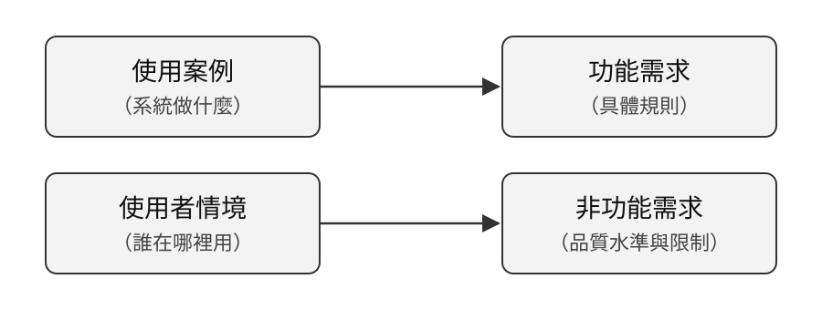

# 系統需求分析

## 系統分析與設計（IE226）115-1

授課教師：呂卓勲

本課程教材：[GitHub](https://github.com/billy1125/system-analysis-and-design)

---

## 本章寫的是系統需求規格

> **本章介紹怎麼寫系統需求規格（System Requirements Specification, SRS）。**

- SRS 是詳細描述並規範系統需求的文件，是系統分析最重要的產出
- 它是後續設計、開發與驗收的共同依據
- 主體是兩份清單：功能需求與非功能需求

本章每一節，都是在說明 SRS 的某一部分怎麼寫、怎麼檢查。

---

## 本章是系統分析中最重要的部分

> **需求清單是系統分析的核心，前面的分析匯進它，後面的分析從它展開。**

- 往前：問題定義與使用者分析的結果，都要落成一條條需求
- 往後：功能清單、使用案例敘述都要填「對應需求」
- 往外：設計、開發與驗收都以它為依據

需求寫錯或寫漏，後面每一項分析都會跟著錯。

---

## 收不收得到錢，看的是需求

合約一定會依據雙方認定的需求書內容核對。

- 系統收不收得到錢，就看當初你和客戶談好的需求有哪些
- 分析不出合適的需求：客戶不滿意
- 訂出模糊的需求，或與實際差異過大、做不出來的需求：賠錢的是你

> **需求書寫了什麼，驗收就核對什麼。**

---

## 期待不是需求

「系統要能管理訪客證」是一句期待，不是一項需求。它沒有說明：

- 管理包含哪些動作？
- 誰可以做？
- 正在訪客身上的證，能不能停用？
- 停用的證，還能不能發出去？

> **不在分析階段回答這些問題，它們就會由工程師各自猜測。**

---

## SRS 的需求要寫到可驗證

每一條需求都能在系統做出來之後回答「符合」或「不符合」，沒有第三種答案。

| 主軸 | 回答的問題 | 決定什麼 |
|---|---|---|
| 功能需求 | 系統要做什麼 | 系統有沒有用 |
| 非功能需求 | 要做到什麼程度、在什麼限制下做 | 系統能不能用 |

---

## 本章的順序（1/2）

本章照 SRS 的撰寫順序走：

1. 從期待到需求：SRS 收哪些級別的需求
2. 功能需求：SRS 的第一份清單
3. 非功能需求：SRS 的第二份清單
4. 判斷需求品質的準則：寫完怎麼檢查

---

## 本章的順序（2/2）

5. 需求的優先順序與追溯
6. 系統需求規格：整份文件的章節架構

系統上線後怎麼改需求，見「修改需求與變更規格」。

---

## 本章的例子

- 工廠訪客進出登記系統 `SAD-Visitor`：一間電子零件廠大門櫃台現行的系統
- 上一章已經找出接待員與管理員兩種角色，畫出使用案例圖與現況流程
- 本章的需求清單對應「系統分析完整報告」〈4. 系統需求分析〉，以下簡稱訪客系統報告

訪客系統報告共整理出 18 條功能需求（FR-01 到 FR-18）與 6 條非功能需求（NFR-01 到 NFR-06）。

---

## 本章對應範例報告的哪些小節

| 範例報告的小節 | 本章哪一節在講 |
|---|---|
| 〈4.1 功能需求〉 | 二、功能需求 |
| 〈4.2 非功能需求〉 | 三、非功能需求 |
| 〈5.2 功能清單〉的「對應需求」欄 | 五、需求的優先順序與追溯 |
| 〈6.1〉〈6.2〉使用案例敘述的「對應需求」欄 | 一、從期待到需求 |

主體是〈4.1〉與〈4.2〉；另外兩處是需求編號被引用的地方。期中的「系統分析範例報告」章節編號相同。

---

# 一、從期待到需求

需求不是把期待的功能列出來，而是寫清楚這個系統要做什麼。

「要能確認廠內還有多少外人」和「同一筆訪客資料仍在廠內時，不得再登記新的來訪」都是需求，但前者只講為什麼要有這套系統，後者才講到系統遇到某個情況要怎麼回應。

本節先分清楚需求的級別，再說明處理需求的四個階段，最後接上上一章的使用案例。

---

## 需求的五個級別

| 報告要有 | 級別 | 回答的問題 |
|---|---|---|
| ✅ | 商業需求 | 為什麼要投資這個專案 |
| ✅ | 利害關係人需求 | 各方各自期待得到什麼 |
| ✅ | 功能需求 | 系統要提供哪些能力 |
| ✅ | 非功能需求 | 這些能力要達到什麼水準、受什麼限制 |
| | 過渡需求 | 從現況切換到新系統需要什麼 |

從最抽象到最具體，下層要能追溯到上層。打勾的四個級別，是期中報告必定要寫出來的內容。

---

## 訪客登記系統的例子

| 級別 | 訪客系統報告寫在哪裡 | 例子 |
|---|---|---|
| 商業需求 | 〈1.3 原本要解決的問題〉 | 緊急狀況時要能確認廠內還有多少外人（P-02） |
| 利害關係人需求 | 〈2.1 使用者〉與〈2.2 利害關係人〉 | 工安與環安人員在緊急疏散時需要在廠訪客名單 |
| 功能需求 | 〈4.1 功能需求〉 | FR-11 系統應列出所有在廠的訪客，並顯示在廠人數與隨行人數合計 |
| 非功能需求 | 〈4.2 非功能需求〉 | NFR-03 來訪登記應在單一頁面完成，不換頁 |

---

## 下層需求必須能追溯到上層

FR-11「列出所有在廠的訪客，並顯示在廠人數」往上追：

- 工安與環安人員：緊急疏散時需要在廠訪客名單
- P-02：沒有即時的在廠訪客名單，緊急狀況時無法確認廠內還有多少外人

> **一項功能需求對應不到任何上層需求，就要問它為什麼存在。**

---

## 需求工程的四個階段

| 階段 | 工作內容 |
|---|---|
| 需求收集 | 從不同來源蒐集需求資訊 |
| 需求分析 | 找出其中的錯誤、矛盾、遺漏或不足 |
| 需求描述 | 以標準格式寫成需求 |
| 需求驗證 | 審查需求是否正確且完整 |

四個階段會反覆疊代。上一章做的是前兩個，本章集中在「描述」與「驗證」。

---

## 使用案例與需求的關係

使用案例圖界定範圍，但它本身還不是需求規格。

---

## UC-05 登記來訪展開成五條需求

| 編號 | 需求 |
|---|---|
| FR-06 | 查無訪客時可建立新訪客，四個欄位皆必填 |
| FR-07 | 登記來訪，送出即記錄報到時間 |
| FR-08 | 受訪員工只能從在職員工中選擇 |
| FR-09 | 訪客證只能選啟用中且未被使用的證，送出時再檢查一次 |
| FR-10 | 同一筆訪客資料仍在廠內時，不得再登記 |

這五個編號就是使用案例敘述「對應需求」那一欄要填的內容。

---

# 二、功能需求

功能需求描述系統必須提供的行為：在什麼條件下、接收什麼輸入、執行什麼處理、產生什麼輸出。判斷一項敘述是不是功能需求，最簡單的方法是問它描述的是不是「系統會做的一件事」。

本節說明功能需求從哪裡找、怎麼寫，以及期中報告的「依據」欄為什麼重要。

---

## 新系統：功能需求的四個來源

| 來源 | 說明 |
|---|---|
| 使用案例展開 | 每個使用案例的主要流程與例外流程 |
| 事件表 | 每個事件對應的系統回應 |
| 資料的生命週期 | 每一類資料的新增、查詢、修改、刪除與封存 |
| 法規與公司規章 | 外部要求轉成的系統行為 |

這四個來源適用於系統還沒做出來的時候。

---

## 既有系統：需求是查出來的

> **分析一套已經在運作的系統時，需求不是問出來的，是從系統本身查出來的。**

期中報告與期末第一部分，需求都從以下四種證據得知：

- 系統畫面
- 操作路徑
- 資料欄位
- 錯誤訊息

---

## 四種證據各推出什麼（1/4）

| 證據 | 要去看什麼 | 畫面上看到的內容 | 推出來的需求 |
|---|---|---|---|
| 畫面 | 每頁有哪些欄位、按鈕、清單，哪些依身分而不同 | 接待員登入看到四項選單；管理員多出「員工名單」「訪客證」「帳號」三項 | FR-04 登入後應進入在廠訪客清單，選單依角色顯示可用功能 |

---

## 四種證據各推出什麼（2/4）

| 證據 | 要去看什麼 | 畫面上看到的內容 | 推出來的需求 |
|---|---|---|---|
| 操作路徑 | 按鈕按下去到哪一頁、出現什麼 | 在來訪明細頁按「修改」，只有事由、受訪員工、隨行人數、車牌、備註可以編輯 | FR-14 可修改這五個欄位，報到與離廠時間不可修改 |

---

## 四種證據各推出什麼（3/4）

| 證據 | 要去看什麼 | 資料庫裡看到的內容 | 推出來的需求 |
|---|---|---|---|
| 資料欄位 | 有哪些欄位、預設值是什麼、哪一欄有唯一限制 | 按「離廠」之後，`visits.check_out_at` 與 `checkout_by` 寫入離廠時間與登記人 | FR-12 登記離廠時記錄離廠時間與登記人，並釋出訪客證 |

---

## 四種證據各推出什麼（4/4）

| 證據 | 要去看什麼 | 畫面上看到的內容 | 推出來的需求 |
|---|---|---|---|
| 錯誤訊息 | 故意做錯，把每一則訊息原文抄下來 | 新訪客表單的訊息：「請輸入訪客姓名」「手機號碼格式錯誤，須為 09 開頭的 10 碼數字」「身分證字號格式錯誤，須為 1 個英文字母加 9 個數字」 | FR-06 查無訪客時可建立新訪客，四個欄位皆必填 |

---

## 錯誤訊息的產出效率最高

- 順利完成一次操作：只知道系統做得到這件事
- 被擋下一次：知道系統認為什麼情況不合法，那才是規則

分析既有系統的必做功課：

- 每個欄位留空送出
- 填錯格式送出
- 用沒有權限的身分去點

---

## 功能需求的寫法

一條功能需求包含 **條件、主體、行為、對象** 四個成分，並用「應」表示強制要求。

以 FR-05「系統應能以手機號碼查詢訪客，查到多筆時列出讓接待員選擇」為例：

| 成分 | 內容 |
|---|---|
| 條件 | 查到多筆時 |
| 主體 | 系統 |
| 行為 | 以手機號碼查詢、列出讓接待員選擇 |
| 對象 | 訪客 |

---

## 「處理」是什麼意思

**不好**的寫法：系統要能處理查到多筆訪客的情況。

自動帶出最近的一筆？顯示錯誤要接待員改用別的條件？列出讓人選？三種做法都符合這句話。

**好**的寫法：FR-05　系統應能以手機號碼查詢訪客，查到多筆時列出讓接待員選擇。

> **寫得出明確的行為，才能直接轉成測試。**

---

## 功能需求清單的範例

| 編號 | 功能需求 | 依據 |
|---|---|---|
| FR-02 | 系統應阻擋已停用的帳號登入 | 以停用的 `guard03` 實測 |
| FR-08 | 受訪員工只能從在職員工中選擇 | 下拉選單中沒有已離職的許文傑 |
| FR-09 | 訪客證只能選擇啟用中且未被使用的證 | 下拉選單中沒有 `V-03`、`V-05`、`V-06`、`V-07` |
| FR-18 | 管理員不得停用自己或修改自己的角色 | 對自己操作時的兩則錯誤訊息 |

---

## 「依據」是期中的評分重點

> **有了依據，讀者才分得出哪幾條是你查到的、哪幾條是你想像的。**

填不出依據的需求只有兩種可能：

- 這個功能根本不存在，你把「應該要有」誤當成「已經有」
- 它存在，但你還沒找到它在哪裡

兩種都不能留著不管。

---

## 擋下、放行，還有第三個選項

FR-10：同一筆訪客資料仍在廠內時，不得再登記新的來訪。

- 「在廠」只看離廠時間是否為空，忘了登記離廠的紀錄會一直算在廠
- 11/2 沒有登記離廠的陳俊宏再來時被擋下，接待員只能先按「離廠」，離廠時間變成按下去的當下
- 訪客系統報告的建議一沒有放寬 FR-10，而是讓補登時寫得進實際離開的時間

> **讓它通得過，但要留下痕跡，這個選項通常最貼近現場。**

---

# 三、非功能需求

非功能需求描述系統的品質水準與必須遵守的限制，不描述系統做什麼，而描述系統做得如何。

訪客登記系統的登入功能做出來了。但密碼如果以明文存在資料庫，沒有先轉成無法還原的雜湊值，資料庫一旦外洩，所有使用者的帳號密碼就直接曝光。

> **登入功能是功能需求；NFR-01「密碼不得以明文儲存」是非功能需求，作用是強化系統安全性。**

本節先介紹盤點用的分類，再說明寫法與衝突，最後是期中的重點：既有系統的非功能需求怎麼推。

---

---

## FURPS+ 分類 (1/3)

| 類別 | 涵蓋內容 | 訪客登記系統的例子 |
|---|---|---|
| 功能（Functionality） | 能力、可重用性、安全性、利用度 | NFR-01 密碼不得以明文儲存 |
| 易用性（Usability） | 人因、美觀、一致性、說明文件、回應速度 | NFR-03 來訪登記應在單一頁面完成，不換頁 |

---

## FURPS+ 分類 (2/3)

| 類別 | 涵蓋內容 | 訪客登記系統的例子 |
|---|---|---|
| 可靠度（Reliability） | 可用性、故障範圍與復原時間、可預測性、準確性 | NFR-05 時間一律記錄本機時間，精確到秒 |
| 效能（Performance） | 速度、效率、資源消耗、流通量、容量、可擴展性 | 訪客系統報告沒有定義。範例：尖峰時段連續登記 8 位訪客，每位 60 秒內完成 |

---

## FURPS+ 分類 (3/3)

| 類別 | 涵蓋內容 | 訪客登記系統的例子 |
|---|---|---|
| 支援性（Supportability） | 可測試性、彈性、可安裝性、在地化 | 新增訪客證不需修改程式，由管理員在訪客證管理頁新增（訪客系統報告寫成 FR-17） |

---

## 分類的作用是檢查清單

- FURPS+ 的加號代表四類約束：設計、實作、介面、實體，期中報告可以自由選擇要不要加入。
- 與 FURPS+ 類似的分類標準是 ISO/IEC 25010，分成八個品質特性，與 FURPS+ 大幅重疊

> **重點不在採用哪一套，而在於有一份固定的檢查清單。**

沒有清單，就只會想到效能與安全，其餘全部漏掉。

---

## FURPS+ 的加號：四類約束 (1/2)

約束不是「做得多好」，而是「不准怎麼做」。

| 約束類型 | 說明 | 訪客登記系統的例子 |
|---|---|---|
| 設計約束 | 設計上的限制 | 權限檢查一律在伺服器端執行，不靠畫面隱藏選單 |
| 實作約束 | 程式碼或執行環境的限制 | 系統以 Node.js 執行，資料庫使用 SQLite，不需安裝其他套件 |

---

## FURPS+ 的加號：四類約束 (2/2)

| 約束類型 | 說明 | 訪客登記系統的例子 |
|---|---|---|
| 介面約束 | 與外部系統互通的要求 | 沒有外部介接，這一類從缺 |
| 實體約束 | 硬體或環境的限制 | 系統只能在櫃台這台電腦上使用，其他電腦連不進來 |

> **約束幾乎都來自現場的物理條件與既有系統，而不是來自使用者的期望。**
---

## 非功能需求不能寫成形容詞

非功能需求要具體，不能是一種形容，能具體的在系統中被驗證。

| 不可驗證 | 可驗證 |
|---|---|
| 系統要安全 | NFR-01 密碼不得以明文儲存 |
| 紀錄要可靠 | NFR-04 來訪紀錄不得刪除 |
| 時間要記得準 | NFR-05 時間一律記錄本機時間，精確到秒 |

右邊每一條都查得出系統有沒有做到。

---

## 非功能需求不能寫成形容詞，更好的寫法

替新系統訂標準時要量化。以下是示範，訪客系統報告裡沒有這些數值：

| 不可驗證 | 可驗證 |
|---|---|
| 系統反應要快 | 尖峰時段連續登記 8 位訪客時，每位自輸入手機號碼至顯示「登記完成」，95% 應在 60 秒內完成 |
| 系統要穩定 | 上班時段的月可用率應達 99.5%，即每月非計畫停機不超過 3 小時 |
| 介面要好用 | **未受過任何指導的接待員**，應能於 2 分鐘內獨立完成一位新訪客的建檔與登記，錯誤率低於 5% |
| 系統要安全 | 連續登入失敗 5 次應鎖定帳號 15 分鐘；所有來訪紀錄的修改須留存修改人、時間與原值 |

---

## 期中/期末報告的非功能需求

| 情境 | 非功能需求寫什麼 |
|---|---|
| 替新系統訂標準 | 可測量的指標、目標值、測量條件，三者缺一驗收時就有爭議 |
| 分析既有系統（期中、期末第一部分） | 規則與不變條件 |
| 期末修改後新增的 | 也是規則；修改前後的數值目標寫在第 8 項效益評估 |

---

## 非功能需求之間會互相衝突

- **安全性與易用性**：輸入手機就帶出姓名、公司與身分證字號，回頭訪客不必重填（P-04）；代價是每位接待員都看得到完整的身分證字號（I-03）
- **說清楚與不洩漏**：停用的帳號要告訴當事人去找管理員，帳號不存在與密碼錯誤卻要回同一則訊息。`SAD-Visitor` 的做法是密碼正確才顯示「此帳號已停用」

因此非功能需求不是列得越多越好，衝突時要做取捨，並寫下理由。

> **沒有記錄理由的取捨，半年後一定會被重新爭論一次。**

---

## 每一條非功能需求都否決了一個做法

| 非功能需求 | 它否決了什麼 |
|---|---|
| 在廠清單必須與當時的來訪紀錄一致 | 在訪客證表加一個「使用中」欄位：報到與離廠時兩邊都要改，漏改一次那張證就發不出去 |
| NFR-04 來訪紀錄不得刪除 | 登記錯了就刪掉重登：刪掉的紀錄查不回來 |

只列需求而不寫它砍掉了什麼，讀者看不出這條需求有什麼份量。

---

## 既有系統的非功能需求藏在哪裡

非功能需求不會寫在任何地方，畫面上也看不到。

> **同一個動作，在不同狀況下系統給了不同的回應。**

把那些差異擺在一起，規則就浮出來了。

---

## 推非功能需求的三個步驟

1. **同一件事，換不同狀態做一次**：用正常的 `guard01`、停用的 `guard03`、不存在的帳號各登入一次，再用 `guard01` 打錯密碼一次
2. **比較差異**：帳號不存在與密碼錯誤的訊息一模一樣，帳號已停用的訊息卻不同
3. **問這個差異在保護什麼**

---

## 這個差異在保護什麼

| 觀察到的差異 | 在保護什麼 |
|---|---|
| 帳號不存在、密碼錯誤都回「帳號或密碼錯誤」 | 不讓外人藉此試出哪些帳號存在 |
| 帳號已停用單獨給「此帳號已停用，請洽管理員」 | 停用可以回復，告訴當事人去找管理員是合理的 |

這兩句話寫下來，就是需求。訪客系統報告把停用寫成 FR-02，「回同一則訊息」沒有另列。

---

## 推出來的是規則與不變條件

| 編號 | 非功能需求 | 依據 |
|---|---|---|
| NFR-03 | 來訪登記應在單一頁面完成，不換頁 | 來訪登記頁的兩段在同一頁 |
| NFR-04 | 來訪紀錄不得刪除 | 所有畫面都沒有刪除來訪紀錄的按鈕 |
| NFR-05 | 時間一律記錄本機時間，精確到秒 | 資料表中時間欄位的格式 |

NFR-04 的依據是「找遍所有畫面都沒有」，要每一頁都看過才寫得出來。

---

## 不對應任何畫面的不變條件

FR-18 與系統的現況合起來：

- 不可停用自己
- 不可修改自己的角色
- 系統沒有刪除帳號的功能

推得出「系統中永遠至少有一個可用的管理員」。訪客系統報告沒有把它另外列成一條。

> **功能需求畫面上有，人人抄得出來；這一類要靠交叉比對才推得出來。**

---

## 推不出來的要誠實標示

訪客系統報告〈1.3〉的寫法：

「`employees.department` 是自由文字而非選單，看不出當初是刻意保留彈性，還是沒有考慮到部門名稱要統一，需訪談開發者才能確認。」

這種寫法比編一個理由有價值，被追問時也站得住。

---

# 四、判斷需求品質的準則

需求寫完之後要檢查。功能需求與非功能需求用的是同一套準則，其中最好用的一項是可驗證性：寫完一條，立刻問自己驗收時要怎麼證明它有做到。

本節列出六項準則，每一項各看一個反例與正確寫法，再提醒三個常見的措辭陷阱。

---

## 六項準則

| 準則 | 含義 |
|---|---|
| 正確 | 確實反映系統或使用者的實況 |
| 明確 | 只有一種解讀方式 |
| 完整 | 不遺漏必要條件與例外 |
| 一致 | 不與其他需求矛盾 |
| 可驗證 | 能設計出檢查方法 |
| 可追溯 | 對得到來源與下游 |

---

## 反例與正確寫法（1/3）

| 準則 | ❌ 反例 | ✅ 正確寫法 |
|---|---|---|
| 正確 | 寫「系統應通知受訪員工」，但系統只顯示分機 | 只寫系統上查得到依據的內容，例如 FR-08 的依據是下拉選單中沒有已離職的許文傑 |
| 明確 | 「接待員可修改來訪紀錄」 | FR-14「可修改事由、受訪員工、隨行人數、車牌與備註，報到與離廠時間不可修改」 |

---

## 反例與正確寫法（2/3）

| 準則 | ❌ 反例 | ✅ 正確寫法 |
|---|---|---|
| 完整 | 只寫登記成功，沒寫訪客證已被使用時怎麼辦 | 成功與失敗都要寫：FR-07 寫登記來訪，FR-09、FR-10 寫哪些情況不得登記 |
| 一致 | 需求寫訪客證有「使用中」狀態欄，資料字典卻沒有這一欄 | 「使用中」只有一個定義：有離廠時間為空的來訪紀錄綁著它 |

---

## 反例與正確寫法（3/3）

| 準則 | ❌ 反例 | ✅ 正確寫法 |
|---|---|---|
| 可驗證 | 「時間要記得準」 | NFR-05「時間一律記錄本機時間，精確到秒」 |
| 可追溯 | 填不出依據的需求 | FR-10 往上連到實測依據與 UC-05 例外流程 6a，往下連到 F-23 |

> **寫完一條需求，立刻問自己：驗收時要怎麼證明它有做到？**

答不出來的，就是還沒寫好。

---

## 三個措辭陷阱

- **模糊量詞**：「快速」「大量」「友善」「適當」「必要時」，一律換成數字或明確條件
- **多重需求擠在一句**：「系統應提供登入、登出功能並阻擋停用的帳號」是三條，訪客系統報告拆成 FR-01、FR-03、FR-02
- **把解法當需求**：規定了實作方式，把設計空間用掉了。例如這樣的寫法不好：「系統應使用下拉選單選擇受訪員工」，這樣會寫死了實作方式，限定程式設計師只能用下拉選單開發系統

---

## 把解法當需求的例外

NFR-03「來訪登記應在單一頁面完成，不換頁」規定了畫面怎麼做，看起來像在指定實作方式。

但它描述的是這套系統現在的事實，而且對得上接待員最在意的事：尖峰時段要快。

> **替新系統訂需求，不替設計者決定怎麼做；描述既有系統，就是要把它怎麼做的寫清楚。**

---

# 五、需求的優先順序與追溯

需求整理出來之後，還有兩件事要做：排出先後，以及確認每一條都對得到來源與下游。期中不排需求的優先順序，期末的變更需求才要排；追溯則是期中就要做的事，範例報告的功能清單就是一張追溯表。

本節依序說明排序、追溯與驗證。

---

## 排優先順序：MoSCoW

| 等級 | 含義 |
|---|---|
| Must have | 沒有它系統就沒有意義 |
| Should have | 重要，但短期可用人工替代 |
| Could have | 有更好，資源允許才做 |
| Won't have (this time) | 這次明確不做 |

「這次不做」白紙黑字寫下來，是控制專案範圍最有效的工具。期末的變更需求可以用它排，也可以只分高、中兩級。

---

## 範例報告怎麼排改善的先後

| 分級 | 問題 | 理由 |
|---|---|---|
| 提出改善建議 | I-01 未離廠的紀錄、I-03 與 I-05 身分證字號、I-04 修改不留紀錄 | 影響較大且改法明確 |
| 待確認 | I-02 重複訪客、I-06 部門寫法、I-07 隨行人員、I-08 過去紀錄的公司 | 要先決定辨識方式，或先取得資料 |
| 影響較小 | I-09 停用使用中的訪客證 | 改法明確，影響較小 |

期中不排需求的優先順序，但問題要分出先後，而且每一級都寫出理由。

---

## 需求追溯（章節：功能分析會說明）

> **每條需求往上連到它的依據，往下連到使用案例與功能。**

| 需求編號 | 依據 | 對應使用案例 | 對應功能 |
|---|---|---|---|
| FR-02 | 以停用的 `guard03` 實測 | UC-01 登入 | F-11 登入 |
| FR-09 | 下拉選單中沒有使用中與停用的證 | UC-05 登記來訪 | F-23 登記來訪與發證 |
| NFR-04 | 所有畫面都沒有刪除來訪紀錄的按鈕 | UC-09 修改來訪紀錄 | F-43 修改來訪紀錄 |

---

## 追溯的三個用途

- 需求變更時，立刻查得出會影響哪些使用案例與功能
- 驗收時，證明每條需求都有對應
- 之後的維護人員查得出某項功能當初為什麼這樣做

期中的做法：需求清單填「依據」，功能清單填「對應需求」與「對應使用案例」。期末第 16 項改從變更需求出發，欄位是「變更｜需求｜流程｜資料｜畫面｜驗收」，見「系統設計規格與追溯」。

---

## 需求驗證的三種方法

| 方法 | 做法 | 能抓到的問題 |
|---|---|---|
| 同儕審查 | 團隊逐條檢視 | 遺漏、矛盾、模糊 |
| 情境演練 | 拿實際情境走一遍需求 | 流程斷裂、例外未涵蓋 |
| 原型驗證 | 讓使用者實際操作畫面 | 看到才知道不對的需求 |

---

## 情境演練：拿「停用遺失的訪客證」走一遍

- 停用流程的完成後狀態：該證不再出現在登記的下拉選單
- FR-17：管理員可新增訪客證，並停用或啟用
- 情境：要停用的那張證，正掛在某位訪客身上

FR-17 沒有涵蓋這個情況。實測把使用中的 `V-05` 停用，系統沒有提示，在廠清單仍顯示 `V-05`，也就是訪客系統報告的問題 I-09。

---

# 六、系統需求規格

前面五節寫的都是系統需求規格（SRS）的內容，這一節回頭看整份文件的架構：除了功能需求與非功能需求兩份清單，SRS 還有哪些章節。

期中與期末報告都不必寫成完整的 SRS。期中第 4 項的需求清單是其中「系統規格」的主體；期末修改既有系統，寫的是原有需求清單上的變更（見「修改需求與變更規格」）。

---

## SRS 的內容架構

| 章節 | 內容 |
|---|---|
| 背景說明 | 系統開發的緣起與背景 |
| 系統目標 | 主要的開發目的與可衡量的目標 |
| 執行範圍概述 | 專案範圍與系統運作範圍 |
| 系統架構 | 軟硬體環境，以及本系統與外部系統的關係 |
| 使用者需求 | 各利害關係人的需求 |
| 系統規格 | 功能需求與非功能需求的完整條列 |

---

## SRS 不是寫完就凍結

需求會變：法規改了、使用方式調整了、試用後發現原本的想法行不通。

> **SRS 的價值不在於它永遠正確，而在於它讓每一次變更都被記錄、被評估、被決定。**

---

## 本章重點回顧

- 需求要寫到可驗證，每一條都答得出「符合」或「不符合」
- 分析既有系統時，需求從畫面、路由、資料欄位與錯誤訊息查出來，「依據」欄分得出哪幾條是查到的
- 既有系統的非功能需求，來自同一個動作在不同狀況下的不同回應
- 每條需求都要對得到依據、使用案例與功能

---

## 下一章

本章得到的是一份條列式的需求清單。

下一章「功能分析」把它重新組織成有邊界、有層次的功能結構，回答「這套系統的範圍到哪裡、由哪些功能組成」。
