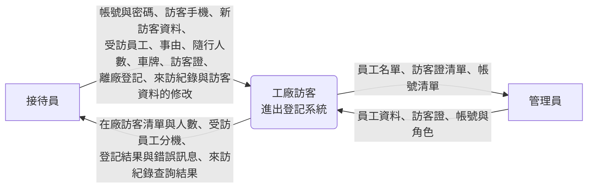
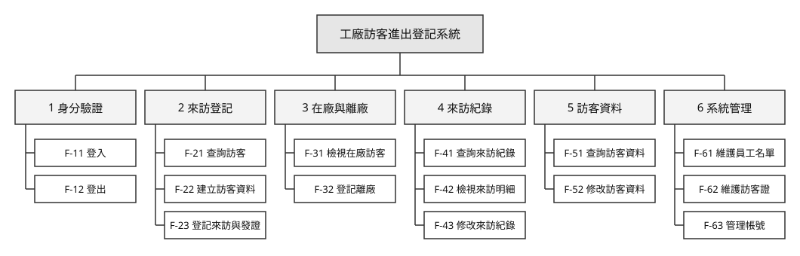
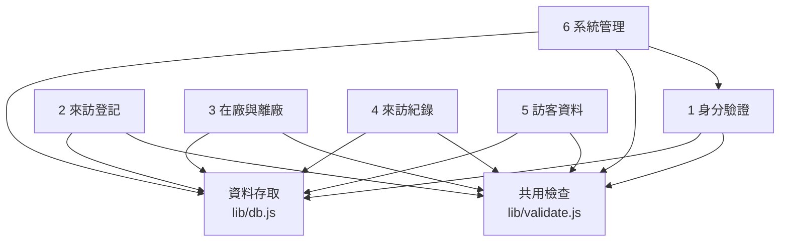

# 功能分析

你的需求清單寫到第三十條的時候，通常會出現一個問題：這三十條加起來，到底是一套什麼樣的系統？條列式的需求彼此平行、沒有從屬關係。讀完可以知道系統該做哪些事，卻看不出這些事怎麼組成一個整體，也看不出哪一件事其實不該由這套系統負責。

功能分析要處理的正是這兩件事：**這套系統的範圍到哪裡**（系統邊界），以及 **範圍內的功能如何組成一個結構**（功能分解與模組劃分）。前者決定專案做多少，後者決定專案怎麼分工。兩者都做完，你才有辦法回答「這個系統要花多少時間做完」這種在提案階段一定會被問到的問題。

> **前情提要**：本章假設你已完成[「使用者分析」](03-User-Analysis.md)的使用案例分析與[「系統需求分析」](04-System-Requirements-Analysis.md)的需求條列。本章的例子取自工廠訪客進出登記系統 `SAD-Visitor`（原始碼在 `05-Final-Project-Topics/Example-Systems/SAD-Visitor/`）與它的[「系統分析完整報告」](../04-Final-Project-Example-Reports/Visitor-System-Full-Analysis.md)〈5. 功能分析與系統邊界〉，以下簡稱「訪客系統報告」，編號沿用該報告（FR-01、NFR-01、UC-01、F-11 起）。〈四、4.2〉以後的模組劃分、CRUD 矩陣與模組設計，報告沒有對應內容，改以 `SAD-Visitor` 的原始碼示範。期末第一部分怎麼用一段文字寫系統邊界，見[「修改需求與變更規格」](09-Change-Specification.md)〈二〉。

> **延伸閱讀**：功能分析在各組報告中的繳交格式與最低標準，見[「系統分析範例報告說明」](../02-Midterm-Project-Example-Reports/Analysis-Phase-Deliverables.md)。

> **必讀標記**：標題後加註 🔴 期中必讀 的小節，是期中小組報告九項產出直接會用到的內容；加註 🔵 期末必讀 的，是期末報告直接會用到的。判準與成品的樣子，期中見[「系統分析範例報告說明」](../02-Midterm-Project-Example-Reports/Analysis-Phase-Deliverables.md)與[「系統分析範例報告」](../02-Midterm-Project-Example-Reports/Analysis-Phase-Sample-Report.md)，期末見[「期末範例報告」](../04-Final-Project-Example-Reports/Final-Phase-Sample-Report.md)。未標記的小節仍屬課程範圍，只是報告不會直接產出。

## 一、功能分析在做什麼 🔴 期中必讀

### 1.1 需求是條目，功能是結構 🔴 期中必讀

需求與功能不是同一種東西。需求是一句可驗證的敘述，功能是系統實際要建造的組成單位。兩者的關係經常不是一對一：

- FR-07（登記來訪並記錄報到時間）、FR-08（受訪員工只能選在職員工）、FR-09（訪客證只能選可用的證）、FR-10（仍在廠內的訪客不得再登記）四條需求，在功能結構裡合起來只是 F-23「登記來訪與發證」這一項功能。
- 反過來，FR-13（依報到日期區間與關鍵字查詢來訪紀錄）只是一條需求，在功能結構裡卻拆成 F-41「查詢來訪紀錄」與 F-42「檢視來訪明細」兩項——因為它們各自需要工時、可以分給不同的人做，也可能一項做完、另一項延期。

功能分析就是把需求清單重新整理成功能結構的過程，它要回答三個問題：

| 問題 | 產出 |
|---|---|
| 哪些事情是這套系統要做的、哪些不是？ | 系統邊界與範圍外清單 |
| 要做的事情怎麼組織成有層次的整體？ | 功能分解圖 |
| 每項功能對應誰的需求、由哪個模組承擔？ | 功能清單與模組劃分 |

> **簡單來說，功能分析就是把需求整理成系統的組成方式。**

### 1.2 跳過功能分析的後果

分析文件裡若只有需求清單而沒有功能結構，在實務上可能出現以下問題：

1. **估不出時程**。需求條目的大小差距可以到一百倍，把條目數量乘上平均工時得到的估算沒有意義。能估的單位是功能，不是需求。
2. **分不了工**。開發要分給不同人做，切分的依據是功能模組。沒有模組劃分，分工只能靠口頭協調，介面上的責任歸屬會反覆爭執。
3. **修改不容易討論**。客戶說「加一個查詢功能」時，你手上沒有界定範圍的圖，就評估不了修改會影響哪些地方，也很難跟客戶說明這次修改有多難。
4. **交給 AI 寫也省不了成本**。用 AI 寫程式確實便宜很多，但企業 AI 導入顧問張可佳在[〈AI 讓寫程式變便宜，系統開發的成本為什麼沒有跟著降？〉](https://claire-chang.com/post/ai-development-capability-transfer/)一文中指出，變便宜的只是寫程式這一段，瓶頸移到了需求釐清、分工與審查。少了系統分析，需求常常只用一兩句話就交給 AI，AI 只好依自己的模式補完空白，之後的 **重工**（做出來的東西不符合要求，必須回頭修改或重做）與審查又把省下的時間吃掉。她的建議是把需求寫成可驗收的條件：誰使用、要解決什麼問題、什麼情況算正確。

課程報告最常見的症狀是：你可能寫了很多條需求，但整份文件沒有任何一張圖說得出「這個系統長什麼樣子」，功能分析就是補上這一塊。

### 1.3 對開發人員的好處

分析做到功能分析這一步，交給開發團隊的就不只是一份需求清單。接手的人主要有兩種：程式設計師負責把功能寫成程式；系統工程師負責系統的整體架構、與外部系統的整合以及部署。兩者從功能分析拿到的東西不同：

| 接手的人 | 從功能分析拿到什麼 | 好處 |
|---|---|---|
| 程式設計師 | 功能清單，每項都有對應需求與對應使用案例 | 一次認領一項功能，知道要做到什麼程度、驗收時看哪幾條需求，不必自己從需求清單拼湊 |
| 程式設計師 | 範圍外清單 | 知道哪些事不必做，不會順手多做 |
| 系統工程師 | 系統邊界與介面 | 知道要和哪些外部系統介接，資料格式與出錯時的責任有討論的基礎 |
| 系統工程師 | 功能階層圖 | 作為模組劃分、架構規劃與估算工時的起點 |

換句話說，功能分析把「客戶要什麼」翻譯成「開發團隊要做哪幾件事」。少了這一步，這段翻譯就會落到每一位工程師身上各自進行，結果就是〈1.2〉說的那些問題。

### 1.4 用 AI 寫程式之後，功能分析更重要

接手的人不一定是工程師，也可能是 AI。〈1.2〉第四點說的空白，功能分析的產出正好補得上：

| 功能分析的產出 | 交給 AI 時的作用 |
|---|---|
| 功能清單 | 一次交代一項功能，「對應需求」就是這項功能的驗收條件 |
| 對應使用案例 | 說明誰在什麼情境下使用，例外流程也一併交代 |
| 範圍外清單 | 告訴 AI 哪些事不要做，避免它自行補上沒人要求的功能 |
| 功能階層圖 | 決定工作怎麼切、每一塊由誰審查 |

> **AI 寫程式越快，交給它的東西越要先想清楚。**

## 二、系統邊界 🔴 期中必讀 🔵 期末必讀

### 2.1 邊界界定的是責任

**系統邊界（System Boundary）是一條把「本系統負責的部分」與「環境」分開的線。** 界內的東西由本專案設計、實作、維護；界外的東西是本系統必須配合、卻不去改變的既有條件。

簡單來說，系統會做的事在界內；系統上找不到的功能、沒有檢核的工作，都在界外。

要注意這是一個 **責任與範圍的協議，不是技術上的分界**。`SAD-Visitor` 的員工名單現在由管理員在畫面上手動維護。如果要把與人資系統同步納入系統，兩者之間資料往來會很密切，但人資系統仍在界外，因為這次專案沒有預算與權限去改它。你把人資系統畫進界內，等於承諾了一件做不到的事。

### 2.2 判斷一件事在界內或界外 🔵 期末必讀

判斷方法取決於你面對的是哪一種系統：分析既有系統（期中，以及期末第一部分），找的是「這件事在系統上有沒有痕跡」；從零設計新系統，問的是「這件事的責任歸誰」。兩種方法判出來的界外對象，都不脫以下四類：

| 類型 | 定義 |
|---|---|
| 外部系統 | 和本系統交換資料，但由別人開發與維護的資訊系統或連網設備 |
| 外部組織或人員 | 不操作本系統，卻會提供資料給系統、從系統取得資料，或受系統內容影響的組織與人 |
| 實體設備與人工作業 | 在現場由設備或人完成的動作；系統不執行它，最多只記錄它的結果 |
| 系統沒做的事 | 使用者可能預期系統會做，但系統沒有做、也沒有指定由誰做的事 |

各類在 `SAD-Visitor` 的例子（取自[「系統分析完整報告」](../04-Final-Project-Example-Reports/Visitor-System-Full-Analysis.md)）與常見的疏漏如下：

| 類型 | 訪客登記系統 | 常見的疏漏 |
|---|---|---|
| 外部系統 | 無，查證後確認沒有任何外部系統或設備介接（〈5.3〉） | 沒問清楚對方能不能提供介接方式 |
| 外部組織或人員 | 訪客、受訪員工、工安與環安人員（〈2.2〉） | 忘記他們也需要取得或提供資料 |
| 實體設備與人工作業 | 訪客證實體的收發、打分機通知受訪員工、目視核對訪客的證件（〈1.4〉） | 誤以為系統可以取代，實際上系統只是記錄它的結果 |
| 系統沒做的事 | 事前預約、與人資系統同步、報表匯出與列印（〈5.3〉）；偵測訪客沒登記離廠就離開（〈1.4〉） | 以為它一定有，沒有實際去查證 |

其中第三類最容易搞混。訪客證由接待員親手交付與收回，系統不做這個動作；但「哪一張證綁在哪一筆來訪」要被記錄下來，所以界內有登記來訪與發證、登記離廠兩項功能（訪客系統報告〈5.3〉）。核對身分也一樣：目視核對證件是接待員的人工作業，系統只存下身分證字號（〈1.4〉）。**界定邊界時，把人工作業與它的資料紀錄分開看。**

第四類和前三類不同。前三類的界外對象確實存在，只是在系統之外；第四類則是這件事根本沒有人做，既不在系統裡，也沒有指定給誰。

**分析既有系統：找系統上的痕跡。** 既有系統早就做完了，規則、預算與責任歸誰多半問不到，最有效的是一個問題：**系統上有沒有任何畫面、操作路徑或資料欄位對應到它？** 有的就在界內；三處都找不到痕跡的事，就在界外。系統若有外部介接，畫面上的匯入匯出入口、資料表裡存放外部系統識別碼的欄位，就是介面留下的痕跡，交界處同樣要標出來（見〈2.3〉）。

第四類在既有系統最難找。沒有人會告訴你哪些沒做，只能靠你自己查出來，所以它是期中報告最容易漏掉的一類。`SAD-Visitor` 的「訪客沒登記離廠就離開」就是典型例子。有在廠訪客清單，使用者自然以為系統會發現沒離廠的人，但系統上沒有任何偵測，清單也不區分報到日期，只能靠接待員自己發現（訪客系統報告〈1.4〉〈3.2〉）。這類界外項目往往是改善建議的第一批候選，訪客系統報告就把它寫成〈9.1〉的現況問題 I-01，也是〈9.2〉建議一針對的問題。

做期中報告時，你可以照下表的兩種情況去找，兩者都要寫進現況問題，差別在於要不要列進範圍外清單：

| 你發現的情況 | 屬於 | 寫在哪裡 |
|---|---|---|
| 經驗上該有，系統上卻完全找不到痕跡 | 界外 | 範圍外清單，並寫進現況問題 |
| 畫面上有入口，按了卻沒有作用 | 界內，但沒做完 | 不列進範圍外清單，直接寫進現況問題 |

**從零設計新系統：問責任歸誰。** 期中與期末面對的都是既有系統，用不到這個方法；它適用於日後從零設計系統的場合。用四個問題判斷：

| 問題 | 答「是」代表 |
|---|---|
| 這件事的處理規則是不是由本系統決定 | 界內 |
| 這份資料是不是由本系統儲存與維護 | 界內 |
| 這次專案有沒有預算與權限修改它 | 界內 |
| 出問題時是不是由本專案團隊負責修 | 界內 |

全部答「是」的，放進系統內；全部答「否」的，是外部實體。真正需要你注意的是答案混雜的情況，那代表這裡有一個 **介面（interface）**，也就是兩邊交界的地方。介面必須把資料格式、傳輸方式、發生錯誤時誰負責處理都寫清楚，專案後期的爭執常發生在這裡。

第四類在新系統是規劃時決定不做的事，寫進範圍外清單並附上理由（見〈2.4〉）。

### 2.3 情境圖

**情境圖（System Context Diagram，又稱環境圖）把整個系統畫成一個處理，四周是外部實體，箭頭是流進流出的資料。** 它是[資料流程圖](https://zh.wikipedia.org/wiki/資料流圖)的最上層，也是表達系統邊界最直接的一張圖。

下圖是 `SAD-Visitor` 現行的情境圖：



上圖以流程圖語法示意，正式的情境圖中，系統畫成圓形或圓角方框、外部實體畫成方框、資料流為帶名稱的箭頭。管理員能做接待員的全部操作，圖上只畫他多出來的那幾道資料流。

圖上沒有訪客與受訪員工。他們都不操作系統：訪客的資料由接待員輸入，受訪員工由接待員看了畫面上的分機再打電話通知（訪客系統報告〈1.4〉〈2.3〉）。資料流只畫和系統直接交換的對象，透過接待員轉手的，算在接待員那兩道箭頭裡。

這張圖只有一頁，卻能做到三件事：一頁講完專案範圍、標出每一個必須開發的介面、提供逐一向外部單位確認資料格式的檢查清單。你畫這張圖時，箭頭上一定要寫資料名稱。只畫線不標名稱的情境圖沒有分析價值。

有些系統完全不與外部系統或設備往來，所有資料都由自己產生與儲存，這時情境圖上只剩下使用者角色，看起來空蕩蕩的，`SAD-Visitor` 就是這樣。**這種情況不要留白，要寫一句話交代**。訪客系統報告〈5.3 系統邊界〉的寫法是：「本系統沒有任何外部系統或設備介接。經檢視畫面、程式與資料表後確認，所有資料都由櫃台人員在這台電腦上輸入。」——「查證後確認沒有」與「沒查所以沒寫」在文件上長得一模一樣，讀者無從分辨，而那句話正是差別所在。要說得出你怎麼確認的：程式裡沒有任何對外連線或寄信的設定、資料表中沒有任何一欄存放外部系統的識別碼、畫面上沒有任何匯入匯出的入口。

**期中與期末報告都不要求情境圖，但可以用來補充使用案例圖。** 使用案例圖畫的是「誰用系統做哪些事」，看不出每個角色和系統之間交換了哪些資料；情境圖把這些資料寫在箭頭上，正好補上這一塊。以 `SAD-Visitor` 為例，使用案例圖只畫出接待員會「登記來訪」（UC-05），情境圖則會標出接待員送進系統的是訪客手機、受訪員工、事由、隨行人數、車牌與訪客證，系統回給接待員的是「登記完成：訪客證 V-08」這類結果或錯誤訊息。兩張圖的參與者必須一致：情境圖上的每一個外部實體，在使用案例圖上都要找得到對應的參與者；系統若有外部介接，使用案例圖上的外部系統參與者也要出現在情境圖上。

### 2.4 把不做的事寫下來 🔴 期中必讀 🔵 期末必讀

邊界只畫界內是不夠的，還要有一份明確的 **範圍外清單**。從零設計新系統時，清單寫「這次不做」與理由，理由的寫法與「延後」「不做」的區分，見[「系統需求分析」](04-System-Requirements-Analysis.md)〈五、5.1〉。

分析既有系統時，「理由」那一欄要換成 **「如何確認」**。理由那一欄回答的是「為什麼不做」，而既有系統早就做完了，沒有人會告訴你當初為什麼不做；你能回答的是另一個問題：**你憑什麼斷定它沒做？** 訪客系統報告〈5.3 系統邊界〉把界內、界外與如何確認放在同一張表：

| 界內（本系統有） | 界外（本系統沒有） | 如何確認 |
|---|---|---|
| 訪客到廠後的現場登記 | 事前預約 | 沒有任何「預定來訪日」欄位；來訪紀錄一建立就有報到時間 |
| 顯示受訪員工的分機 | 通知受訪員工 | 受訪員工沒有帳號；系統沒有寄信或簡訊設定 |
| 訪客證與來訪紀錄的綁定 | 訪客證實體的收發 | 系統只記錄 `pass_id`，交付與收回由接待員動手 |
| 隨行人數 | 隨行人員的個別資料 | `visits.companions` 只是一個整數 |
| 員工名單的手動維護 | 與人資系統同步 | 員工名單只能由管理員在畫面上新增與修改 |
| 畫面上的查詢 | 報表匯出與列印 | 查詢頁沒有匯出或列印按鈕 |

**右欄的寫法是「以證據反證缺席」**，意思是：我去了會有的地方看，那裡沒有。畫面、操作路徑、資料表三處都查過還是找不到，這個結論才站得住。這一欄是期中報告最容易被追問的地方之一——老師會直接問「你怎麼知道它沒有？」

**界外項目也是找現況問題的入口。** 界外的每一條都問一次：系統沒做這件事，有沒有人因此卡住？有的話，就寫進第 9 項的現況問題。上表的六條界外項目，對照訪客系統報告〈9.1〉：

| 界外項目 | 〈9.1〉的現況問題 |
|---|---|
| 隨行人員的個別資料 | I-07 隨行人員只記人數，緊急疏散時不知道是誰 |
| 訪客證實體的收發 | I-01 沒有登記離廠的訪客會一直留在在廠清單上。訪客沒交回訪客證就離開時，離廠流程不會被觸發（〈3.2〉） |
| 報表匯出與列印 | 沒有列。紀錄在查詢頁查得到，報告沒有找到誰因為不能匯出而受影響 |

另外三條也沒有列成問題。其中通知受訪員工的影響，報告記在〈2.2〉的利害關係人：受訪員工「訪客到了只能等接待員來電」。

寫進現況問題時要換個寫法。界外寫的是系統「沒有什麼」，現況問題要寫的是「誰因此遇到什麼後果」：界外那一條是「隨行人員的個別資料」，I-07 寫的則是「緊急疏散時不知道是誰」。

寫下不做的事，是為了處理 **範圍蔓延（scope creep）**：需求一次追加 5%，沒有人會覺得過分，但十次之後專案就多了一半的工作量而時程不變。你有了這份清單，追加要求就會變成一個必須重新談時程與資源的正式決策。

### 2.5 邊界的三種常見錯誤

| 錯誤 | 症狀 | 後果 |
|---|---|---|
| 邊界畫太大 | 把〈2.4〉表中的界外項目（事前預約、通知受訪員工、報表匯出）也寫成系統的功能 | 需求與功能清單出現系統上找不到的項目，「依據」欄填不出來 |
| 邊界畫太小 | 只分析來訪登記與離廠，漏了員工名單、訪客證與帳號的維護 | 說不出受訪員工與訪客證兩個下拉選單的資料從哪裡來 |
| 邊界會移動 | 每次開會的範圍都不太一樣，沒有書面確認 | 合併報告時才發現各組員寫的範圍對不起來 |

第二種的根源是默認資料「本來就在那裡」。凡是系統用到、你卻沒找到是誰建立的資料，都要回頭確認它由哪一項功能維護；從零設計新系統時，寫成「假設由其他系統提供」的資料也一樣，要確認有沒有對應的介面設計。找不到的話，那份資料實際上不存在，依賴它的功能就是做不出來的。

## 三、功能分解 🔴 期中必讀 🔵 期末必讀

### 3.1 由上而下逐層拆解 🔴 期中必讀 🔵 期末必讀

**功能分解（Functional Decomposition）是把系統的整體目的逐層拆成較小的功能，直到每一項小到可以被指派、估時與驗收。** 典型是三層：

```
系統  →  功能模組（子系統）  →  功能  →  （必要時再拆子功能）
```

拆解的方向必須由上而下。你由下而上把想到的功能一項項堆起來，最後幾乎一定會發現有的重複、有的遺漏，而且看不出來哪些屬於同一類。

### 3.2 分解的四個原則 🔴 期中必讀 🔵 期末必讀

原則之一牽涉到 **粒度（granularity）** 這個詞：粒度指的是一個項目切得多粗或多細——同一件事可以寫成一項大功能，也可以拆成十項小功能，粒度講的就是你選在哪一個層次描述它。分解的過程實際上就是一層一層調整粒度，直到每一項都落在可以被指派與估算的大小。

| 原則 | 說明 | 違反時的症狀 |
|---|---|---|
| 完整 | 同一層各項合起來要涵蓋上一層的全部 | 「來訪紀錄」底下只列了查詢，漏了修改，登記錯的受訪員工沒有功能可以更正 |
| 互斥 | 同一層各項之間不重疊 | 「來訪登記」與「訪客資料」都列了「修改訪客資料」，兩邊的檢核規則對不起來 |
| 粒度相當 | 同一層的項目大小接近 | 同一層出現「系統管理」與「登出」 |
| 每層 5–9 項 | 超過就再分一層 | 圖橫向拉得很寬，看不出結構 |

前兩項合起來就是常說的不重複、不遺漏（Mutually Exclusive, Collectively Exhaustive, MECE）。檢查方法很簡單：把同一層的項目念一遍，問自己「還有沒有漏掉的一群？」以及「這兩項有沒有重疊的部分？」

第四項管的是上限。少於 5 項不必硬湊，訪客系統報告的六群底下都只有兩到三項。

**粒度還要注意一件事：每一項功能都要能和同層的其他功能分開。** 拆出來的項目如果小到同時出現在兩項以上的功能裡，它就不是一項獨立的功能，而是那幾項功能共用的步驟，不應該拉高成第二或第三層的主要功能。以 `SAD-Visitor` 為例，「填寫來訪資訊」在 F-23 登記來訪與發證與 F-43 修改來訪紀錄兩項功能裡都會用到，兩者檢查的是同一組欄位：事由、隨行人數（0 到 20）、車牌與備註。把它獨立列出來，它就和那兩項重疊，違反互斥，粒度也和同層的其他項目不相當。訪客系統報告的做法是不列它，讓它留在兩項功能各自的流程裡。到了設計階段，這類共用的部分可能會收進共用模組（見〈四、4.2〉），但那屬於模組設計，功能分析不處理。

因此，功能列得太多、太細時，很可能有些項目其實是別的功能共用的步驟。這時逐項檢查：這一項有沒有出現在別的功能裡？有的話，就把它從功能階層圖移出，留在使用它的那幾項功能的流程裡。

### 3.3 功能階層圖 🔴 期中必讀 🔵 期末必讀

訪客系統報告〈5.1 功能階層圖〉把 `SAD-Visitor` 拆成六群、十五項功能：



*本圖由作者自製*

這張圖上有三件事值得注意。

第一，**分群依業務性質，不依畫面**。分群的順序跟著一位訪客的進出走：先登記、在廠、離廠，之後才是查詢紀錄。「在廠與離廠」單獨成一群，是因為它有自己的規則：在廠與否不存欄位，由離廠時間是否為空推導（訪客系統報告〈5.1〉）。這一群的主體就是首頁，最容易被當成畫面併掉，判準見〈3.6〉。

第二，**F-21「查詢訪客」看起來不像一項獨立的功能**。它沒有自己的選單，只是來訪登記頁的第一段，在使用案例圖上也只是登記來訪的包含關係（UC-03 被 UC-05 包含）。但它是 FR-05 唯一的落點——**不在功能結構裡佔一個位置，追溯時 FR-05 就找不到承接它的功能。**

第三，**F-22「建立訪客資料」放在「來訪登記」，沒有放在「訪客資料」**。訪客資料頁只能查詢與修改，沒有新增按鈕；新訪客只會在登記時查無手機號碼才建立，所以 UC-04 是 UC-05 的延伸關係。照畫面名稱分，它會被放進「訪客資料」，就看不出「新訪客只在登記時產生」這條規則。

分析既有系統時，這張圖可以分三步找出來。

**第一步，觀察畫面上界線清楚的區塊。** 功能雖然依業務性質分群，但既有系統的畫面仍是重要的線索。開發者設計畫面時，通常會把同一件工作需要的操作放在同一個區塊，所以區塊多半反映了當初對業務的切分；而且畫面是你看得到、操作得到的部分，從它下手最直接。來訪登記頁的「第一段：找訪客」與「第二段：來訪資訊」、在廠訪客清單每一列的「離廠」按鈕、員工名單頁每一列的「修改」與「設為離職」按鈕，都是這種區塊。區塊只是線索，不能直接當成功能，理由見〈3.6〉。

**第二步，實際操作系統，以使用案例為骨架整合功能。** 想像自己是某個角色，會用這套系統做哪些工作，再對照使用案例圖，看每個使用案例會用到畫面上哪些 UI 元素，把它們整合成一項項功能。以接待員為例，UC-05 會用到第一段的手機欄位與「查詢」按鈕、查無訪客時出現的新訪客表單、第二段的下拉選單與「登記並發證」按鈕，整合起來就是 F-21 查詢訪客、F-22 建立訪客資料、F-23 登記來訪與發證三項功能。分群以使用案例為骨架，畫面只當佐證，所以仍然是〈3.1〉說的由上而下；反過來從按鈕一個個往上堆，就會出現〈3.5〉說的拆過頭。

**第三步，把所有功能彙總成功能清單，回頭對應需求與使用案例。** 把所有功能列成功能清單（見〈四、4.1〉），逐條檢查有沒有需求沒被任何功能認領。沒被認領的需求有兩種可能：一是漏找了功能，回第二步補上；二是這條需求在現有系統上本來就對應不到任何功能，代表系統沒做到，應改寫成第 9 項的現況問題。同時，每一項功能也都要對應得到至少一個使用案例，對應不到的，不是功能多列了，就是使用案例圖漏畫了。

> **畫面提供線索，使用案例決定分群，需求負責驗收。**

### 3.4 新系統的功能階層圖

分析既有系統時，功能已經在那裡，你做的是把它們歸類。期中與期末面對的都是既有系統，期末第 3 項的功能階層圖同樣用〈3.3〉的三步整理。從零設計新系統時，功能要從需求與使用案例推出來，畫面還不存在，〈3.3〉第一步的線索也就沒有了，容易漏的地方不一樣。

**最容易漏掉的是不處理業務的那一群。** 以〈3.3〉的圖為例，「6 系統管理」的三項功能不處理任何一位訪客的進出，但少了 F-61 維護員工名單與 F-62 維護訪客證，F-23 登記來訪與發證的受訪員工與訪客證兩個下拉選單都是空的。分析既有系統時，這一群在畫面上看得到，不會漏；從需求推功能時，它不解決任何一個業務問題，很少有人主動提起，要靠〈4.3〉CRUD 矩陣「每一份資料都要有功能建立它」的檢查才補得回來。

**沒有自己畫面的功能，也要在圖上佔一個位置。** 道理和〈3.3〉的 F-21 相同：它不在功能結構裡，就沒有人做。如果要把訪客系統報告〈9.2〉建議一的「在廠清單標示報到日期不是今天的紀錄」納入系統，這條規則沒有新的畫面，只是在廠清單上的一個標示，但它要寫進承接它的功能，否則改的時候不會有人記得。期末修改後的功能與需求怎麼寫，見[「修改需求與變更規格」](09-Change-Specification.md)〈六〉。

### 3.5 什麼時候停止分解 🔴 期中必讀

下列三個判準任一成立即可停止：

- 這一項對應得到一個使用案例，執行完使用者能得到有意義的結果。
- 這一項可以估出工時。
- 這一項可以指派給一個人，在合理時間內完成。

拆過頭的典型是出現「輸入手機號碼」「按下登記並發證」這種項目——那是操作步驟，屬於使用案例敘述裡的流程（例如訪客系統報告〈6.1〉UC-05 的主要流程），不是功能。

### 3.6 分解的常見錯誤 🔴 期中必讀

| 錯誤 | 症狀 | 修正方向 |
|---|---|---|
| 用畫面當功能 | 出現「首頁」「查詢頁」 | 一個畫面可能承載多項功能，也可能一項功能跨多個畫面，兩者不對等 |
| 用資料表當功能 | 出現「`visits`」「`visitor_passes`」 | 那是資料模型；功能要寫成「動詞＋受詞」 |
| 用組織單位或角色當模組 | 出現「接待員專區」「管理員專區」 | 依業務性質分；「查詢來訪紀錄」兩種角色都會用，依角色切就得放兩次 |
| 層級混雜 | 「來訪登記」與「查詢訪客」放在同一層 | 粒度差太多，重新分層 |

第一項有例外，判準是 **這個畫面有沒有自己的業務規則**。「首頁」若只是幾個連結的集合，那確實是畫面不是功能；但 `SAD-Visitor` 的首頁是在廠訪客清單，它有自己的規則——在廠與否不存欄位，由離廠時間是否為空推導，清單上方還要算出在廠人數與隨行人數合計——那就是一條規則，需要有人實作、有人測試。訪客系統報告把它寫成 F-31「檢視在廠訪客」，並和登記離廠合成「在廠與離廠」一群，那條規則才有地方掛。**把它當成畫面併掉，規則就會不見。**

## 四、功能清單與模組劃分 🔴 期中必讀

### 4.1 功能清單 🔴 期中必讀

功能階層圖呈現結構，功能清單承載細節，兩者搭配使用。清單的欄位至少要有：

| 欄位 | 用途 |
|---|---|
| 功能代號 | 供後續文件引用，建議與模組編號一致 |
| 功能名稱 | 動詞加受詞 |
| 功能說明 | 一兩句話說明做什麼、產出什麼 |
| 使用角色 | 誰會用到，對應使用案例圖的參與者 |
| 對應需求 | 這項功能滿足哪幾條需求 |
| 對應使用案例 | 追溯到分析階段的來源 |
| 優先順序 | 沿用需求的 MoSCoW 分級 |

期中報告只要求其中五欄：功能代號、功能名稱、使用角色、對應需求、對應使用案例。「功能說明」與「優先順序」兩欄期中免填——分析既有系統時，功能名稱本身已經說得夠清楚，而優先順序是替新系統排開發順序用的，既有系統已經全部做完了。

以訪客系統報告〈5.2 功能清單〉的「來訪登記」與「來訪紀錄」兩群為例：

| 代號 | 功能名稱 | 使用角色 | 對應需求 | 對應使用案例 |
|---|---|---|---|---|
| F-21 | 查詢訪客 | 接待員、管理員 | FR-05 | UC-03 |
| F-22 | 建立訪客資料 | 接待員、管理員 | FR-06 | UC-04 |
| F-23 | 登記來訪與發證 | 接待員、管理員 | FR-07、FR-08、FR-09、FR-10、NFR-03 | UC-05 |
| F-41 | 查詢來訪紀錄 | 接待員、管理員 | FR-13 | UC-08 |
| F-42 | 檢視來訪明細 | 接待員、管理員 | FR-13 | UC-08 |
| F-43 | 修改來訪紀錄 | 接待員、管理員 | FR-14、NFR-04 | UC-09 |

「對應需求」與「對應使用案例」兩欄不可省略。它們是[「系統需求分析」](04-System-Requirements-Analysis.md)〈五、5.2〉追溯矩陣的延續，讓每一項功能都答得出「我為什麼存在」。

**「對應需求」要把非功能需求也掛進來**，不是只填 FR。上表的 F-23「登記來訪與發證」除了四條 FR，還承擔 NFR-03（來訪登記在單一頁面完成）；F-43「修改來訪紀錄」承擔 FR-14 之外，還有 NFR-04（來訪紀錄不得刪除）。NFR-04 掛在 F-43，檢查這項功能時才會記得確認明細頁沒有刪除按鈕。只填 FR，這兩條 NFR 就變成沒有任何功能負責的孤兒，而它們正是這兩項功能最需要被檢查的部分。

反過來檢查也一樣有用：**每一條需求，都應該至少被一項功能認領。** 認領不到的那幾條，通常代表你在寫需求時把「應該要有的」寫了進去，而系統其實沒有——這條應該改寫成第 9 項的現況問題。

### 4.2 模組怎麼切

模組（或稱子系統）的劃分依據是 **業務領域**。畫面、使用者身分與技術層次都不適合當依據，因為這三者都會變：畫面會改版、組織會改組、技術會換版本，唯有業務性質相對穩定。

判斷切得好不好，有兩個經典指標：

- **[內聚性](https://zh.wikipedia.org/wiki/内聚性)（Cohesion）**：一個模組裡的功能是不是都在處理同一件事。越高越好。
- **[耦合性](https://zh.wikipedia.org/wiki/耦合性)（Coupling）**：模組之間互相依賴的程度。越低越好。

白話的檢查方法是問一個問題：**如果要修改「一張訪客證能不能發」的判定規則，需要動到幾個模組？** 答案是一個，代表切得好；答案是三個，代表這件事被拆散在三處，日後每次規則變動你都要改三個地方，而且很容易漏掉一處。

依這個標準檢查 `SAD-Visitor`。它的程式依訪客系統報告的六個子系統分檔（`routes/` 底下一個子系統一個檔案）。「訪客證使用中」由 `visits.check_out_at` 是否為空推導，這段判斷寫在「2 來訪登記」的 `routes/register.js` 裡：列出可用的證時用一次，送出時再查一次。「6 系統管理」停用訪客證時也該用到這條判斷，`routes/admin.js` 卻沒有檢查，所以使用中的 `V-05` 停得掉，系統沒有任何提示（訪客系統報告〈3.3〉與 I-09）。同一條規則牽涉兩個模組，卻只寫在其中一個，另一個就漏了。實務上會把這條判斷集中在一處，兩個模組都去呼叫它。你在寫程式之前做這個調整，改的只是一張圖；等到程式都寫完才發現，改的是好幾份程式。

**還有第三個檢查，而且它最容易被跳過：有沒有看不見的模組？** 判斷方法很直接——**如果你的模組數量剛好等於畫面上的選單數量，那多半是把選單抄了一遍**，真正的模組還沒切出來。

有兩類模組不對應任何選單，卻常常被其他模組大量依賴：

| 類型 | 它在做什麼 | 不獨立出來會怎樣 |
|---|---|---|
| 資料存取 | 把某一張表的讀寫收在一處 | 資料庫語法散在每一個業務模組裡，換資料庫要全改 |
| 共用檢查與判斷 | 收斂那些「會被多個模組用到、改一次要全部一起改」的邏輯 | 同一條規則在四個地方各寫一次，改的時候一定會漏掉其中幾處 |

`SAD-Visitor` 的 `lib/` 資料夾就是這兩類。`lib/db.js` 負責開啟資料庫、交易與取得本機時間，但各子系統讀寫資料表的 SQL 仍寫在 `routes/` 各自的檔案裡，只收了一半。第二類特別值得找：`lib/validate.js` 收了訪客四個欄位的檢查，F-22 建立訪客資料與 F-52 修改訪客資料共用；也收了來訪資訊的檢查，F-23 與 F-43 共用。訪客系統報告 I-05 指出持護照的外籍訪客無法建檔，要放寬身分證字號的格式，改這一個檔案，建檔與修改兩處就一起改了。反過來，「訪客證使用中」那段判斷沒有收進共用的地方，才會出現上面系統管理漏掉它的情況。

**共用模組要有收錄的判準。** 判準是「被兩個以上的模組用到，而且規則改變時必須一次全改」；只被一個模組用到的邏輯放進來，只會讓它變成什麼都有的垃圾桶。

### 4.3 CRUD 矩陣

把功能與資料交叉排成矩陣，在每格標上該功能對該份資料做的動作——建立（Create）、讀取（Read）、更新（Update）、刪除（Delete）。下表依 `SAD-Visitor` 的程式整理，F-12 登出只清掉記憶體裡的登入狀態，不碰任何資料表，沒有列：

| 功能 ＼ 資料 | 來訪紀錄 `visits` | 訪客 `visitors` | 訪客證 `visitor_passes` | 員工 `employees` | 帳號 `users` |
|---|---|---|---|---|---|
| F-11 登入 | | | | | R |
| F-21 查詢訪客 | | R | | | |
| F-22 建立訪客資料 | | C | | | |
| F-23 登記來訪與發證 | C R | R | R | R | |
| F-31 檢視在廠訪客 | R | R | R | R | |
| F-32 登記離廠 | R U | R | | | |
| F-41 查詢來訪紀錄 | R | R | R | R | |
| F-42 檢視來訪明細 | R | R | R | R | R |
| F-43 修改來訪紀錄 | U | | | R | |
| F-51 查詢訪客資料 | | R | | | |
| F-52 修改訪客資料 | | U | | | |
| F-61 維護員工名單 | | | | C R U | |
| F-62 維護訪客證 | | | C R U | | |
| F-63 管理帳號 | | | | | C R U |

矩陣有三個用途。一是確認每一份資料都有建立者與維護者：該欄若沒有任何 C，代表整套系統沒有地方可以建立這份資料，上線時資料庫是空的。上表五欄都有 C，其中員工、訪客證與帳號的 C 都落在「6 系統管理」，這一群就是為了接住這一類功能而存在。二是找出被過多功能更新的高風險資料：本例的來訪紀錄有兩處 U，你必須確認這兩處的更新規則一致。F-32 只寫離廠時間與離廠登記人，F-43 依 FR-14 不能動報到與離廠時間，兩處改的欄位不重疊。三是在設計階段作為權限規劃的基礎。

期末報告把 CRUD 矩陣列為可選項目（見[「報告內容」](../00-Course-Introduction/Report-Contents.md)〈二、期末技術深度原則〉）。選擇畫的話，還有兩件事要在報告裡交代：

**跨出自己範圍的寫入，要寫理由。** 上表 F-22 對訪客標 C，但它沒有自己的送出按鈕：新訪客表單填完後，要等接待員按下 F-23 的「登記並發證」，訪客資料才和來訪紀錄在同一筆交易裡一起寫入，任何一項檢查沒過，兩筆都不會留下（`routes/register.js`）。照程式實際寫入的位置畫，C 就會出現在 F-23 那一列，看起來像越界——登記來訪為什麼要建訪客主檔？**這種格子不解釋，讀者會判定為模組邊界破裂**；解釋了，它就是一項有依據的設計決定。同理，兩個模組都對同一張表有 C，要寫出它們各自負責寫哪一種資料、以什麼欄位區隔。

**F-23 與 F-32 對訪客證都沒有 U，這一格同樣要說明。** 登記來訪與登記離廠都不改訪客證那張表，因為「這張證現在在誰身上」是由來訪紀錄推導出來的，不是存在證上的欄位（訪客系統報告〈7.1〉）。這一格如果出現 U，就代表你選了另一條設計路線——那也可以，但要寫出理由。

**整欄或整張表沒有 D，本身就是一項設計決策的證據。** 上表一個 D 都沒有：來訪紀錄不得刪除（NFR-04），員工以在職旗標、訪客證與帳號以啟用旗標取代刪除，訪客資料也沒有刪除功能。**沒有 D 時，要寫一句話說明原因**，否則讀者分不出是刻意設計還是忘了想。分析既有系統時說不出原因的，例如訪客資料為什麼不能刪，照[「系統需求分析」](04-System-Requirements-Analysis.md)〈3.5〉的做法標明推不出來。

## 五、模組設計（進階閱讀）

以下屬於可選內容。**不做不扣分**。期末改成分析一套既有系統、再提出修改建議，「程式要怎麼改」不列入必做，模組規格與模組相依關係圖也不用做（見[「報告內容」](../00-Course-Introduction/Report-Contents.md)〈二、期末技術深度原則〉）。這一節說明模組劃分怎麼寫成可分工的規格，從零設計新系統時用得到；例子照 `SAD-Visitor` 現行的程式寫。

前一節切出了模組，但只有名稱與所屬功能。你要讓不同的人各自認領一個模組去實作，還缺兩件事：每個模組對外承諾提供什麼、模組之間誰依賴誰。補上這兩件事，模組劃分才從一張分類圖變成可分工的規格。

### 5.1 模組規格要寫什麼

每個模組寫一份規格，欄位如下：

| 欄位 | 說明 | 「來訪登記」模組的例子 |
|---|---|---|
| 模組名稱與代號 | 沿用功能階層圖，代號要能被追溯鏈引用 | 2 來訪登記（程式在 `routes/register.js`） |
| 責任範圍 | 一句話說明這個模組負責什麼，以及不負責什麼 | 負責查詢與建立訪客、寫入來訪紀錄並綁定訪客證；不負責通知受訪員工，也不負責核對證件 |
| 包含的功能 | 對應功能清單的代號 | F-21 到 F-23（查詢訪客、建立訪客資料、登記來訪與發證） |
| 使用角色 | 哪些角色會觸發它 | 接待員、管理員 |
| 主要輸入 | 從哪裡來、有哪些欄位 | 手機號碼；新訪客的姓名、公司、手機、身分證字號；受訪員工、事由、隨行人數、車牌、備註、訪客證 |
| 主要處理 | 條列，含每一道檢查與判斷 | 1. 檢查新訪客的欄位，或確認選定的訪客存在<br>2. 受訪員工須為在職員工<br>3. 檢查事由、隨行人數（0 到 20）、車牌與備註<br>4. 訪客證須存在且啟用<br>5. 再查一次訪客證未被使用<br>6. 該訪客不在廠內<br>7. 新訪客時寫入訪客資料<br>8. 寫入來訪紀錄 |
| 主要輸出 | 產出什麼、寫到哪裡、畫面看到什麼 | 一筆來訪紀錄，離廠時間為空；畫面顯示「登記完成：訪客證 V-08」這類訊息 |
| 對外提供的服務 | 其他模組可以呼叫它做什麼 | 無。「訪客證使用中」的判斷寫在這個模組裡，系統管理沒有呼叫它（見〈4.2〉） |
| 依賴的模組 | 它需要別人提供什麼 | 身分驗證提供登入者，寫入報到登記人；共用檢查 `lib/validate.js`；資料存取 `lib/db.js` 的交易 |
| 存取的資料 | 對應 CRUD 矩陣該列 | 來訪紀錄（C R）、訪客（C R）、訪客證（R）、員工（R） |
| 對應需求 | FR 與 NFR 編號 | FR-05 到 FR-10、NFR-03 |

「責任範圍」那一欄要寫出「不負責什麼」，理由與範圍外清單相同：你不寫下來的責任邊界，在分工時就會變成兩個人都以為對方會做的事。上表那句「不負責通知受訪員工」就是典型——**系統只在在廠清單上顯示分機，打電話的是接待員**（訪客系統報告〈1.4〉），這件事不寫清楚，就會有人以為登記完成後系統會通知受訪員工。

**「主要處理」那一欄的順序本身就是設計。** 檢查誰先做誰後做，每一個順序都該說得出理由。第 5 步再查一次訪客證，是因為下拉選單是打開頁面當下的狀態，送出前那張證可能已被另一位接待員發出去（見[「系統需求分析」](04-System-Requirements-Analysis.md)〈2.3〉）；所有檢查都排在第 7、8 步的寫入之前，而且整段包在同一筆交易裡，任何一步沒過，訪客資料與來訪紀錄都不會寫入。**這些順序值得在規格裡各寫一句話**，它們是這一項最能看出你想過的地方。

**沒有畫面入口的模組更需要規格**，因為讀者無法從畫面反推它做什麼。共用檢查、資料存取這類模組的規格裡，「對外提供什麼」與「被誰呼叫」兩欄要寫得特別清楚。

### 5.2 模組相依關係圖

把各模組的依賴畫成一張圖，看的是箭頭的方向與數量。下圖照 `SAD-Visitor` 的程式畫，`routes/` 底下的六個檔案是六個子系統，`lib/` 底下是共用程式：



「6 系統管理」依賴「1 身分驗證」，是因為新增帳號時要用它的密碼雜湊。另外，伺服器收到每一個請求都先經過身分驗證的權限檢查（`server.js`），六個子系統都受它管，圖上省略這組箭頭。

這張圖有兩個檢查重點。

**有沒有循環依賴。** A 依賴 B、B 又依賴 A，兩個模組就綁死了，無法分開開發也無法分開測試。上圖中所有箭頭都指向下層，沒有循環。你的圖若出現循環，多半是責任切錯了——把兩個模組共用的那部分抽出來獨立成第三個模組，通常就解開了。

**被最多人依賴的是哪一個。** 上圖是共用檢查與資料存取，六個子系統都依賴它們。被依賴最多的模組要最先做、介面要最早定案、改動時要最謹慎，因為動它會牽連所有人。這一點直接決定開發的排程順序。

### 5.3 分析階段與設計階段的差別

| | 分析階段 | 設計階段 |
|---|---|---|
| 模組劃分 | 依業務領域切，說得出為什麼這樣切 | 同上，但要能對應到實作的目錄或套件結構 |
| 對外服務 | 不必寫 | 要寫出服務名稱與需要的參數 |
| 相依關係 | 不必畫 | 要畫，且要檢查無循環依賴 |
| 內部結構 | 不處理 | 由類別圖與循序圖承接 |

## 六、功能分析的自我檢核 🔴 期中必讀

功能分析完成後，你往前後兩個方向各檢查一次：

| 方向 | 檢查問題 | 對不上代表 |
|---|---|---|
| 需求 → 功能 | 每一條需求，是否都找得到承接它的功能 | 功能漏了，或那條需求其實是現況問題 |
| 功能 → 需求 | 每一項功能，是否都答得出它滿足哪一條需求 | 功能多了，或需求沒寫下來 |
| 使用案例 → 功能 | 每一個使用案例，是否都能對應到一或多項功能 | 分解時漏掉整個使用情境 |
| 邊界 → 介面 | 情境圖上每一個箭頭，是否都有對應的介面說明 | 假設了一份取不到的資料 |
| 資料 → 功能 | 每一份資料，是否都有功能負責建立與維護 | 漏了基本資料維護功能 |

第四條在沒有任何外部系統的題目上無事可檢，這時改問另一個問題：**範圍外清單上的每一條，「如何確認」那一欄是不是都填得出來？** 第五條期中用資料表逐一對照即可：翻開資料字典，每一張表、每一個欄位，都問一次「誰把它寫進去、誰改它」。訪客系統報告〈7.3〉到〈7.7〉資料字典的「資料來源」欄，就是在回答這個問題。答不出「誰維護」的資料，不是漏了功能，就是那份資料根本沒有人在維護——後者是一項可以寫進報告的分析發現。

你在報告完成前把這五條跑一遍，對不上的地方就是還沒補完的功能。它們也正是[「報告評量 Rubrics」](../00-Course-Introduction/Rubrics.md)「文件間一致性與可追溯性」這個面向實際在看的東西。

## 七、學習重點總結

讀完本章後，你應該能夠理解以下核心概念，並將其應用於工業場域的思考與決策：

**系統邊界是責任的協議，不是技術的分界**

一件事在界內或界外，取決於這次專案有沒有預算與權限去改它、出了問題由誰負責，和它與系統的資料往來多密切無關。工廠裡的 ERP 或人資系統就算與系統資料往來密切，多半仍在界外；界上留下的是介面，而介面必須被明確描述。把界外的東西畫進界內，等於承諾了一件做不到的事。

**不做的事必須白紙黑字寫下來**

範圍外清單的價值不亞於功能清單。它讓後續的追加要求成為一個需要重新分配時程與資源的正式決策。在期限固定的課程專案裡，這件事的重要性只會更高——寫下「這次不做手機端」，比做出十個半成品有價值。

**功能分解要停在可以被指派的粒度**

拆解要停在「這一項可以估工時、可以交給一個人做完」。停太早，功能大到無法分工與估算；停太晚，圖上出現的是操作步驟而不是功能。這條判準同時解釋了為什麼功能分析是估算與排程的前提——沒有可指派的單位，就沒有可計算的工期。

**模組依業務領域切，不依組織或畫面切**

畫面會改版、組織會改組、技術會換版本，只有業務性質相對穩定。檢驗方式是問「改一條業務規則要動幾個模組」，答案超過一個就代表同一件事被拆散了。高內聚、低耦合這兩個看似抽象的原則，在這個問題上就變得具體。

**功能分析的產出必須雙向追溯得回去**

每一項功能都答得出它滿足哪一條需求、來自哪一個使用案例；每一條必要需求也都找得到承接它的功能。這條雙向檢查是分析階段各份文件之間主要的黏著劑，一旦斷開，後面的資料庫設計、循序圖與系統架構就會各自長成不同的系統。

> **銜接提示**：本章交出的是系統的靜態結構——有哪些功能、由哪些模組承擔。下一章[「行為建模」](06-Behavioral-Modeling.md)補上動態的一面：這些功能在一次實際操作中按什麼次序發生、在哪裡分岔、參與者與系統之間來回傳了哪些資料。

## 參考文獻

- Baldwin, C. Y., & Clark, K. B. (2000). *Design rules: The power of modularity*. MIT Press.
- Booch, G., Rumbaugh, J., & Jacobson, I. (2005). *The unified modeling language user guide* (2nd ed.). Addison-Wesley.
- Chen, P. P.-S. (1976). The entity-relationship model: Toward a unified view of data. *ACM Transactions on Database Systems*, *1*(1), 9–36. https://doi.org/10.1145/320434.320440
- DeMarco, T. (1978). *Structured analysis and system specification*. Yourdon Press.
- Dennis, A., Wixom, B. H., & Roth, R. M. (2018). *Systems analysis and design* (7th ed.). Wiley.
- Gane, C., & Sarson, T. (1979). *Structured systems analysis: Tools and techniques*. Prentice Hall.
- Hoffer, J. A., George, J. F., & Valacich, J. S. (2017). *Modern systems analysis and design* (8th ed.). Pearson.
- Institute of Electrical and Electronics Engineers. (1998). *IEEE recommended practice for software requirements specifications* (IEEE Std 830-1998). IEEE. https://doi.org/10.1109/IEEESTD.1998.88286
- International Organization for Standardization. (2018). *Systems and software engineering — Life cycle processes — Requirements engineering* (ISO/IEC/IEEE 29148:2018). ISO.
- Jackson, M. (1995). *Software requirements and specifications: A lexicon of practice, principles and prejudices*. Addison-Wesley.
- Kendall, K. E., & Kendall, J. E. (2019). *Systems analysis and design* (10th ed.). Pearson.
- Larman, C. (2004). *Applying UML and patterns: An introduction to object-oriented analysis and design and iterative development* (3rd ed.). Prentice Hall.
- Martin, J. (1990). *Information engineering: Book II — Planning and analysis*. Prentice Hall.
- Parnas, D. L. (1972). On the criteria to be used in decomposing systems into modules. *Communications of the ACM*, *15*(12), 1053–1058. https://doi.org/10.1145/361598.361623
- Pressman, R. S., & Maxim, B. R. (2020). *Software engineering: A practitioner's approach* (9th ed.). McGraw-Hill.
- Project Management Institute. (2021). *A guide to the project management body of knowledge (PMBOK guide)* (7th ed.). PMI.
- Robertson, S., & Robertson, J. (2012). *Mastering the requirements process: Getting requirements right* (3rd ed.). Addison-Wesley.
- Ross, D. T., & Schoman, K. E. (1977). Structured analysis for requirements definition. *IEEE Transactions on Software Engineering*, *SE-3*(1), 6–15. https://doi.org/10.1109/TSE.1977.229899
- Satzinger, J. W., Jackson, R. B., & Burd, S. D. (2016). *Systems analysis and design in a changing world* (7th ed.). Cengage Learning.
- Sommerville, I. (2016). *Software engineering* (10th ed.). Pearson.
- Stevens, W. P., Myers, G. J., & Constantine, L. L. (1974). Structured design. *IBM Systems Journal*, *13*(2), 115–139. https://doi.org/10.1147/sj.132.0115
- Whitten, J. L., & Bentley, L. D. (2007). *Systems analysis and design methods* (7th ed.). McGraw-Hill.
- Wiegers, K., & Beatty, J. (2013). *Software requirements* (3rd ed.). Microsoft Press.
- Yourdon, E. (1989). *Modern structured analysis*. Yourdon Press.
- Yourdon, E., & Constantine, L. L. (1979). *Structured design: Fundamentals of a discipline of computer program and systems design*. Prentice Hall.

---

*本章是分析階段的收束點：把前兩章得到的使用案例與需求，整理成一份有邊界、有層次、可估算、可追溯的功能全貌。建議的延伸練習是拿自己組的題目畫一張情境圖，把每一個箭頭都標上資料名稱，再用〈六〉的五條檢核逐一比對。標不出名稱的箭頭與對不上的那幾條，就是還沒想清楚的地方。*
