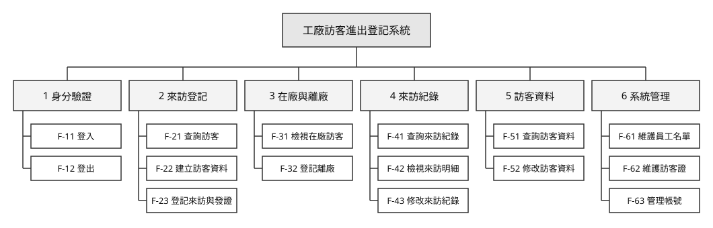

# 功能分析

## 系統分析與設計（IE226）115-1

授課教師：呂卓勲

本課程教材：[GitHub](https://github.com/billy1125/system-analysis-and-design)

---

## 需求寫完之後的問題

需求清單寫到第三十條，會出現一個問題：這三十條加起來，到底是一套什麼樣的系統？

- 條列式的需求彼此平行，沒有從屬關係
- 看得出系統該做哪些事，看不出這些事怎麼組成一個整體
- 也看不出哪一件事其實不該由這套系統負責

---

## 本章的例子

- 工廠訪客進出登記系統 `SAD-Visitor`
- 上一章整理出 18 條功能需求與 6 條非功能需求
- 本章把它們整理成功能結構，對應「系統分析完整報告」〈5. 功能分析與系統邊界〉，以下簡稱訪客系統報告

訪客系統報告把系統拆成六群、十五項功能，並列出六條界外項目。

---

## 本章對應範例報告的哪些小節

| 範例報告的小節 | 本章哪一節在講 |
|---|---|
| 〈5.1 功能階層圖〉 | 三、功能分解 |
| 〈5.2 功能清單〉 | 四、功能清單 |
| 〈5.3 系統邊界〉 | 二、系統邊界 |
| 〈9.1 從分析中找到的問題〉 | 二、界外項目怎麼變成現況問題 |

期末第一部分用一段文字寫邊界，見「修改需求與變更規格」。

---

# 一、功能分析在做什麼

需求與功能不是同一種東西。需求是一句可驗證的敘述，功能是系統實際要建造的組成單位，兩者的關係經常不是一對一。

本節先分清楚需求和功能的差別，再看跳過功能分析會出什麼問題。

---

## 需求是條目，功能是結構

| 方向 | 訪客登記系統的例子 |
|---|---|
| 多條需求合成一項功能 | FR-07 到 FR-10 四條需求，合起來是 F-23「登記來訪與發證」 |
| 一條需求拆成多項功能 | FR-13 依日期與關鍵字查詢來訪紀錄，拆成 F-41「查詢來訪紀錄」與 F-42「檢視來訪明細」 |

拆開的理由：兩項各自需要工時，可以分給不同的人做。

---

## 功能分析要回答三個問題

| 問題 | 產出 |
|---|---|
| 哪些事情是這套系統要做的、哪些不是？ | 系統邊界與範圍外清單 |
| 要做的事情怎麼組織成有層次的整體？ | 功能階層圖 |
| 每項功能對應誰的需求？ | 功能清單 |

> **簡單來說，功能分析就是把需求整理成系統的組成方式。**

---

## 跳過功能分析的後果

- **估不出時程**：需求條目的大小可以差到一百倍，能估的單位是功能
- **分不了工**：分工的依據是功能模組，沒有劃分只能靠口頭協調
- **修改不容易討論**：沒有一張界定範圍的圖，評估不了修改的影響
- **交給 AI 寫也省不了成本**：見下一頁

課程報告最常見的症狀：需求寫了很多，但沒有任何一張圖說得出「這個系統長什麼樣子」。

---

## 交給 AI 寫，也省不了成本

網路文章〈[AI 讓寫程式變便宜，系統開發的成本為什麼沒有跟著降？](https://claire-chang.com/post/ai-development-capability-transfer/)〉的觀察：

- 變便宜的只是寫程式這一段，瓶頸移到需求釐清、分工與審查
- 需求只用一兩句話交給 AI，AI 會依自己的模式補完空白
- 重工與審查又把省下的時間吃掉

> **需求要寫成可驗收的條件：誰使用、要解決什麼問題、什麼情況算正確。**

---

## 對開發人員的好處（1/2）

| 接手的人 | 拿到什麼 | 好處 |
|---|---|---|
| 程式設計師 | 功能清單 | 一次認領一項功能，知道要做到什麼程度、驗收看哪幾條需求 |
| 程式設計師 | 範圍外清單 | 知道哪些事不必做 |

---

## 對開發人員的好處（2/2）

| 接手的人 | 拿到什麼 | 好處 |
|---|---|---|
| 系統工程師 | 系統邊界與介面 | 知道要和哪些外部系統介接 |
| 系統工程師 | 功能階層圖 | 模組劃分、架構規劃與估算工時的起點 |

> **功能分析把「客戶要什麼」翻譯成「開發團隊要做哪幾件事」。**

---

## 用 AI 寫程式之後，功能分析更重要

| 功能分析的產出 | 交給 AI 時的作用 |
|---|---|
| 功能清單 | 一次交代一項功能，「對應需求」就是驗收條件 |
| 對應使用案例 | 說明誰在什麼情境下使用，例外流程一併交代 |
| 範圍外清單 | 告訴 AI 哪些事不要做 |
| 功能階層圖 | 決定工作怎麼切、每一塊由誰審查 |

> **AI 寫程式越快，交給它的東西越要先想清楚。**

---

# 二、系統邊界

系統邊界是一條把「本系統負責的部分」與「環境」分開的線。界內的東西由本專案設計、實作、維護；界外的東西是本系統必須配合、卻不去改變的既有條件。

期中與期末第一部分分析的都是既有系統，找邊界的方法和設計新系統不一樣。本節先看界外有哪幾類，再看既有系統怎麼找、找到之後寫在哪裡。

---

## 邊界界定的是責任

> **邊界劃分的是責任與範圍。**

- 一個外部系統和本系統資料往來再密切，只要這次專案沒有預算與權限去改它，它就在界外
- 例：`SAD-Visitor` 的員工名單現在由管理員手動維護；如果要改成與人資系統同步，人資系統仍在界外
- 把它畫進界內，等於承諾了一件做不到的事

---

## 界外的四類對象：定義

| 類型 | 定義 |
|---|---|
| 外部系統 | 和本系統交換資料，但由別人開發與維護的資訊系統或連網設備 |
| 外部組織或人員 | 不操作本系統，卻會提供資料、取得資料，或受系統內容影響的組織與人 |
| 實體設備與人工作業 | 在現場由設備或人完成的動作；系統最多只記錄它的結果 |
| 系統沒做的事 | 使用者可能預期系統會做，但沒有做、也沒有指定由誰做的事 |

---

## 界外的四類對象（1/2）

| 類型 | 訪客登記系統 | 常見的疏漏 |
|---|---|---|
| 外部系統 | 無，查證後確認沒有任何外部系統或設備介接 | 沒問清楚對方能不能提供介接方式 |
| 外部組織或人員 | 訪客、受訪員工、工安與環安人員 | 忘記他們也需要取得或提供資料 |

---

## 界外的四類對象（2/2）

| 類型 | 訪客登記系統 | 常見的疏漏 |
|---|---|---|
| 實體設備與人工作業 | 訪客證實體的收發、打分機通知受訪員工、目視核對證件 | 誤以為系統可以取代，實際上系統只是記錄它的結果 |
| 系統沒做的事 | 事前預約、與人資系統同步、報表匯出；偵測訪客沒登記離廠就離開 | 以為它一定有，沒有實際去查證 |

---

## 第三類：人工作業與它的紀錄分開看

同一件事常拆成兩半：人做的動作在界外，留下的紀錄在界內。

| 事項 | 界外：人工作業 | 界內：系統的功能 |
|---|---|---|
| 訪客證 | 接待員親手交付與收回訪客證 | 登記來訪與發證、登記離廠：記下哪一張證綁在哪一筆來訪 |
| 核對身分 | 接待員目視核對證件 | 存下身分證字號 |

> **界定邊界時，把人工作業與它的資料紀錄分開看。**

---

## 第四類：根本沒有人做的事

| | 前三類 | 第四類 |
|---|---|---|
| 這件事有沒有人做 | 有，只是在系統之外 | 沒有 |
| 由誰負責 | 外部系統、外部的人或現場作業 | 沒有指定給誰 |
| 怎麼發現 | 看得到負責的對象 | 沒有人會告訴你，只能自己查 |

既有系統的第四類最難找，是期中報告最容易漏掉的一類。

---

## 第四類的例子：訪客沒登記離廠就離開

- 有在廠訪客清單，使用者自然以為系統會發現沒離廠的人
- 系統沒有任何偵測，清單也不區分報到日期
- 只能靠接待員自己發現

> **使用者以為系統會做，系統沒做，也沒有人負責，這就是第四類。**

訪客系統報告把它寫成現況問題 I-01。

---

## 既有系統：找系統上的痕跡

既有系統早就做完了，規則、預算與責任歸誰多半問不到。最有效的是一個問題：

> **系統上有沒有任何畫面、操作路徑或資料欄位對應到它？**

- 有：在界內
- 三處都找不到：在界外

---

## 找到之後寫在哪裡

| 你發現的情況 | 屬於 | 寫在哪裡 |
|---|---|---|
| 經驗上該有，系統上卻完全找不到痕跡 | 界外 | 範圍外清單，並寫進現況問題 |
| 畫面上有入口，按了卻沒有作用 | 界內，但沒做完 | 不列進範圍外清單，直接寫進現況問題 |

兩者都要寫進現況問題，差別在於要不要列進範圍外清單。

---

## 從零設計新系統：問責任歸誰

期中與期末面對的都是既有系統，用不到這個方法。設計新系統時，用四個問題判斷：

- 處理規則是不是由本系統決定
- 資料是不是由本系統儲存與維護
- 這次專案有沒有預算與權限修改它
- 出問題時是不是由本專案團隊負責修

全部答「是」在界內，全部答「否」是外部實體；答案混雜的地方就是介面。

---

## 情境圖：期中、期末都不要求

情境圖把整個系統畫成一個處理，四周是外部實體，箭頭上寫流進流出的資料。

- 期中、期末都不要求，但可以用來補充使用案例圖
- 使用案例圖畫出接待員會「登記來訪」；情境圖標出接待員送進系統的資料：訪客手機、受訪員工、事由、隨行人數、車牌、訪客證
- `SAD-Visitor` 的情境圖只有接待員與管理員；訪客與受訪員工不操作系統，資料都經接待員轉手

---

## 沒有外部介接，也要寫一句話

訪客系統報告〈5.3〉的寫法：

「本系統沒有任何外部系統或設備介接。經檢視畫面、程式與資料表後確認，所有資料都由櫃台人員在這台電腦上輸入。」

> **「查證後確認沒有」與「沒查所以沒寫」在文件上長得一模一樣，那句話正是差別所在。**

---

## 範圍外清單：期中寫「如何確認」

新系統的範圍外清單寫「理由」。既有系統沒有人會告訴你當初為什麼不做，你能回答的是另一個問題：

> **你憑什麼斷定它沒做？**

所以期中把「理由」換成「如何確認」。

---

## 訪客系統報告的系統邊界（1/2）

| 界內 | 界外 | 如何確認 |
|---|---|---|
| 訪客到廠後的現場登記 | 事前預約 | 沒有任何「預定來訪日」欄位 |
| 顯示受訪員工的分機 | 通知受訪員工 | 受訪員工沒有帳號；沒有寄信或簡訊設定 |
| 訪客證與來訪紀錄的綁定 | 訪客證實體的收發 | 系統只記錄 `pass_id` |

---

## 訪客系統報告的系統邊界（2/2）

| 界內 | 界外 | 如何確認 |
|---|---|---|
| 隨行人數 | 隨行人員的個別資料 | `visits.companions` 只是一個整數 |
| 員工名單的手動維護 | 與人資系統同步 | 員工名單只能由管理員在畫面上新增與修改 |
| 畫面上的查詢 | 報表匯出與列印 | 查詢頁沒有匯出或列印按鈕 |

右欄的寫法是「以證據反證缺席」：我去了會有的地方看，那裡沒有。

---

## 界外項目是找現況問題的入口

界外的每一條都問一次：系統沒做這件事，有沒有人因此卡住？

| 界外項目 | 〈9.1〉的現況問題 |
|---|---|
| 隨行人員的個別資料 | I-07 隨行人員只記人數，緊急疏散時不知道是誰 |
| 訪客證實體的收發 | I-01 訪客沒交回訪客證就離開，一直留在在廠清單上 |
| 報表匯出與列印 | 沒有列：紀錄在查詢頁查得到，找不到誰因此受影響 |

界外寫系統「沒有什麼」，現況問題寫「誰因此遇到什麼後果」。

---

## 為什麼要把不做的事寫下來

範圍蔓延（scope creep）：需求一次追加 5%，沒有人覺得過分，十次之後工作量多了一半，時程卻不變。

> **有了範圍外清單，追加要求就變成一個必須重新談時程與資源的正式決策。**

---

# 三、功能分解

功能分解是把系統的整體目的逐層拆成較小的功能，直到每一項小到可以被指派、估時與驗收。拆得太粗分不了工，拆得太細又會變成操作步驟。

本節先講分解的方向與原則，再看範例報告的功能階層圖，以及分析既有系統時怎麼一步步找出這張圖。

---

## 由上而下逐層拆解

```
系統  →  功能模組（子系統）  →  功能
```

> **拆解的方向必須由上而下。**

由下而上把想到的功能一項項堆起來，最後一定會發現有的重複、有的遺漏，而且看不出哪些屬於同一類。

---

## 分解的四個原則

| 原則 | 說明 | 違反時的症狀 |
|---|---|---|
| 完整 | 同一層合起來涵蓋上一層的全部 | 「來訪紀錄」底下漏了修改 |
| 互斥 | 同一層各項之間不重疊 | 兩群都列了「修改訪客資料」 |
| 粒度相當 | 同一層的項目大小接近 | 同一層出現「系統管理」與「登出」 |
| 每層不超過 9 項 | 超過就再分一層 | 圖拉得很寬，看不出結構 |

前兩項合起來就是 MECE：不重複、不遺漏。

---

## 粒度：功能要能彼此分開

> **一個項目同時出現在兩項以上的功能裡，它就是共用的步驟，不是獨立的功能。**

- 「填寫來訪資訊」在登記來訪與發證、修改來訪紀錄兩項功能裡都用到
- 兩者檢查同一組欄位：事由、隨行人數、車牌、備註
- 訪客系統報告不列它，讓它留在兩項功能各自的流程裡

功能列得太多、太細時，逐項問：這一項有沒有出現在別的功能裡？有的話就移出功能階層圖。

---

## 訪客系統報告的功能階層圖



六群、十五項功能。每群只有兩到三項，少於 5 項不必硬湊。

---

## 這張圖值得注意的三件事

- **分群依業務性質，不依畫面**：跟著一位訪客的進出排；「在廠與離廠」有自己的規則，在廠與否由離廠時間是否為空推導
- **F-21「查詢訪客」看起來不像獨立功能**：沒有自己的選單，只是來訪登記頁的第一段，但它是 FR-05 唯一的落點
- **F-22「建立訪客資料」放在來訪登記**：訪客資料頁沒有新增按鈕，新訪客只在登記時查無手機才建立

---

## 既有系統的功能怎麼找

> **畫面提供線索，使用案例決定分群，需求負責驗收。**

1. 觀察畫面上界線清楚的區塊
2. 實際操作系統，以使用案例為骨架整合功能
3. 彙總成功能清單，回頭對應需求與使用案例

---

## 第一步：觀察畫面上的區塊

功能依業務性質分群，但既有系統的畫面仍是重要的線索。

- 開發者通常把同一件工作需要的操作放在同一個區塊
- 例子：來訪登記頁的「找訪客」與「來訪資訊」兩段、在廠清單每一列的「離廠」按鈕、員工名單的「修改」與「設為離職」
- 區塊只是線索，不能直接當成功能

---

## 第二步：以使用案例為骨架整合

想像自己是某個角色，會用系統做哪些工作，再對照使用案例圖，看每個使用案例用到哪些 UI 元素。

| 使用案例 | 用到的 UI 元素 | 整合成的功能 |
|---|---|---|
| UC-05 登記來訪（接待員） | 手機欄位與「查詢」、新訪客表單、下拉選單與「登記並發證」 | F-21 查詢訪客、F-22 建立訪客資料、F-23 登記來訪與發證 |

分群以使用案例為骨架，畫面只當佐證，所以仍然是由上而下。

---

## 第三步：回頭對應需求與使用案例

列成功能清單後，逐條檢查有沒有需求沒被任何功能認領：

- 漏找了功能：回第二步補上
- 現有系統本來就對應不到：系統沒做到，寫成現況問題

反過來，每一項功能也都要對應得到至少一個使用案例。

---

## 從零設計時容易漏的

從零設計新系統時，功能要從需求與使用案例推出來，畫面還不存在。

| 容易漏的 | 為什麼 |
|---|---|
| 不處理業務的那一群 | 「系統管理」不處理任何訪客的進出，但少了 F-61、F-62，登記頁的兩個下拉選單都是空的 |
| 沒有自己畫面的功能 | 道理和 F-21 相同：不在功能結構裡佔一個位置，就沒有人做 |

> **期末第 3 項畫的是既有系統，用前面的三步整理即可。**

---

## 什麼時候停止分解

下列任一成立即可停止：

- 對應得到一個使用案例，執行完使用者能得到有意義的結果
- 可以估出工時
- 可以指派給一個人，在合理時間內完成

> **出現「輸入手機號碼」「按下登記並發證」，就是拆過頭了，那是操作步驟。**

---

## 分解的常見錯誤

| 錯誤 | 症狀 |
|---|---|
| 用畫面當功能 | 出現「首頁」「查詢頁」 |
| 用資料表當功能 | 出現「`visits`」「`visitor_passes`」 |
| 用角色當模組 | 出現「接待員專區」「管理員專區」 |
| 層級混雜 | 「來訪登記」與「查詢訪客」放在同一層 |

---

## 「用畫面當功能」的例外

> **判準是這個畫面有沒有自己的業務規則。**

`SAD-Visitor` 的首頁是在廠訪客清單：

- 在廠與否不存欄位，由離廠時間是否為空推導
- 清單上方要算出在廠人數與隨行人數合計

訪客系統報告把它寫成 F-31「檢視在廠訪客」，那條規則才有地方掛。

---

# 四、功能清單

功能階層圖呈現結構，功能清單承載細節，兩者搭配使用。清單上的「對應需求」與「對應使用案例」兩欄，讓每一項功能都答得出「我為什麼存在」。

本節說明期中要填哪幾欄，以及對應需求時最常漏掉的東西。

---

## 期中要填五欄

| 欄位 | 用途 |
|---|---|
| 功能代號 | 供後續文件引用 |
| 功能名稱 | 動詞加受詞 |
| 使用角色 | 對應使用案例圖的參與者 |
| 對應需求 | 這項功能滿足哪幾條需求 |
| 對應使用案例 | 追溯到分析階段的來源 |

「功能說明」與「優先順序」期中免填，替新系統排開發順序時才要。

---

## 訪客系統報告的功能清單：來訪登記

| 代號 | 功能名稱 | 使用角色 | 對應需求 | 對應使用案例 |
|---|---|---|---|---|
| F-21 | 查詢訪客 | 接待員、管理員 | FR-05 | UC-03 |
| F-22 | 建立訪客資料 | 接待員、管理員 | FR-06 | UC-04 |
| F-23 | 登記來訪與發證 | 接待員、管理員 | FR-07、FR-08、FR-09、FR-10、NFR-03 | UC-05 |
| F-43 | 修改來訪紀錄 | 接待員、管理員 | FR-14、NFR-04 | UC-09 |

---

## 對應需求要把非功能需求也掛進來

- F-23「登記來訪與發證」：FR-07 到 FR-10，加上 NFR-03 來訪登記在單一頁面完成
- F-43「修改來訪紀錄」：FR-14，加上 NFR-04 來訪紀錄不得刪除

NFR-04 掛在 F-43，檢查這項功能時才會記得確認明細頁沒有刪除按鈕。

> **只填 FR，NFR 就變成沒有功能負責的孤兒。**

---

## 期中期末都不必交的部分

本章後半段處理模組。期末改成修改既有系統，這幾節也不列入必做：

- 模組怎麼切：內聚性與耦合性
- CRUD 矩陣：功能與資料的交叉檢查，期末列為可選
- 模組設計：模組規格與相依關係圖，列為進階閱讀

這幾節以 `SAD-Visitor` 的原始碼為例：「訪客證使用中」的判斷只寫在來訪登記，系統管理停用訪客證時沒有檢查，就是問題 I-09。

---

# 五、功能分析的自我檢核

功能分析完成後，要往前後兩個方向各檢查一次。這些檢查看的是各份文件是不是在描述同一套系統。

對不上的地方，就是還沒補完的功能，也是評量 Rubrics「文件間一致性與可追溯性」實際在看的東西。

---

## 五條檢核（1/2）

| 方向 | 檢查問題 | 對不上代表 |
|---|---|---|
| 需求 → 功能 | 每一條需求都找得到承接的功能 | 功能漏了，或那條是現況問題 |
| 功能 → 需求 | 每一項功能都答得出滿足哪條需求 | 功能多了，或需求沒寫下來 |
| 使用案例 → 功能 | 每個使用案例都對應到功能 | 漏掉整個使用情境 |

---

## 五條檢核（2/2）

| 方向 | 檢查問題 | 對不上代表 |
|---|---|---|
| 邊界 → 介面 | 情境圖上每個箭頭都有介面說明 | 假設了取不到的資料 |
| 資料 → 功能 | 每一份資料都有功能負責維護 | 漏了維護功能 |

---

## 期中做第四、五條的方法

- **邊界 → 介面**：`SAD-Visitor` 沒有外部介接，改問「範圍外清單的『如何確認』是不是都填得出來」
- **資料 → 功能**：翻開資料字典，每一張表、每一個欄位都問「誰寫進去、誰改它」

訪客系統報告〈7.3〉到〈7.7〉的「資料來源」欄，就是在回答這個問題。

---

## 本章重點回顧

- 系統邊界劃分的是責任，不看資料往來多密切
- 既有系統找邊界看系統上的痕跡，界外項目要寫出「如何確認」
- 界外項目是找現況問題的入口
- 功能分解由上而下，停在可以被指派的粒度
- 每一項功能都要對應得到需求與使用案例

---

## 下一章

本章交出的是系統的靜態結構：有哪些功能、由哪些模組承擔。

下一章「行為建模」補上動態的一面：這些功能在一次實際操作中按什麼次序發生、在哪裡分岔、參與者與系統之間來回傳了哪些資料。
