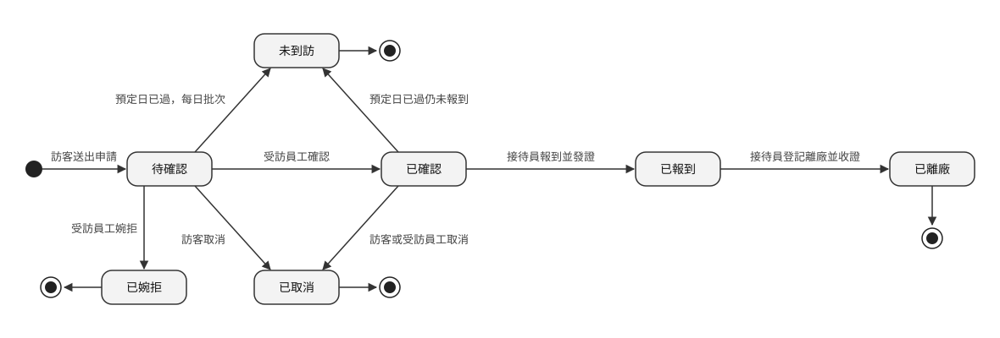
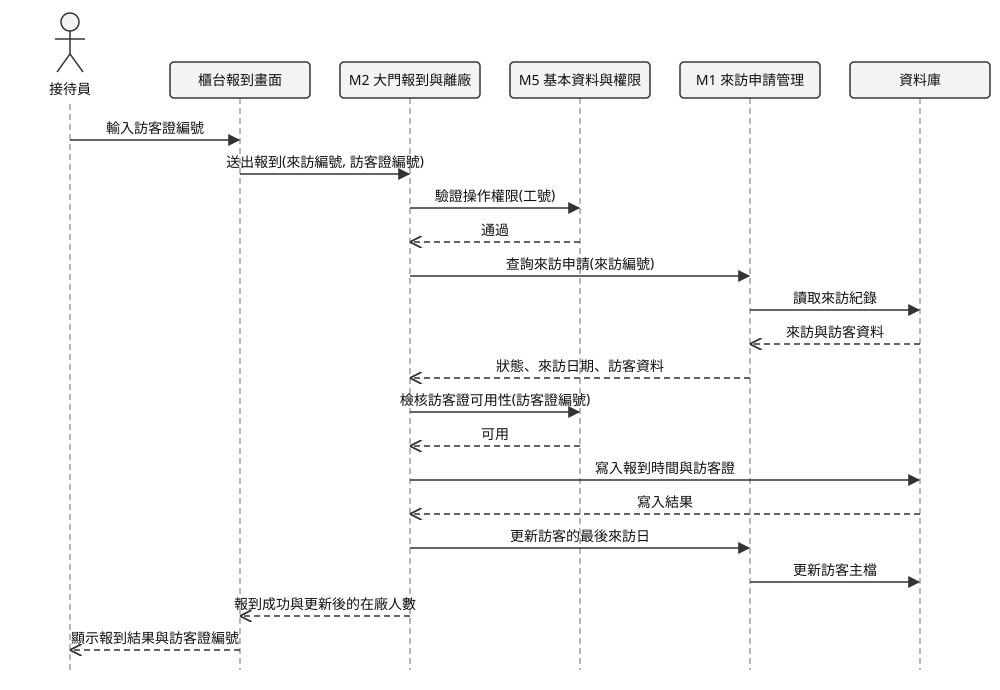

# 行為建模

功能清單上有一行寫著「F-43　啟用或停用會員」。這一行看起來已經把事情交代清楚了，但把它交給開發人員，第一個問題就會冒出來：管理員按下停用之後，系統是先檢查帳號存不存在，還是先檢查帳號是不是他自己？帳號已經被刪除了，是擋下來還是照樣停用？被停用的那個人此刻正登入著，他手上的操作會不會立刻被擋住？

這些問題的答案都不在功能結構裡。功能分解回答的是「系統由哪些部分組成」，上面每一個問題問的卻是「事情按什麼次序發生」。前者是靜態的結構，後者是動態的行為。兩者是同一套系統的兩個切面，缺哪一份，你都做不出可以實作的規格。

本章補上行為這一面，介紹三張圖。**活動圖/泳道圖** 描述流程怎麼走與在哪裡分岔，**循序圖** 描述參與者與系統之間來回傳遞了什麼訊息，**狀態機圖**（期末）描述一個資料物件從誕生到結束經歷哪些狀態。三張圖看的是同一件事的不同角度，也各自能抓出不同類型的遺漏。

> **前情提要**：本章假設你已完成[「使用者分析」](03-User-Analysis.md)的使用案例分析、[「系統需求分析」](04-System-Requirements-Analysis.md)的需求條列，以及[「功能分析」](05-Functional-Analysis.md)的系統邊界與功能結構。本章的例子以課堂範例系統 `SAD-Forum`（論壇系統）與它的[「系統分析範例報告」](../02-Midterm-Project-Example-Reports/Analysis-Phase-Sample-Report.md)〈3. 現況流程分析〉〈6. 使用案例與系統互動分析〉為主，編號沿用該報告（FR-01、NFR-01、UC-01、F-11 起）；範例報告沒有對應內容的部分——〈二、2.4〉的平行工作、〈五〉狀態機圖（期末）與〈六〉設計階段的深化——沿用前幾章的工廠訪客進出登記系統。

> **延伸閱讀**：這三張圖在各組報告中的繳交格式與最低標準，見[「系統分析範例報告說明」](../02-Midterm-Project-Example-Reports/Analysis-Phase-Deliverables.md)〈四、期中的 UML 最低要求〉與[「系統設計範例報告說明」](../04-Final-Project-Example-Reports/Design-Phase-Deliverables.md)。

> **必讀標記**：標題後加註 🔴 期中必讀 的小節，是期中小組報告九項產出直接會用到的內容；加註 🔵 期末必讀 的，是期末八項產出直接會用到的。判準與成品的樣子，期中見[「系統分析範例報告說明」](../02-Midterm-Project-Example-Reports/Analysis-Phase-Deliverables.md)與[「系統分析範例報告」](../02-Midterm-Project-Example-Reports/Analysis-Phase-Sample-Report.md)，期末見[「系統設計範例報告說明」](../04-Final-Project-Example-Reports/Design-Phase-Deliverables.md)與[「系統設計範例報告」](../04-Final-Project-Example-Reports/Design-Phase-Sample-Report.md)。未標記的小節仍屬課程範圍，只是報告不會直接產出。

## 一、結構之外還要描述行為 🔵 期末必讀

### 1.1 系統邊界確定後，請再回來確認行為建模

其實之前講過行為建模，也就是跟同學說明過了「使用案例圖」與「活動圖/泳道圖」，但是行為建模必須在功能分析之後重新確認，理由在於確認了系統邊界，更要與行為建模對齊。

循序圖要畫「參與者對系統說了什麼、系統回了什麼」，那個「系統」是一個方塊，方塊的範圍就是系統邊界。活動圖同理：哪些動作畫在系統的泳道裡、哪些留在人的泳道裡，取決於這件事是不是系統的責任。[「使用者分析」](03-User-Analysis.md)〈六〉畫活動圖時，邊界還沒有正式界定，系統泳道裡放什麼是憑操作系統的印象決定的；[「功能分析」](05-Functional-Analysis.md)〈二〉把邊界與範圍外清單寫下來之後，才有了可以對照的依據。

做完功能分析後，拿功能清單與範圍外清單，回頭對一次之前畫的活動圖/泳道圖，看兩件事：

- **有沒有多畫了系統沒做的事。** 憑經驗畫登入流程，很容易順手加上「寄送密碼重設信」。但論壇系統不寄任何電子郵件，這個分支畫上去，圖就和系統對不起來。泳道圖也一樣：管理員停用會員後要不要通知當事人，是系統以外的人工作業。〈2.3〉停用會員的泳道圖上，系統泳道的最後一步是「顯示：帳號已停用」，是給管理員看的；把「通知被停用的會員」畫進系統泳道，就等於說系統會主動通知當事人。
- **有沒有漏畫系統真的會做的事。** 反過來，系統實際會做的檢查，只憑操作印象畫圖時容易只畫出成功的那條路。停用會員時，系統會先確認目標是不是管理員自己、帳號是不是已刪除，兩種情況各回一則訊息：「不可停用自己的帳號」「該帳號已刪除，無法操作」。圖上少了這兩個判斷，系統的行為就沒有描述完整。

對不上的地方，要查清楚是圖畫錯了，還是邊界漏了一條。接下來要畫的循序圖，也以同一條邊界為準。

### 1.2 三張圖各回答什麼問題 🔴 期中必讀 🔵 期末必讀

| 圖 | 回答的問題 | 主角 | 最能抓出什麼遺漏 |
|---|---|---|---|
| 活動圖/泳道圖 | 這道流程怎麼走？在哪裡分岔？ | 動作與判斷 | 沒想過的例外分支 |
| 循序圖 | 誰對誰說了什麼？按什麼順序？ | 訊息 | 沒定義的輸入或回應 |
| 狀態機圖（期末） | 這個東西的一生經歷哪些狀態？ | 狀態與轉移 | 不該發生卻沒被擋住的操作 |

三張圖的關係可以這樣理解：活動圖/泳道圖是俯視的，看得到整條流程的全貌與所有岔路；循序圖是側視的，看得到時間軸上一來一往的細節；狀態機圖（期末）則是把鏡頭對準單一個資料物件，追蹤它自己的變化。

其中活動圖/泳道圖與循序圖是本課程要求每一組都要會畫的三張圖裡的後兩張。三張圖依分析的推進排列，各自回答一個問題：

| 順序 | 圖 | 回答的問題 | 在哪一章 |
|---|---|---|---|
| 1 | 使用案例圖 | 誰要做什麼 | [使用者分析](03-User-Analysis.md)〈五〉 |
| 2 | 活動圖/泳道圖 | 事情怎麼做 | [使用者分析](03-User-Analysis.md)〈六〉初次畫；本章〈二〉補完整符號並回頭確認 |
| 3 | 循序圖 | 使用者與系統怎麼互動 | 本章〈四〉 |

本章的圖不是從零開始畫，而是拿前面幾章的成果來畫。使用案例圖決定要畫哪些流程，圖上每一個橢圓都可以拿來畫活動圖/泳道圖或循序圖。[「系統需求分析」](04-System-Requirements-Analysis.md)寫下的每一條需求，都要能在其中一張圖上找到對應的步驟。[「功能分析」](05-Functional-Analysis.md)畫出的系統邊界，決定哪些步驟由系統做、哪些由人做；功能清單則用來檢查循序圖上的每一次操作，系統是不是真的有這項功能。所以同一件事，文字、活動圖/泳道圖與循序圖講的要一致。只要有一邊對不上，就是有東西漏了，或是改了一邊卻忘了改另一邊。

至於「系統管理哪些資料與概念」這個問題，期中用實體關聯圖與資料字典回答，見[「資料建模與資料庫設計」](07-Data-Modeling.md)；期末另外要求一張概念類別圖，見[「物件建模」](10-Object-Modeling.md)。兩張圖容易混淆，先畫過一輪 ERD 再學概念類別圖，差別才看得出來。

### 1.3 要畫幾張 🔴 期中必讀 🔵 期末必讀

你不需要每個使用案例都畫這三張圖，那會產出幾十張沒有人讀的圖。實務上的取捨是：

- **活動圖/泳道圖**：以有分支的流程為主。一般線性走到底、沒有任何判斷的流程，有在使用案例圖中畫出來就夠了，畫成活動圖只是畫出一個線性的流程而已。
- **循序圖**：建議畫核心且牽涉多方往返的使用案例。範例報告挑的是 UC-03「登入系統」與 UC-13「啟用或停用會員」，前者是每個會員都會走的主力流程、例外最多，後者是管理員的核心操作、還牽涉被停用的會員。
- **狀態機圖（期末）**：只畫有明確生命週期的物件。訪客登記系統裡只有來訪紀錄值得畫——它會經歷待確認、已確認、已報到、已離廠等狀態，而每個狀態允許的操作不同。訪客證則不需要，它只有可用與停用兩種情況。

以下是建議的內容：

| | 活動圖/泳道圖 | 循序圖 | 狀態機圖 |
|---|---|---|---|
| 期中 | 至少兩張，每張都要有例外分支，跨角色的那張用泳道 | 一到兩張，畫核心流程，系統是黑箱 | 不必畫 |
| 期末 | 至少兩張，挑**有判斷、有例外**的核心功能 | 一到兩張，挑**跨最多模組**的流程，**生命線必須是模組，不是黑箱** | 課程列為可選，**但物件的狀態多、又有會往回走的轉移時強烈建議做** |

表格期末那一列提到「往回走的轉移」，舉個例子：受訪員工原本已經確認一筆來訪申請，後來改成婉拒。這時狀態要先從「已確認」退回「待確認」，再改成「已婉拒」。**這種往回走的轉移，不畫圖很容易漏掉。** 漏掉的話，這筆已經取消的來訪還會留在櫃台的當日清單上，接待員就會照樣讓訪客進廠。

**期末還有一種情況要特別注意：某個狀態只有一條路可以離開，而走這條路要靠系統管不到的人配合。** 來訪紀錄的「已報到」就是這樣。它唯一的下一步是「登記離廠」，但這一步要訪客自己走回櫃台交還訪客證。畫出狀態機圖，這個問題一眼就看得出來，後面做風險分析時也才有根據。

## 二、活動圖/泳道圖 🔴 期中必讀 🔵 期末必讀

**[活動圖](https://zh.wikipedia.org/wiki/活动图)（Activity Diagram）是 [統一塑模語言](https://zh.wikipedia.org/wiki/统一建模语言)（Unified Modeling Language, UML）中描述流程步驟與控制流向的圖。** 它與傳統流程圖最大的差別在於能表達平行進行的工作，以及能用泳道標示每個動作由誰執行。

**泳道圖就是加上泳道的活動圖**，兩者是同一種圖，泳道圖多了「每個動作由哪個角色執行」的說明。本章寫「活動圖」時也包含泳道圖，只談泳道的部分才寫「泳道圖」。

期中的流程分析用的就是活動圖，基本畫法已在[「使用者分析」](03-User-Analysis.md)〈六、6.3〉到〈6.5〉介紹過。本章補上完整的符號與平行工作的畫法，並在需求與功能分析完成之後，回頭檢查之前畫的圖。

### 2.1 符號 🔴 期中必讀 🔵 期末必讀

| 符號 | 畫法 | 含義 |
|---|---|---|
| 起始節點 | 實心圓 | 流程的起點，一張圖只有一個 |
| 動作 | 圓角方框 | 一個有明確起訖的步驟，寫成動詞加受詞 |
| 判斷節點 | 菱形，一進多出 | 依條件選擇其中一條路徑，每條出線都要標示條件 |
| 合併節點 | 菱形，多進一出 | 分岔的路徑重新合流 |
| 分岔（fork） | 粗橫線，一進多出 | 之後的路徑同時進行 |
| 會合（join） | 粗橫線，多進一出 | 等所有平行路徑都完成才繼續 |
| 結束節點 | 內含實心圓的空心圓 | 流程的終點，可以有多個 |

[「使用者分析」](03-User-Analysis.md)〈6.3〉只用到起始節點、動作、判斷節點與結束節點四種，合併、分岔與會合是本章補上的。

判斷節點和分岔最容易搞混，其實兩者剛好相反：判斷是從幾條路裡 **選一條走**，分岔是 **每條路都要走**。以登入流程為例，「驗證碼是否正確」是判斷，結果只會是對或錯其中一個；通過之後的「更新最後登入時間」與「建立登入狀態」如果可以同時做，就畫成分岔。

動作方框怎麼寫，還有兩點要補充，分析既有系統時都會用到：

**顯示錯誤時，要把系統實際顯示的文字寫進方框。** 只寫「顯示錯誤訊息」，讀圖的人不知道系統到底說了什麼，要寫成「顯示：帳號或密碼錯誤」「顯示：不可停用自己的帳號」。因此有時你可以透過系統顯示的訊息，確認活動圖的方框要顯示甚麼訊息？

**處理完例外之後，箭頭要接回哪裡，由你來判斷。** 例外分成兩種。第一種可以重試，例如欄位沒填、格式不對、驗證碼錯誤：顯示訊息後，把箭頭拉回輸入的那個動作，讓使用者改完再送一次。第二種不能重試，例如權限不足、要處理的資料已經被刪除：那就需要顯示訊息，再直接到結束節點。

### 2.2 用使用案例敘述與需求回頭檢查 🔴 期中必讀 🔵 期末必讀

[「使用者分析」](03-User-Analysis.md)〈6.5〉是從流程的文字欄位把活動圖畫出來。到了這一步，使用案例敘述已經寫成詳細版本，需求也有了編號，就要拿這兩份回頭檢查之前的圖。對照方式：**主要流程的每一個步驟都要對得到一個動作，每一條例外流程都要對得到一個判斷節點加上一條分支。**

以範例報告〈6.1〉的 UC-03「登入系統」為例。它的主要流程是：1. 訪客請求登入頁　2. 系統回傳表單與驗證碼圖　3. 訪客送出 email、密碼、驗證碼　4. 系統驗證驗證碼　5. 系統驗證帳號與密碼　6. 系統檢查帳號狀態　7. 系統記錄登入時間並建立登入狀態　8. 系統導向首頁。例外流程有 `4a` 驗證碼未填或錯誤、`5a` 帳號密碼未填、`5b` 帳號或密碼錯誤、`6a` 帳號已停用四條。範例報告〈3.1〉把它們畫成這張活動圖：

*本圖由作者自製*

`4a` 在圖上拆成「驗證碼是否填寫」與「驗證碼是否正確」兩個判斷，因為「沒填」與「填錯」給的訊息不同；其餘三條各對應一個判斷。一個例外可以拆成幾個判斷，但每一個例外至少要有一個判斷，詳見[「使用者分析」](03-User-Analysis.md)〈六、6.5〉。

圖畫好之後，把和 UC-03 有關的功能需求與非功能需求逐條拿來比對，找出每一條落在圖上的哪個動作或判斷：

**功能需求：**

- FR-06（登入成功後記錄最後登入時間）：對應「更新最後登入時間」這個動作。
- FR-07（擋下已停用或已刪除的帳號）：對應「帳號是否啟用」這個判斷，但這個判斷只處理停用，已刪除的帳號見下一段。
- FR-02（每次載入都產生新的驗證碼）：在這張圖上找不到，它畫在〈四、4.3〉的循序圖上。

**非功能需求：**

- NFR-02（先檢查驗證碼，再查資料庫）：對應驗證碼的兩個判斷排在帳號密碼前面。
- NFR-03（帳號不存在、已刪除與密碼錯誤，都回同一則訊息）：對應「帳號存在且密碼正確」只有一個判斷，失敗時只有一則訊息。
- NFR-09（錯誤訊息要說明問題，但不能透露帳號是否存在）：對應「顯示：帳號或密碼錯誤」這則訊息的寫法，它告訴使用者登入失敗，卻沒說是帳號不存在還是密碼錯。

像 FR-02 這樣找不到的，不一定是漏了，也可能是由另一張圖負責，但你要說得出是哪一張。這種逐條對照，是活動圖最直接的檢查用法。

對照時還會冒出一個問題。FR-07 說要擋下「已停用」和「已刪除」兩種帳號，圖上卻只有「帳號是否啟用」一個判斷，那已刪除的帳號走哪條路？這個問題要等到畫圖時才會發現。期中分析的是現成的系統，答案要實際測試：拿已刪除的帳號登入，系統回的是「帳號或密碼錯誤」。也就是說，已刪除的帳號在「帳號存在且密碼正確」這一關就被擋下，和帳號不存在走同一條路（見範例報告〈7.3〉的帳號狀態表）。**畫活動圖的一個用處，就是逼你發現這種問題。**

活動圖的另一個用處，是看出 **判斷的先後順序**。只把功能需求與非功能需求一條條列出來，看不出哪個檢查先做、哪個後做；畫成活動圖，順序就清楚擺在圖上。這個順序不是隨便排的，它本身就是一項分析結果，值得在報告裡專門寫一段。

例如上圖把驗證碼排在帳號密碼前面。檢查帳號密碼要查資料庫，每多一次嘗試，系統負擔就多一分；檢查驗證碼只要和伺服器暫存的答案比對，不必查資料庫。先檢查驗證碼，惡意程式自動大量嘗試登入時，在查資料庫之前就會被擋下（NFR-02）。

範例報告〈3.2〉停用會員的流程也是一樣。系統依「是否已登入 → 帳號是否可用 → 是否為管理員」的順序檢查權限，因為每一關沒通過時，處理方式都不同：

- 第一關沒過：導向登入頁。
- 第二關沒過：代表身分已經失效，要把使用者登出。
- 第三關沒過：只是權限不足，導回首頁就好（NFR-05）。

順序一旦對調，使用者看到的回應就和實際狀況不符。

**所以畫完之後要多問一句：這幾個判斷可以對調嗎？** 如果答案是「不行，因為……」，後面那句理由就值得寫進報告；如果答案是「可以，順序沒差」，這也是一個結論，代表這裡沒有藏著規則。

### 2.3 用泳道標示責任 🔴 期中必讀 🔵 期末必讀

如果你的活動圖中的流程牽涉好幾個角色，或是要分清楚哪些動作由人做、哪些由系統做時？建議畫成「**泳道圖**」。反過來說，**只有「使用者」和「系統」兩方的流程，不必加泳道**。這種流程每個動作是誰做的，一看就知道，加了泳道只是多兩個框。

> 為什麼叫泳道圖？因為圖上每個角色各佔一條長條，動作都畫在負責角色的那一條裡，並排起來就像游泳池裡分隔好的泳道。

泳道圖的重點與優點：**每個動作都標得出是誰做的**？以範例報告〈3.2〉的「管理員停用會員」為例，這個流程有管理員、系統與被停用的會員三方參與：

*本圖由作者自製*

泳道要畫幾條、每條放什麼，看這個流程有沒有系統參與。[「使用者分析」](03-User-Analysis.md)〈六、6.4〉那張圖畫的是系統導入之前的作業，泳道全是人和單位，目的是整理現在誰在做什麼、工作在哪裡交給下一個人。**只要流程裡有系統參與，「系統」就要獨立畫成一條泳道。** 使用者送出操作之後，系統接手做的檢查、寫入資料與回應，都畫在這條泳道裡。期中分析的是既有系統，你畫的每一張跨角色活動圖都屬於這一種，上圖就是一例。

**箭頭跨過泳道，代表工作換人負責。** 從人的泳道進到系統泳道，代表從這一步開始由系統負責；再從系統泳道出來，代表系統把結果交回給人。把導入前和導入後的兩張圖放在一起比，跨泳道的箭頭少了幾條，就代表系統實際省掉了幾次人工交接。

實際動手畫的時候，馬上會遇到三個畫法上的問題：

- **系統泳道裡也可以有判斷節點（菱形）。** 系統做的事大多是檢查，像上圖的「目標是否存在」「目標是否為自己」「目標是否已被刪除」都是。這些判斷是系統做的，就畫在系統泳道裡，不要為了圖面整齊，把它們全部移到泳道外面。
- **錯誤訊息的方框可以不放在任何泳道裡。** 檢查沒通過時顯示的訊息，可以畫在所有泳道外面，再用箭頭指過去。上圖只有三則錯誤訊息，放在系統泳道裡還看得清楚；訊息一多，全部塞進同一條泳道，這條泳道就會被錯誤訊息塞滿，看不出主要流程在哪裡。畫法見本節最後「管理員調整會員角色」的泳道圖。
- **可以多開一條泳道，畫出動作的「後果」。** 有些動作的影響，要等流程結束之後才出現，而且落在另一個人身上。上圖的「被停用的會員」泳道就是這樣：這位會員要等下一次登入時才會被擋下。這件事不在停用流程裡，卻是停用這個動作真正的目的。替這位會員開一條泳道、只放一個方框，整張圖要表達的事就完整了。這個方框還會帶出下一個問題：如果這位會員被停用時還在登入狀態呢？實際測試的結果是，這位會員仍然可以修改自己的姓名與顯示名稱，這就是範例報告〈9.1〉的現況問題 I-01。

下圖是同一套系統的「管理員調整會員角色」（FR-19、FR-21）。管理員送出新角色之後，系統依序做四項檢查，每一項沒通過都有一則錯誤訊息。這四則訊息全部畫在泳道外面，系統泳道裡只留下判斷與成功的那條路：

*本圖由作者自製*

### 2.4 平行工作怎麼畫

前面的例子都是單線流程。有好幾件事可以同時進行時，用分岔與會合來畫。[「系統分析範例報告」](../02-Midterm-Project-Example-Reports/Analysis-Phase-Sample-Report.md)分析的論壇系統沒有這種流程，期中報告也就沒有範例可以參考，所以這裡改用前幾章的工廠訪客進出登記系統來示範：每天結算時，系統要整理三份資料，三份互不相干，可以同時做，全部做完才能產生日報。

*本圖由作者自製*

分岔與會合都畫成一條粗橫線（同步桿）：分岔是一條線進、多條線出，會合是多條線進、一條線出。

平行的判準是 **這幾件事之間沒有先後依賴**。彙整來訪筆數不需要等彙整逾時紀錄做完，所以可以分岔；但產生日報必須等三者都完成，所以要會合。最常見的錯是把所有動作串成一長條直線，這樣你後續估算工期時，就看不出哪些工作可以同時進行。

## 三、活動圖/泳道圖的常見錯誤 🔴 期中必讀 🔵 期末必讀

| 錯誤 | 症狀 | 修正方向 |
|---|---|---|
| 判斷節點沒標條件 | 菱形出來兩條線，都沒寫字 | 每條出線都要標條件，且條件要互斥且窮盡 |
| 只畫順利的那條路 | 整張圖沒有任何菱形 | 回到使用案例敘述的例外流程，逐條補上分支 |
| 畫成畫面操作流程 | 出現「點選右上角的登入連結」「切換到第二頁」 | 那是介面設計，活動圖描述的是業務動作 |
| 動作寫成名詞 | 出現「會員資料」「登入作業」 | 改成動詞加受詞，例如「更新最後登入時間」 |
| 沒有結束節點 | 某條分支走到一半就斷了 | 每條路徑都要有出口，斷掉的地方通常代表漏了一段流程 |
| 泳道分給部門而非角色 | 出現「警衛室」「廠務課」 | 改成角色，組織改組時圖才不會失效 |

其中第二項最要緊。一張沒有菱形的活動圖，幾乎可以斷定是把使用案例敘述的主要流程原樣搬過來，而 **活動圖該畫的正是例外流程**。系統上線後出問題的地方多半在這裡，順利的那條路早在開發時就走過幾百次了。

## 四、循序圖 🔴 期中必讀 🔵 期末必讀

**[循序圖](https://zh.wikipedia.org/wiki/时序图)（Sequence Diagram）畫的是幾個參與方之間，依時間先後互相傳了哪些訊息。** 分析階段用的是簡化畫法：把整套系統當成一個看不到內部的黑箱，只畫使用者和系統之間的一來一往，不畫系統內部做了什麼。教科書把這種畫法叫做 System Sequence Diagram（SSD，系統循序圖），本章一律簡稱循序圖。

換個角度看，循序圖是在規劃使用者和系統怎麼互動：使用者輸入什麼、系統顯示什麼、遇到狀況怎麼反應。這份規劃之後也是使用者介面（User Interface，UI）設計的起點。

### 4.1 黑箱的意義 🔴 期中必讀

分析階段刻意把系統畫成黑箱，是因為這個階段要回答的是「系統對外答應做到什麼」，不是「系統內部怎麼做到」。前者可以拿去和使用者確認，後者不行。例如沒有會員會關心自己的密碼存在哪一張資料表。

這樣畫的好處是，圖上的每一條訊息，之後都會變成系統要負責的一件事。訊息送進去卻沒有回應，代表使用者做完操作，不知道有沒有成功；系統送出回應，卻找不到是哪一條訊息觸發的，代表這份資料不知道從哪裡來。這兩種漏洞在功能清單上看不出來，畫成循序圖就很明顯。

### 4.2 符號 🔴 期中必讀 🔵 期末必讀

| 符號 | 含義 |
|---|---|
| 參與者 | 圖左邊的人形符號，代表發起操作的角色 |
| 物件（分析階段只有一個：系統） | 圖上方的方框，代表接收請求的一方 |
| 生命線 | 從方框往下拉的虛線，越往下時間越晚 |
| 訊息 | 實線箭頭，寫成動詞加參數，代表送出一次請求 |
| 回傳 | 虛線箭頭，寫使用者看到的結果或訊息，代表系統的回應 |
| 片段 | 把幾條訊息框起來的方框，標上 `loop`、`alt`、`opt` 說明這幾條訊息在什麼條件下發生 |

三種常用片段可以用程式語言的寫法來理解：

| 片段 | 對應的程式寫法 | 意思 |
|---|---|---|
| `loop` | `for` 迴圈 | 框裡的訊息重複做 |
| `alt` | `if … else if … else` | 幾種情況選一種，對應活動圖的判斷節點 |
| `opt` | 沒有 `else` 的 `if` | 條件成立才做，不成立就跳過，對應使用案例的 «extend» |

**回傳要寫使用者看到什麼，不要寫系統內部傳了什麼資料。** 「顯示：帳號已停用」「回傳該頁會員清單與總筆數」是對的寫法；「回傳 boolean（是或否的值）」「回傳 user 物件」不對。後者是設計階段才決定的事，分析階段也沒辦法確認。

**活動圖上串成一串的好幾個判斷，到了循序圖通常合併成一個 `alt`，裡面分好幾種情況。** 活動圖在意的是「檢查的先後順序」，所以判斷要一個接一個畫；循序圖在意的是「使用者送出一次之後，可能收到哪幾種回應」，所以把這幾種結果並排放在同一個 `alt` 裡，一個 `else` 代表一種結果。下圖節錄自〈4.3〉UC-03 的循序圖（範例報告〈6.1〉），只留送出登入之後的部分：

*本圖由作者自製*

兩種畫法沒有對錯之分，只是回答的問題不同。要檢查的是數量：活動圖上有幾種結果，`alt` 裡就要有幾種情況。

### 4.3 範例報告的兩張循序圖 🔴 期中必讀

範例報告〈6.1〉和〈6.2〉各畫了一張循序圖。第一張是 UC-03 登入系統：

*本圖由作者自製*

第二張是 UC-13 停用會員：

*本圖由作者自製*

畫這兩張圖時，有幾條規則要遵守。

**訊息名稱要寫出帶了哪些資料。** 只寫「送出登入」不夠，要寫成 `送出登入(email, 密碼, 驗證碼)`。括號裡的參數，就是這個操作需要使用者輸入的欄位。這些參數會直接對應到資料字典裡的欄位，之後設計畫面時也要用到。只寫動作不寫參數，這張圖對後面的工作幫助不大。

查詢類的訊息也要寫參數，而且最容易漏掉。UC-13 的 `請求會員清單(狀態篩選, 關鍵字, 頁碼)` 有三個參數，代表這個畫面可以篩選、可以搜尋、可以分頁；如果只寫「請求會員清單」，這三項功能在圖上就看不到了。**只要是使用者送給系統的東西，不管是輸入的資料還是選擇的條件，都算參數。**

**每一條送進系統的訊息都要有回應。** 上面兩張圖裡，使用者每送出一次，系統都會回一次。如果某條訊息送進去之後沒有回傳箭頭，就要問：使用者怎麼知道這件事做完了？

**拿到畫面和圖片的往返也要畫。** 使用者要先拿到表單，才能填寫；畫面上的驗證碼圖片，也是向系統要來的。UC-03 的前四條訊息「請求登入頁 → 回傳登入表單 → 請求驗證碼圖片 → 回傳驗證碼圖片」很常被省略，但省略之後，就看不出「驗證碼每次都重新產生」，FR-02 與 NFR-02 在圖上也找不到對應的地方。**圖要從使用者第一次打開這個功能開始畫，不是從按下送出鍵開始畫。**

**黑箱裡不要畫系統內部的動作。** 圖上不應該出現「系統呼叫資料庫」「系統驗證權限」這種系統自己指向自己的箭頭，那些是設計階段才畫的。

### 4.4 與活動圖/泳道圖的分工 🔴 期中必讀

同一個使用案例，畫了活動圖又畫循序圖，會不會重複？不會，因為兩張圖記錄的東西不一樣。

| | 活動圖/泳道圖 | 循序圖 |
|---|---|---|
| 擅長表達 | 分支、同時進行的工作、誰負責 | 每次傳了什麼資料、來回幾次、先後順序 |
| 不擅長表達 | 看不出每次互動傳了什麼資料 | 分支一多，圖會擠成一團 |
| 之後用在哪裡 | 整理業務規則、規劃權限 | 設計畫面欄位、API（程式之間互相呼叫的介面）的初稿 |

實際搭配的方式是：流程複雜的使用案例，以活動圖為主；來回互動多的，以循序圖為主；核心的使用案例兩張都畫。範例報告的「登入」和「停用會員」都兩張都畫，〈3.1〉〈3.2〉是活動圖，〈6.1〉〈6.2〉是循序圖。原因是這兩個使用案例都有好幾個例外分支，又分別是會員和管理員的核心操作。兩張圖怎麼互相對照，範例報告〈6.3〉用 UC-03 示範了一次。

## 五、狀態機圖 🔵 期末必讀

**[狀態機圖](https://zh.wikipedia.org/wiki/状态图)（State Machine Diagram）畫的是一筆資料從建立到結束，會經過哪些狀態，以及發生什麼事會讓它從一個狀態變到下一個狀態。** 它的理論基礎是 [有限狀態機](https://zh.wikipedia.org/wiki/有限状态机)（Finite State Machine）。這個概念在製造業很常見，例如機台的待機、運轉、故障、保養，就是一組狀態。

### 5.1 什麼樣的東西需要狀態圖 🔵 期末必讀

判斷標準只有一條：**這筆資料在不同階段，能做的操作是不是不一樣。**

來訪紀錄符合這個標準。來訪還在「待確認」時，可以修改日期與事由；一旦變成「已報到」就不能改了，因為訪客已經拿著訪客證進廠。「已離廠」的來訪，也不能再登記一次離廠。這些規則如果不畫成狀態圖，就會分散寫在各個功能的說明裡，很容易漏掉幾條。

狀態機圖是期末才要交的，期中不必畫，但範例報告已經用過同一個判斷標準。〈7.3〉的帳號狀態表列出正常、停用、已刪除三種狀態，每一種能不能登入、能做哪些管理操作都不一樣，已刪除的帳號則是任何管理操作都不能做。這張表其實就是用表格寫成的狀態圖。

訪客證就不符合。它只有「可用」和「已停用」兩種情況，一條規則（遺失或損壞時由管理者停用）就說完了，不需要畫圖。**要注意，「這張證現在在不在某位訪客身上」不是訪客證的狀態**，這件事要從來訪紀錄推算出來，兩者不要搞混。

### 5.2 來訪紀錄的狀態機圖 🔵 期末必讀

*本圖由作者自製*

### 5.3 狀態圖抓出的漏洞 🔵 期末必讀

畫完之後，用下面三個問題檢查，每一個都可能找出漏掉的功能。

**每一次狀態改變，是不是都有一項功能負責？** 拿[「功能分析」](05-Functional-Analysis.md)〈三、3.4〉的功能階層圖一條條對照，會發現「訪客取消申請」在功能清單上找不到。這是一項被漏掉的功能，而訪客取消在實際運作時是會發生的事。

**每一個狀態下，哪些操作要擋下來，是不是都想清楚了？** 例如來訪還在「待確認」時，接待員能不能直接讓訪客報到？分析時沒想過這個問題，開發人員寫程式時就會自己決定，而開發人員的決定不一定符合現場的做法。

**有沒有哪個狀態，要離開它得靠系統管不到的事？** 上圖的「已報到」只有一條路可以離開，就是訪客走回櫃台交還訪客證。**系統沒辦法控制大門**，訪客直接走出去，系統也不知道。把這個情況畫出來，後面做風險分析時就有具體根據，不是憑空寫一條「訪客可能不登記」。這個問題最容易被忽略。

狀態圖還可以用在資料庫設計：圖上的狀態名稱，會直接變成來訪紀錄資料表中「狀態」欄位可以填的值，後面的資料建模會再用到。**上圖有三個結束狀態都代表「沒有來成」：已婉拒、已取消、未到訪。這三個要分開記，因為管理上想知道的事不一樣：婉拒是受訪員工不同意，取消是事先就通知了，未到訪是訪客沒有出現。如果合成一個值，就統計不出各自發生幾次。**

## 六、設計階段的深化 🔵 期末必讀

以上三張圖畫的都是分析階段的版本。到了設計階段，同樣三張圖要往下推進一層，成為期末報告的「主要流程設計」。

### 6.1 黑箱打開 🔵 期末必讀

分析階段的循序圖只有一個方塊，設計階段要把這個方塊拆開，畫出內部的呼叫。拆的依據是[「功能分析」](05-Functional-Analysis.md)〈五、模組設計〉的模組規格。圖上每一個方塊對應一個模組，每一條跨方塊的訊息，都應該在該模組「對外提供的服務」那一欄找得到。

*本圖由作者自製*

你把這張圖與〈4.3〉的循序圖擺在一起比較：分析階段的圖只有參與者與系統兩條生命線，只承諾「送進去會有回應」；設計階段的圖則說明這個回應是怎麼被做出來的——經過哪幾個模組、讀寫了哪幾份資料、檢核發生在哪一步。

設計循序圖上的方塊名稱，必須與功能模組設計的模組對得起來；讀寫的資料必須與資料庫設計的資料表對得起來。這幾份文件不一致，是期末報告最常見的扣分點。**訊息括號裡的參數也一樣要寫，而且每一個都要在資料字典或推導欄位清單裡找得到對應**——`檢核訪客證()` 與 `檢核訪客證(訪客證編號)` 傳達的資訊量差很多。

**還有一件設計階段才會出現的東西：交易邊界。** 一次操作如果要同時寫兩張表（報到時間寫進來訪紀錄、最後來訪日寫進訪客主檔），兩者必須一起成功或一起失敗，否則會留下一筆報到了卻沒更新保存期限起算日的資料。這件事在圖上要看得出來——用 `開始交易` 與 `結束交易` 兩條訊息把該包住的那幾次寫入夾起來。

**交易邊界畫在哪裡是設計決定，不是實作細節。** 而且它畫出來之後，常常會順便暴露一個問題：**檢核在交易外面、寫入在交易裡面，兩者之間有一段空隙。** 兩個同時進行的請求會在這段空隙裡讀到同一個舊值、各自通過檢核，然後都寫進去。你把這個空隙畫出來，不代表你要解決它——但那個位置就是風險分析裡最具體的一條，畫得出來才寫得出「我知道它在哪、我評估過、這次不處理」。

**要不要再往下拆到 Controller、Service、Repository 這一層？** 本課程不要求。依[「報告內容」](../00-Course-Introduction/Report-Contents.md)期末的技術深度原則，那屬於可選範圍。畫到模組層級、每條訊息都對得回模組規格，就達到「主要流程設計」的要求了。

### 6.2 設計階段要交的東西 🔵 期末必讀

| 產出 | 分析階段 | 設計階段 |
|---|---|---|
| 活動圖/泳道圖 | 業務流程與例外分支 | 加上系統內部的處理步驟與錯誤處理 |
| 循序圖 | 系統為黑箱，只有參與者與系統 | 黑箱打開，畫出模組之間的呼叫鏈 |
| 狀態機圖 | 期中不必畫 | 業務狀態（來訪的待確認、已報到），加上狀態欄位的實際值與轉移時的資料異動 |

三者合起來就是期末報告的「主要流程設計」。你要選哪幾條流程來畫，判準是 **選會影響架構決策的**：牽涉多個模組、有交易一致性要求、或效能敏感的流程優先。把五條增刪改查流程各畫一張，圖很多但沒有資訊量。

## 七、三張圖如何與前後文件對得起來 🔴 期中必讀 🔵 期末必讀

行為建模的產出必須能雙向追溯，往前追到使用案例與需求，往後接到資料與介面設計。三張圖畫完後，你用下表逐項檢查一次：

| 方向 | 檢查問題 | 對不上代表 | 期中 |
|---|---|---|---|
| 使用案例 → 活動圖 | 敘述裡的每一條例外流程（`4a`、`5b` 那些編號），圖上是否都有對應的判斷節點 | 例外沒被處理，或敘述寫了卻沒實作 | 要查 |
| 需求 → 活動圖 | 每一條功能需求，是否都落在某個動作或判斷上 | 需求漏了，或圖畫得不夠細 | 要查 |
| 活動圖 → 循序圖 | 圖上每一次跨越系統邊界的動作，是否都是循序圖上的一條訊息 | 有一段互動只存在於其中一張圖 | 要查 |
| 循序圖 → 功能清單 | 圖上每一條訊息，是否都對應得到一項功能 | 冒出了功能清單沒有的功能 | 要查 |
| 循序圖 → 需求 | 每一條訊息與它的回應，是否都對得到一條功能需求或非功能需求 | 系統做了一件沒有需求依據的事 | 要查 |
| 循序圖 → 資料字典 | 訊息括號裡的參數，是否都能在資料字典裡找到對應欄位 | 使用者輸入的東西沒有地方存，或欄位定義漏了一個 | 要查 |
| 循序圖 → 介面欄位 | 參數是否都能在畫面上找到輸入的地方 | 要求使用者提供一份他手上沒有的資料 | 期末 |
| 狀態機圖 → 功能清單 | 每一條狀態轉移，是否都有功能負責觸發 | 漏了功能，如前述的「訪客取消申請」 | 期末 |
| 狀態機圖 → 資料模型 | 圖上的狀態，是否都在資料表的狀態欄位值域裡 | 資料設計與業務規則脫節 | 期末 |

最後一欄標「期中」的六條，是期中報告交件前一定要做一遍的。這些檢查與[「功能分析」](05-Functional-Analysis.md)〈六〉的自我檢核性質相同：它們不檢查圖畫得漂不漂亮，只檢查各份文件是不是在描述同一套系統。**對不上的時候，先別急著改圖——比較常見的情況是有東西真的被漏掉了，改圖只會把證據抹掉。**

## 八、學習重點總結

讀完本章後，你應該能夠理解以下核心概念，並將其應用於工業場域的思考與決策：

**結構與行為是同一套系統的兩個切面**

功能分解說得出系統由哪些部分組成，卻說不出一次操作按什麼次序發生；行為模型補上後者。兩者都不能單獨構成可實作的規格：只有結構，開發人員得自行猜測流程；只有行為，就看不出整套系統的全貌與工作量。系統邊界確定之後，行為模型要回頭再確認一次，原因也在這裡——邊界決定了哪些動作該畫在系統這一側。

**例外分支才是行為模型的價值所在**

一張沒有任何判斷節點的活動圖等於把文字重排一次，技術增量為零。真正值得你畫圖的是那些「如果驗證碼填錯怎麼辦」「如果目標帳號已被刪除怎麼辦」的岔路，因為系統上線後出問題的地方幾乎都在這裡。畫圖的過程會逼出使用案例敘述沒寫到的問題——例如被停用的會員此刻還登入著，他還能做什麼。這些問題在分析階段被問出來，成本是幾分鐘的討論；到實作階段才發現，成本是重寫。

**黑箱是分析階段刻意的紀律**

分析階段的循序圖只有一個方塊，因為這個階段要交出的是系統對外的承諾，而承諾必須是會員與管理員聽得懂、確認得了的。你守住這條紀律，圖上每一條訊息都會變成一項可驗收的責任。一旦畫進內部呼叫，看得懂這張圖的就只剩開發團隊，而他們正是最不該單獨決定系統要做什麼的一群人。

**訊息要寫出攜帶的資料**

循序圖上的箭頭若只寫動作名稱，這張圖對後續工作沒有貢獻；寫出括號裡的參數，它就成為介面欄位與資料設計的直接依據。這一點是循序圖與活動圖最實際的分工——活動圖告訴你流程往哪裡走，循序圖告訴你每一次往返實際搬動了哪些資料。

**狀態決定了哪些操作應該被擋住（期末）**

有生命週期的物件，在不同狀態下允許的操作不同：待確認的來訪可以改日期，已報到的不行。這些規則你若不畫成狀態機圖，就會零散地藏在各項功能的描述裡而漏掉大半。狀態圖同時是一張檢查表——每一條轉移都應該有一項功能負責觸發，對不上的轉移就是一項被漏掉的功能；而某個狀態如果只有一條出口、走那條出口又要靠系統管不到的人配合，那就是一項風險的所在。

**行為模型的每一條線都要追溯得回去**

活動圖的分支追溯到使用案例的例外流程，循序圖的訊息追溯到功能清單，狀態轉移追溯到功能與資料欄位。這種雙向對照要做，是因為對不上的地方只有兩種可能：圖畫錯了，或有東西被漏掉了。兩種都值得在動工前查清楚。

> **銜接提示**：本章描述的是系統怎麼動，下一章[「資料建模與資料庫設計」](07-Data-Modeling.md)接著處理系統記得什麼——把流程中來回傳遞的資料，整理成實體關聯圖、資料表與資料字典。本章狀態機圖（期末）上的那幾個狀態，到下一章會變成資料表裡一個欄位的值域。

## 參考文獻

- Ambler, S. W. (2005). *The elements of UML 2.0 style*. Cambridge University Press. https://doi.org/10.1017/CBO9780511817533
- Arlow, J., & Neustadt, I. (2005). *UML 2 and the unified process: Practical object-oriented analysis and design* (2nd ed.). Addison-Wesley.
- Bittner, K., & Spence, I. (2003). *Use case modeling*. Addison-Wesley.
- Booch, G., Rumbaugh, J., & Jacobson, I. (2005). *The unified modeling language user guide* (2nd ed.). Addison-Wesley.
- Cockburn, A. (2001). *Writing effective use cases*. Addison-Wesley.
- Dennis, A., Wixom, B. H., & Roth, R. M. (2018). *Systems analysis and design* (7th ed.). Wiley.
- Dennis, A., Wixom, B. H., & Tegarden, D. (2015). *Systems analysis and design: An object-oriented approach with UML* (5th ed.). Wiley.
- Dumas, M., La Rosa, M., Mendling, J., & Reijers, H. A. (2018). *Fundamentals of business process management* (2nd ed.). Springer. https://doi.org/10.1007/978-3-662-56509-4
- Eriksson, H.-E., Penker, M., Lyons, B., & Fado, D. (2004). *UML 2 toolkit*. Wiley.
- Fowler, M. (2003). *UML distilled: A brief guide to the standard object modeling language* (3rd ed.). Addison-Wesley.
- Harel, D. (1987). Statecharts: A visual formalism for complex systems. *Science of Computer Programming*, *8*(3), 231–274. https://doi.org/10.1016/0167-6423(87)90035-9
- Harel, D., & Naamad, A. (1996). The STATEMATE semantics of statecharts. *ACM Transactions on Software Engineering and Methodology*, *5*(4), 293–333. https://doi.org/10.1145/235321.235322
- Jacobson, I., Christerson, M., Jonsson, P., & Övergaard, G. (1992). *Object-oriented software engineering: A use case driven approach*. Addison-Wesley.
- Kendall, K. E., & Kendall, J. E. (2019). *Systems analysis and design* (10th ed.). Pearson.
- Larman, C. (2004). *Applying UML and patterns: An introduction to object-oriented analysis and design and iterative development* (3rd ed.). Prentice Hall.
- Object Management Group. (2013). *Business process model and notation (BPMN), version 2.0.2*. https://www.omg.org/spec/BPMN/2.0.2/
- Object Management Group. (2017). *OMG unified modeling language (OMG UML), version 2.5.1*. https://www.omg.org/spec/UML/2.5.1/
- Pilone, D., & Pitman, N. (2005). *UML 2.0 in a nutshell*. O'Reilly Media.
- Pressman, R. S., & Maxim, B. R. (2020). *Software engineering: A practitioner's approach* (9th ed.). McGraw-Hill.
- Rumbaugh, J., Jacobson, I., & Booch, G. (2004). *The unified modeling language reference manual* (2nd ed.). Addison-Wesley.
- Satzinger, J. W., Jackson, R. B., & Burd, S. D. (2016). *Systems analysis and design in a changing world* (7th ed.). Cengage Learning.
- Sommerville, I. (2016). *Software engineering* (10th ed.). Pearson.
- Wiegers, K., & Beatty, J. (2013). *Software requirements* (3rd ed.). Microsoft Press.
- Yourdon, E. (1989). *Modern structured analysis*. Yourdon Press.

---

*本章是分析階段從靜態結構走向動態行為的轉折點：功能分析交出了系統的組成，本章交出的是這些組成如何隨時間互相作用。建議的延伸練習是拿自己組的題目挑一個核心使用案例，先畫活動圖再畫循序圖，然後用〈七〉的六條逐項對照。特別留意「循序圖 → 介面欄位」那一條：訊息括號裡的每一個參數，使用者在那個時點真的拿得到嗎？*
