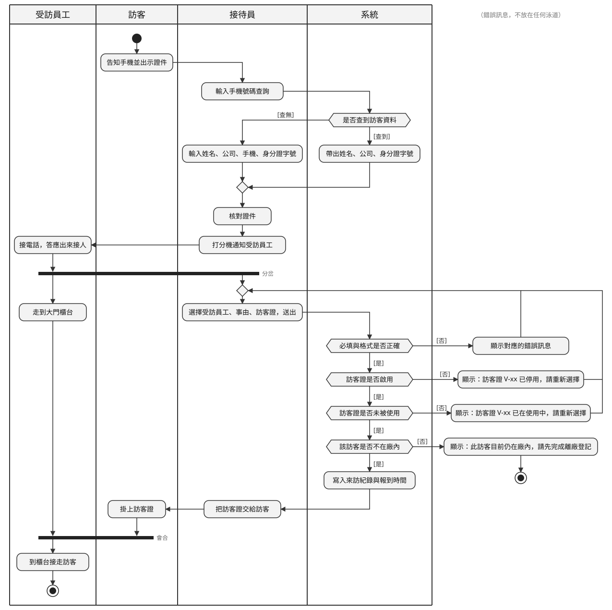
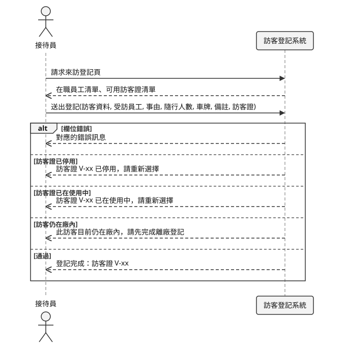
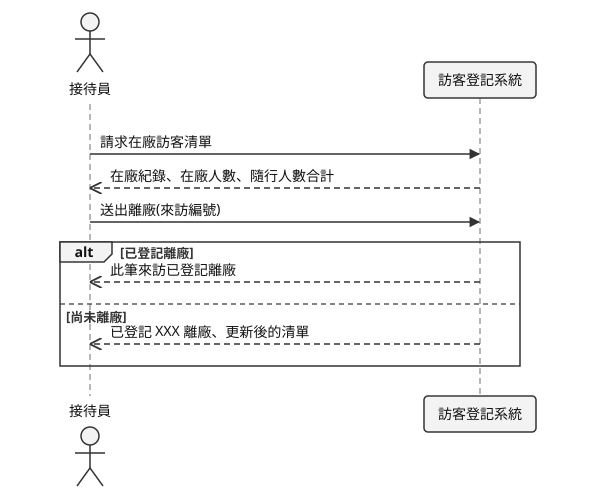
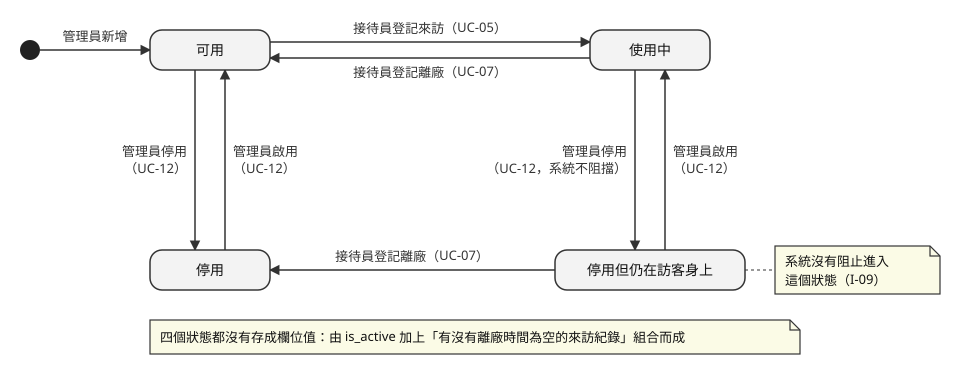

# 行為建模

功能清單上有一行寫著「F-23　登記來訪與發證」。這一行看起來已經把事情交代清楚了，但把它交給開發人員，第一個問題就會冒出來：接待員按下送出之後，系統是先檢查欄位，還是先檢查訪客證？選好的訪客證剛被另一位接待員發出去了，是擋下來還是照樣登記？這位訪客上次來沒有登記離廠，這次還能再登記一次嗎？

這些問題的答案都不在功能結構裡。功能分解回答的是「系統由哪些部分組成」，上面每一個問題問的卻是「事情按什麼次序發生」。前者是靜態的結構，後者是動態的行為。兩者是同一套系統的兩個切面，缺哪一份，你都做不出可以實作的規格。

本章補上行為這一面，介紹三張圖。**活動圖/泳道圖** 描述流程怎麼走與在哪裡分岔，**循序圖** 描述參與者與系統之間來回傳遞了什麼訊息，**狀態機圖**（期末可選）描述一個資料物件從誕生到結束經歷哪些狀態。三張圖看的是同一件事的不同角度，也各自能抓出不同類型的遺漏。期末要修改一套既有系統，同樣的圖要畫修改前與修改後兩個版本，對照的畫法見[「修改需求與變更規格」](09-Change-Specification.md)〈四〉與〈六〉。

> **前情提要**：本章假設你已完成[「使用者分析」](03-User-Analysis.md)的使用案例分析、[「系統需求分析」](04-System-Requirements-Analysis.md)的需求條列，以及[「功能分析」](05-Functional-Analysis.md)的系統邊界與功能結構。本章的例子取自期末示範的工廠訪客進出登記系統 `SAD-Visitor`（現行版）與它的[「系統分析完整報告」](../04-Final-Project-Example-Reports/Visitor-System-Full-Analysis.md)〈3. 現況流程分析〉〈6. 使用案例與系統互動分析〉，文中簡稱「訪客系統報告」，編號沿用該報告（FR-01、NFR-01、UC-01、F-11、I-01 起）。

> **延伸閱讀**：這三張圖在各組報告中的繳交格式與最低標準，期中見[「系統分析範例報告說明」](../02-Midterm-Project-Example-Reports/Analysis-Phase-Deliverables.md)〈四、期中的 UML 最低要求〉，期末見[「報告內容」](../00-Course-Introduction/Report-Contents.md)〈2.1 書面應包含的內容〉的第 2、6、9 項。

> **必讀標記**：標題後加註 🔴 期中必讀 的小節，是期中小組報告九項產出直接會用到的內容；加註 🔵 期末必讀 的，是期末報告直接會用到的。判準與成品的樣子，期中見[「系統分析範例報告說明」](../02-Midterm-Project-Example-Reports/Analysis-Phase-Deliverables.md)與[「系統分析範例報告」](../02-Midterm-Project-Example-Reports/Analysis-Phase-Sample-Report.md)，期末見[「期末範例報告」](../04-Final-Project-Example-Reports/Final-Phase-Sample-Report.md)。未標記的小節仍屬課程範圍，只是報告不會直接產出。

## 一、結構之外還要描述行為 🔴 期中必讀 🔵 期末必讀

### 1.1 系統邊界確定後，請再回來確認行為建模

其實之前講過行為建模，也就是跟同學說明過了「使用案例圖」與「活動圖/泳道圖」，但是行為建模必須在功能分析之後重新確認，理由在於確認了系統邊界，更要與行為建模對齊。

循序圖要畫「參與者對系統說了什麼、系統回了什麼」，那個「系統」是一個方塊，方塊的範圍就是系統邊界。活動圖同理：哪些動作畫在系統的泳道裡、哪些留在人的泳道裡，取決於這件事是不是系統的責任。[「使用者分析」](03-User-Analysis.md)〈六〉畫活動圖時，邊界還沒有正式界定，系統泳道裡放什麼是憑操作系統的印象決定的；[「功能分析」](05-Functional-Analysis.md)〈二〉把邊界與範圍外清單寫下來之後，才有了可以對照的依據。

做完功能分析後，拿功能清單與範圍外清單，回頭對一次之前畫的活動圖/泳道圖，看兩件事：

- **有沒有多畫了系統沒做的事。** 憑經驗畫來訪登記流程，很容易順手在系統泳道加上「通知受訪員工」。但這套系統只在畫面上顯示受訪員工的分機，通知是接待員打電話（訪客系統報告〈1.4〉〈5.3〉）。〈2.3〉的泳道圖上，「打分機通知受訪員工」畫在接待員的泳道；把它畫進系統泳道，就等於說系統會主動通知，圖就和系統對不起來。
- **有沒有漏畫系統真的會做的事。** 反過來，系統實際會做的檢查，只憑操作印象畫圖時容易只畫出成功的那條路。登記來訪時，系統會檢查選到的訪客證是不是已經停用、是不是已經發出去，以及這位訪客是不是還在廠內，三種情況各回一則訊息：「訪客證 V-xx 已停用，請重新選擇」「訪客證 V-xx 已在使用中，請重新選擇」「此訪客目前仍在廠內，請先完成離廠登記」。圖上少了這三個判斷，系統的行為就沒有描述完整。

對不上的地方，要查清楚是圖畫錯了，還是邊界漏了一條。接下來要畫的循序圖，也以同一條邊界為準。

### 1.2 三張圖各回答什麼問題 🔴 期中必讀 🔵 期末必讀

| 圖 | 回答的問題 | 主角 | 最能抓出什麼遺漏 |
|---|---|---|---|
| 活動圖/泳道圖 | 這道流程怎麼走？在哪裡分岔？ | 動作與判斷 | 沒想過的例外分支 |
| 循序圖 | 誰對誰說了什麼？按什麼順序？ | 訊息 | 沒定義的輸入或回應 |
| 狀態機圖（期末可選） | 這個東西的一生經歷哪些狀態？ | 狀態與轉移 | 不該發生卻沒被擋住的操作 |

三張圖的關係可以這樣理解：活動圖/泳道圖是俯視的，看得到整條流程的全貌與所有岔路；循序圖是側視的，看得到時間軸上一來一往的細節；狀態機圖（期末可選）則是把鏡頭對準單一個資料物件，追蹤它自己的變化。

其中活動圖/泳道圖與循序圖是本課程要求每一組都要會畫的三張圖裡的後兩張。三張圖依分析的推進排列，各自回答一個問題：

| 順序 | 圖 | 回答的問題 | 在哪一章 |
|---|---|---|---|
| 1 | 使用案例圖 | 誰要做什麼 | [使用者分析](03-User-Analysis.md)〈五〉 |
| 2 | 活動圖/泳道圖 | 事情怎麼做 | [使用者分析](03-User-Analysis.md)〈六〉初次畫；本章〈二〉補完整符號並回頭確認 |
| 3 | 循序圖 | 使用者與系統怎麼互動 | 本章〈四〉 |

本章的圖不是從零開始畫，而是拿前面幾章的成果來畫。使用案例圖決定要畫哪些流程，圖上每一個橢圓都可以拿來畫活動圖/泳道圖或循序圖。[「系統需求分析」](04-System-Requirements-Analysis.md)寫下的每一條需求，都要能在其中一張圖上找到對應的步驟。[「功能分析」](05-Functional-Analysis.md)畫出的系統邊界，決定哪些步驟由系統做、哪些由人做；功能清單則用來檢查循序圖上的每一次操作，系統是不是真的有這項功能。所以同一件事，文字、活動圖/泳道圖與循序圖講的要一致。只要有一邊對不上，就是有東西漏了，或是改了一邊卻忘了改另一邊。

至於「系統管理哪些資料與概念」這個問題，期中與期末都用實體關聯圖與資料字典回答，見[「資料建模與資料庫設計」](07-Data-Modeling.md)。

### 1.3 要畫幾張 🔴 期中必讀 🔵 期末必讀

你不需要每個使用案例都畫這三張圖，那會產出幾十張沒有人讀的圖。實務上的取捨是：

- **活動圖/泳道圖**：以有分支的流程為主。一般線性走到底、沒有任何判斷的流程，有在使用案例圖中畫出來就夠了，畫成活動圖只是畫出一個線性的流程而已。
- **循序圖**：建議畫核心且牽涉多方往返的使用案例。訪客系統報告挑的是 UC-05「登記來訪」與 UC-07「登記離廠」，前者是接待員最常走、例外最多的流程，後者是同一位訪客進出的另一半：沒有登記離廠，訪客證不會釋出，在廠清單也不會更新。
- **狀態機圖（期末可選）**：只畫有明確生命週期的物件。這套系統值得畫的是訪客證——它有可用、使用中、停用三種情況，每種情況允許的操作不同，還有一種系統沒擋住的組合（見〈五〉）。帳號則不需要，它只有啟用與停用兩種情況，一條規則（停用的帳號不能登入，FR-02）就說完了。

以下是建議的內容：

| | 活動圖/泳道圖 | 循序圖 | 狀態機圖 |
|---|---|---|---|
| 期中 | 至少兩張，每張都要有例外分支，跨角色的那張用泳道 | 一到兩張，畫核心流程，系統是黑箱 | 不必畫 |
| 期末 | 現況一到兩張，挑與修改方向相關、含主要例外的流程；修改後的版本要與現況對照，見[修改需求與變更規格](09-Change-Specification.md)〈四〉 | 一到兩張修改後的版本，系統仍是黑箱，**只畫受修改影響的互動**，見[修改需求與變更規格](09-Change-Specification.md)〈六〉 | 可選，見〈五〉 |

期末的活動圖與循序圖都是拿既有系統來改，不是從零開始畫：現況的活動圖放在報告第一部分，修改後的活動圖與循序圖放在第二部分。修改後多出角色或使用案例時，使用案例圖也要重畫，見[「修改需求與變更規格」](09-Change-Specification.md)〈四〉。

## 二、活動圖/泳道圖 🔴 期中必讀 🔵 期末必讀

**[活動圖](https://zh.wikipedia.org/wiki/活动图)（Activity Diagram）是 [統一塑模語言](https://zh.wikipedia.org/wiki/统一建模语言)（Unified Modeling Language, UML）中描述流程步驟與控制流向的圖。** 它與傳統流程圖最大的差別在於能表達平行進行的工作，以及能用泳道標示每個動作由誰執行。

**泳道圖就是加上泳道的活動圖**，兩者是同一種圖，泳道圖多了「每個動作由哪個角色執行」的說明。本章寫「活動圖」時也包含泳道圖，只談泳道的部分才寫「泳道圖」。

期中的流程分析用的就是活動圖，基本畫法已在[「使用者分析」](03-User-Analysis.md)〈六、6.3〉到〈6.5〉介紹過。本章補上完整的符號與平行工作的畫法，並在需求與功能分析完成之後，回頭檢查之前畫的圖。

### 2.1 符號 🔴 期中必讀 🔵 期末必讀

| 符號 | 畫法 | 含義 |
|---|---|---|
| 起始節點 | 實心圓 | 流程的起點，一張圖只有一個 |
| 動作 | 圓角方框 | 一個有明確起訖的步驟，寫成動詞加受詞 |
| 判斷節點 | 菱形，一進多出 | 依條件選擇其中一條路徑，每條出線都要標示條件 |
| 合併節點 | 菱形，多進一出 | 分岔的路徑重新合流 |
| 分岔（fork） | 粗橫線，一進多出 | 之後的路徑同時進行 |
| 會合（join） | 粗橫線，多進一出 | 等所有平行路徑都完成才繼續 |
| 結束節點 | 內含實心圓的空心圓 | 流程的終點，可以有多個 |

[「使用者分析」](03-User-Analysis.md)〈6.3〉只用到起始節點、動作、判斷節點與結束節點四種，合併、分岔與會合是本章補上的。

判斷節點和分岔最容易搞混，其實兩者剛好相反：判斷是從幾條路裡 **選一條走**，分岔是 **每條路都要走**。以來訪登記為例，「訪客證是否未被使用」是判斷，結果只會是「已被使用」或「未被使用」其中一個；接待員打完分機之後，受訪員工走到櫃台與接待員在系統上登記是同時進行的，就畫成分岔（見〈2.4〉）。

動作方框怎麼寫，還有兩點要補充，分析既有系統時都會用到：

**顯示錯誤時，要把系統實際顯示的文字寫進方框。** 只寫「顯示錯誤訊息」，讀圖的人不知道系統到底說了什麼，要寫成「顯示：訪客證 V-xx 已在使用中，請重新選擇」「顯示：此訪客目前仍在廠內，請先完成離廠登記」。因此有時你可以透過系統顯示的訊息，確認活動圖的方框要顯示甚麼訊息？

**處理完例外之後，箭頭要接回哪裡，由你來判斷。** 例外分成兩種。第一種可以重試，例如欄位沒填、格式不對、選到的訪客證已被使用：顯示訊息後，把箭頭拉回輸入的那個動作，讓使用者改完再送一次。第二種不能重試，例如這位訪客還在廠內：換一張訪客證、改哪個欄位都沒用，要先處理上一筆來訪，所以顯示訊息後直接到結束節點。

### 2.2 用使用案例敘述與需求回頭檢查 🔴 期中必讀 🔵 期末必讀

[「使用者分析」](03-User-Analysis.md)〈6.5〉是從流程的文字欄位把活動圖畫出來。到了這一步，使用案例敘述已經寫成詳細版本，需求也有了編號，就要拿這兩份回頭檢查之前的圖。對照方式：**主要流程的每一個步驟都要對得到一個動作，每一條例外流程都要對得到一個判斷節點加上一條分支。**

以訪客系統報告〈6.1〉的 UC-05「登記來訪」為例。它的主要流程是：1. 接待員請求來訪登記頁　2. 系統回傳在職員工清單與可用訪客證清單　3. 接待員送出訪客資料與來訪資訊　4. 系統檢查欄位　5. 系統檢查訪客證已啟用且未被使用　6. 系統檢查訪客不在廠內　7. 系統寫入來訪紀錄　8. 系統回傳登記完成與訪客證編號。例外流程有 `4a` 必填未填或格式錯誤、`5a` 訪客證已停用、`5b` 訪客證已在使用中、`6a` 訪客仍在廠內四條。訪客系統報告〈3.1〉把這條流程畫成這張活動圖：

*本圖由作者自製*

`4a` 在圖上拆成「格式是否正確」與「必填是否齊全、隨行人數是否 0 到 20」兩個判斷，因為前者只在查無訪客、要建立新訪客時檢查那四項資料，後者檢查的是每次登記都要填的來訪資訊；其餘三條各對應一個判斷（訪客系統報告〈6.3〉）。一個例外可以拆成幾個判斷，但每一個例外至少要有一個判斷，詳見[「使用者分析」](03-User-Analysis.md)〈六、6.5〉。

圖畫好之後，把和 UC-05 有關的功能需求與非功能需求逐條拿來比對，找出每一條落在圖上的哪個動作或判斷：

**功能需求：**

- FR-05（以手機查詢訪客，查到多筆時列出讓接待員選擇）：對應「是否查到訪客資料」這個判斷的三條出線：查無、一筆、多筆。
- FR-06（查無訪客時建立新訪客，四項皆為必填）：對應「查無」那條分支，以及「格式是否正確」這個判斷。
- FR-09（訪客證只能選啟用中且未被使用的證，送出時須再檢查一次）：「送出時再檢查」對應「訪客證是否啟用」與「訪客證是否未被使用」；「只能選可用的證」在這張圖上找不到，它畫在〈四、4.3〉循序圖回傳的「可用訪客證清單」。
- FR-10（同一筆訪客資料仍在廠內時，不得再登記）：對應「該訪客是否不在廠內」這個判斷。
- FR-08（受訪員工只能從在職員工中選擇）：在這張圖上找不到，它也畫在循序圖上，對應回傳的「在職員工清單」。

**非功能需求：**

- NFR-03（來訪登記在單一頁面完成，不換頁）：在這張圖上找不到。它規定的是畫面怎麼安排，不是流程怎麼走，活動圖本來就不畫。

像 FR-08 這樣找不到的，不一定是漏了，也可能是由另一張圖負責，但你要說得出是哪一張。這種逐條對照，是活動圖最直接的檢查用法。

對照時還會冒出一個問題。FR-10 說訪客仍在廠內就不能再登記，那上次忘了登記離廠的訪客再來時怎麼辦？這個問題要等到畫圖時才會發現。期中分析的是現成的系統，答案要實際測試：訪客系統報告〈3.1〉拿 11/2 進廠、沒有登記離廠的陳俊宏再登記一次，系統擋住了他，接待員必須先替 11/2 那筆補登離廠，但補登的離廠時間會是今天，不是他實際離開的時間。這就是訪客系統報告〈9.1〉的現況問題 I-01。**畫活動圖的一個用處，就是逼你發現這種問題。**

活動圖的另一個用處，是看出 **判斷的先後順序**。只把功能需求與非功能需求一條條列出來，看不出哪個檢查先做、哪個後做；畫成活動圖，順序就清楚擺在圖上。這個順序本身就是一項分析結果，值得在報告裡專門寫一段。

例如上圖送出之後，系統依「欄位 → 訪客證 → 是否在廠內」的順序檢查。前兩關沒過，接待員改完欄位或換一張訪客證就能重送；最後一關沒過，整筆登記都做不下去。這三關可以對調嗎？把「是否在廠內」移到最前面，接待員就不必先改好欄位、換好訪客證，才發現這位訪客根本不能登記。系統沒有說明為什麼這樣排，訪客系統報告也沒有交代，這時照[「問題定義與現況分析」](02-Problem-Definition.md)〈一、1.3〉的原則，寫明推不出理由，列為要訪談開發者確認的事項。

FR-09 的兩道關卡就說得出理由。下拉選單在載入頁面時只列出可用的證，送出時系統再檢查一次。只留第一道，接待員打開頁面到按下送出之間，若另一位接待員剛好發出同一張證，就會一張證發給兩位訪客；只留第二道，接待員每次都要猜哪一張能用，猜錯就被擋回來。

**所以畫完之後要多問一句：這幾個判斷可以對調嗎？** 如果答案是「不行，因為……」，後面那句理由就值得寫進報告；如果答案是「可以，順序沒差」，這也是一個結論，代表這裡沒有藏著規則；如果答不出來，就照實寫答不出來。

### 2.3 用泳道標示責任 🔴 期中必讀

如果你的活動圖中的流程牽涉好幾個角色，或是要分清楚哪些動作由人做、哪些由系統做時？建議畫成「**泳道圖**」。反過來說，**只有「使用者」和「系統」兩方的流程，不必加泳道**。這種流程每個動作是誰做的，一看就知道，加了泳道只是多兩個框。

> 為什麼叫泳道圖？因為圖上每個角色各佔一條長條，動作都畫在負責角色的那一條裡，並排起來就像游泳池裡分隔好的泳道。

泳道圖的重點與優點：**每個動作都標得出是誰做的**？以訪客系統報告〈3.1〉的「來訪登記與發證」為例，這個流程有訪客、接待員、系統與受訪員工四方參與。訪客系統報告把它寫成泳道表，畫成泳道圖就是下面這樣（為了看清楚誰負責哪一步，省略了手機查到多筆時讓接待員選一筆的分支）：

*本圖由作者自製*

泳道要畫幾條、每條放什麼，看這個流程有沒有系統參與。[「使用者分析」](03-User-Analysis.md)〈六、6.4〉那張圖用泳道整理現在誰在做什麼、工作在哪裡交給下一個人。**只要流程裡有系統參與，「系統」就要獨立畫成一條泳道。** 使用者送出操作之後，系統接手做的檢查、寫入資料與回應，都畫在這條泳道裡。期中分析的是既有系統，你畫的每一張跨角色活動圖都屬於這一種，上圖就是一例。

**箭頭跨過泳道，代表工作換人負責。** 從人的泳道進到系統泳道，代表從這一步開始由系統負責；再從系統泳道出來，代表系統把結果交回給人。把導入前和導入後的兩張圖放在一起比，跨泳道的箭頭少了幾條，就代表系統實際省掉了幾次人工交接。上圖從接待員到受訪員工那一條箭頭是打電話，不經過系統，這正是訪客系統報告〈1.4〉列為「仍靠人工」的那一項。

實際動手畫的時候，馬上會遇到三個畫法上的問題：

- **系統泳道裡也可以有判斷節點（菱形）。** 系統做的事大多是檢查，像上圖的「是否查到訪客資料」「訪客證是否未被使用」「該訪客是否不在廠內」都是。這些判斷是系統做的，就畫在系統泳道裡，不要為了圖面整齊，把它們全部移到泳道外面。
- **錯誤訊息的方框可以不放在任何泳道裡。** 檢查沒通過時顯示的訊息，可以畫在所有泳道外面，再用箭頭指過去。上圖的四則錯誤訊息都畫在泳道外面，系統泳道裡只留下判斷與成功的那條路。訊息全部塞進系統泳道，這條泳道就會被錯誤訊息塞滿，看不出主要流程在哪裡。
- **不操作系統的人，也可以有自己的泳道。** 訪客與受訪員工都不操作系統，使用案例圖上不畫他們（訪客系統報告〈2.3〉），但流程要等他們動作才走得下去。替受訪員工開一條泳道、放進「接電話，答應出來接人」，下一個問題就跟著出來：受訪員工沒接電話怎麼辦？訪客系統報告〈3.1〉的答案是系統沒有規範，由接待員自行判斷。這個問題在使用案例圖上看不到，畫進泳道才會被問出來。

### 2.4 平行工作怎麼畫

有好幾件事可以同時進行時，用分岔與會合來畫。〈2.3〉的泳道圖就用到了：接待員打完分機之後，受訪員工走到大門櫃台，接待員同時在系統上登記；等訪客掛上訪客證、受訪員工也到了，才能把人接走。訪客系統報告〈3.1〉的泳道表把這段寫成先後的步驟，畫成泳道圖時才看得出其中兩件事互不等待。

分岔與會合都畫成一條粗橫線（同步桿）：分岔是一條線進、多條線出，會合是多條線進、一條線出。

平行的判準是 **這幾件事之間沒有先後依賴**。受訪員工走過來不需要等接待員登記完，接待員登記也不需要等受訪員工走到，所以可以分岔；但接走訪客必須等兩邊都完成，所以要會合。最常見的錯是把所有動作串成一長條直線，這樣你後續估算時間時，就看不出哪些工作可以同時進行：畫成直線，會以為訪客在櫃台要等「登記的時間加上受訪員工走過來的時間」；畫成平行，才看得出等的是兩者中比較久的那一段。訪客系統報告〈1.3〉的 P-04 說尖峰時段訪客在櫃台排隊，要分析等候時間，就需要這種畫法。

## 三、活動圖/泳道圖的常見錯誤 🔴 期中必讀 🔵 期末必讀

| 錯誤 | 症狀 | 修正方向 |
|---|---|---|
| 判斷節點沒標條件 | 菱形出來兩條線，都沒寫字 | 每條出線都要標條件，且條件要互斥且窮盡 |
| 只畫順利的那條路 | 整張圖沒有任何菱形 | 回到使用案例敘述的例外流程，逐條補上分支 |
| 畫成畫面操作流程 | 出現「點選上方選單的來訪登記」「捲到頁面第二段」 | 那是介面設計，活動圖描述的是業務動作 |
| 動作寫成名詞 | 出現「訪客資料」「來訪登記作業」 | 改成動詞加受詞，例如「寫入來訪紀錄與報到時間」 |
| 沒有結束節點 | 某條分支走到一半就斷了 | 每條路徑都要有出口，斷掉的地方通常代表漏了一段流程 |
| 泳道分給部門而非角色 | 出現「總務課」「大門櫃台」 | 改成角色（接待員、管理員），組織改組時圖才不會失效 |

其中第二項最要緊。一張沒有菱形的活動圖，幾乎可以斷定是把使用案例敘述的主要流程原樣搬過來，而 **活動圖該畫的正是例外流程**。系統上線後出問題的地方多半在這裡，順利的那條路早在開發時就走過幾百次了。

## 四、循序圖 🔴 期中必讀 🔵 期末必讀

**[循序圖](https://zh.wikipedia.org/wiki/时序图)（Sequence Diagram）畫的是幾個參與方之間，依時間先後互相傳了哪些訊息。** 分析階段用的是簡化畫法：把整套系統當成一個看不到內部的黑箱，只畫使用者和系統之間的一來一往，不畫系統內部做了什麼。教科書把這種畫法叫做 System Sequence Diagram（SSD，系統循序圖），本章一律簡稱循序圖。

換個角度看，循序圖是在規劃使用者和系統怎麼互動：使用者輸入什麼、系統顯示什麼、遇到狀況怎麼反應。這份規劃之後也是使用者介面（User Interface，UI）設計的起點。

### 4.1 黑箱的意義 🔴 期中必讀 🔵 期末必讀

分析階段刻意把系統畫成黑箱，是因為這個階段要回答的是「系統對外答應做到什麼」，不是「系統內部怎麼做到」。前者可以拿去和使用者確認，後者不行。例如接待員不會關心「訪客證使用中」存在哪一張資料表——事實上它根本沒有存成欄位（見〈五〉）。

這樣畫的好處是，圖上的每一條訊息，之後都會變成系統要負責的一件事。訊息送進去卻沒有回應，代表使用者做完操作，不知道有沒有成功；系統送出回應，卻找不到是哪一條訊息觸發的，代表這份資料不知道從哪裡來。這兩種漏洞在功能清單上看不出來，畫成循序圖就很明顯。

### 4.2 符號 🔴 期中必讀 🔵 期末必讀

| 符號 | 含義 |
|---|---|
| 參與者 | 圖左邊的人形符號，代表發起操作的角色 |
| 物件（分析階段只有一個：系統） | 圖上方的方框，代表接收請求的一方 |
| 生命線 | 從方框往下拉的虛線，越往下時間越晚 |
| 訊息 | 實線箭頭，寫成動詞加參數，代表送出一次請求 |
| 回傳 | 虛線箭頭，寫使用者看到的結果或訊息，代表系統的回應 |
| 片段 | 把幾條訊息框起來的方框，標上 `loop`、`alt`、`opt` 說明這幾條訊息在什麼條件下發生 |

三種常用片段可以用程式語言的寫法來理解：

| 片段 | 對應的程式寫法 | 意思 |
|---|---|---|
| `loop` | `for` 迴圈 | 框裡的訊息重複做 |
| `alt` | `if … else if … else` | 幾種情況選一種，對應活動圖的判斷節點 |
| `opt` | 沒有 `else` 的 `if` | 條件成立才做，不成立就跳過，對應使用案例的 «extend» |

**回傳要寫使用者看到什麼，不要寫系統內部傳了什麼資料。** 「訪客證 V-xx 已在使用中，請重新選擇」「在廠紀錄、在廠人數、隨行人數合計」是對的寫法；「回傳 boolean（是或否的值）」「回傳 visit 物件」不對。後者是程式內部怎麼傳資料，使用者看不到，也沒辦法確認，本課程期中與期末都不這樣寫。

**活動圖上串成一串的好幾個判斷，到了循序圖通常合併成一個 `alt`，裡面分好幾種情況。** 活動圖在意的是「檢查的先後順序」，所以判斷要一個接一個畫；循序圖在意的是「使用者送出一次之後，可能收到哪幾種回應」，所以把這幾種結果並排放在同一個 `alt` 裡，一個 `else` 代表一種結果。〈4.3〉UC-05 的循序圖就是這樣：〈2.2〉活動圖上送出之後的幾個判斷，在循序圖上合成一個 `alt`，分成欄位錯誤、訪客證已停用、訪客證已在使用中、訪客仍在廠內與通過五種情況。

兩種畫法沒有對錯之分，只是回答的問題不同。要檢查的是數量：活動圖上有幾種結果，`alt` 裡就要有幾種情況。

### 4.3 訪客系統報告的兩張循序圖 🔴 期中必讀 🔵 期末必讀

訪客系統報告〈6.1〉和〈6.2〉各畫了一張循序圖。第一張是 UC-05 登記來訪：

*本圖由作者自製*

第二張是 UC-07 登記離廠：

*本圖由作者自製*

畫這兩張圖時，有幾條規則要遵守。

**訊息名稱要寫出帶了哪些資料。** 只寫「送出登記」不夠，要寫成 `送出登記(訪客資料, 受訪員工, 事由, 隨行人數, 車牌, 備註, 訪客證)`。括號裡的參數，就是這個操作需要使用者提供的資料。這些參數會直接對應到資料字典裡的欄位，例如受訪員工對應 `visits.employee_id`、訪客證對應 `visits.pass_id`，之後設計畫面時也要用到。只寫動作不寫參數，這張圖對後面的工作幫助不大。

不是打字輸入的東西，也算參數，而且最容易漏掉。UC-07 的 `送出離廠(來訪編號)`，接待員沒有輸入任何字，只按了在廠清單某一列的「離廠」，但系統要知道是哪一筆，所以來訪編號也要寫。查詢條件也一樣：如果要畫 UC-08 查詢來訪紀錄，訊息要寫成 `查詢來訪紀錄(報到日期起訖, 關鍵字)`；只寫「查詢來訪紀錄」，FR-13 的兩種查詢條件在圖上就看不到了。**只要是使用者送給系統的東西，不管是輸入的資料、點選的那一筆，還是選擇的條件，都算參數。**

**每一條送進系統的訊息都要有回應。** 上面兩張圖裡，使用者每送出一次，系統都會回一次。如果某條訊息送進去之後沒有回傳箭頭，就要問：使用者怎麼知道這件事做完了？

**拿到畫面的往返也要畫。** 使用者要先拿到表單，才能填寫。UC-05 的前兩條訊息「請求來訪登記頁 → 在職員工清單、可用訪客證清單」很常被省略，但省略之後，FR-08（只能選在職員工）與 FR-09（只能選可用的證）在圖上就找不到對應的地方。**圖要從使用者第一次打開這個功能開始畫，不是從按下送出鍵開始畫。**

**黑箱裡不要畫系統內部的動作。** 圖上不應該出現「系統查詢資料庫」「系統檢查訪客證」這種系統自己指向自己的箭頭，那些是程式內部的做法，本課程期中與期末都不畫。

### 4.4 與活動圖/泳道圖的分工 🔴 期中必讀 🔵 期末必讀

同一個使用案例，畫了活動圖又畫循序圖，會不會重複？不會，因為兩張圖記錄的東西不一樣。

| | 活動圖/泳道圖 | 循序圖 |
|---|---|---|
| 擅長表達 | 分支、同時進行的工作、誰負責 | 每次傳了什麼資料、來回幾次、先後順序 |
| 不擅長表達 | 看不出每次互動傳了什麼資料 | 分支一多，圖會擠成一團 |
| 之後用在哪裡 | 整理業務規則、規劃權限 | 設計畫面欄位、API（程式之間互相呼叫的介面）的初稿 |

實際搭配的方式是：流程複雜的使用案例，以活動圖為主；來回互動多的，以循序圖為主；核心的使用案例兩張都畫。訪客系統報告的「登記來訪」和「登記離廠」都兩張都畫，〈3.1〉〈3.2〉是活動圖，〈6.1〉〈6.2〉是循序圖。原因是這兩個使用案例是接待員每天的核心操作，合起來就是一位訪客的進與出。兩張圖怎麼互相對照，訪客系統報告〈6.3〉用 UC-05 示範了一次。

反過來，**互動只有一來一回的使用案例，可以不畫循序圖，但要寫一句理由。** 例如 UC-02 登出（FR-03）：使用者按登出，系統回到登入頁，循序圖上只有兩條箭頭，畫不出比文字更多的東西。期末修改後的循序圖不畫時，理由怎麼寫見[「修改需求與變更規格」](09-Change-Specification.md)〈六〉。沒有這句話，讀者分不出是判斷過後決定不畫，還是忘了畫。

## 五、狀態機圖

**[狀態機圖](https://zh.wikipedia.org/wiki/状态图)（State Machine Diagram）畫的是一筆資料從建立到結束，會經過哪些狀態，以及發生什麼事會讓它從一個狀態變到下一個狀態。** 它的理論基礎是 [有限狀態機](https://zh.wikipedia.org/wiki/有限状态机)（Finite State Machine）。這個概念在製造業很常見，例如機台的待機、運轉、故障、保養，就是一組狀態。

### 5.1 什麼樣的東西需要狀態圖

判斷標準只有一條：**這筆資料在不同階段，能做的操作是不是不一樣。**

以訪客證為例，它符合這個標準。可用的證會出現在登記頁的下拉選單，可以發給訪客；使用中的證不會出現，送出時也會被擋下（FR-09），要等訪客離廠才會釋出（FR-12）；停用的證同樣不能發，管理員可以再把它啟用（FR-17）。這些規則分散寫在三條需求裡，不畫成狀態圖，就看不出它們合起來是一套完整的規則，也看不出中間有沒有漏洞。

狀態機圖期中不必畫，期末列為可選項目（見[「報告內容」](../00-Course-Introduction/Report-Contents.md)〈二、期末技術深度原則〉），但期中的分析已經會用到同一個判斷標準。訪客系統報告〈7.7〉列了一張訪客證的狀態表：「是否啟用」與「有沒有在廠的來訪紀錄」兩兩組合，得出可用、使用中、停用、停用但仍在訪客身上四種情況，每一種能不能拿來登記都寫清楚了。這張表其實就是用表格寫成的狀態圖。

帳號就不需要畫。它只有「啟用」和「停用」兩種情況，一條規則（停用的帳號不能登入，FR-02）就說完了。**要注意，訪客證的狀態不全存在訪客證這張表裡。**「有沒有停用」存在 `visitor_passes.is_active`，「現在在不在某位訪客身上」卻要從來訪紀錄推算，兩者合起來才是一張證的狀態。

選擇畫的話，最值得畫的是 **沒有人操作、時間到了就發生的轉移**。其他轉移都有人按了某個按鈕，這種轉移沒有，所以最容易漏掉。現行系統沒有這種轉移，訪客證的每一次改變都是接待員或管理員按出來的；如果要把事前預約納入系統（訪客系統報告〈5.3〉列在界外），「預約日已過、訪客沒來」就會是這種轉移，期末範例怎麼處理見[「修改需求與變更規格」](09-Change-Specification.md)〈六〉。

### 5.2 訪客證的狀態機圖

*本圖由作者自製*

這張圖是把訪客系統報告〈7.7〉的狀態表畫成圖。每一條箭頭標的是誰做了什麼，括號是對應的使用案例。

### 5.3 狀態圖抓出的漏洞

畫完之後，用下面三個問題檢查，每一個都可能找出漏掉的功能或規則。

**每一次狀態改變，是不是都有一項功能負責？** 拿功能清單一條條對照：發證是 F-23 登記來訪與發證，釋出是 F-32 登記離廠，新增、停用與啟用都是 F-62 維護訪客證。圖上每一條箭頭都找得到功能。如果有一條找不到，例如沒有人觸發、時間到了就發生的轉移，它就一定要寫成一條規則；對不到功能、也沒寫成規則的轉移，就是漏掉的東西。

**每一個狀態下，哪些操作要擋下來，是不是都想清楚了？** 使用中的證，管理員能不能停用？現行系統沒有擋，所以圖上多出一個沒有人設計過的狀態：停用但仍在訪客身上。訪客系統報告〈3.3〉實測把使用中的 `V-05` 停用，系統沒有提示，在廠清單上照樣顯示 `V-05`，離廠時也照常登記，這就是現況問題 I-09。分析時沒想過這個問題，開發人員寫程式時就會自己決定，而開發人員的決定不一定符合現場的做法。

**有沒有哪個狀態，要離開它得靠系統管不到的事？** 「使用中 → 可用」只有一條路，就是接待員登記離廠，而這要等訪客走回櫃台交還訪客證。**系統沒辦法控制大門**，訪客直接走出去，系統也不知道，這張證就一直是使用中，那筆來訪紀錄也一直留在在廠清單上（訪客系統報告〈3.2〉、I-01）。來訪紀錄本身也一樣：它沒有狀態欄位，但「在廠」到「已離廠」也是一次狀態改變，出口同樣只有這一條。訪客系統報告〈9.2〉的建議一就是在處理這件事。這個問題最容易被忽略。

狀態圖還可以用在資料庫設計：圖上的每一個狀態，資料表裡都要有地方存，或寫得出推導規則。訪客證的「停用」與「啟用」存在 `is_active` 的兩個值；「使用中」不存，由有沒有一筆 `check_out_at` 為空的來訪紀錄綁著這張證推導。為什麼這樣設計，見[「資料建模與資料庫設計」](07-Data-Modeling.md)〈四、4.3〉。

## 六、三張圖如何與前後文件對得起來 🔴 期中必讀 🔵 期末必讀

行為建模的產出必須能雙向追溯，往前追到使用案例與需求，往後接到資料與介面設計。三張圖畫完後，你用下表逐項檢查一次：

| 方向 | 檢查問題 | 對不上代表 | 期中 |
|---|---|---|---|
| 使用案例 → 活動圖 | 敘述裡的每一條例外流程（`4a`、`5b` 那些編號），圖上是否都有對應的判斷節點 | 例外沒被處理，或敘述寫了卻沒實作 | 要查 |
| 需求 → 活動圖 | 每一條功能需求，是否都落在某個動作或判斷上 | 需求漏了，或圖畫得不夠細 | 要查 |
| 活動圖 → 循序圖 | 圖上每一次跨越系統邊界的動作，是否都是循序圖上的一條訊息 | 有一段互動只存在於其中一張圖 | 要查 |
| 循序圖 → 功能清單 | 圖上每一條訊息，是否都對應得到一項功能 | 冒出了功能清單沒有的功能 | 要查 |
| 循序圖 → 需求 | 每一條訊息與它的回應，是否都對得到一條功能需求或非功能需求 | 系統做了一件沒有需求依據的事 | 要查 |
| 循序圖 → 資料字典 | 訊息括號裡的參數，是否都能在資料字典裡找到對應欄位 | 使用者輸入的東西沒有地方存，或欄位定義漏了一個 | 要查 |
| 循序圖 → 介面欄位 | 參數是否都能在畫面上找到輸入的地方 | 要求使用者提供一份他手上沒有的資料 | 期末 |
| 狀態機圖 → 功能清單 | 每一條狀態轉移，是否都有功能負責觸發；沒有人觸發的，是否寫成了規則 | 漏了功能，或漏了一條規則 | 期末可選 |
| 狀態機圖 → 資料模型 | 圖上的狀態，是否都在狀態欄位的值域裡，或寫得出推導規則 | 資料設計與業務規則脫節 | 期末可選 |

最後一欄標「期中」的六條，是期中報告交件前一定要做一遍的。這些檢查與[「功能分析」](05-Functional-Analysis.md)〈六〉的自我檢核性質相同：它們不檢查圖畫得漂不漂亮，只檢查各份文件是不是在描述同一套系統。**對不上的時候，先別急著改圖——比較常見的情況是有東西真的被漏掉了，改圖只會把證據抹掉。**

## 七、學習重點總結

讀完本章後，你應該能夠理解以下核心概念，並將其應用於工業場域的思考與決策：

**結構與行為是同一套系統的兩個切面**

功能分解說得出系統由哪些部分組成，卻說不出一次操作按什麼次序發生；行為模型補上後者。兩者都不能單獨構成可實作的規格：只有結構，開發人員得自行猜測流程；只有行為，就看不出整套系統的全貌與工作量。系統邊界確定之後，行為模型要回頭再確認一次，原因也在這裡——邊界決定了哪些動作該畫在系統這一側。

**例外分支才是行為模型的價值所在**

一張沒有任何判斷節點的活動圖等於把文字重排一次，技術增量為零。真正值得你畫圖的是那些「如果選到的訪客證剛被別人發出去怎麼辦」「如果這位訪客上次沒登記離廠怎麼辦」的岔路，因為系統上線後出問題的地方幾乎都在這裡。畫圖的過程會逼出使用案例敘述沒寫到的問題——例如受訪員工沒接電話時，接待員該怎麼辦。這些問題在分析階段被問出來，成本是幾分鐘的討論；到實作階段才發現，成本是重寫。

**循序圖是黑箱，但訊息要寫出攜帶的資料**

循序圖只有一個代表系統的方塊，因為它要交出的是系統對外的承諾，而承諾必須是接待員與管理員聽得懂、確認得了的；期末修改後的循序圖也一樣。一旦畫進內部呼叫，看得懂這張圖的就只剩開發團隊。黑箱不等於含糊：箭頭若只寫動作名稱，這張圖對後續工作沒有貢獻；寫出括號裡的參數，它就成為介面欄位與資料設計的直接依據。活動圖告訴你流程往哪裡走，循序圖告訴你每一次往返實際搬動了哪些資料。

**狀態決定了哪些操作應該被擋住（期末可選）**

有生命週期的物件，在不同狀態下允許的操作不同：可用的訪客證可以發給訪客，使用中與停用的都不行。這些規則你若不畫成狀態機圖，就會零散地藏在各項功能的描述裡而漏掉大半。狀態圖同時是一張檢查表——每一條轉移都應該有一項功能負責觸發，對不上的轉移就是一項被漏掉的功能；每個狀態下該擋的操作沒擋，圖上就會多出一個沒人設計過的狀態，像「停用但仍在訪客身上」；而某個狀態如果只有一條出口、走那條出口又要靠系統管不到的人配合，紀錄就可能卡在那個狀態出不來。

**行為模型的每一條線都要追溯得回去**

活動圖的分支追溯到使用案例的例外流程，循序圖的訊息追溯到功能清單，狀態轉移追溯到功能與資料欄位。這種雙向對照要做，是因為對不上的地方只有兩種可能：圖畫錯了，或有東西被漏掉了。兩種都值得在動工前查清楚。

> **銜接提示**：本章描述的是系統怎麼動，下一章[「資料建模與資料庫設計」](07-Data-Modeling.md)接著處理系統記得什麼——把流程中來回傳遞的資料，整理成實體關聯圖、資料表與資料字典。本章狀態機圖（期末可選）上的那幾個狀態，到下一章會變成資料表裡一個欄位的值域，或一條推導規則。

## 參考文獻

- Ambler, S. W. (2005). *The elements of UML 2.0 style*. Cambridge University Press. https://doi.org/10.1017/CBO9780511817533
- Arlow, J., & Neustadt, I. (2005). *UML 2 and the unified process: Practical object-oriented analysis and design* (2nd ed.). Addison-Wesley.
- Bittner, K., & Spence, I. (2003). *Use case modeling*. Addison-Wesley.
- Booch, G., Rumbaugh, J., & Jacobson, I. (2005). *The unified modeling language user guide* (2nd ed.). Addison-Wesley.
- Cockburn, A. (2001). *Writing effective use cases*. Addison-Wesley.
- Dennis, A., Wixom, B. H., & Roth, R. M. (2018). *Systems analysis and design* (7th ed.). Wiley.
- Dennis, A., Wixom, B. H., & Tegarden, D. (2015). *Systems analysis and design: An object-oriented approach with UML* (5th ed.). Wiley.
- Dumas, M., La Rosa, M., Mendling, J., & Reijers, H. A. (2018). *Fundamentals of business process management* (2nd ed.). Springer. https://doi.org/10.1007/978-3-662-56509-4
- Eriksson, H.-E., Penker, M., Lyons, B., & Fado, D. (2004). *UML 2 toolkit*. Wiley.
- Fowler, M. (2003). *UML distilled: A brief guide to the standard object modeling language* (3rd ed.). Addison-Wesley.
- Harel, D. (1987). Statecharts: A visual formalism for complex systems. *Science of Computer Programming*, *8*(3), 231–274. https://doi.org/10.1016/0167-6423(87)90035-9
- Harel, D., & Naamad, A. (1996). The STATEMATE semantics of statecharts. *ACM Transactions on Software Engineering and Methodology*, *5*(4), 293–333. https://doi.org/10.1145/235321.235322
- Jacobson, I., Christerson, M., Jonsson, P., & Övergaard, G. (1992). *Object-oriented software engineering: A use case driven approach*. Addison-Wesley.
- Kendall, K. E., & Kendall, J. E. (2019). *Systems analysis and design* (10th ed.). Pearson.
- Larman, C. (2004). *Applying UML and patterns: An introduction to object-oriented analysis and design and iterative development* (3rd ed.). Prentice Hall.
- Object Management Group. (2013). *Business process model and notation (BPMN), version 2.0.2*. https://www.omg.org/spec/BPMN/2.0.2/
- Object Management Group. (2017). *OMG unified modeling language (OMG UML), version 2.5.1*. https://www.omg.org/spec/UML/2.5.1/
- Pilone, D., & Pitman, N. (2005). *UML 2.0 in a nutshell*. O'Reilly Media.
- Pressman, R. S., & Maxim, B. R. (2020). *Software engineering: A practitioner's approach* (9th ed.). McGraw-Hill.
- Rumbaugh, J., Jacobson, I., & Booch, G. (2004). *The unified modeling language reference manual* (2nd ed.). Addison-Wesley.
- Satzinger, J. W., Jackson, R. B., & Burd, S. D. (2016). *Systems analysis and design in a changing world* (7th ed.). Cengage Learning.
- Sommerville, I. (2016). *Software engineering* (10th ed.). Pearson.
- Wiegers, K., & Beatty, J. (2013). *Software requirements* (3rd ed.). Microsoft Press.
- Yourdon, E. (1989). *Modern structured analysis*. Yourdon Press.

---

*本章是分析階段從靜態結構走向動態行為的轉折點：功能分析交出了系統的組成，本章交出的是這些組成如何隨時間互相作用。建議的延伸練習是拿自己組的題目挑一個核心使用案例，先畫活動圖再畫循序圖，然後用〈六〉的六條逐項對照。特別留意「循序圖 → 介面欄位」那一條：訊息括號裡的每一個參數，使用者在那個時點真的拿得到嗎？*
