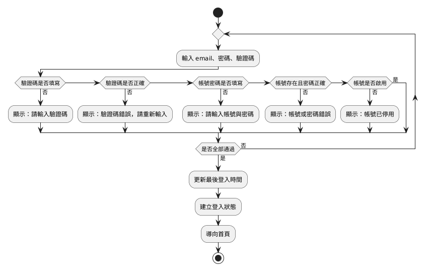
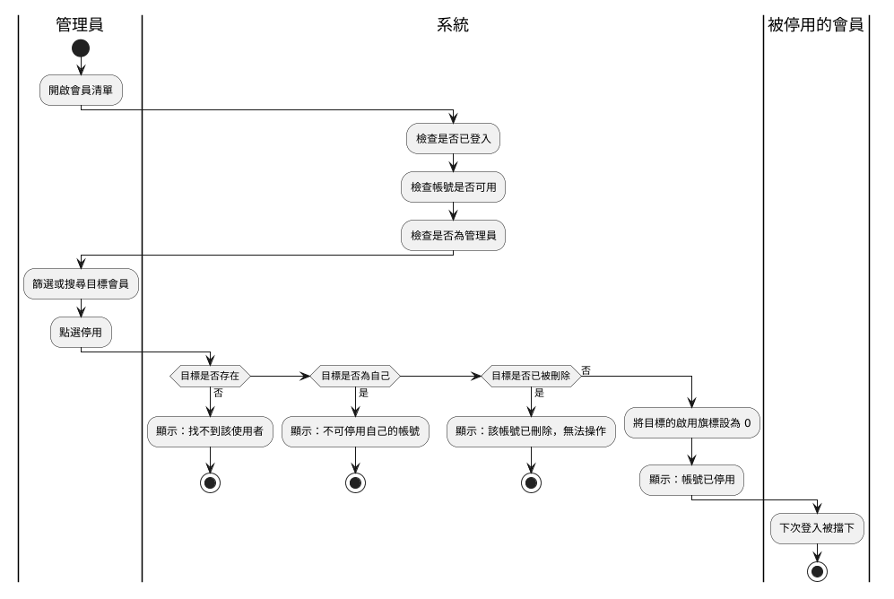
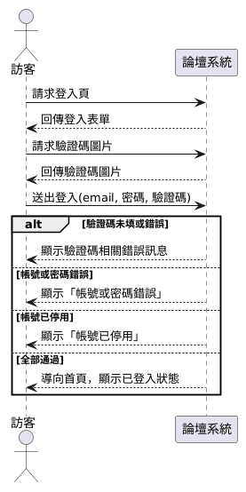
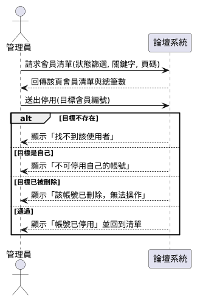

# 行為建模

## 系統分析與設計（IE226）115-1

授課教師：呂卓勲

本課程教材：[GitHub](https://github.com/billy1125/system-analysis-and-design)

---

## 功能清單上的一行字

功能清單上寫著「F-43 啟用或停用會員」。交給開發人員，問題馬上冒出來：

- 系統先檢查帳號存不存在，還是先檢查帳號是不是自己？
- 帳號已經被刪除了，是擋下來還是照樣停用？
- 被停用的人此刻正登入著，他手上的操作會不會立刻被擋住？

這些答案都不在功能結構裡。

---

## 結構與行為

| 切面 | 回答的問題 | 對應的章節 |
|---|---|---|
| 靜態的結構 | 系統由哪些部分組成 | 功能分析 |
| 動態的行為 | 事情按什麼次序發生 | 本章 |

> **兩者是同一套系統的兩個切面，缺哪一份都做不出可以實作的規格。**

---

## 本章的例子

- 課堂範例系統「論壇系統」`sad-forum`
- 對應「系統分析範例報告」〈3. 現況流程分析〉與〈6. 使用案例與系統互動分析〉
- 編號沿用範例報告：FR-01、NFR-01、UC-01、F-11 起

平行工作、狀態機圖與設計階段的深化是期末的內容，沿用工廠訪客進出登記系統。

---

# 一、結構之外還要描述行為

使用案例圖、活動圖與泳道圖在「使用者分析」就畫過了，但那時系統邊界還沒有正式界定，系統泳道裡放什麼，是憑操作系統的印象決定的。

本節先說明為什麼邊界確定之後要回頭確認行為模型，再看三張圖各回答什麼問題、各要畫幾張。

---

## 邊界確定後，回頭確認行為模型

> **系統邊界決定了哪些動作該畫在系統這一側。**

- 循序圖上的「系統」是一個方塊，方塊的範圍就是系統邊界
- 活動圖上的動作畫在系統泳道還是人的泳道，取決於這件事是不是系統的責任
- 「功能分析」寫下範圍外清單之後，才有了可以對照的依據

---

## 拿範圍外清單對一次之前畫的圖

| 檢查 | 論壇系統的例子 |
|---|---|
| 系統泳道裡有沒有界外的事 | 停用後通知當事人是人工作業。把「通知被停用的會員」畫進系統泳道，等於說系統會主動告知 |
| 有沒有畫出系統其實沒有的分支 | 論壇系統不寄送任何電子郵件，登入的活動圖上不該出現「寄送密碼重設信」 |

對不上的地方，要查清楚是圖畫錯了，還是邊界漏了一條。

---

## 三張圖各回答什麼問題

| 圖 | 回答的問題 | 最能抓出什麼遺漏 |
|---|---|---|
| 活動圖 | 流程怎麼走？在哪裡分岔？ | 沒想過的例外分支 |
| 循序圖 | 誰對誰說了什麼？按什麼順序？ | 沒定義的輸入或回應 |
| 狀態機圖（期末） | 這個東西的一生經歷哪些狀態？ | 不該發生卻沒被擋住的操作 |

活動圖是俯視，循序圖是側視，狀態機圖把鏡頭對準單一個資料物件。

---

## 期中要會畫的三張圖

| 順序 | 圖 | 回答的問題 | 在哪一章 |
|---|---|---|---|
| 1 | 使用案例圖 | 誰要做什麼 | 使用者分析〈五〉 |
| 2 | 活動圖 | 事情怎麼做 | 使用者分析〈六〉初次畫，本章補完整 |
| 3 | 系統循序圖 | 使用者與系統怎麼互動 | 本章〈四〉 |

> **同一項需求要能在文字敘述、活動圖與循序圖之間互相對照。**

---

## 要畫幾張

| | 活動圖 | 循序圖 | 狀態機圖 |
|---|---|---|---|
| 期中 | 至少兩張，每張都要有例外分支，跨角色的那張用泳道 | 一到兩張，畫核心流程，系統是黑箱 | 不必畫 |
| 期末 | 至少兩張，挑有判斷、有例外的核心功能 | 一到兩張，生命線必須是模組 | 可選，狀態多又會往回走時強烈建議 |

---

## 挑哪幾個使用案例來畫

- **活動圖**：以有分支的流程為主，線性走到底的流程不必畫
- **循序圖**：核心且牽涉多方往返的使用案例

範例報告挑的是：

- UC-03「登入系統」：每個會員都會走的主力流程，例外最多
- UC-13「啟用或停用會員」：管理員的核心操作，還牽涉被停用的會員

---

# 二、活動圖

活動圖描述流程的步驟與控制流向。它和傳統流程圖的差別，在於能表達平行進行的工作，以及能用泳道標示每個動作由誰執行。

基本畫法在「使用者分析」〈6.3〉到〈6.5〉講過了。本節補上完整的符號與平行工作的畫法，再拿使用案例敘述與需求回頭檢查之前畫的圖。

---

## 已經會的四種符號

| 符號 | 畫法 | 含義 |
|---|---|---|
| 起始節點 | 實心圓 | 流程的起點，一張圖只有一個 |
| 動作 | 圓角方框 | 一個步驟，寫成動詞加受詞 |
| 判斷節點 | 菱形，一進多出 | 依條件選一條路，每條出線都要標條件 |
| 結束節點 | 內含實心圓的空心圓 | 流程的終點，可以有多個 |

---

## 本章補上的三種符號

| 符號 | 畫法 | 含義 |
|---|---|---|
| 合併節點 | 菱形，多進一出 | 分岔的路徑重新合流 |
| 分岔（fork） | 粗橫線，一進多出 | 之後的路徑同時進行 |
| 會合（join） | 粗橫線，多進一出 | 等所有平行路徑都完成才繼續 |

> **判斷是選一條走，分岔是每條都走。**

---

## 動作方框的兩個寫法

**錯誤訊息要寫原文**

- 不寫「顯示錯誤訊息」，要寫「顯示：帳號或密碼錯誤」
- 帳號不存在與密碼打錯收到同一則訊息，那是一條刻意設計的安全規則

**例外處理完要接回哪裡**

- 改一改就能成功的（欄位沒填、驗證碼錯誤）：拉回輸入
- 怎麼改都沒用的（權限不足、目標已被刪除）：直接結束

---

## 用使用案例敘述回頭檢查

> **主要流程的每一個步驟都對得到一個動作，每一條例外流程都對得到一個判斷節點加上一條分支。**

UC-03「登入系統」的例外流程：

- `4a` 驗證碼未填或錯誤
- `5a` 帳號密碼未填
- `5b` 帳號或密碼錯誤
- `6a` 帳號已停用

---

## 範例報告：會員登入的活動圖



---

## 例外與判斷的對應

- `4a` 拆成「驗證碼是否填寫」與「驗證碼是否正確」兩個判斷，因為兩者訊息不同
- 其餘三條各對應一個判斷

> **一個例外可以拆成幾個判斷，但每一個例外至少要有一個判斷。**

---

## 用需求逐條對照（1/2）

| 需求 | 圖上對應的地方 |
|---|---|
| FR-06 登入成功後記錄最後登入時間 | 「更新最後登入時間」 |
| NFR-03 三種失敗回同一則訊息 | 「帳號存在且密碼正確」只有一個判斷、一則訊息 |

---

## 用需求逐條對照（2/2）

| 需求 | 圖上對應的地方 |
|---|---|
| NFR-02 驗證碼在查詢資料庫之前檢查 | 驗證碼的兩個判斷排在帳號密碼之前 |
| FR-02 每次載入產生新的驗證碼 | 這張圖上沒有，在系統循序圖上 |

找不到不一定是漏了，但要說得出是哪一張圖負責。

---

## 畫圖時可能冒出來的問題

FR-07 要阻擋「已停用或已刪除」兩種帳號，圖上卻只有「帳號是否啟用」一個判斷。已刪除的帳號走哪條路？

- 期中分析的是既有系統，答案要靠實測
- 拿已刪除的帳號登入，收到「帳號或密碼錯誤」
- 它在「帳號存在且密碼正確」就被擋下，和帳號不存在走同一條路
- 這裡可能就有一個地方值得再繪製流程

> **活動圖的價值有一半來自畫圖過程中冒出來的問題。**

---

## 判斷的先後順序

停用會員的權限檢查依序是：

1. 是否已登入：失敗導向登入頁
2. 帳號是否可用：失敗代表身分已失效，把人登出
3. 是否具管理員身分：失敗只是權限不足，導回首頁

三關失敗的處置不同，順序調換，使用者收到的回饋就與事實不符（NFR-05）。

---

## 畫完之後多問一句

> **這幾個判斷可以對調嗎？**

- 答得出「不行，因為……」：那句話就是報告裡最有價值的一段分析
- 答得出「可以，順序無所謂」：也是一項結論，代表這裡沒有隱含規則

> 最好的方式，確認程式碼內容

---

## 什麼時候加泳道

- 流程牽涉多個角色，或要區分人做的與系統做的
- 只有「使用者」與「系統」兩方時，不必加泳道
- 系統已經參與其中時，「系統」就是獨立的一條泳道

> **跨泳道的箭頭代表責任的移交。**

---

## mermaid 沒有原生的泳道

範例報告用 PlantUML 畫，它有原生泳道。mermaid 用 `subgraph` 充當泳道，常被排成上下堆疊。三種替代做法：

| 做法 | 怎麼做 |
|---|---|
| 表格式泳道 | 欄是角色、列是步驟序號 |
| 表格加一張不帶泳道的圖 | 表回答誰做，圖回答怎麼分岔 |
| 專門的繪圖工具 | draw.io、Visio、Figma 畫好存成圖片 |

用哪一種都不影響分數。

---

## 範例報告：管理員停用會員的泳道圖



---

## 泳道圖的三個畫法問題

- **系統泳道裡可以有菱形**：「目標是否存在」「目標是否為自己」「目標是否已被刪除」都是系統做的檢核
- **例外的出口不必歸屬任何泳道**：訊息一多，畫在泳道之外，主線才看得清楚
- **可以用一條泳道表達後果**：被停用的會員到下次登入才被擋下

---

# 三、活動圖的常見錯誤

活動圖最常見的錯誤不在符號，而在內容：只畫了順利的那條路，或把畫面操作當成業務動作。

本節列出六種常見錯誤與修正方向，其中最要緊的是整張圖沒有任何菱形。

---

## 常見錯誤（1/2）

| 錯誤 | 症狀 | 修正方向 |
|---|---|---|
| 判斷節點沒標條件 | 菱形出來兩條線，都沒寫字 | 每條出線都標條件，互斥且窮盡 |
| 只畫順利的那條路 | 整張圖沒有任何菱形 | 回到例外流程，逐條補上分支 |
| 畫成畫面操作流程 | 「點選右上角的登入連結」 | 那是介面設計，改寫業務動作 |

---

## 常見錯誤（2/2）

| 錯誤 | 症狀 | 修正方向 |
|---|---|---|
| 動作寫成名詞 | 「會員資料」「登入作業」 | 改成「更新最後登入時間」 |
| 沒有結束節點 | 某條分支走到一半就斷了 | 斷掉的地方通常漏了一段流程 |
| 泳道分給部門 | 「警衛室」「廠務課」 | 改成角色，組織改組時圖才不會失效 |

---

## 最要緊的一項

> **活動圖該畫的正是例外流程。**

- 沒有菱形的活動圖，幾乎可以斷定是把主要流程原樣搬過來
- 系統上線後出問題的地方多半在例外
- 順利的那條路，開發時早就走過幾百次了

---

# 四、系統循序圖

循序圖描述數個參與方在時間軸上互相傳遞訊息的順序。分析階段用的是簡化版本，稱為系統循序圖（System Sequence Diagram, SSD）。

系統循序圖把整套系統當成單一個黑箱，只畫參與者與系統之間的往返。本節說明黑箱的意義、符號，再看範例報告的兩張圖。

---

## 黑箱是分析階段的紀律

> **分析階段要回答的是系統對外承諾了什麼，不是系統內部怎麼做到。**

- 對外的承諾可以拿去和使用者確認，內部做法不行
- 沒有會員關心自己的密碼存進哪張資料表
- 黑箱上的每一條訊息，都會變成一項系統責任

---

## 黑箱抓得出的兩種漏洞

| 圖上看到的 | 代表 |
|---|---|
| 訊息進去了，沒有回應 | 使用者不知道成功了沒 |
| 回應出去了，沒有對應的進入訊息 | 這份資料憑空產生 |

這兩種漏洞在功能清單上看不出來。

---

## 符號

| 符號 | 含義 |
|---|---|
| 參與者 | 圖左側的人形符號，發起互動的角色 |
| 物件 | 上方的方框，分析階段只有一個：系統 |
| 生命線 | 從方框往下的虛線，時間往下推進 |
| 訊息／回傳 | 實線箭頭是請求，虛線箭頭是回應 |
| 片段 | `loop` 重複、`alt` 多選一、`opt` 可有可無 |

---

## 回傳寫使用者看到什麼

| 合格 | 不合格 |
|---|---|
| 顯示：帳號已停用 | 回傳 boolean |
| 回傳該頁會員清單與總筆數 | 回傳 user 物件 |

右欄是設計階段的事，而且在分析階段根本無從確認。

---

## 判斷鏈在循序圖上壓成一個 alt

活動圖關心檢核的順序，循序圖關心送出一次後可能收到哪幾種回應。

```text
alt 驗證碼未填或錯誤
    系統 --> 訪客：顯示驗證碼相關錯誤訊息
else 帳號或密碼錯誤
    系統 --> 訪客：顯示「帳號或密碼錯誤」
else 帳號已停用
    系統 --> 訪客：顯示「帳號已停用」
else 全部通過
    系統 --> 訪客：導向首頁，顯示已登入狀態
end
```

---

## 範例報告：UC-03 登入系統



---

## 範例報告：UC-13 停用會員



---

## 訊息名稱要寫出攜帶的資料

- 不寫「送出登入」，要寫 `送出登入(email, 密碼, 驗證碼)`
- 參數就是這個操作需要的輸入欄位，會對應到資料字典
- 查詢的條件也是參數：`請求會員清單(狀態篩選, 關鍵字, 頁碼)`
- 只寫「請求會員清單」，篩選、搜尋與分頁三項功能就從圖上消失了

> **使用者送給系統的，不管是輸入的資料還是選定的條件，都算參數。**

---

## 畫循序圖的另外三條規則

- **每一條進入的訊息都要有回應**：否則使用者怎麼知道這件事做完了？
- **取得畫面與資源的往返也要畫**：UC-03 前四條訊息拿登入表單與驗證碼圖片，FR-02 與 NFR-02 才有落點
- **黑箱裡不要出現內部動作**：「系統呼叫資料庫」「系統驗證權限」是設計階段的事

> **圖從使用者第一次接觸這個功能畫起，不是從按下送出鍵畫起。**

---

## 與活動圖的分工

| | 活動圖 | 系統循序圖 |
|---|---|---|
| 強項 | 分支、平行、誰執行 | 訊息內容、往返次數、時序 |
| 弱項 | 看不出每次互動傳了什麼資料 | 複雜分支畫起來很擠 |
| 下游依據 | 業務規則、權限規劃 | 介面欄位、API 的雛形 |

範例報告的登入與停用會員兩張都畫：〈3.1〉〈3.2〉是活動圖，〈6.1〉〈6.2〉是循序圖，〈6.3〉示範兩張怎麼對照。

---

## 期末才會用到的部分

本章後半段期中不必做，留到期末：

- 狀態機圖：物件在不同狀態下允許的操作不同
- 設計循序圖：黑箱打開，生命線換成模組
- 交易邊界：一次操作寫兩張表時，兩者要一起成功或一起失敗

這幾節以工廠訪客進出登記系統為例，期末設計階段再講。

---

# 五、三張圖如何與前後文件對得起來

行為建模的產出要能雙向追溯：往前追到使用案例與需求，往後接到資料與介面設計。

本節列出期中交件前一定要做的六條檢查。它們不看圖畫得漂不漂亮，只看各份文件是不是在描述同一套系統。

---

## 往前追：使用案例與需求

| 方向 | 檢查問題 | 對不上代表 |
|---|---|---|
| 使用案例 → 活動圖 | 每一條例外流程都有對應的判斷節點 | 例外沒被處理 |
| 需求 → 活動圖 | 每一條功能需求都落在某個動作或判斷上 | 需求漏了，或圖不夠細 |
| 活動圖 → 循序圖 | 每一次跨越系統邊界的動作都是一條訊息 | 有一段互動只在其中一張圖 |

---

## 往後接：功能、需求與資料

| 方向 | 檢查問題 | 對不上代表 |
|---|---|---|
| 循序圖 → 功能清單 | 每一條訊息都對應得到一項功能 | 冒出清單沒有的功能 |
| 循序圖 → 需求 | 每一條訊息與回應都對得到一條需求 | 做了沒有需求依據的事 |
| 循序圖 → 資料字典 | 參數都找得到對應欄位 | 輸入的東西沒有地方存 |

---

## 對不上的時候

> **先別急著改圖。比較常見的情況是有東西真的被漏掉了，改圖只會把證據抹掉。**

對不上只有兩種可能：圖畫錯了，或有東西被漏掉了。兩種都值得在動工前查清楚。

---

## 本章重點回顧

- 系統邊界確定之後，行為模型要回頭再確認一次
- 例外分支才是活動圖的價值所在，判斷的順序本身就是分析發現
- 系統循序圖把系統當黑箱，回傳寫使用者看到什麼
- 訊息要寫出攜帶的資料，參數會變成資料字典與介面的依據
- 行為模型的每一條線都要追溯得回使用案例、需求與功能

---

## 下一章

本章描述的是系統怎麼動。

下一章「資料建模與資料庫設計」接著處理系統記得什麼：把流程中來回傳遞的資料，整理成實體關聯圖、資料表與資料字典。
