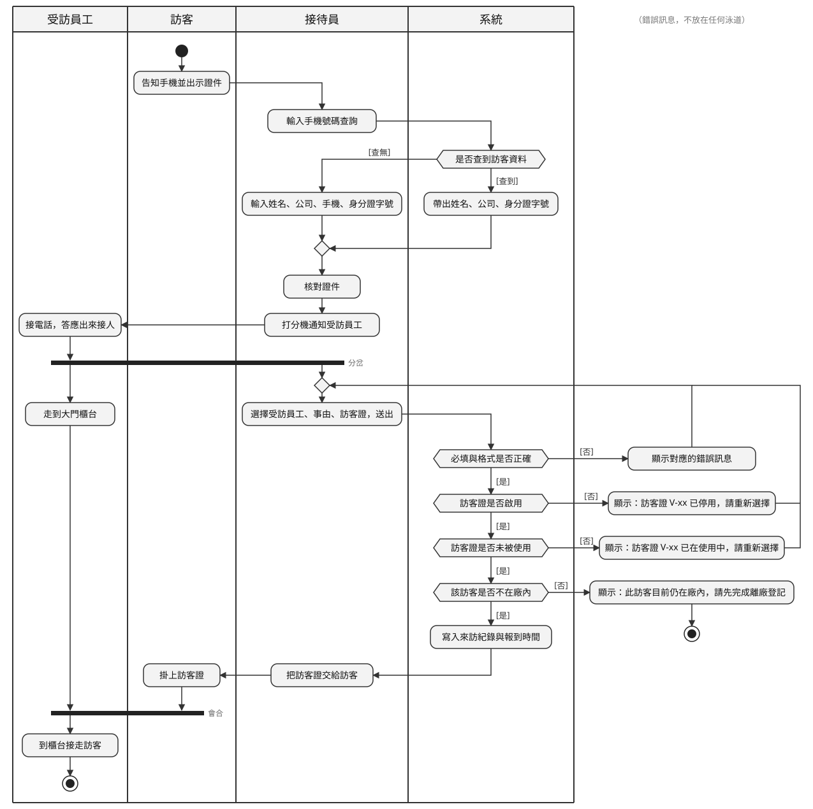
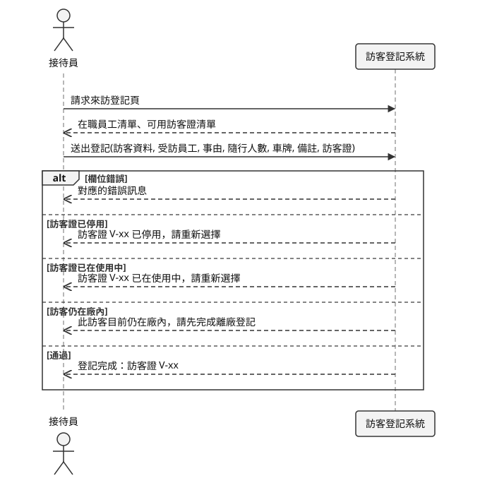
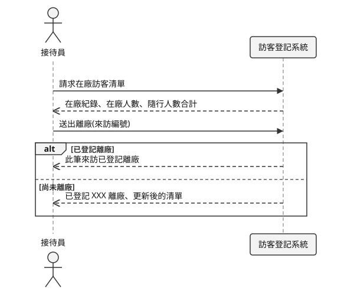
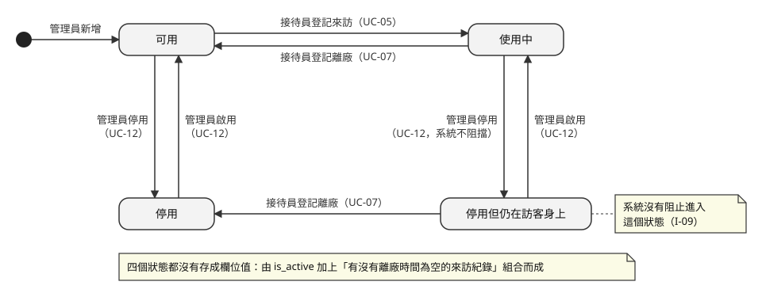

# 行為建模

## 系統分析與設計（IE226）115-1

授課教師：呂卓勲

本課程教材：[GitHub](https://github.com/billy1125/system-analysis-and-design)

---

## 功能清單上的一行字

功能清單上寫著「F-23 登記來訪與發證」。交給開發人員，問題馬上冒出來：

- 接待員按下送出之後，系統先檢查欄位，還是先檢查訪客證？
- 選好的訪客證剛被另一位接待員發出去了，是擋下來還是照樣登記？
- 這位訪客上次來沒有登記離廠，這次還能再登記一次嗎？

這些答案都不在功能結構裡。

---

## 結構與行為

| 切面 | 回答的問題 | 對應的章節 |
|---|---|---|
| 靜態的結構 | 系統由哪些部分組成 | 功能分析 |
| 動態的行為 | 事情按什麼次序發生 | 本章 |

> **兩者是同一套系統的兩個切面，缺哪一份都做不出可以實作的規格。**

---

## 本章的例子

- 期末示範的工廠訪客進出登記系統 `SAD-Visitor`（現行版）
- 對應「系統分析完整報告」〈3. 現況流程分析〉與〈6. 使用案例與系統互動分析〉
- 編號沿用訪客系統報告：FR-01、NFR-01、UC-01、F-11、I-01 起

期末要畫的修改前後對照，見「修改需求與變更規格」〈四〉〈六〉。

---

# 一、結構之外還要描述行為

使用案例圖和活動圖/泳道圖，在「使用者分析」就畫過了。但那時系統邊界還沒確定，系統泳道裡放什麼，是憑操作系統的印象決定的。

本節先說明邊界確定之後，為什麼要回頭確認之前畫的圖，再看三張圖各回答什麼問題、各要畫幾張。

---

## 邊界確定後，回頭確認行為模型

> **系統邊界決定了哪些動作要畫在系統這一側。**

- 循序圖上的「系統」是一個方塊，方塊的範圍就是系統邊界
- 活動圖上的動作畫在系統泳道還是人的泳道，看這件事是不是系統負責
- 「功能分析」寫下範圍外清單之後，才有可以對照的依據

---

## 拿功能清單與範圍外清單對一次

| 檢查 | 訪客系統的例子 |
|---|---|
| 有沒有多畫系統沒做的事 | 系統只顯示分機，通知受訪員工是接待員打電話，不畫進系統泳道 |
| 有沒有漏畫系統真的會做的事 | 登記時，系統會檢查訪客證是否已停用、是否已在使用中，以及訪客是否仍在廠內 |

對不上的地方，要查清楚是圖畫錯了，還是邊界漏了一條。

---

## 三張圖各回答什麼問題

| 圖 | 回答的問題 | 最能抓出什麼遺漏 |
|---|---|---|
| 活動圖/泳道圖 | 流程怎麼走？在哪裡分岔？ | 沒想過的例外分支 |
| 循序圖 | 誰對誰說了什麼？按什麼順序？ | 沒定義的輸入或回應 |
| 狀態機圖（期末可選） | 這筆資料會經過哪些狀態？ | 不該發生卻沒被擋住的操作 |

活動圖從上往下看整條流程，循序圖從側面看一來一往，狀態機圖只看一筆資料的變化。

---

## 期中要會畫的三張圖

| 順序 | 圖 | 回答的問題 | 在哪一章 |
|---|---|---|---|
| 1 | 使用案例圖 | 誰要做什麼 | 使用者分析〈五〉 |
| 2 | 活動圖/泳道圖 | 事情怎麼做 | 使用者分析〈六〉初次畫，本章補完整 |
| 3 | 循序圖 | 使用者與系統怎麼互動 | 本章〈四〉 |

---

## 拿前面幾章的成果來畫

| 前面的成果 | 在本章的用途 |
|---|---|
| 使用案例圖 | 決定要畫哪些流程 |
| 系統需求分析的需求 | 每一條都要在其中一張圖上找到對應的步驟 |
| 功能分析的系統邊界 | 決定哪些步驟由系統做、哪些由人做 |
| 功能分析的功能清單 | 檢查循序圖上的每一次操作，系統是不是真的有這項功能 |

> **同一件事，文字、活動圖/泳道圖與循序圖講的要一致。**

---

## 要畫幾張

| | 活動圖/泳道圖 | 循序圖 | 狀態機圖 |
|---|---|---|---|
| 期中 | 至少兩張，每張都要有例外分支，跨角色的那張用泳道 | 一到兩張，畫核心流程，系統是黑箱 | 不必畫 |
| 期末 | 現況一到兩張，與修改方向相關；修改後的版本與現況對照 | 一到兩張修改後的版本，仍是黑箱，只畫受修改影響的互動 | 可選 |

---

## 挑哪幾個使用案例來畫

- **活動圖/泳道圖**：以有分支的流程為主，從頭走到尾沒有判斷的流程不必畫
- **循序圖**：核心、來回互動多的使用案例

訪客系統報告挑的是：

- UC-05「登記來訪」：接待員最常走的流程，例外最多
- UC-07「登記離廠」：同一位訪客進出的另一半，沒登記離廠，訪客證不會釋出

---

# 二、活動圖/泳道圖

活動圖畫的是流程的步驟和走向。它和傳統流程圖的差別，是能畫出同時進行的工作，也能用泳道標出每個動作由誰負責。泳道圖就是加上泳道的活動圖。

基本畫法在「使用者分析」〈6.3〉到〈6.5〉講過了。本節補上完整的符號，再拿使用案例敘述和需求，回頭檢查之前畫的圖。

---

## 符號（1/2）：使用者分析已經用過的

| 符號 | 畫法 | 意思 |
|---|---|---|
| 起始節點 | 實心圓 | 流程的起點，一張圖只有一個 |
| 動作 | 圓角方框 | 一個步驟，寫成動詞加受詞 |
| 判斷節點 | 菱形，一進多出 | 依條件選一條路，每條出線都要標條件 |
| 結束節點 | 內含實心圓的空心圓 | 流程的終點，可以有多個 |

---

## 符號（2/2）：本章補上的

| 符號 | 畫法 | 意思 |
|---|---|---|
| 合併節點 | 菱形，多進一出 | 分開的路重新合在一起 |
| 分岔（fork） | 粗橫線，一進多出 | 之後的路同時進行 |
| 會合（join） | 粗橫線，多進一出 | 所有同時進行的路都做完才繼續 |

> **判斷是從幾條路裡選一條走，分岔是每條路都要走。**

---

## 動作方框的兩個寫法

**錯誤訊息要寫系統實際顯示的文字**

- 不寫「顯示錯誤訊息」，要寫「顯示：訪客證 V-xx 已在使用中，請重新選擇」
- 方框要寫什麼訊息，可以從系統實際顯示的文字確認

**處理完例外之後，箭頭接回哪裡**

- 可以重試的（欄位沒填、訪客證已被使用）：拉回輸入的動作
- 不能重試的（訪客仍在廠內）：顯示訊息後結束

---

## 用使用案例敘述回頭檢查

> **主要流程的每一步都要對得到一個動作，每一條例外流程都要對得到一個判斷節點和一條分支。**

UC-05「登記來訪」的例外流程：

- `4a` 必填未填或格式錯誤
- `5a` 訪客證已停用
- `5b` 訪客證已在使用中
- `6a` 訪客仍在廠內

---

## 訪客系統報告：來訪登記與發證的活動圖

---

## 例外與判斷的對應

- `4a` 拆成「格式是否正確」與「必填是否齊全、隨行人數是否 0 到 20」兩個判斷：前者只在建立新訪客時檢查，後者每次登記都檢查
- 其餘三條各對應一個判斷

> **一個例外可以拆成幾個判斷，但每一個例外至少要有一個判斷。**

---

## 用需求逐條對照（1/2）：圖上找得到的

| 需求 | 圖上對應的地方 |
|---|---|
| FR-05 以手機查詢，多筆時列出選擇 | 「是否查到訪客資料」的三條出線 |
| FR-06 查無時建立新訪客 | 「查無」分支與「格式是否正確」 |
| FR-09 送出時再檢查訪客證 | 「訪客證是否啟用」「訪客證是否未被使用」 |
| FR-10 仍在廠內不得再登記 | 「該訪客是否不在廠內」 |

---

## 用需求逐條對照（2/2）：圖上找不到的

| 需求 | 在哪裡 |
|---|---|
| FR-09 只能選可用的證 | 循序圖回傳的「可用訪客證清單」 |
| FR-08 只能選在職員工 | 循序圖回傳的「在職員工清單」 |
| NFR-03 單一頁面完成 | 畫面的規定，活動圖不畫 |

找不到不一定是漏了，但要說得出是哪一張圖負責。

---

## 畫圖時冒出來的問題

FR-10 說訪客仍在廠內就不能再登記。那上次忘了登記離廠的訪客再來時怎麼辦？

- 期中分析的是現成的系統，答案要實際測試
- 11/2 進廠、沒登記離廠的陳俊宏再登記，系統擋住他
- 接待員要先替 11/2 那筆補登離廠，但離廠時間只能是今天（I-01）

> **畫活動圖的一個用處，就是逼你發現這種問題。**

---

## 判斷的先後順序（1/2）

只把需求一條條列出來，看不出哪個檢查先做；畫成活動圖，順序就擺在圖上。

送出之後依「欄位 → 訪客證 → 是否在廠內」檢查：

- 前兩關沒過，改完欄位或換一張證就能重送
- 最後一關沒過，整筆登記都做不下去
- 移到最前面，接待員就不必先填完才發現不能登記
- 系統沒說明為什麼這樣排：寫明推不出理由，列為待確認

---

## 判斷的先後順序（2/2）

FR-09 的兩道關卡說得出理由：

- 下拉選單只列出可用的證，送出時系統再檢查一次
- 只留第一道：打開頁面到送出之間，別人可能剛好發出同一張證
- 只留第二道：接待員每次都要猜哪一張能用

---

## 畫完之後多問一句

> **這幾個判斷可以對調嗎？**

- 答案是「不行，因為……」：後面那句理由值得寫進報告
- 答案是「可以，順序沒差」：也是一個結論，代表這裡沒有藏著規則
- 答不出來：照實寫答不出來，列為待確認

分析既有系統時，最直接的確認方式是看程式碼。

---

## 什麼時候畫成泳道圖

- 流程牽涉好幾個角色，或要分清楚哪些動作由人做、哪些由系統做
- 只有「使用者」和「系統」兩方時，不必加泳道
- 流程裡有系統參與時，「系統」要獨立畫成一條泳道

> **為什麼叫泳道圖？每個角色各佔一條長條，並排起來就像游泳池的泳道。**

---

## 訪客系統報告〈3.1〉畫成泳道圖

---

## 箭頭跨過泳道

> **箭頭跨過泳道，代表工作換人負責。**

- 從人的泳道進到系統泳道：從這一步開始由系統負責
- 從系統泳道出來：系統把結果交回給人
- 導入前和導入後的圖放在一起比，跨泳道的箭頭少了幾條，就代表系統省掉了幾次人工交接
- 接待員到受訪員工那條箭頭是打電話，不經過系統

---

## 泳道圖的三個畫法問題

- **系統泳道裡也可以有菱形**：「訪客證是否未被使用」「該訪客是否不在廠內」都是系統做的檢查
- **錯誤訊息可以不放在任何泳道裡**：訊息一多，畫在泳道外面，主要流程才看得清楚
- **不操作系統的人也可以有泳道**：畫出受訪員工，才會問到「他沒接電話怎麼辦」

---

## 同時進行的工作：分岔與會合

- 判準：這幾件事之間 **沒有先後依賴**
- 泳道圖上：受訪員工走到櫃台，接待員同時在系統上登記
- 接走訪客要等兩邊都完成，所以要會合
- 全部串成一條直線，會以為訪客要等「登記加走路」的時間；畫成平行，才看得出等的是兩者中比較久的那一段

---

# 三、活動圖/泳道圖的常見錯誤

活動圖最常見的錯誤不在符號，而在內容：只畫了順利的那條路，或把畫面操作當成業務動作。

本節列出六種常見錯誤和修正方向，其中最要緊的是整張圖沒有任何菱形。

---

## 常見錯誤（1/2）

| 錯誤 | 症狀 | 修正方向 |
|---|---|---|
| 判斷節點沒標條件 | 菱形出來兩條線，都沒寫字 | 每條出線都標條件，互斥且窮盡 |
| 只畫順利的那條路 | 整張圖沒有任何菱形 | 回到例外流程，逐條補上分支 |
| 畫成畫面操作流程 | 「點選上方選單的來訪登記」 | 那是介面設計，活動圖畫的是業務動作 |

---

## 常見錯誤（2/2）

| 錯誤 | 症狀 | 修正方向 |
|---|---|---|
| 動作寫成名詞 | 「訪客資料」「來訪登記作業」 | 改成「寫入來訪紀錄與報到時間」 |
| 沒有結束節點 | 某條分支走到一半就斷了 | 斷掉的地方通常漏了一段流程 |
| 泳道分給部門 | 「總務課」「大門櫃台」 | 改成角色，組織改組時圖才不會失效 |

---

## 最要緊的一項

> **活動圖該畫的正是例外流程。**

- 沒有菱形的活動圖，通常是把主要流程原樣搬過來
- 系統上線後出問題的地方，多半在例外
- 順利的那條路，開發時早就走過很多次了

---

# 四、循序圖

循序圖畫的是幾個參與方之間，依時間先後互相傳了哪些訊息。分析階段用的是簡化畫法，教科書叫做 System Sequence Diagram（SSD），本章一律簡稱循序圖。

這種畫法把整套系統當成一個黑箱，只畫使用者和系統之間的一來一往。本節說明黑箱的意義和符號，再看訪客系統報告的兩張圖。

換個角度看，循序圖是在規劃使用者和系統怎麼互動：使用者輸入什麼、系統顯示什麼、遇到狀況怎麼反應。這份規劃之後也是使用者介面（UI）設計的起點。

---

## 黑箱的意義

> **分析階段要回答的是系統對外答應做到什麼，不是系統內部怎麼做到。**

- 對外答應的事，可以拿去和使用者確認；內部做法不行
- 接待員不會關心「訪客證使用中」存在哪一張資料表
- 圖上的每一條訊息，之後都會變成系統要負責的一件事

---

## 黑箱抓得出的兩種漏洞

| 圖上看到的 | 代表 |
|---|---|
| 訊息送進去，沒有回應 | 使用者做完操作，不知道有沒有成功 |
| 系統送出回應，找不到是哪條訊息觸發的 | 這份資料不知道從哪裡來 |

這兩種漏洞在功能清單上看不出來。

---

## 符號

| 符號 | 意思 |
|---|---|
| 參與者 | 圖左邊的人形符號，發起操作的角色 |
| 物件 | 圖上方的方框，分析階段只有一個：系統 |
| 生命線 | 從方框往下拉的虛線，越往下時間越晚 |
| 訊息／回傳 | 實線箭頭是請求，虛線箭頭是回應 |
| 片段 | 把幾條訊息框起來，標上 `loop`、`alt`、`opt` |

---

## 三種片段：用程式寫法來理解

| 片段 | 對應的程式寫法 | 意思 |
|---|---|---|
| `loop` | `for` 迴圈 | 框裡的訊息重複做 |
| `alt` | `if … else if … else` | 幾種情況選一種，對應活動圖的判斷節點 |
| `opt` | 沒有 `else` 的 `if` | 條件成立才做，對應使用案例的 «extend» |

---

## 回傳寫使用者看到什麼

| 對的寫法 | 不對的寫法 |
|---|---|
| 訪客證 V-xx 已在使用中，請重新選擇 | 回傳 boolean |
| 在廠紀錄、在廠人數、隨行人數合計 | 回傳 visit 物件 |

右欄是程式內部怎麼傳資料，使用者看不到，也沒辦法確認。

---

## 一串判斷，合併成一個 alt

- 活動圖在意 **檢查的先後順序**，判斷一個接一個畫
- 循序圖在意 **送出一次之後，可能收到哪幾種回應**，結果並排放在同一個 `alt`
- UC-05：欄位錯誤、訪客證已停用、訪客證已在使用中、訪客仍在廠內、通過，五種情況

> **活動圖上有幾種結果，alt 裡就要有幾種情況。**

---

## 訪客系統報告：UC-05 登記來訪

---

## 訪客系統報告：UC-07 登記離廠

---

## 訊息名稱要寫出帶了哪些資料

- 不寫「送出登記」，要寫 `送出登記(訪客資料, 受訪員工, 事由, 隨行人數, 車牌, 備註, 訪客證)`
- 括號裡的參數，會對應到資料字典的欄位，之後設計畫面也會用到
- 點選的那一筆也是參數：`送出離廠(來訪編號)`
- 查詢條件也是參數：`查詢來訪紀錄(報到日期起訖, 關鍵字)`

> **使用者送給系統的東西，不管是輸入的、點選的還是選擇的條件，都算參數。**

---

## 畫循序圖的另外三條規則

- **每一條送進系統的訊息都要有回應**：否則使用者怎麼知道這件事做完了？
- **拿到畫面的往返也要畫**：UC-05 前兩條訊息省掉，FR-08 與 FR-09 就找不到對應的地方
- **黑箱裡不要畫系統內部的動作**：「系統查詢資料庫」「系統檢查訪客證」是程式內部的做法，本課程不畫

> **圖要從使用者第一次打開這個功能開始畫，不是從按下送出鍵開始畫。**

---

## 與活動圖/泳道圖的分工

| | 活動圖/泳道圖 | 循序圖 |
|---|---|---|
| 擅長表達 | 分支、同時進行的工作、誰負責 | 每次傳了什麼資料、來回幾次、先後順序 |
| 不擅長表達 | 看不出每次互動傳了什麼資料 | 分支一多，圖會擠成一團 |
| 之後用在哪裡 | 整理業務規則、規劃權限 | 設計畫面欄位、API 的初稿 |

訪客系統報告的登記來訪與登記離廠兩張都畫，〈6.3〉示範兩張怎麼對照。

---

## 互動只有一來一回：可以不畫，但要寫理由

- 使用者送出一次、系統回一次，循序圖畫不出比活動圖更多的東西
- 例：UC-02 登出，按登出、系統回到登入頁
- 沒有這句話，讀者分不出是決定不畫，還是忘了畫

> **不畫也是一個判斷，要寫出理由。**

---

# 五、狀態機圖

狀態機圖畫的是一筆資料從建立到結束，會經過哪些狀態，以及發生什麼事會讓它換到下一個狀態。期中不必畫，期末列為可選。

本節用訪客證示範：它的狀態有一半不存在訪客證這張表裡，畫出來之後，還會多出一個沒有人設計過的狀態。

---

## 什麼樣的東西需要狀態圖

> **判準只有一條：這筆資料在不同階段，能做的操作是不是不一樣。**

- 訪客證：可用的能發，使用中的要等離廠，停用的不能發
- 帳號：只有啟用與停用，一條規則就說完了，不必畫
- 訪客系統報告〈7.7〉的訪客證狀態表，就是用表格寫成的狀態圖
- 最值得畫的是時間到了就發生的轉移；現行系統沒有，事前預約納入後才會出現

---

## 例：訪客證的狀態機圖

---

## 狀態圖抓出的漏洞

| 檢查 | 訪客證的例子 |
|---|---|
| 每次狀態改變都有功能負責嗎？ | 發證 F-23、釋出 F-32、停用與啟用 F-62，都找得到 |
| 每個狀態該擋的操作想清楚了嗎？ | 使用中的證可以停用，多出「停用但仍在訪客身上」（I-09） |
| 有狀態要靠系統管不到的事才離開嗎？ | 使用中只能等訪客交回訪客證，沒交回就一直使用中（I-01） |

「使用中」不存欄位，由有沒有在廠的來訪紀錄推導。

---

# 六、三張圖如何與前後文件對得起來

行為建模的產出要能雙向追溯：往前追到使用案例與需求，往後接到資料與介面設計。

本節列出期中交件前一定要做的六條檢查。它們不看圖畫得漂不漂亮，只看各份文件是不是在描述同一套系統。

---

## 往前追：使用案例與需求

| 方向 | 檢查問題 | 對不上代表 |
|---|---|---|
| 使用案例 → 活動圖 | 每一條例外流程都有對應的判斷節點 | 例外沒被處理 |
| 需求 → 活動圖 | 每一條功能需求都落在某個動作或判斷上 | 需求漏了，或圖不夠細 |
| 活動圖 → 循序圖 | 每一次跨過系統邊界的動作都是一條訊息 | 有一段互動只在其中一張圖 |

---

## 往後接：功能、需求與資料

| 方向 | 檢查問題 | 對不上代表 |
|---|---|---|
| 循序圖 → 功能清單 | 每一條訊息都對應得到一項功能 | 冒出清單沒有的功能 |
| 循序圖 → 需求 | 每一條訊息與回應都對得到一條需求 | 做了沒有需求依據的事 |
| 循序圖 → 資料字典 | 參數都找得到對應欄位 | 輸入的東西沒有地方存 |

---

## 對不上的時候

> **先別急著改圖。比較常見的情況是有東西真的被漏掉了，改圖只會把證據抹掉。**

對不上只有兩種可能：圖畫錯了，或有東西被漏掉了。兩種都要在動工前查清楚。

---

## 本章重點回顧

- 系統邊界確定之後，之前畫的行為模型要回頭再確認一次
- 例外分支是活動圖的重點，判斷的先後順序本身就是分析結果
- 循序圖把系統當黑箱，訊息寫出參數，回傳寫使用者看到什麼
- 狀態機圖（期末可選）看得出哪些操作該擋卻沒擋
- 行為模型的每一條線，都要追溯得回使用案例、需求與功能

---

## 下一章

本章描述的是系統怎麼動。

下一章「資料建模與資料庫設計」接著處理系統記得什麼：把流程中來回傳遞的資料，整理成實體關聯圖、資料表與資料字典。
