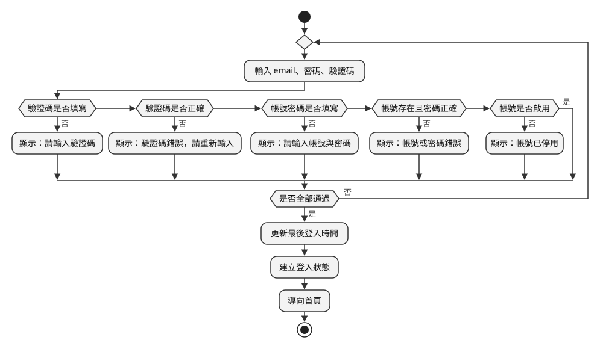
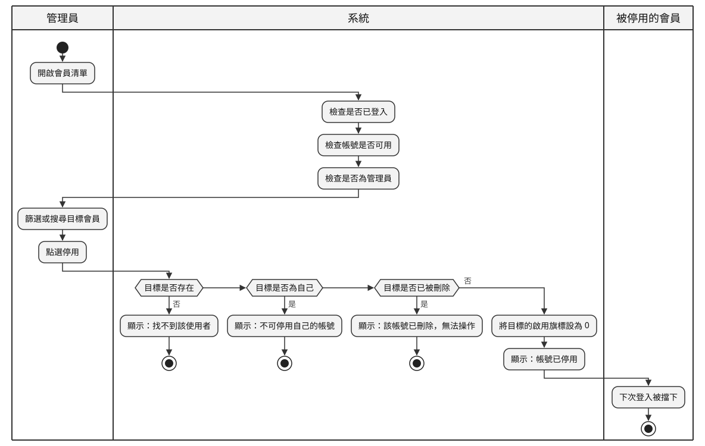
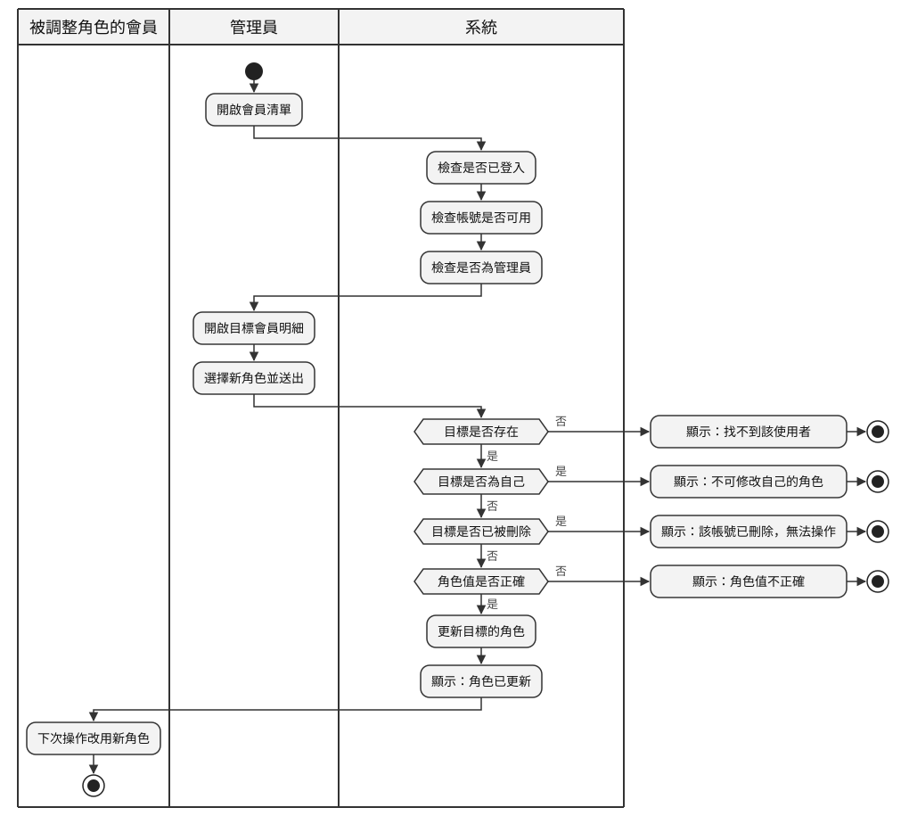
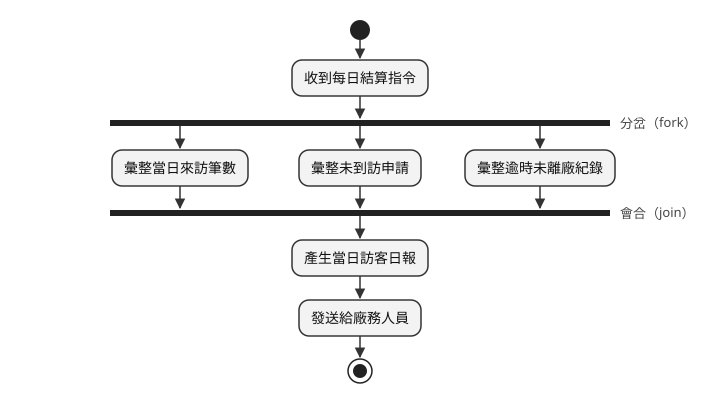
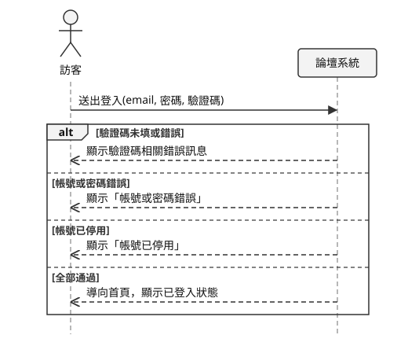
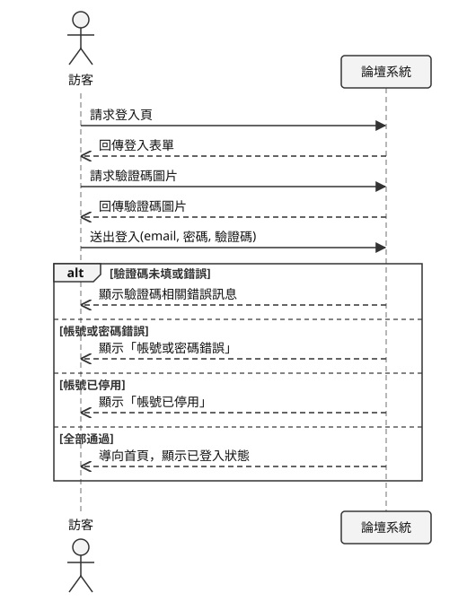
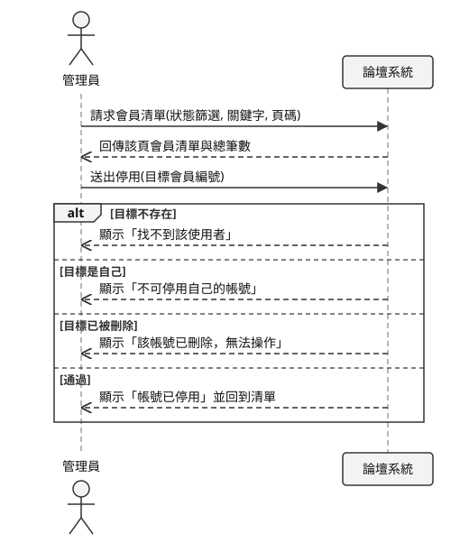

# 行為建模

## 系統分析與設計（IE226）115-1

授課教師：呂卓勲

本課程教材：[GitHub](https://github.com/billy1125/system-analysis-and-design)

---

## 功能清單上的一行字

功能清單上寫著「F-43 啟用或停用會員」。交給開發人員，問題馬上冒出來：

- 系統先檢查帳號存不存在，還是先檢查帳號是不是管理員自己？
- 帳號已經被刪除了，是擋下來還是照樣停用？
- 被停用的會員此刻正登入著，手上的操作會不會立刻被擋住？

這些答案都不在功能結構裡。

---

## 結構與行為

| 切面 | 回答的問題 | 對應的章節 |
|---|---|---|
| 靜態的結構 | 系統由哪些部分組成 | 功能分析 |
| 動態的行為 | 事情按什麼次序發生 | 本章 |

> **兩者是同一套系統的兩個切面，缺哪一份都做不出可以實作的規格。**

---

## 本章的例子

- 課堂範例系統「論壇系統」`SAD-Forum`
- 對應「系統分析範例報告」〈3. 現況流程分析〉與〈6. 使用案例與系統互動分析〉
- 編號沿用範例報告：FR-01、NFR-01、UC-01、F-11 起

範例報告沒有的內容（平行工作、狀態機圖、設計階段的深化），改用工廠訪客進出登記系統。

---

# 一、結構之外還要描述行為

使用案例圖和活動圖/泳道圖，在「使用者分析」就畫過了。但那時系統邊界還沒確定，系統泳道裡放什麼，是憑操作系統的印象決定的。

本節先說明邊界確定之後，為什麼要回頭確認之前畫的圖，再看三張圖各回答什麼問題、各要畫幾張。

---

## 邊界確定後，回頭確認行為模型

> **系統邊界決定了哪些動作要畫在系統這一側。**

- 循序圖上的「系統」是一個方塊，方塊的範圍就是系統邊界
- 活動圖上的動作畫在系統泳道還是人的泳道，看這件事是不是系統負責
- 「功能分析」寫下範圍外清單之後，才有可以對照的依據

---

## 拿功能清單與範圍外清單對一次

| 檢查 | 論壇系統的例子 |
|---|---|
| 有沒有多畫系統沒做的事 | 論壇系統不寄電子郵件，登入流程不該有「寄送密碼重設信」；通知被停用的會員是人工作業，不畫進系統泳道 |
| 有沒有漏畫系統真的會做的事 | 停用會員時，系統會檢查目標是不是自己、帳號是不是已刪除 |

對不上的地方，要查清楚是圖畫錯了，還是邊界漏了一條。

---

## 三張圖各回答什麼問題

| 圖 | 回答的問題 | 最能抓出什麼遺漏 |
|---|---|---|
| 活動圖/泳道圖 | 流程怎麼走？在哪裡分岔？ | 沒想過的例外分支 |
| 循序圖 | 誰對誰說了什麼？按什麼順序？ | 沒定義的輸入或回應 |
| 狀態機圖（期末） | 這筆資料會經過哪些狀態？ | 不該發生卻沒被擋住的操作 |

活動圖從上往下看整條流程，循序圖從側面看一來一往，狀態機圖只看一筆資料的變化。

---

## 期中要會畫的三張圖

| 順序 | 圖 | 回答的問題 | 在哪一章 |
|---|---|---|---|
| 1 | 使用案例圖 | 誰要做什麼 | 使用者分析〈五〉 |
| 2 | 活動圖/泳道圖 | 事情怎麼做 | 使用者分析〈六〉初次畫，本章補完整 |
| 3 | 循序圖 | 使用者與系統怎麼互動 | 本章〈四〉 |

---

## 拿前面幾章的成果來畫

| 前面的成果 | 在本章的用途 |
|---|---|
| 使用案例圖 | 決定要畫哪些流程 |
| 系統需求分析的需求 | 每一條都要在其中一張圖上找到對應的步驟 |
| 功能分析的系統邊界 | 決定哪些步驟由系統做、哪些由人做 |
| 功能分析的功能清單 | 檢查循序圖上的每一次操作，系統是不是真的有這項功能 |

> **同一件事，文字、活動圖/泳道圖與循序圖講的要一致。**

---

## 要畫幾張

| | 活動圖/泳道圖 | 循序圖 | 狀態機圖 |
|---|---|---|---|
| 期中 | 至少兩張，每張都要有例外分支，跨角色的那張用泳道 | 一到兩張，畫核心流程，系統是黑箱 | 不必畫 |
| 期末 | 至少兩張，挑有判斷、有例外的核心功能 | 一到兩張，生命線必須是模組 | 可選，狀態多又會往回走時強烈建議 |

---

## 挑哪幾個使用案例來畫

- **活動圖/泳道圖**：以有分支的流程為主，從頭走到尾沒有判斷的流程不必畫
- **循序圖**：核心、來回互動多的使用案例

範例報告挑的是：

- UC-03「登入系統」：每個會員都會走的流程，例外最多
- UC-13「啟用或停用會員」：管理員的核心操作，還牽涉被停用的會員

---

# 二、活動圖/泳道圖

活動圖畫的是流程的步驟和走向。它和傳統流程圖的差別，是能畫出同時進行的工作，也能用泳道標出每個動作由誰負責。泳道圖就是加上泳道的活動圖。

基本畫法在「使用者分析」〈6.3〉到〈6.5〉講過了。本節補上完整的符號，再拿使用案例敘述和需求，回頭檢查之前畫的圖。

---

## 符號（1/2）：使用者分析已經用過的

| 符號 | 畫法 | 意思 |
|---|---|---|
| 起始節點 | 實心圓 | 流程的起點，一張圖只有一個 |
| 動作 | 圓角方框 | 一個步驟，寫成動詞加受詞 |
| 判斷節點 | 菱形，一進多出 | 依條件選一條路，每條出線都要標條件 |
| 結束節點 | 內含實心圓的空心圓 | 流程的終點，可以有多個 |

---

## 符號（2/2）：本章補上的

| 符號 | 畫法 | 意思 |
|---|---|---|
| 合併節點 | 菱形，多進一出 | 分開的路重新合在一起 |
| 分岔（fork） | 粗橫線，一進多出 | 之後的路同時進行 |
| 會合（join） | 粗橫線，多進一出 | 所有同時進行的路都做完才繼續 |

> **判斷是從幾條路裡選一條走，分岔是每條路都要走。**

---

## 動作方框的兩個寫法

**錯誤訊息要寫系統實際顯示的文字**

- 不寫「顯示錯誤訊息」，要寫「顯示：帳號或密碼錯誤」
- 方框要寫什麼訊息，可以從系統實際顯示的文字確認

**處理完例外之後，箭頭接回哪裡**

- 可以重試的（欄位沒填、驗證碼錯誤）：拉回輸入的動作
- 不能重試的（權限不足、資料已被刪除）：顯示訊息後結束

---

## 用使用案例敘述回頭檢查

> **主要流程的每一步都要對得到一個動作，每一條例外流程都要對得到一個判斷節點和一條分支。**

UC-03「登入系統」的例外流程：

- `4a` 驗證碼未填或錯誤
- `5a` 帳號密碼未填
- `5b` 帳號或密碼錯誤
- `6a` 帳號已停用

---

## 範例報告：會員登入的活動圖

---

## 例外與判斷的對應

- `4a` 拆成「驗證碼是否填寫」與「驗證碼是否正確」兩個判斷，因為沒填和填錯的訊息不同
- 其餘三條各對應一個判斷

> **一個例外可以拆成幾個判斷，但每一個例外至少要有一個判斷。**

---

## 用需求逐條對照（1/2）：功能需求

| 需求 | 圖上對應的地方 |
|---|---|
| FR-06 登入成功後記錄最後登入時間 | 「更新最後登入時間」 |
| FR-07 擋下已停用或已刪除的帳號 | 「帳號是否啟用」，但只處理停用 |
| FR-02 每次載入都產生新的驗證碼 | 這張圖上找不到，畫在循序圖上 |

---

## 用需求逐條對照（2/2）：非功能需求

| 需求 | 圖上對應的地方 |
|---|---|
| NFR-02 先檢查驗證碼，再查資料庫 | 驗證碼的兩個判斷排在帳號密碼前面 |
| NFR-03 三種失敗都回同一則訊息 | 「帳號存在且密碼正確」只有一個判斷、一則訊息 |
| NFR-09 錯誤訊息不透露帳號是否存在 | 「顯示：帳號或密碼錯誤」的寫法 |

找不到不一定是漏了，但要說得出是哪一張圖負責。

---

## 畫圖時冒出來的問題

FR-07 要擋下「已停用」和「已刪除」兩種帳號，圖上卻只有「帳號是否啟用」一個判斷。已刪除的帳號走哪條路？

- 期中分析的是現成的系統，答案要實際測試
- 拿已刪除的帳號登入，系統回「帳號或密碼錯誤」
- 它在「帳號存在且密碼正確」就被擋下，和帳號不存在走同一條路

> **畫活動圖的一個用處，就是逼你發現這種問題。**

---

## 判斷的先後順序（1/2）

只把需求一條條列出來，看不出哪個檢查先做；畫成活動圖，順序就擺在圖上。

登入流程把驗證碼排在帳號密碼前面（NFR-02）：

- 檢查帳號密碼要查資料庫，每多一次嘗試，系統負擔就多一分
- 檢查驗證碼只要和伺服器暫存的答案比對，不必查資料庫
- 惡意程式大量嘗試登入時，在查資料庫之前就會被擋下

---

## 判斷的先後順序（2/2）

停用會員（範例報告〈3.2〉）的權限檢查依序是：

1. 是否已登入：沒過就導向登入頁
2. 帳號是否可用：沒過代表身分已失效，把使用者登出
3. 是否為管理員：沒過只是權限不足，導回首頁

每一關沒過的處理方式都不同，順序一對調，使用者看到的回應就和實際狀況不符（NFR-05）。

---

## 畫完之後多問一句

> **這幾個判斷可以對調嗎？**

- 答案是「不行，因為……」：後面那句理由值得寫進報告
- 答案是「可以，順序沒差」：也是一個結論，代表這裡沒有藏著規則

分析既有系統時，最直接的確認方式是看程式碼。

---

## 什麼時候畫成泳道圖

- 流程牽涉好幾個角色，或要分清楚哪些動作由人做、哪些由系統做
- 只有「使用者」和「系統」兩方時，不必加泳道
- 流程裡有系統參與時，「系統」要獨立畫成一條泳道

> **為什麼叫泳道圖？每個角色各佔一條長條，並排起來就像游泳池的泳道。**

---

## 範例報告：管理員停用會員的泳道圖

---

## 箭頭跨過泳道

> **箭頭跨過泳道，代表工作換人負責。**

- 從人的泳道進到系統泳道：從這一步開始由系統負責
- 從系統泳道出來：系統把結果交回給人
- 導入前和導入後的圖放在一起比，跨泳道的箭頭少了幾條，就代表系統省掉了幾次人工交接

---

## 泳道圖的三個畫法問題

- **系統泳道裡也可以有菱形**：「目標是否存在」「目標是否為自己」「目標是否已被刪除」都是系統做的檢查
- **錯誤訊息可以不放在任何泳道裡**：訊息一多，畫在泳道外面，主要流程才看得清楚
- **可以多開一條泳道畫「後果」**：被停用的會員要到下次登入才被擋下

---

## 例：錯誤訊息畫在泳道外

---

## 同時進行的工作：分岔與會合

範例報告的論壇系統沒有這種流程，期中沒有範例可以參考，這裡改用工廠訪客系統示範。

- 判準：這幾件事之間 **沒有先後依賴**
- 分岔是一條線進、多條線出；會合是多條線進、一條線出
- 全部串成一條直線，之後估算工期時就看不出哪些工作可以同時做

---

## 例：訪客日報結算

---

# 三、活動圖/泳道圖的常見錯誤

活動圖最常見的錯誤不在符號，而在內容：只畫了順利的那條路，或把畫面操作當成業務動作。

本節列出六種常見錯誤和修正方向，其中最要緊的是整張圖沒有任何菱形。

---

## 常見錯誤（1/2）

| 錯誤 | 症狀 | 修正方向 |
|---|---|---|
| 判斷節點沒標條件 | 菱形出來兩條線，都沒寫字 | 每條出線都標條件，互斥且窮盡 |
| 只畫順利的那條路 | 整張圖沒有任何菱形 | 回到例外流程，逐條補上分支 |
| 畫成畫面操作流程 | 「點選右上角的登入連結」 | 那是介面設計，活動圖畫的是業務動作 |

---

## 常見錯誤（2/2）

| 錯誤 | 症狀 | 修正方向 |
|---|---|---|
| 動作寫成名詞 | 「會員資料」「登入作業」 | 改成「更新最後登入時間」 |
| 沒有結束節點 | 某條分支走到一半就斷了 | 斷掉的地方通常漏了一段流程 |
| 泳道分給部門 | 「警衛室」「廠務課」 | 改成角色，組織改組時圖才不會失效 |

---

## 最要緊的一項

> **活動圖該畫的正是例外流程。**

- 沒有菱形的活動圖，通常是把主要流程原樣搬過來
- 系統上線後出問題的地方，多半在例外
- 順利的那條路，開發時早就走過很多次了

---

# 四、循序圖

循序圖畫的是幾個參與方之間，依時間先後互相傳了哪些訊息。分析階段用的是簡化畫法，教科書叫做 System Sequence Diagram（SSD），本章一律簡稱循序圖。

這種畫法把整套系統當成一個黑箱，只畫使用者和系統之間的一來一往。本節說明黑箱的意義和符號，再看範例報告的兩張圖。

換個角度看，循序圖是在規劃使用者和系統怎麼互動：使用者輸入什麼、系統顯示什麼、遇到狀況怎麼反應。這份規劃之後也是使用者介面（UI）設計的起點。

---

## 黑箱的意義

> **分析階段要回答的是系統對外答應做到什麼，不是系統內部怎麼做到。**

- 對外答應的事，可以拿去和使用者確認；內部做法不行
- 沒有會員會關心自己的密碼存在哪一張資料表
- 圖上的每一條訊息，之後都會變成系統要負責的一件事

---

## 黑箱抓得出的兩種漏洞

| 圖上看到的 | 代表 |
|---|---|
| 訊息送進去，沒有回應 | 使用者做完操作，不知道有沒有成功 |
| 系統送出回應，找不到是哪條訊息觸發的 | 這份資料不知道從哪裡來 |

這兩種漏洞在功能清單上看不出來。

---

## 符號

| 符號 | 意思 |
|---|---|
| 參與者 | 圖左邊的人形符號，發起操作的角色 |
| 物件 | 圖上方的方框，分析階段只有一個：系統 |
| 生命線 | 從方框往下拉的虛線，越往下時間越晚 |
| 訊息／回傳 | 實線箭頭是請求，虛線箭頭是回應 |
| 片段 | 把幾條訊息框起來，標上 `loop`、`alt`、`opt` |

---

## 三種片段：用程式寫法來理解

| 片段 | 對應的程式寫法 | 意思 |
|---|---|---|
| `loop` | `for` 迴圈 | 框裡的訊息重複做 |
| `alt` | `if … else if … else` | 幾種情況選一種，對應活動圖的判斷節點 |
| `opt` | 沒有 `else` 的 `if` | 條件成立才做，對應使用案例的 «extend» |

---

## 回傳寫使用者看到什麼

| 對的寫法 | 不對的寫法 |
|---|---|
| 顯示：帳號已停用 | 回傳 boolean |
| 回傳該頁會員清單與總筆數 | 回傳 user 物件 |

右欄是設計階段才決定的事，分析階段也沒辦法確認。

---

## 一串判斷，合併成一個 alt

- 活動圖在意 **檢查的先後順序**，判斷一個接一個畫
- 循序圖在意 **送出一次之後，可能收到哪幾種回應**，結果並排放在同一個 `alt`
- 一個 `else` 代表一種結果

> **活動圖上有幾種結果，alt 裡就要有幾種情況。**

---

## 例：UC-03 的 alt 片段（節錄）

---

## 範例報告：UC-03 登入系統

---

## 範例報告：UC-13 停用會員

---

## 訊息名稱要寫出帶了哪些資料

- 不寫「送出登入」，要寫 `送出登入(email, 密碼, 驗證碼)`
- 括號裡的參數，會對應到資料字典的欄位，之後設計畫面也會用到
- 查詢條件也是參數：`請求會員清單(狀態篩選, 關鍵字, 頁碼)`
- 只寫「請求會員清單」，篩選、搜尋與分頁三項功能在圖上就看不到了

> **使用者送給系統的東西，不管是輸入的資料還是選擇的條件，都算參數。**

---

## 畫循序圖的另外三條規則

- **每一條送進系統的訊息都要有回應**：否則使用者怎麼知道這件事做完了？
- **拿到畫面和圖片的往返也要畫**：UC-03 前四條訊息省掉，FR-02 與 NFR-02 就找不到對應的地方
- **黑箱裡不要畫系統內部的動作**：「系統呼叫資料庫」「系統驗證權限」是設計階段才畫的

> **圖要從使用者第一次打開這個功能開始畫，不是從按下送出鍵開始畫。**

---

## 與活動圖/泳道圖的分工

| | 活動圖/泳道圖 | 循序圖 |
|---|---|---|
| 擅長表達 | 分支、同時進行的工作、誰負責 | 每次傳了什麼資料、來回幾次、先後順序 |
| 不擅長表達 | 看不出每次互動傳了什麼資料 | 分支一多，圖會擠成一團 |
| 之後用在哪裡 | 整理業務規則、規劃權限 | 設計畫面欄位、API 的初稿 |

範例報告的登入與停用會員兩張都畫，〈6.3〉示範兩張怎麼對照。

---

## 期末才會用到的部分

本章〈五〉〈六〉期中不必做，留到期末：

- 狀態機圖：一筆資料在不同狀態下，能做的操作不一樣
- 設計循序圖：黑箱打開，生命線換成模組
- 交易邊界：一次操作寫兩張表時，兩者要一起成功或一起失敗

這幾節以工廠訪客進出登記系統為例，期末設計階段再講。

---

# 七、三張圖如何與前後文件對得起來

行為建模的產出要能雙向追溯：往前追到使用案例與需求，往後接到資料與介面設計。

本節列出期中交件前一定要做的六條檢查。它們不看圖畫得漂不漂亮，只看各份文件是不是在描述同一套系統。

---

## 往前追：使用案例與需求

| 方向 | 檢查問題 | 對不上代表 |
|---|---|---|
| 使用案例 → 活動圖 | 每一條例外流程都有對應的判斷節點 | 例外沒被處理 |
| 需求 → 活動圖 | 每一條功能需求都落在某個動作或判斷上 | 需求漏了，或圖不夠細 |
| 活動圖 → 循序圖 | 每一次跨過系統邊界的動作都是一條訊息 | 有一段互動只在其中一張圖 |

---

## 往後接：功能、需求與資料

| 方向 | 檢查問題 | 對不上代表 |
|---|---|---|
| 循序圖 → 功能清單 | 每一條訊息都對應得到一項功能 | 冒出清單沒有的功能 |
| 循序圖 → 需求 | 每一條訊息與回應都對得到一條需求 | 做了沒有需求依據的事 |
| 循序圖 → 資料字典 | 參數都找得到對應欄位 | 輸入的東西沒有地方存 |

---

## 對不上的時候

> **先別急著改圖。比較常見的情況是有東西真的被漏掉了，改圖只會把證據抹掉。**

對不上只有兩種可能：圖畫錯了，或有東西被漏掉了。兩種都要在動工前查清楚。

---

## 本章重點回顧

- 系統邊界確定之後，之前畫的行為模型要回頭再確認一次
- 例外分支是活動圖的重點，判斷的先後順序本身就是分析結果
- 循序圖把系統當黑箱，回傳寫使用者看到什麼
- 訊息要寫出帶了哪些資料，參數會變成資料字典與畫面的依據
- 行為模型的每一條線，都要追溯得回使用案例、需求與功能

---

## 下一章

本章描述的是系統怎麼動。

下一章「資料建模與資料庫設計」接著處理系統記得什麼：把流程中來回傳遞的資料，整理成實體關聯圖、資料表與資料字典。
