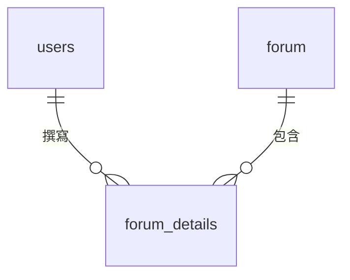
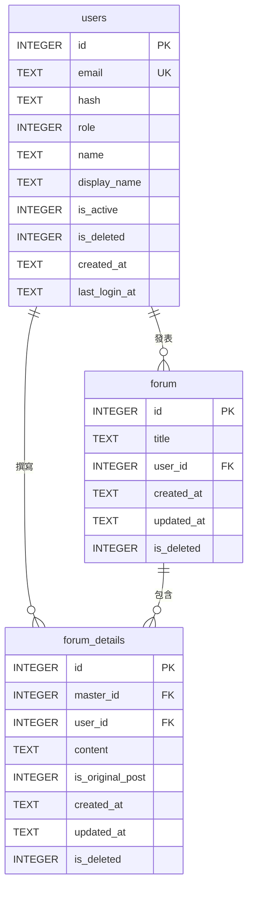

# 資料建模與資料庫設計

前面幾章談的都是動作：誰做什麼、流程怎麼走、系統怎麼回應。但動作做完之後，總得有東西被記下來——會員最後一次登入的時間、一篇文章最後被回覆的時間、一個帳號目前是啟用還是停用。

功能可以改寫，介面可以重做，但資料一旦存錯了結構，後面每一個功能都要跟著扭曲。一套論壇用了三年之後，管理員想查某個帳號是誰、在什麼時候停用的，卻發現資料庫只存了一個「是否啟用」的旗標。功能可以從今天起補上紀錄，但過去三年的停用經過已經沒有任何資料可以還原。**資料模型是系統裡最難改的部分，所以值得在動工前想清楚。**

本章要做的事是把「系統需要記住什麼」轉成一套一致的資料結構。這件事不是程式設計——決定要記錄哪些欄位、哪些欄位不能空白、狀態有哪幾種，靠的是對業務的理解，不是寫程式的能力。這正是工業工程背景的人最有把握的部分。

> **前情提要**：本章假設你已完成[「功能分析」](05-Functional-Analysis.md)的功能清單與 CRUD 矩陣，以及[「行為建模」](06-Behavioral-Modeling.md)的流程與狀態分析。本章的例子以課堂範例系統 `SAD-Forum`（論壇系統）與它的[「系統分析範例報告」](../02-Midterm-Project-Example-Reports/Analysis-Phase-Sample-Report.md)〈7. 資料需求分析〉為主，編號沿用該報告（FR-01、NFR-01、UC-01、F-11 起）；範例報告沒有對應內容的部分——〈二、2.3〉的一對一、〈三〉從需求找實體、〈四〉正規化、〈五、5.3〉的第一種問題，以及〈七〉期末的資料設計——沿用前幾章的工廠訪客進出登記系統。

> **延伸閱讀**：這一項在各組報告中要交出什麼、欄位怎麼填，見[「報告內容」](../00-Course-Introduction/Report-Contents.md)期中第 7 項與期末第 4 項。

> **必讀標記**：標題後加註 🔴 期中必讀 的小節，是期中小組報告九項產出直接會用到的內容；加註 🔵 期末必讀 的，是期末八項產出直接會用到的。判準與成品的樣子，期中見[「系統分析範例報告說明」](../02-Midterm-Project-Example-Reports/Analysis-Phase-Deliverables.md)與[「系統分析範例報告」](../02-Midterm-Project-Example-Reports/Analysis-Phase-Sample-Report.md)，期末見[「系統設計範例報告說明」](../04-Final-Project-Example-Reports/Design-Phase-Deliverables.md)與[「系統設計範例報告」](../04-Final-Project-Example-Reports/Design-Phase-Sample-Report.md)。未標記的小節仍屬課程範圍，只是報告不會直接產出。

## 一、資料是系統的骨架 🔴 期中必讀 🔵 期末必讀

### 1.1 三份產出是同一件事的三個層次 🔴 期中必讀 🔵 期末必讀

期中報告的資料需求分析要交三份東西。它們是同一件事看三次，一次比一次細：

| 層次 | 回答的問題 | 產出 |
|---|---|---|
| 1 | 這個領域有哪些東西？彼此什麼關係？ | 實體關聯圖（ERD） |
| 2 | 這些東西存成哪幾張表？怎麼串起來？ | Schema 與資料表 |
| 3 | 每一欄到底存什麼？ | 資料字典 |

**三者必須互相對得起來**：ERD 上的每個實體，要在 Schema 找得到對應的資料表；Schema 每張表的每一欄，要在資料字典裡找得到定義。少一層或對不上，代表你的資料模型還沒想清楚——這也是報告最容易被追問的地方。

中間那一層最常被跳過，因為它夾在一張圖與一份字典之間，看起來沒什麼東西可寫。它要的其實只是一張表，把每張資料表的身分交代清楚：

| 資料表 | 用途 | 主鍵 | 對外參照 | 其他約束 |
|---|---|---|---|---|
| `users` | 會員帳號 | `id` | 無 | `email` 唯一 |
| `forum` | 文章主檔，存標題與發文者 | `id` | `user_id` → `users.id` | 無 |
| `forum_details` | 內文與回覆 | `id` | `master_id` → `forum.id`、`user_id` → `users.id` | 無 |

「其他約束」那一欄放的是主鍵與外鍵以外的規則，最常見的是唯一性——某一欄雖然不是主鍵，但不允許兩筆資料重複。論壇系統的 `users.email` 就是一例：它不是主鍵，卻是實際的登入帳號，重複註冊會被擋下（FR-05）。這一欄常常空著，但只要有內容，那就是一條業務規則。

### 1.2 資料模型與功能模型的分工

前面幾章畫的圖都在描述「系統做什麼」，本章的圖描述「系統記得什麼」。兩者的關係是互相檢查的：

- 每一項功能都要有它讀寫的資料，否則那項功能沒有東西可處理。
- 每一份資料都要有建立它、維護它的功能，否則系統上線時那張表是空的。

第二條正是[「功能分析」](05-Functional-Analysis.md)〈四、4.3〉CRUD 矩陣在檢查的事。本章不重複那套做法，但會在第三節用它來驗證實體有沒有找齊。

## 二、實體、屬性與關係 🔴 期中必讀 🔵 期末必讀

### 2.1 三個基本元素 🔴 期中必讀 🔵 期末必讀

**[實體關聯模型](https://zh.wikipedia.org/wiki/ER模型)（Entity-Relationship Model）** 由 Peter Chen 在 1976 年提出，用三個元素描述資料：

| 元素 | 意義 | 論壇系統的例子 |
|---|---|---|
| 實體（Entity） | 需要被記錄的人、事、物 | 會員、文章、內容（首篇內文與回覆） |
| 屬性（Attribute） | 實體的特徵 | 電子郵件、文章標題、建立時間 |
| 關係（Relationship） | 實體之間的關聯 | 一位會員發表多篇文章 |

判斷一個東西該不該當實體，最實用的判準是：**這個東西需要單獨被查詢、被統計，或是有自己的一組屬性嗎？** 「回覆」需要，因為每一則都有自己的作者、內容與建立時間，也能單獨被修改或刪除；「標題」不需要，它只是文章的一個屬性。

### 2.2 識別碼 🔴 期中必讀 🔵 期末必讀

每個實體要有一個能唯一辨識它的屬性，稱為 **[主鍵](https://zh.wikipedia.org/wiki/主键)（Primary Key, PK）**。論壇系統三張表的 `id` 都是。

主鍵有兩種來源：

**自然鍵** 是業務上本來就有的識別資料，例如會員的電子郵件。好處是使用者看得懂、本來就記得；壞處是業務規則一變（例如允許會員更換信箱、或發現會重複）就麻煩。

**代理鍵** 是系統自己產生的流水號，與業務無關。好處是穩定、不會因為業務規則改變而失效；壞處是人看不懂，查資料時得多繞一層。

實務上常見的做法是兩者都留：用代理鍵當主鍵，另外保留業務上的識別資料並設為唯一。論壇系統的 `users` 正是這樣：主鍵是流水號 `id`，`email` 另設唯一。**期中報告不必糾結這個選擇，說得出那套系統用的是哪一種即可。**

當一張表的紀錄要指向另一張表時，用 **[外鍵](https://zh.wikipedia.org/wiki/外鍵)（Foreign Key, FK）** 記錄對方的主鍵。文章主檔裡的 `user_id` 就是指向會員表的外鍵，記的是發文者。

### 2.3 基數：一對一、一對多、多對多 🔴 期中必讀 🔵 期末必讀

關係要標明兩邊各能對應到幾筆，這稱為 **基數（Cardinality）**：

| 基數 | 意義 | 例子 |
|---|---|---|
| 1:1 | 一邊只對應一筆 | 一位員工對應一組登入帳號 |
| 1:N | 一邊對應多筆 | 一位會員發表多篇文章 |
| M:N | 兩邊都對應多筆 | 一位會員可在多篇文章下發言、一篇文章可有多位會員發言 |

論壇系統裡沒有一對一的關係，上表那一列沿用工廠訪客進出登記系統的例子。

**多對多在資料庫裡沒辦法直接存**，必須拆成兩個一對多，中間放一張關聯表。「會員」與「文章」的多對多，被拆成 `forum_details` 這張中間表——**而它剛好存著整個論壇的所有發言**：一則內容同時記下了「哪位會員寫的」與「屬於哪篇文章」，多對多因此被自然地拆開了。

拆出來的中間表往往不只是牽線，它自己會長出屬性——`forum_details` 有內容、建立時間、最後編輯時間，以及是否為首篇內文。**你看到多對多就要想：這段關係本身有沒有需要記錄的資訊？** 有的話，它其實是一個被漏掉的實體。

一對多之中有一種特別常見的形態，叫 **主檔／明細（master-detail）**：一份單據的抬頭資料存在主檔，單據上的每一行明細各存一筆。`forum` 與 `forum_details` 就是這個關係——標題屬於「一篇文章」，內容屬於「一則發言」；同一篇文章的首篇內文與後續回覆都存在明細表，用 `is_original_post` 區分。你只要看到一份單據或一個頁面上有「重複好幾行」的區域，那就是主檔與明細。

認得這個形態的好處是它到處都會出現，換個題目只是換個名字：

| 主檔 | 明細 | 一行明細代表 |
|---|---|---|
| 訂單 | 訂單明細 | 訂了哪個品項、幾件 |
| 借用單 | 借用明細 | 借了哪一項設備 |
| 活動 | 報名紀錄 | 誰報了這場活動 |
| 討論主題 | 主題內容與回覆 | 一則發言 |

**判斷的方法是問「哪些欄位只會有一份、哪些會有很多份」**：只有一份的放主檔，會有很多份的放明細。把它們硬塞成一張表，明細一多，主檔的資料就要跟著重複幾十次，那就是下一節正規化在處理的問題。

### 2.4 兩種畫法 🔴 期中必讀 🔵 期末必讀

ERD 有兩套常見的符號：

| 記法 | 特徵 | 適用 |
|---|---|---|
| Chen 記法 | 實體用方框、關係用菱形、屬性用橢圓 | 教學、概念討論 |
| Crow's Foot（鳥爪） | 實體用方框列出欄位，關係用線端符號表示基數 | 實務、工具預設 |

**本課程以 Crow's Foot 為主**，因為多數繪圖工具與資料庫工具用的是它，畫出來的圖也更接近實際的資料表。Chen 記法認得出來即可。

鳥爪記法的線端符號：一橫槓代表「一」，三叉（像鳥爪）代表「多」，圓圈代表「零，可有可無」。所以「零或多」畫成圓圈加鳥爪，「一或多」畫成橫槓加鳥爪。

### 2.5 論壇系統的 ERD 🔴 期中必讀 🔵 期末必讀

圖上的欄位名用英文，是因為它們直接對應資料庫裡的實際欄位；`UK` 標示唯一欄位。中文名稱與其他細節寫在第五節的資料字典裡。這種分工是實務慣例：**圖負責呈現結構，字典負責承載細節。**

這張圖上的三條關聯，在資料庫裡其實沒有宣告成外鍵。圖照業務關係畫是對的，但報告要指出這個落差，見〈六〉。

## 三、從需求找實體 🔵 期末必讀

### 3.1 名詞分析法 🔵 期末必讀

最直接的做法是把需求與使用案例敘述裡的名詞圈出來，逐一判斷它是實體、屬性，還是不必記錄的東西。

以 FR-014（系統應記錄每筆報到的來訪編號、訪客證編號、接待員工號與報到時間）為例，圈出的名詞是：報到、來訪編號、訪客證編號、接待員工號、報到時間。判斷結果：

| 名詞 | 判斷 | 理由 |
|---|---|---|
| 回報 | 實體 | 每一筆都要單獨保存與查詢 |
| 來訪編號 | 外鍵 | 指向另一個實體 |
| 訪客證編號 | 外鍵 | 指向另一個實體 |
| 接待員工號 | 外鍵 | 指向另一個實體 |
| 數量 | 屬性 | 回報的特徵，不需單獨存在 |
| 時間 | 屬性 | 同上 |

名詞分析法的價值在於它機械、可重複，不容易漏。缺點是會撈出一堆同義詞與雜訊——「訪客」「來賓」「外賓」可能講的是同一件事，要合併；「效率」「狀況」這種抽象名詞則要刪掉。

### 3.2 用 CRUD 矩陣驗證 🔵 期末必讀

找完實體之後，用[「功能分析」](05-Functional-Analysis.md)〈四、4.3〉的 CRUD 矩陣交叉檢查。三種對不上的情況各代表一種遺漏：

| 症狀 | 代表什麼 |
|---|---|
| 某份資料整欄沒有 C | 沒有任何功能會建立它，系統上線時這張表是空的 |
| 某份資料只有 R | 只讀不寫，多半漏了維護功能 |
| 某項功能沒有對應到任何資料 | 這項功能不需要資料？通常是實體漏了 |

第一種最常出現，而且幾乎都發生在同一類資料上：訪客證、員工、部門這些 **基本資料**。你的注意力集中在業務流程，很容易忘記這些資料本身也需要有人新增與維護。

### 3.3 從狀態找出漏掉的欄位 🔵 期末必讀

[「行為建模」](06-Behavioral-Modeling.md)〈五〉的狀態機圖，在這裡有一個直接的用途：**圖上的每一個狀態，都要在資料表裡有地方存。**

來訪紀錄的狀態機圖上有待確認、已確認、已報到、已離廠、已婉拒、未到訪、已取消七個狀態，那麼來訪紀錄表就要有一個 `status` 欄位，值域正好是這七個。更進一步，每一次狀態轉移如果需要追溯（誰在什麼時候把一筆來訪從已確認改成已婉拒），就需要一張獨立的狀態異動紀錄表。

**要不要留這張異動紀錄表，是一個你要明確決定的問題**，不是可以忽略的細節。留了，儲存量增加但查得到歷程；不留，出事時只知道現在的狀態，不知道經過。

## 四、正規化 🔵 期末必讀

### 4.1 為什麼要正規化 🔵 期末必讀

**[正規化](https://zh.wikipedia.org/wiki/数据库规范化)（Normalization）是把資料表拆解到「同一件事只存一個地方」的過程。** 它要防的是三種異動異常：

| 異常 | 症狀 |
|---|---|
| 更新異常 | 同一份資料存在多處，改了一處忘了其他處，資料開始互相矛盾 |
| 新增異常 | 想新增一筆資料，卻被迫填入一堆還不知道的欄位 |
| 刪除異常 | 刪掉一筆紀錄，連帶把另一件事的資料也弄丟了 |

用一張沒有正規化的來訪紀錄表來看：

| 來訪編號 | 訪客姓名 | 公司 | 受訪人工號 | 受訪人部門 | 受訪人分機 | 隨行人員 |
|---|---|---|---|---|---|---|
| V-001 | 王大同 | 大同機電 | E-214 | 設備課 | 2314 | 張三、李四 |
| V-002 | 王大同 | 大同機電 | E-214 | 設備課 | 2314 | |
| V-003 | 李美惠 | 全新科技 | E-108 | 採購課 | 2108 | 陳五 |

問題一眼可見：設備課換分機時，要改兩筆（更新異常）；新報到的員工還沒有人來拜訪過，他的部門與分機無處可放（新增異常）；刪掉最後一筆與某位訪客有關的來訪紀錄，那位訪客的公司就跟著消失了（刪除異常）。而最右邊那一欄一格塞了兩個姓名，連第一正規化都不符合。

### 4.2 三個範式 🔵 期末必讀

| 範式 | 要求 | 白話 |
|---|---|---|
| [第一正規化](https://zh.wikipedia.org/wiki/第一范式)（1NF） | 每一格只放一個值，不能塞清單 | 不要在「隨行人員」一格裡寫「張三、李四」 |
| 第二正規化（2NF） | 符合 1NF，且非鍵欄位要相依於整個主鍵 | 主鍵是兩欄組成時，不能有欄位只跟其中一欄有關 |
| 第三正規化（3NF） | 符合 2NF，且非鍵欄位之間不能互相相依 | 受訪人的部門與分機跟著工號走，不該留在來訪紀錄表裡 |

三個範式在這張表上各對應一處：

**1NF**：把「隨行人員」那一格拆開。拆法是另開一張隨行人員表，主鍵是（來訪編號、隨行序號），每一位隨行者一筆。

**2NF**：拆完之後那張隨行人員表的主鍵由兩欄組成，這時要檢查有沒有欄位只跟其中一欄有關。如果你順手把「訪客姓名」也放進隨行人員表，它只跟來訪編號有關、跟隨行序號無關——這就違反 2NF，該刪掉，需要時從來訪紀錄串回去。**複合主鍵是 2NF 唯一會出問題的地方；主鍵只有一欄的表，天生就符合 2NF。**

**3NF**：受訪人的部門與分機都跟著工號走，工號變了它們才會變，彼此之間形成一條鏈。把它們搬回員工表，來訪紀錄只留工號。

拆成 3NF 之後：來訪紀錄只留來訪編號、訪客編號、受訪人工號、訪客證編號、日期與時間；訪客姓名與公司回到訪客表；部門與分機回到員工表；隨行人員獨立一張表。要看來訪紀錄上的訪客姓名時，透過外鍵串回去。

**課程要求做到 3NF 就夠了。** 更高的範式（BCNF、4NF）在實務上很少刻意追求，本課程也不要求。

### 4.3 該存還是該算：什麼時候刻意不正規化 🔵 期末必讀

正規化到極致會讓查詢時要串很多張表，影響效能。實務上有時會故意留一些重複，稱為反正規化（Denormalization）。它最常出現在一個具體的問題上：**算得出來的東西，到底該存下來，還是每次重算？**

這個問題在一份設計裡通常會出現好幾次，而且答案不會一致。與其每次憑感覺判斷，不如先訂一條判準：

> **推導值要不要存下來，看它的計算依據會不會隨時間改變。依據不會變，就用算的；依據會被人改，就存快照。**

用這條判準看四個常見的例子：

| 推導值 | 計算依據 | 依據會不會變 | 決定 |
|---|---|:--:|---|
| 訂單金額所用的單價 | 產品表上的現價 | **會**。產品會調價 | **存**。不存的話，去年的訂單金額會隨調價自己變動 |
| 一筆申請是否未到訪 | 預定來訪日與**今天**比較 | **會。今天每天都不一樣** | **存**。用算的話留不下「誰在什麼時候判定的」，而且訪客隔天補來報到，結果會自己翻轉 |
| 某位訪客是否在廠 | 該筆來訪紀錄的狀態是否為已報到 | **不會**。報到與離廠時間寫進去就不再改 | **用算的**。任何時間重算都得到同一個答案 |
| 某張訪客證現在能不能發 | 有沒有一筆已報到未離廠的紀錄綁著它 | **不會**，同上 | **用算的** |

第二列與第三列是最值得對照的一組：兩個都是算出來的東西，一個存一個不存，理由完全相反，而且都成立。**能寫出這種對照，代表你不是在套規則，是真的在判斷。**

第四列還要補一句代價的評估。在訪客證表上加一個「是否使用中」的欄位查詢最快，但報到與離廠時兩邊都要改，而**漏改的錯誤沒有任何人會發現**——那張證從此再也發不出去，而且不會跳出任何警告，因為兩張表各自看起來都很正常。一個月後接待員發現「V-018 明明就在抽屜裡，系統卻說它在外面」，這時候要查是哪一天壞的都沒有依據。**這種「錯了也不會被發現」的風險，通常比查詢慢一點嚴重得多。**

**這種「A 的設計成立，是因為 B 那邊有一條規則擋住」的依賴關係，一定要寫下來。** 半年後有人放寬了 B，A 就會靜靜地壞掉，而且不會有任何錯誤訊息。

**你在報告裡刻意不正規化是可以的，但要寫明理由。** 沒說理由的重複欄位，看起來就是不會正規化。期中分析既有系統時，看到這種欄位，**你的工作是把它看出來並指出它的維護成本；期末替新系統做決定時，要用上面那條判準重新判斷一次。**

## 五、資料字典 🔴 期中必讀 🔵 期末必讀

### 5.1 每一欄要交代什麼 🔴 期中必讀 🔵 期末必讀

資料字典把每個欄位講到不會有第二種解釋：

| 欄位 | 用途 |
|---|---|
| 欄位名稱 | 資料表裡的實際名稱 |
| 中文名稱 | 給看不懂英文欄位名的人對照 |
| 資料型別與長度 | 文字幾個字、數字幾位、日期或時間 |
| 是否必填 | 可不可以空白 |
| 值域或格式 | 允許哪些值、要符合什麼格式 |
| 資料來源 | 使用者輸入、系統產生，或計算得來 |

以論壇系統的 `users` 表為例：

| 欄位名稱 | 中文名稱 | 型別 | 必填 | 值域／格式 | 資料來源 |
|---|---|---|---|---|---|
| `id` | 會員編號 | INTEGER | 是 | 主鍵，系統流水號 | 系統產生 |
| `email` | 電子郵件 | TEXT | 是 | 唯一；須含 `@` 與一個點 | 使用者輸入 |
| `hash` | 密碼雜湊 | TEXT | 是 | 雜湊字串，非明文 | 系統產生 |
| `role` | 角色 | INTEGER | 是 | `0` 管理員、`1` 一般會員；預設 1 | 系統預設或管理員指定 |
| `name` | 姓名 | TEXT | 否 | 無長度限制；空白存為 NULL | 使用者輸入 |
| `display_name` | 顯示名稱 | TEXT | 否 | 無長度限制；空白存為 NULL | 使用者輸入 |
| `is_active` | 是否啟用 | INTEGER | 是 | `1` 啟用、`0` 停用；預設 1 | 系統預設或管理員切換 |
| `is_deleted` | 是否已刪除 | INTEGER | 是 | `1` 已刪除、`0` 未刪除；預設 0 | 管理員執行刪除 |
| `created_at` | 建立時間 | TEXT | 是 | `YYYY-MM-DD HH:MM:SS`，UTC | 系統產生 |
| `last_login_at` | 最後登入時間 | TEXT | 否 | 同上；從未登入時為 NULL | 系統於登入成功時寫入 |

兩個實務上的提醒。**型別要照那套系統實際使用的資料庫寫**，不要照抄別的系統。不同資料庫的型別名稱不一樣：有的用 `VARCHAR` 與 `DATETIME`，論壇系統用的 SQLite 只有 `TEXT` 與 `INTEGER`，日期時間是用文字存的。你分析既有系統時，型別要去查它實際的定義，查不到就照它的行為描述（例如上表 `created_at` 的「以 `YYYY-MM-DD HH:MM:SS` 格式存成文字」），不要憑印象填一個。上表沒有「長度」一欄，因為 SQLite 的文字欄位不設長度上限，所以改在值域寫「無長度限制」。這本身也是一項發現——`forum_details.content` 沒有長度上限，代表使用者可以貼進一篇萬言書。

**同一個欄位名出現在兩張表時，要確認它們是不是同一個意思。** 這是最容易被放過的一種不一致。論壇系統的 `updated_at` 就是一例：主檔 `forum` 的 `updated_at` 是「最後活動時間」，新增回覆或修改標題時就會更新；明細 `forum_details` 的 `updated_at` 卻是「最後編輯時間」，只有內容被改才會動。兩者名字一樣、意思完全不同，而這個差異直接決定了文章列表的排序：有新回覆的文章會移到最上面（FR-12、FR-15）。字典裡把它們分開寫清楚，是你唯一能防住這種誤解的地方。

### 5.2 值域是最有價值的一欄 🔴 期中必讀 🔵 期末必讀

前面幾欄多數人都填得出來，**值域是拉開差距的地方**。它逼你把業務規則寫死：

- `role` 有哪幾個值？（`0` 管理員、`1` 一般會員，新帳號預設 1，見 FR-03）
- `email` 要符合什麼格式？（須含 `@` 與一個點，見 FR-04）
- `name` 送出空白時存成什麼？（存成 NULL，不是空字串）
- `last_login_at` 是 NULL 代表什麼？（這個帳號從未登入過）

第一項要花點時間。**狀態與角色這類欄位的值域，會同時出現在活動圖的判斷節點、畫面上的標籤，以及資料表裡**。論壇系統的停用就跨了三處：活動圖上的判斷是「帳號是否啟用」，畫面顯示「帳號已停用」，資料庫存的是 `is_active = 0`。三處說法不同沒有關係，但你要能把它們一一對起來；對不起來——例如畫面上出現一種狀態，資料表裡找不到對應的值——就是文件不一致，也是訪談追溯題最好問的切入點。

值域欄還可以多承載一項資訊：**這一欄什麼時候會被寫進去**。像 `last_login_at` 這種由系統填的時間欄位，光寫「系統時間」不夠，要寫「登入成功時寫入，每次登入都覆蓋前一次」；而前面提到的 `forum.updated_at`，寫明「新增回覆或修改標題時更新」才看得出它與另一張表的差別。什麼時候寫，往往比允許填什麼更能決定這一欄的實際意義。

狀態不一定放在單一個欄位裡。**有些系統改用好幾個「是或否」的旗標表達狀態**，這種設計看起來單純，實際的狀態數卻是它們的乘積：兩個旗標交叉出四種組合，三個就有八種。你要把組合逐一列出來、一格一格填，才知道這套系統實際上有幾種狀態，以及每種狀態下什麼能做、什麼不能做。

論壇系統的 `users` 表就是用 `is_active` 與 `is_deleted` 兩個旗標表達帳號狀態：

| `is_active` | `is_deleted` | 這是什麼狀態 | 可否登入 | 可執行的管理動作 |
|:---:|:---:|---|---|---|
| 1 | 0 | 正常 | 可以 | 停用、調整角色、刪除 |
| 0 | 0 | 停用中 | 否，訊息為「帳號已停用」 | 啟用、調整角色、刪除 |
| 1 | 1 | 已刪除 | 否，訊息為「帳號或密碼錯誤」 | 無 |
| 0 | 1 | 已刪除 | 否，訊息為「帳號或密碼錯誤」 | 無 |

填完之後要看兩件事：

- **有沒有兩格的結果一模一樣？** 上表最後兩格就是，代表帳號一旦被刪除，「是否啟用」這一欄就失去意義了。這不算錯誤，但你要在報告裡寫明「已刪除時啟用旗標不具意義」，否則讀的人會以為那是兩種不同的狀態。
- **有沒有哪一格根本到不了？** 找得到到不了的組合，代表有一條規則擋著它。那條規則寫下來，就是一條非功能需求。

這張表用兩個現成的旗標欄位，就推出了四種狀態、三種登入結果與兩組管理權限，全部都是原本散落在各處的規則。**畫得出這張表，等於證明你把系統的狀態邏輯完整走過一遍。**

### 5.3 資料來源那一欄在防什麼 🔴 期中必讀 🔵 期末必讀

「來源」欄位分成三類：使用者輸入、系統產生、計算得來。填這一欄的用意是提早發現兩種問題。

**要求使用者提供他手上沒有的資料。** 你把某欄標成「使用者輸入」，就要回去對照介面設計與流程：那個人在那個時點真的知道這個值嗎？以工廠訪客進出登記系統為例，訪客申請時要填「受訪人的工號」，但他手上只有對方的名片，這個欄位就填不出來。

**該由系統決定的值卻開放輸入。** 論壇系統的 `forum.user_id` 標的是「由登入狀態帶入」，不是讓發文者自己填；`users.role` 對新帳號一律預設為一般會員，申請頁上沒有選角色的欄位。這兩欄如果開放輸入，任何人都能冒用別人的名義發文，或替自己申請一個管理員帳號。標成「系統產生」或「系統預設」，等於做了一個管理決策。

## 六、期中：從既有系統反推資料模型 🔴 期中必讀

期中分析的是既有系統，資料模型不是設計出來的，是看出來的。有四個地方可以看。

**從畫面看。** 每一個輸入欄位背後通常對應一個資料欄位，每一張列表對應一次查詢。論壇系統的個人資料頁列出信箱、姓名、顯示名稱、角色、建立時間與最後登入時間六個欄位（FR-09），`users` 表的大部分欄位就從這裡浮出來了。你把系統的主要畫面逐一截圖、欄位抄下來，八成的資料結構就看得出來。

**從列表與報表看。** 列表的排序方式與報表上的統計維度，反映資料是怎麼儲存的。論壇列表依最後活動時間排序，有新回覆的文章會移到最上面（FR-12、FR-15）——代表文章主檔裡有一個會隨回覆更新的時間欄位，而不是只有建立時間。

**從限制看。** 系統擋住的操作透露欄位的值域：申請帳號時電子郵件格式不對、密碼太短、兩次密碼不一致都會被擋（FR-04），同一個信箱註冊第二次會出現「此電子郵件已被使用」（FR-05）——每一條都是一項值域規則，最後一條還透露了 `email` 設有唯一約束。

**從資料表的定義看。** 前面三個地方推得出「有哪些欄位」，推不出型別、預設值、唯一限制與外鍵——這些東西畫面上永遠看不到。它們寫在建立資料表的那段 SQL 裡，通常在專案的資料庫或初始化腳本中找得到，附有系統文件的話則會直接列出來。論壇系統的定義在原始碼的 `db/__init__.py` 與 `db/forum.py`，系統文件 `document/system-spec.md` 也列了一份。**這一項不看，你的資料字典會有一半的格子填不出來。**

反推的過程中，有一個落差特別值得檢查：**ERD 上畫得出來的關聯，資料庫裡不一定真的宣告了外鍵。** 論壇系統就是這樣：三張資料表之間沒有任何外鍵約束，`forum.user_id` 要怎麼對到 `users.id`，全靠程式在查詢時自己接。

這種情況下，ERD 上把關聯畫出來是對的，因為業務上確實是那個關係；但報告要指出實作與模型之間的落差，並說明它造成什麼後果：

- 可以寫入一篇指向不存在使用者的文章，資料庫不會拒絕。
- 刪除一位使用者，不會連帶處理他發表的文章與回覆。
- 刪除文章時要不要一併刪除回覆，資料庫不管，必須由程式明寫（FR-17 要求一併刪除）；漏寫一處，資料就開始不一致。

**看得出這一層，代表你不只是把畫面上的欄位抄下來而已。** 檢查方式很單純：翻開建立資料表的定義，看有沒有 `FOREIGN KEY` 這幾個字；沒有，就是這種情況。

推不出來的部分你要標示清楚。**「這個欄位的用途無法從介面判斷，需查看資料庫或訪談維護人員」比硬猜一個用途有價值**，這一點與[「問題定義與現況分析」](02-Problem-Definition.md)〈一、1.3〉的原則相同。

## 七、期末：從需求推導資料設計 🔵 期末必讀

期末的方向相反：系統還不存在，資料模型要從需求推出來。做法是前面第三節的名詞分析法，加上三件期中不做的事。

### 7.1 Schema 落地 🔵 期末必讀

把 ERD 轉成實際的資料表定義，明確寫出每張表的主鍵與外鍵。這一步會逼出幾個 ERD 上看不出來的決定：多對多的中間表要叫什麼名字、外鍵允不允許空值、刪除主表時關聯的紀錄要怎麼處理。

### 7.2 與畫面的對應 🔵 期末必讀

期末報告要能回答兩個問題：**「這個畫面上的欄位最後存在哪裡」** 與 **「這項需求需要哪些資料」**。前者從畫面往資料查，後者從需求往資料查。

實務上會做一張對照表：

| 畫面 | 欄位 | 對應資料表.欄位 | 讀或寫 |
|---|---|---|---|
| 櫃台報到 | 來訪編號 | 來訪紀錄.visit_no | 讀 |
| 櫃台報到 | 訪客證編號 | 來訪紀錄.pass_id | 寫 |
| 在廠訪客查詢 | 停留時間 | **不存**，見推導欄位清單 | 推導 |

這張表是期末第 8 項追溯鏈裡「資料 → 畫面」那一段的直接證據。你做這張表時最常發現的問題是：畫面上有一個欄位，在任何一張表裡都找不到對應——那表示資料設計漏了東西，或那個欄位其實不該出現在畫面上。

**但有第三種可能，而且它才是最常見的：那個數字根本不該存在任何一張表裡，因為它是算出來的。** 累計數量、剩餘數量、完成率、工時、是否逾期，這些畫面上到處都是的數字，多半都屬於這一類（判準見〈四、4.3〉）。它們在對照表上填「不存」是正確答案，但不能就這樣結束——**要另外做一張推導欄位清單，把它們一次交代清楚：**

| 推導值 | 出現在哪些畫面 | 算式 | 資料來源 |
|---|---|---|---|
| 在廠訪客清單 | 櫃台報到、在廠訪客查詢 | 狀態為已報到且未作廢的來訪紀錄 | 來訪紀錄 |
| 在廠人數 | 櫃台報到、在廠訪客查詢 | 上列的筆數 ＋ 各筆 `companion_count` 合計 | 來訪紀錄 |
| 停留時間 | 在廠訪客查詢 | 目前時間 − `checkin_at` | 來訪紀錄單筆 |
| 訪客證是否可發 | 櫃台報到 | 該證未停用，且無已報到未離廠的紀錄綁著它 | 兩表 |

**這張清單的用途是把「畫面上的數字」全部收乾淨。** 交件前拿畫面上的每一個數字問一次「它在資料字典裡嗎」，不在的話就必須出現在這張清單上。**兩邊都找不到的數字，就是設計裡的洞**——而訪談時老師只要指著畫面問一句「這個 82% 是哪兩個數字相除、那兩個數字各自從哪裡來」，那個洞就會被看見。

### 7.3 不必做到的部分

索引、Trigger、Stored Procedure、分割表、效能調校，這些屬於資料庫實作層次，**本課程列為可選**。做了不會加分在必做項目上，但如果在報告裡出現，要能在訪談時說明為什麼需要。

判斷的界線是：**影響「資料代表什麼意思」的，是必做；只影響「資料庫跑得快不快」的，是可選。** 主鍵、外鍵、必填、值域屬於前者；索引屬於後者。

## 八、學習重點總結

讀完本章後，你應該能夠理解以下核心概念，並將其應用於工業場域的思考與決策：

**資料模型是系統裡最難改的部分**

功能可以重寫、介面可以重做，但資料結構一旦定了、資料一旦存進去，要改就得處理所有既有紀錄。這是資料建模值得在動工前想清楚的唯一理由，也解釋了為什麼分析階段要花時間逐欄確認值域與必填條件——那些看似瑣碎的決定，三年後會變成無法回頭的事實。

**ERD、Schema 與資料字典是同一件事的三個層次**

ERD 說有哪些東西與什麼關係，Schema 說存成哪幾張表，資料字典說每一欄到底存什麼。三者必須互相對得起來：ERD 的實體要在 Schema 找得到表，Schema 的每一欄要在字典裡找得到定義。任何一層對不上，都代表資料模型還沒想清楚。

**多對多關係裡往往藏著一個被漏掉的實體**

會員與文章的多對多，拆成中間表之後會發現它自己長出內容、建立時間、最後編輯時間與是否為首篇內文這些屬性——那表示這段關係本身就是一件需要被記錄的事，而論壇系統的所有發言正是存在這張表裡。看到多對多就追問「這段關係有沒有要記的資訊」，是找出遺漏實體最有效的一招。

**正規化防的是資料自相矛盾**

同一份資料存在多個地方，遲早會出現改了一處忘了其他處的情況。三個範式的規則背後只有一個目的：讓每一件事只有一個存放的地方。刻意不正規化是允許的——歷史單價要凍結、統計值要預先算好——但必須寫明理由，否則看起來就是不會正規化。

**值域是資料字典裡最有價值的一欄**

欄位名稱與型別多數人都填得出來，值域則逼你把業務規則寫死：角色有哪幾個值、空白存成什麼、一個 NULL 代表什麼意思。狀態欄位的值域尤其關鍵，因為同一個狀態會同時出現在活動圖的判斷節點、畫面的標籤與資料表裡，三處對不起來就是文件不一致。用好幾個旗標表達狀態的系統，要把旗標的組合逐一列出，才看得出實際有幾種狀態。

**每一份資料都要有人建立與維護**

分析時的注意力容易集中在業務流程，而忘記訪客證、員工、部門這些基本資料本身也需要新增與維護的功能。CRUD 矩陣裡整欄沒有 C 的資料，代表系統上線時那張表是空的——這是最常出現的一種遺漏，也是最容易在交件前自己檢查出來的一種。

> **銜接提示**：本章決定了資料存成什麼結構，下一章[「系統環境與架構」](08-System-Architecture.md)處理它們實際放在哪裡：資料庫擺在公司機房還是雲端、使用者從什麼裝置存取、與哪些外部系統相連。本章畫的是資料的靜態結構，下一章畫的是承載這些資料的實體環境。

## 參考文獻

- Chen, P. P.-S. (1976). The entity-relationship model: Toward a unified view of data. *ACM Transactions on Database Systems*, *1*(1), 9–36. https://doi.org/10.1145/320434.320440
- Codd, E. F. (1970). A relational model of data for large shared data banks. *Communications of the ACM*, *13*(6), 377–387. https://doi.org/10.1145/362384.362685
- Codd, E. F. (1972). Further normalization of the data base relational model. In R. Rustin (Ed.), *Data base systems* (pp. 33–64). Prentice Hall.
- Connolly, T., & Begg, C. (2015). *Database systems: A practical approach to design, implementation, and management* (6th ed.). Pearson.
- Date, C. J. (2003). *An introduction to database systems* (8th ed.). Addison-Wesley.
- Dennis, A., Wixom, B. H., & Roth, R. M. (2018). *Systems analysis and design* (7th ed.). Wiley.
- Elmasri, R., & Navathe, S. B. (2016). *Fundamentals of database systems* (7th ed.). Pearson.
- Fleming, C. C., & von Halle, B. (1989). *Handbook of relational database design*. Addison-Wesley.
- Halpin, T., & Morgan, T. (2008). *Information modeling and relational databases* (2nd ed.). Morgan Kaufmann.
- Hay, D. C. (1996). *Data model patterns: Conventions of thought*. Dorset House.
- Hoffer, J. A., Ramesh, V., & Topi, H. (2019). *Modern database management* (13th ed.). Pearson.
- Kendall, K. E., & Kendall, J. E. (2019). *Systems analysis and design* (10th ed.). Pearson.
- Kent, W. (1983). A simple guide to five normal forms in relational database theory. *Communications of the ACM*, *26*(2), 120–125. https://doi.org/10.1145/358024.358054
- Kimball, R., & Ross, M. (2013). *The data warehouse toolkit: The definitive guide to dimensional modeling* (3rd ed.). Wiley.
- Silberschatz, A., Korth, H. F., & Sudarshan, S. (2019). *Database system concepts* (7th ed.). McGraw-Hill.
- Simsion, G., & Witt, G. (2005). *Data modeling essentials* (3rd ed.). Morgan Kaufmann.
- Sommerville, I. (2016). *Software engineering* (10th ed.). Pearson.
- Teorey, T. J., Lightstone, S. S., Nadeau, T., & Jagadish, H. V. (2011). *Database modeling and design: Logical design* (5th ed.). Morgan Kaufmann.
- Whitten, J. L., & Bentley, L. D. (2007). *Systems analysis and design methods* (7th ed.). McGraw-Hill.
- Wiegers, K., & Beatty, J. (2013). *Software requirements* (3rd ed.). Microsoft Press.
- Yourdon, E. (1989). *Modern structured analysis*. Yourdon Press.

---

*本章交出的是系統的記憶：有哪些東西要被記住、記成什麼結構、每一欄存什麼。建議的延伸練習是拿自己組的題目畫一張 ERD，然後做兩件事——用 CRUD 矩陣檢查每張表是否都有功能負責建立，再把狀態欄位的值域抄出來，逐一比對活動圖的判斷節點與畫面上的文字是否一致。第二項只要有一處三個地方講法不同，就是訪談時最好問的切入點。*
