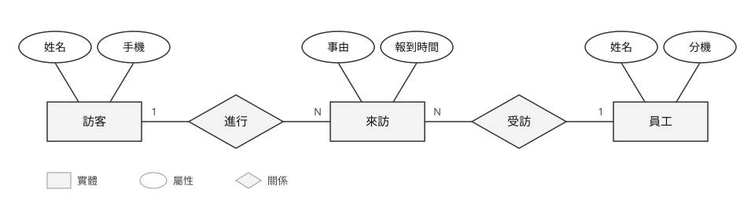
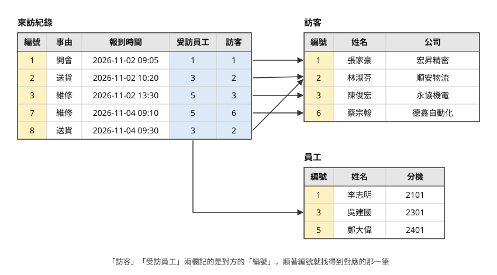
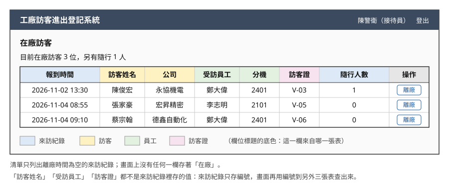
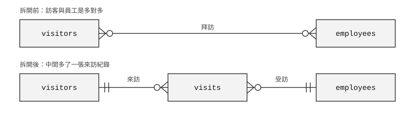
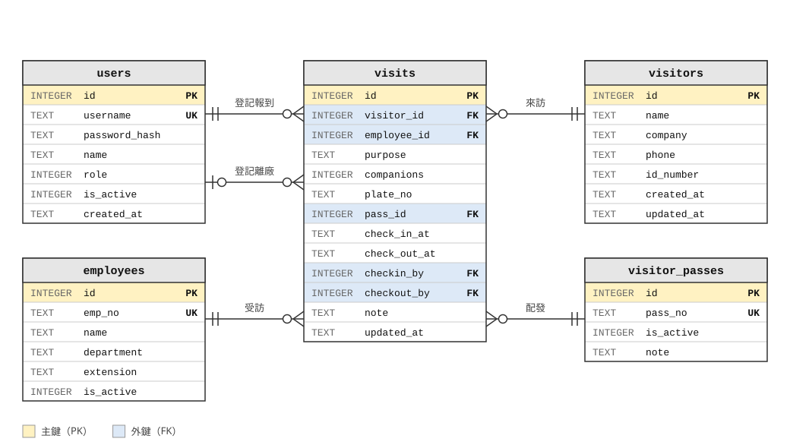

# 資料建模與資料庫設計

前面幾章談的都是動作：誰做什麼、流程怎麼走、系統怎麼回應。但動作做完之後，總要有東西被記下來，例如一位訪客幾點報到、拿走哪一張訪客證、一筆來訪紀錄最後一次被修改是什麼時候。

功能可以改寫，介面可以重做，但資料的結構一開始就存錯，後面每一個功能都要跟著遷就。工廠訪客進出登記系統的來訪紀錄可以修改，但修改時直接覆蓋原值，只留一個最後修改時間（[「系統分析完整報告」](../04-Final-Project-Example-Reports/Visitor-System-Full-Analysis.md)的現況問題 I-04，以下簡稱「訪客系統報告」）。種子資料第 4 筆的備註寫著「受訪人改為黃美玲」，原本的受訪人是誰，已經查不到了。從今天起補上修改紀錄不難（訪客系統報告〈9.2〉建議三），但過去被覆蓋掉的原值，已經沒有資料可以還原。**資料模型是系統裡最難改的部分，所以要在動工前想清楚。**

再看同一套系統的訪客主檔。下面兩筆是種子資料裡的兩位訪客：

| `id` | `name` | `company` | `phone` | `id_number` |
|---|---|---|---|---|
| 1 | 張家豪 | 宏昇精密 | 0912345678 | A123456789 |
| 7 | 張家豪 | 宏昇精密 | 0911888999 | A123456789 |

身分證字號相同、手機不同，是同一個人被建了兩筆（訪客系統報告 I-02）。系統以手機查詢訪客，手機號碼不同就查不到，接待員只能再建一筆；`phone` 和 `id_number` 都沒有設成不能重複，資料庫也不會擋。他 11/2 的來訪掛在第 1 筆，11/4 的掛在第 7 筆，要查「張家豪來過幾次」，只查其中一筆就會少算。

這類問題在系統剛上線時不明顯。假設這套系統用了兩年才決定整理，麻煩的是下面三件事：

| 要處理的事 | 為什麼麻煩 |
|---|---|
| 找出重複的訪客 | 要先決定以什麼辨識同一個人。手機會換；身分證字號如果改成只存末四碼（訪客系統報告〈9.2〉建議二），也不能再拿來比對（〈9.3〉） |
| 合併兩筆訪客資料 | 被併掉的那一筆底下的來訪紀錄，訪客編號都要改指向留下來的那一筆 |
| 確認合併得對不對 | 同名同公司不一定是同一個人，程式無法全部自動判斷，很多筆要人工確認 |

如果一開始就決定用什麼辨識同一位訪客，並把它設成不能重複，就不會長出第二筆，識別碼怎麼選見〈二、2.2〉。另一類問題是同一件事存在好幾個地方、彼此矛盾，要靠拆表處理，這種做法叫正規化，見〈四〉。

本章要做的事，是把「系統需要記住什麼」整理成一套前後一致的資料結構。這件事不是寫程式：要記錄哪些欄位、哪些欄位不能空白、狀態有哪幾種，靠的是對業務的了解，不是寫程式的能力。反過來說，程式是跟著資料走的：系統裡的程式，說到底都在處理資料怎麼存、怎麼算、怎麼顯示。

> **前情提要**：本章假設你已完成[「功能分析」](05-Functional-Analysis.md)的功能清單與 CRUD 矩陣，以及[「行為建模」](06-Behavioral-Modeling.md)的流程與狀態分析。本章的例子取自期末示範的工廠訪客進出登記系統 `SAD-Visitor`（現行版）與它的[「系統分析完整報告」](../04-Final-Project-Example-Reports/Visitor-System-Full-Analysis.md)〈7. 資料需求分析〉，文中簡稱「訪客系統報告」，編號沿用該報告（FR-01、UC-01、I-01 起）。期末要寫的資料變更，見[「修改需求與變更規格」](09-Change-Specification.md)〈七〉。

> **延伸閱讀**：這一項在各組報告中要交出什麼、欄位怎麼填，見[「報告內容」](../00-Course-Introduction/Report-Contents.md)期中第 7 項、期末第 4 項與第 10 項。

> **必讀標記**：標題後加註 🔴 期中必讀 的小節，是期中小組報告九項產出直接會用到的內容；加註 🔵 期末必讀 的，是期末報告直接會用到的。判準與成品的樣子，期中見[「系統分析範例報告說明」](../02-Midterm-Project-Example-Reports/Analysis-Phase-Deliverables.md)與[「系統分析範例報告」](../02-Midterm-Project-Example-Reports/Analysis-Phase-Sample-Report.md)，期末見[「期末範例報告」](../04-Final-Project-Example-Reports/Final-Phase-Sample-Report.md)。未標記的小節仍屬課程範圍，只是報告不會直接產出。

## 一、資料是系統的骨架 🔴 期中必讀 🔵 期末必讀

### 1.1 三份產出是同一件事的三個層次 🔴 期中必讀 🔵 期末必讀

期中報告的資料需求分析要交三份東西。這三份講的是同一件事，只是一份比一份細：

| 層次 | 回答的問題 | 產出 |
|---|---|---|
| 1 | 這個領域有哪些東西？彼此有什麼關係？ | 實體關聯圖（ERD） |
| 2 | 這些東西存成哪幾張表？表和表怎麼連起來？ | Schema（資料表的結構定義）與資料表 |
| 3 | 每一欄到底存什麼？ | 資料字典 |

**三份要互相對得起來**：ERD 上的每個實體，在 Schema 裡要找得到對應的資料表；Schema 裡每張表的每一欄，在資料字典裡要找得到說明。少了一份，或三份對不起來，代表資料模型還沒想清楚，這也是報告很容易被追問的地方。

中間那一層最常被跳過，因為它夾在一張圖和一份字典之間，看起來沒什麼好寫。其實它只需要一張表，把每張資料表的基本資料交代清楚：

| 資料表 | 用途 | 主鍵 | 對外參照 | 其他約束 |
|---|---|---|---|---|
| `users` | 系統帳號 | `id` | 無 | `username` 唯一 |
| `employees` | 員工名單，供選擇受訪員工 | `id` | 無 | `emp_no` 唯一 |
| `visitors` | 訪客主檔 | `id` | 無 | 無；`phone` 與 `id_number` 都不唯一 |
| `visits` | 來訪紀錄 | `id` | `visitor_id` → `visitors.id`、`employee_id` → `employees.id`、`pass_id` → `visitor_passes.id`、`checkin_by` 與 `checkout_by` → `users.id` | 無 |
| `visitor_passes` | 訪客證 | `id` | 無 | `pass_no` 唯一 |

這張表取自訪客系統報告〈7.2〉。「其他約束」這一欄放的是主鍵和外鍵以外的規則，最常見的是「唯一」：某一欄雖然不是主鍵，但不允許兩筆資料重複。`employees.emp_no` 就是一例。它不是主鍵，卻是員工編號，新增第二位相同編號的員工會被擋下，顯示「員工編號已存在」。這一欄常常是空的，但只要有填，那就是一條業務規則。**空著也是一個結論**：`visitors` 那一列寫「無」，就是本章開頭張家豪會有兩筆資料的原因。

### 1.2 資料模型與功能模型的分工

前面幾章畫的圖，都在說明「系統做什麼」；本章的圖說明「系統記得什麼」。兩者可以互相檢查：

- 每一項功能都要有它讀寫的資料，否則這項功能沒有東西可以處理。
- 每一份資料都要有功能負責建立和維護，否則系統上線時，那張表會是空的。

第二條就是[「功能分析」](05-Functional-Analysis.md)〈四、4.3〉CRUD 矩陣在檢查的事。本章不重講 CRUD 矩陣的做法，但會在第三節用它來檢查實體有沒有找齊。

## 二、實體、屬性與關係 🔴 期中必讀 🔵 期末必讀

### 2.1 三個基本元素 🔴 期中必讀 🔵 期末必讀

**[實體關聯模型](https://zh.wikipedia.org/wiki/ER模型)（Entity-Relationship Model）** 是 Peter Chen 在 1976 年提出的，用三個元素描述資料：

| 元素 | 意思 | 訪客系統的例子 |
|---|---|---|
| 實體（Entity） | 需要被記錄的人、事、物 | 訪客、來訪、員工、訪客證 |
| 屬性（Attribute） | 實體的特徵 | 手機、事由、報到時間 |
| 關係（Relationship） | 實體之間的關聯 | 一位訪客可以來訪很多次 |

要判斷一樣東西該不該當成實體，可以問：**這樣東西需要單獨被查詢、被統計，或是有自己的一組屬性嗎？** 「來訪」需要，因為每一次來訪都有自己的報到時間、受訪員工和訪客證，也能單獨查詢和修改；「事由」不需要，它只是來訪的一個屬性。

*本圖由作者自製*

存進資料庫後，實體變成資料表，屬性變成欄位，關係則靠一個欄位記下對方的編號：

*本圖由作者自製*

系統畫面上看到的在廠訪客清單，就是把來訪紀錄和它指到的三張表串起來顯示：

*本圖由作者自製*

### 2.2 識別碼 🔴 期中必讀 🔵 期末必讀

每個實體都要有一個屬性，用來分辨每一筆資料，這個屬性叫做 **[主鍵](https://zh.wikipedia.org/wiki/主键)（Primary Key, PK）**。`SAD-Visitor` 五張表的 `id` 都是主鍵。

主鍵有兩種來源：

**自然鍵** 是業務上本來就有的編號，例如身分證字號、員工編號。好處是人一看就懂；壞處是業務規則一改，主鍵就跟著出問題。訪客系統就碰得到這種情況：持護照的外籍訪客沒有身分證字號（訪客系統報告 I-05），如果拿身分證字號當訪客的主鍵，這位訪客就沒有主鍵可填。

**代理鍵** 是系統自己編的流水號，例如 000001、000002，和業務無關。好處是穩定，業務規則怎麼改都不受影響；壞處是人看不懂，查資料時要多對照一次。

常見的做法是兩種都留：用代理鍵當主鍵，自然鍵另外設成唯一，也就是不能重複。例如學生名單用流水號當主鍵，學號另外設成唯一，兩個學生不會拿到同一個學號。

`SAD-Visitor` 的 `employees` 也是這樣：主鍵是流水號 `id`，員工編號 `emp_no` 另外設成唯一。`visitors` 則只有代理鍵，沒有任何一欄設成唯一，這就是本章開頭的張家豪問題。**期中報告不必煩惱該選哪一種，說得出那套系統用的是哪一種就好。**

一張表要指到另一張表的某一筆資料時，就把對方的主鍵記下來，這一欄叫做 **[外鍵](https://zh.wikipedia.org/wiki/外鍵)（Foreign Key, FK）**。例如來訪紀錄的 `visitor_id` 記的是訪客的 `id`，它就是指向訪客表的外鍵。

### 2.3 基數：一對一、一對多、多對多 🔴 期中必讀 🔵 期末必讀

每一段關係都要標明，兩邊各能對應到幾筆資料，這叫做 **基數（Cardinality）**，以下以表格說明類型：

| 基數 | 意思 | 例子 | 在關聯式資料庫怎麼實作 |
|---|---|---|---|
| 1:1 | 一筆只對到一筆 | 一位員工只有一組登入帳號 | 在其中一張表放外鍵，並把這個外鍵設成唯一 |
| 1:N | 一筆對到多筆 | 一位訪客可以來訪很多次，但一筆來訪只屬於一位訪客 | 在「多」的那一邊放外鍵，記下「一」那一邊的主鍵 |
| M:N | 兩邊都是一筆對到多筆 | 一位訪客可以拜訪多位員工，一位員工也會接待多位訪客 | 不能直接實作，要加一張中間表，放兩個外鍵分別指向兩邊（見〈2.4〉） |

`SAD-Visitor` 沒有一對一。帳號 `users` 與員工名單 `employees` 是兩張互不相連的表，受訪員工也沒有帳號（訪客系統報告〈1.6〉）。如果要讓受訪員工登入查看誰來找他，帳號就要連到員工名單，一位員工只有一組帳號，這就是 1:1。

### 2.4 多對多與主檔明細 🔴 期中必讀 🔵 期末必讀

**資料庫沒辦法直接存多對多的關係**，要在兩邊中間多加一張表，把它拆成兩個一對多。訪客和員工的多對多，就是靠 `visits` 這張中間表拆開的。這張表存的正是每一次來訪，每一筆都記下「誰來」和「找誰」。這樣一位訪客對到多筆來訪，一位員工也對到多筆來訪，多對多就變成了兩個一對多。

*本圖由作者自製*

中間表常常不只負責把兩邊連起來，它自己也有要記的資料。`visits` 就記了事由、隨行人數、車牌、報到與離廠時間，還連到第三張表：這次用的是哪一張訪客證。**所以看到多對多時，要多問一句：這段關係本身有沒有要記的資料？** 如果有，代表這裡其實藏著一個被漏掉的實體。訪客和員工之間那條「拜訪」的線，拆開來就是整套系統最核心的實體：來訪。

一對多裡最常見的一種，叫 **主檔／明細（master-detail）**。一張單據上只出現一次的資料（例如單號、日期）存在主檔；單據上一行一行重複的明細，每一行各存一筆到明細表。只要單據或頁面上有「同樣格式重複好幾行」的地方，那裡就是主檔和明細。

現行的 `SAD-Visitor` 沒有這種結構，因為隨行人員只記人數，`visits.companions` 一個整數就存完了（訪客系統報告 I-07）。如果要記下每一位隨行人員是誰（訪客系統報告〈5.3〉列在界外），一筆來訪就是主檔，每一位隨行人員是一行明細：報到時間、受訪員工只有一份，隨行人員有好幾位。

這種形式到處都看得到，換個題目只是換個名字：

| 主檔 | 明細 | 一行明細代表 |
|---|---|---|
| 訂單 | 訂單明細 | 訂了哪個品項、幾件 |
| 借用單 | 借用明細 | 借了哪一項設備 |
| 活動 | 報名紀錄 | 誰報了這場活動 |
| 來訪（若記隨行人員） | 隨行人員 | 一位隨行人員 |

**判斷方法是問：「哪些欄位只會有一份，哪些會有很多份？」** 只有一份的放主檔，有很多份的放明細。如果硬塞成一張表，明細一多，主檔的資料就要跟著重複好幾十次，這就是下一節正規化要處理的問題。

### 2.5 兩種畫法 🔴 期中必讀 🔵 期末必讀

ERD 常見的畫法有兩種：

| 記法 | 長什麼樣子 | 適合用在 |
|---|---|---|
| Chen 記法 | 實體畫方框，關係畫菱形，屬性畫橢圓 | 上課、討論概念 |
| Crow's Foot（鳥爪） | 實體畫成方框，欄位直接列在框裡；基數畫成連線兩端的符號 | 實際工作，多數繪圖工具預設就是這種 |

**本課程以 Crow's Foot 為主**。多數繪圖工具和資料庫工具都用它，畫出來的樣子也最接近實際的資料表。Chen 記法看得懂就好，〈2.1〉那張示意圖就是用 Chen 記法畫的。

鳥爪記法要看連線兩端的符號：一條和連線垂直的短線代表「一」，分成三叉、像鳥爪的符號代表「多」，圓圈代表「零」，也就是可以沒有。兩個符號合起來看：圓圈加鳥爪是「零或多」，短線加鳥爪是「一或多」。

### 2.6 訪客系統的 ERD 🔴 期中必讀 🔵 期末必讀

*本圖由作者自製*

這張圖取自訪客系統報告〈7.1〉。圖上的欄位名稱用英文，因為它們就是資料庫裡實際的欄位名稱。欄位右邊的 `PK` 是主鍵，`FK` 是外鍵，`UK` 是唯一欄位。每個欄位的中文名稱和其他細節，寫在〈五〉的資料字典裡。實務上通常這樣分工：**圖只畫結構，細節寫在字典裡。**

`visits` 是整張圖的中心，其他四張表都是它參照的對象。`users` 與 `visits` 之間有兩條線，正好示範〈2.5〉的線端符號：報到登記人一定有，所以 `users` 那一端畫兩條短線；離廠登記人在訪客離廠之前是空的，所以那一端畫成圓圈加短線，表示可以沒有。

這五條關聯，在資料庫裡也都真的設成了外鍵。但不是每一套系統都這樣：ERD 照業務關係畫，資料庫有沒有真的設，要另外查，方法見〈六〉。

## 三、從需求找實體 🔵 期末必讀

期末不從需求推導整套資料設計，本節的方法只用在這次修改要新增的資料表與欄位：從變更需求的敘述圈出名詞，判斷要不要另立一張表，再用狀態檢查有沒有漏掉的欄位。期末範例報告怎麼用這些方法決定新增的資料表，見[「修改需求與變更規格」](09-Change-Specification.md)〈七〉。本節拿現行系統的需求來練習：從訪客系統報告的需求圈名詞，應該推得出現在這五張表。〈3.2〉的 CRUD 矩陣在期末列為可選。

### 3.1 名詞分析法

最直接的做法，是把需求和使用案例敘述裡的名詞圈出來，一個一個判斷它是實體、屬性，還是不需要記下來的東西。

以訪客系統報告〈4.1〉的 FR-07（接待員可登記來訪，填寫受訪員工、事由、隨行人數、車牌、備註並選擇訪客證，送出即記錄報到時間）為例，圈出的名詞是：接待員、來訪、受訪員工、事由、隨行人數、車牌、備註、訪客證、報到時間。逐一判斷的結果如下，理由欄寫的是 `SAD-Visitor` 實際的做法：

| 名詞 | 判斷 | 理由 |
|---|---|---|
| 來訪 | 實體 | 每次來訪各記一筆，就是來訪紀錄 `visits` |
| 受訪員工 | 外鍵 | 記在來訪紀錄上的 `employee_id`，指向員工名單 `employees.id` |
| 訪客證 | 外鍵 | 記在來訪紀錄上的 `pass_id`，指向 `visitor_passes.id` |
| 接待員 | 外鍵 | 記在來訪紀錄上的報到登記人 `checkin_by`，指向帳號 `users.id`，由登入狀態帶入。記的是哪一個登入帳號做了登記；帳號與員工名單是兩張表，所以指向帳號表，不是員工名單 |
| 事由、隨行人數、車牌、備註、報到時間 | 屬性 | 來訪紀錄的欄位 |

所以 FR-07 圈出的九個名詞裡，只有「來訪」是實體，其餘都是來訪紀錄上的欄位或外鍵。「報到」也不另立實體：每筆來訪只報到一次，報到的資料直接記在來訪紀錄上。**名詞不一定都是實體**，要先問它是不是需要單獨保存的一筆資料。

名詞分析法的好處是步驟固定，誰來做結果都差不多，也不容易漏掉。缺點是會撈出很多同義詞和雜訊：「訪客」「來賓」「外賓」可能指同一件事，要合併成一個；「效率」「狀況」這種抽象的名詞不是資料，要刪掉。

### 3.2 用 CRUD 矩陣驗證

找完實體後，拿[「功能分析」](05-Functional-Analysis.md)〈四、4.3〉的 CRUD 矩陣來交叉檢查。CRUD 是新增（Create）、讀取（Read）、修改（Update）、刪除（Delete）四個動作的縮寫。對不上的情況有三種，各代表一種遺漏：

| 症狀 | 代表什麼 |
|---|---|
| 某份資料那一欄完全沒有 C | 沒有任何功能會建立它，系統上線時這張表是空的 |
| 某份資料只有 R | 只有人讀、沒有人寫，通常是漏了維護它的功能 |
| 某項功能沒有對應到任何資料 | 先問這項功能是不是真的不用資料，多半是漏了實體 |

第一種最常見，而且多半出在同一類資料上：訪客證、員工、部門這些 **基本資料**。分析時注意力都放在業務流程上，很容易忘了這些資料本身也要有人新增和維護。`SAD-Visitor` 沒有漏掉：員工名單與訪客證都有管理員的維護功能（FR-16、FR-17）。

### 3.3 從狀態找出漏掉的欄位 🔵 期末必讀

[「行為建模」](06-Behavioral-Modeling.md)〈五〉畫的狀態機圖，在這裡可以直接拿來用：**圖上的每一個狀態，資料表裡都要有地方存，或寫得出推導規則。**

訪客證的狀態機圖上有可用、使用中、停用三種狀態，加上系統沒擋住的「停用但仍在訪客身上」。對照 `visitor_passes`：停用與否存在 `is_active`；使用中沒有欄位，由有沒有一筆 `check_out_at` 為空的來訪紀錄綁著這張證推導（訪客系統報告〈7.1〉）。`visits` 也沒有狀態欄位：在廠或已離廠，都由 `check_out_at` 是否為空推導。為什麼不存，見〈4.3〉。

如果還要追查每一次狀態改變，例如誰在什麼時候停用了一張訪客證，就要再加一張狀態異動紀錄表。現行系統沒有：`visitor_passes` 只有一個 `note` 欄位，每次停用或啟用都寫入當下填的備註，原本的內容不另外保留，所以查得到最後一次填了什麼，查不到中間改過幾次、是誰改的。來訪紀錄也一樣，只記最後修改時間 `updated_at`（I-04）。

**要不要加這張異動紀錄表，要明確做出決定**，不能當成小細節略過。加了，資料會變多，但查得到過程；不加，出事時只知道現在的狀態，不知道中間發生過什麼。

## 四、正規化 🔵 期末必讀

期末同樣只檢查新增和改動的資料表與欄位，既有的表不必重新正規化。期末範例報告怎麼套用本節的判斷，見[「修改需求與變更規格」](09-Change-Specification.md)〈七〉。本節用現行系統說明：`SAD-Visitor` 的五張表都已經拆到 3NF，正好拿來對照沒拆之前的樣子。

### 4.1 為什麼要正規化 🔵 期末必讀

**[正規化](https://zh.wikipedia.org/wiki/数据库规范化)（Normalization）就是把資料表拆開，拆到「同一件事只存在一個地方」為止。** 它要避免的，是新增、修改、刪除資料時會出現的三種問題：

| 問題 | 症狀 |
|---|---|
| 更新異常 | 同一份資料存在好幾個地方，改了一處、忘了改其他地方，資料就會互相矛盾 |
| 新增異常 | 想新增一筆資料，卻被迫先填一堆還不知道的欄位 |
| 刪除異常 | 刪掉一筆紀錄，連帶把另一件事的資料也刪掉了 |

這套系統上線之前，來訪紀錄寫在紙本登記簿上（訪客系統報告 P-01）。假設把登記簿的格式原樣搬成一張資料表，受訪人的部門與分機、隨行人員的姓名都抄在每一筆裡：

| 來訪編號 | 訪客姓名 | 公司 | 受訪人工號 | 受訪人部門 | 受訪人分機 | 隨行人員 |
|---|---|---|---|---|---|---|
| 2 | 林淑芬 | 順安物流 | E1003 | 採購部 | 2301 | |
| 4 | 王怡君 | 立群電子 | E1002 | 品保部 | 2201 | 隨行甲、隨行乙 |
| 8 | 林淑芬 | 順安物流 | E1003 | 採購部 | 2301 | |

這張表三種問題都有。吳建國（E1003）換分機時，要改兩筆（更新異常）。新進員工還沒有人來拜訪過，他的部門和分機沒地方放（新增異常）。刪掉王怡君唯一的一筆來訪紀錄，這位訪客的公司資料也跟著不見了（刪除異常）。另外，最右邊那一欄一格塞了兩個名字，連下一節的第一正規化都不符合。

### 4.2 三個範式 🔵 期末必讀

| 範式 | 要求 | 白話 |
|---|---|---|
| [第一正規化](https://zh.wikipedia.org/wiki/第一范式)（1NF） | 每一格只放一個值，不能塞清單 | 不要在「隨行人員」一格裡寫「隨行甲、隨行乙」 |
| 第二正規化（2NF） | 符合 1NF，而且非主鍵的欄位要由整個主鍵決定 | 主鍵由兩欄組成時，不能有欄位只跟其中一欄有關 |
| 第三正規化（3NF） | 符合 2NF，而且非主鍵的欄位不能由另一個非主鍵的欄位決定 | 受訪人的部門和分機是跟著工號走的，不該留在來訪紀錄表裡 |

回到這張來訪紀錄表，三個範式各對應一個要改的地方：

**1NF**：把「隨行人員」那一格拆開。做法是另外開一張隨行人員表，每位隨行人員存一筆，主鍵是（來訪編號、隨行序號）兩欄。

**2NF**：拆完之後，隨行人員表的主鍵由兩欄組成，這時要檢查有沒有欄位只跟其中一欄有關。例如你順手把「訪客姓名」也放進隨行人員表，它只跟來訪編號有關，跟隨行序號無關，就違反 2NF。這一欄應該刪掉，需要時再從來訪紀錄查回來。**只有主鍵由好幾欄組成時，才可能違反 2NF；主鍵只有一欄的表，一定符合 2NF。** `SAD-Visitor` 五張表的主鍵都只有 `id` 一欄，所以都符合 2NF。

**3NF**：受訪人的部門和分機都跟著工號走，工號換了它們才會跟著換。所以把這兩欄搬回員工表，來訪紀錄只留工號。

拆到 3NF 之後，資料分成四張表：來訪紀錄只留來訪編號、訪客編號、受訪人工號、訪客證編號、日期與時間；訪客姓名和公司放回訪客表；部門和分機放回員工表；隨行人員獨立成一張表。要在來訪紀錄上看到訪客姓名時，再透過外鍵查回來。前三張就是 `SAD-Visitor` 的 `visits`、`visitors`、`employees`（來訪紀錄記的是員工資料的 `id`，不是工號，道理相同）；隨行人員表現行系統沒有，因為它只記人數。

**本課程只要求做到 3NF。** 更高的範式，例如 BCNF（Boyce-Codd 正規化）和 4NF（第四正規化），實務上很少刻意去做，本課程也不要求。

### 4.3 該存還是該算：什麼時候刻意不正規化 🔵 期末必讀

正規化做得越徹底，查詢時要串起來的表就越多，速度會受影響。所以實務上有時會故意留一些重複，這叫反正規化（Denormalization）。它最常出現在一個問題上：**算得出來的值，要存下來，還是每次重算？**

一份設計裡，這個問題通常會出現好幾次，答案也不會每次都一樣。與其每次憑感覺決定，不如先定一條判斷標準：

> **算出來的值要不要存，看計算的依據會不會隨時間改變。依據不會變，就用算的；依據會被人改，就把當時的值存下來。**

用這條標準看三個例子：

| 算出來的值 | 計算依據 | 依據會不會變 | 決定 |
|---|---|:--:|---|
| 來訪紀錄上顯示的公司 | 訪客主檔的 `visitors.company` | **會**。接待員可以修改訪客的公司（FR-15） | 依標準該 **存**。現況沒有存，改了公司，過去所有來訪紀錄顯示的公司都跟著變（I-08） |
| 某位訪客是否在廠 | 這筆來訪的 `check_out_at` 是否為空 | **不會**。報到和離廠時間寫進去後就不能再改（FR-14） | **用算的**。什麼時候重算，答案都一樣 |
| 某張訪客證現在能不能發 | 有沒有一筆 `check_out_at` 為空的來訪紀錄綁著它 | **不會**，同上 | **用算的** |

第一列和第二列可以放在一起比較：兩個值都要到別處查才知道，一個依標準該存、一個用算的就好，而且都說得通。第一列的依據會被人改，所以「現在查到的」不一定是「當時的」。訪客系統報告〈9.3〉把它列為要先確認的事：查詢時想看的是當時的公司，就要把當時的值存下來；想看的是現在的公司，現況就沒有問題。第二列能用算的，是因為有規則擋著：FR-14 規定離廠時間不能修改。如果為了補登實際離開時間而開放修改（訪客系統報告〈9.2〉建議一），就要同時規定離廠時間不能清成空白，否則已離廠的紀錄會變回在廠，那張訪客證也會變回使用中。**寫得出這種對照，代表你是在判斷，不是在套規則。**

**像這種「A 的設計能成立，是因為 B 那邊有一條規則擋著」的依賴關係，一定要寫下來。** 寫法很簡單，在推導規則旁邊加一句：「在廠」由 `check_out_at` 是否為空推導，前提是離廠時間寫入後不能清空（FR-14）。不然半年後有人放寬了 B，A 就會在沒有任何錯誤訊息的情況下出錯。

第三列還要評估另一種做法的代價。如果在訪客證表上加一個「是否使用中」欄位，查詢最快，但報到和離廠時，兩張表都要改。**漏改一張，系統也不會發出任何警告**，因為兩張表各自看起來都正常，但那張證從此就發不出去。等到一個月後，接待員發現「V-08 明明在抽屜裡，系統卻說它在外面」，已經查不出是哪一天開始錯的。**這種錯了也不容易被發現的風險，通常比查詢慢一點更嚴重。**

**報告裡可以刻意不正規化，但要寫明理由。** 沒寫理由的重複欄位，看起來就像不會正規化。期中分析既有系統時看到這種欄位，**要把它找出來，並指出維護它要付出什麼代價；期末新增的欄位如果算得出來，要用上面那條標準判斷一次。**

### 4.4 存一份值，還是參照另一張表 🔵 期末必讀

一張表要用到另一張表裡的資料時，有兩種做法：放一個外鍵指過去，或自己存一份值。照正規化的原則，通常選外鍵；但外鍵指到的永遠是對方「現在」的值。

`visits` 選的是外鍵。來訪紀錄只存 `visitor_id`，訪客的姓名與公司都在 `visitors`，查詢時才接合出來（訪客系統報告〈7.6〉）。好處是訪客資料改一處就好；代價就是〈4.3〉第一列的 I-08：訪客換了公司，接待員一改，他過去所有來訪紀錄顯示的公司都跟著變。

判斷的方法是問三件事：

- **那筆資料在這個時點一定已經存在嗎？** 登記來訪時一定已經有訪客資料：查無訪客時，系統會在同一次送出裡先建訪客、再建來訪。
- **填的人看得到它嗎？** 接待員本來就能查詢與修改訪客資料（FR-15）。
- **之後那筆資料被改時，這裡要的是當時的值，還是現在的值？** 現行系統沒有明確回答，訪客系統報告〈9.3〉列為要先確認的事。

前兩題都是「是」，才放得了外鍵；有一題不是，就存一份自己的值，並寫明之後怎麼對回去。第三題的答案如果是「當時的值」，即使放了外鍵，也要另外把當時的值存一份。期末範例新增資料表時遇到前兩題答「不是」的情況，怎麼處理見[「修改需求與變更規格」](09-Change-Specification.md)〈七〉。

## 五、資料字典 🔴 期中必讀 🔵 期末必讀

### 5.1 每一欄要交代什麼 🔴 期中必讀 🔵 期末必讀

**資料字典把系統要存哪些資料，一欄一欄寫清楚，讓不同的人都看得懂。** 不是資訊背景的人，例如使用單位的承辦人和主管，看了就知道系統會記下哪些資料、每一欄能填什麼，可以確認有沒有漏、有沒有錯。程式設計師和系統工程師則照著它建立資料表、寫程式，不用自己猜每一欄是什麼意思。雙方對資料有疑問時，也可以拿它當共同的依據來討論。

資料字典要把每個欄位說清楚，清楚到讀的人不會有第二種解讀。每個欄位要交代這幾項：

| 欄位 | 用途 |
|---|---|
| 欄位名稱 | 資料表裡的實際名稱 |
| 中文名稱 | 讓看不懂英文欄位名稱的人對照 |
| 資料型別與長度 | 文字幾個字、數字幾位、日期或時間 |
| 是否必填 | 可不可以空白 |
| 值域或格式 | 允許填哪些值、要符合什麼格式 |
| 資料來源 | 使用者輸入、系統產生，或計算出來 |

以 `visits` 表為例（訪客系統報告〈7.6〉）：

| 欄位名稱 | 中文名稱 | 型別 | 必填 | 值域／格式 | 資料來源 |
|---|---|---|---|---|---|
| `id` | 來訪編號 | INTEGER | 是 | 主鍵，系統流水號 | 系統產生 |
| `visitor_id` | 訪客編號 | INTEGER | 是 | 對應 `visitors.id` | 登記時選定 |
| `employee_id` | 受訪員工 | INTEGER | 是 | 對應 `employees.id` | 接待員選擇 |
| `purpose` | 事由 | TEXT | 是 | `開會`、`送貨`、`維修`、`參觀`、`面試`、`其他` | 接待員選擇 |
| `companions` | 隨行人數 | INTEGER | 是 | 0–20；預設 0 | 接待員輸入 |
| `plate_no` | 車牌 | TEXT | 否 | 1–10 字 | 接待員輸入 |
| `pass_id` | 訪客證 | INTEGER | 是 | 對應 `visitor_passes.id` | 接待員選擇 |
| `check_in_at` | 報到時間 | TEXT | 是 | `YYYY-MM-DD HH:MM:SS`，本機時間 | 系統於送出登記時寫入 |
| `check_out_at` | 離廠時間 | TEXT | 否 | 同上；在廠時為 NULL | 系統於離廠登記時寫入 |
| `checkin_by` | 報到登記人 | INTEGER | 是 | 對應 `users.id` | 由登入狀態帶入 |
| `checkout_by` | 離廠登記人 | INTEGER | 否 | 對應 `users.id`；在廠時為 NULL | 由登入狀態帶入 |
| `note` | 備註 | TEXT | 否 | 0–200 字 | 接待員輸入 |
| `updated_at` | 最後修改時間 | TEXT | 否 | 同上；從未修改為 NULL | 系統於修改時寫入 |

填這張表時有兩點要注意。

**型別盡量寫就好，不必太拘泥。** 不同的資料庫系統，型別都有些細微差異，例如 Oracle 和 SQL Server 就不一樣：有的用 `VARCHAR` 和 `DATETIME`，`SAD-Visitor` 用的 SQLite 只有 `TEXT` 和 `INTEGER`，日期時間存成文字。報告裡不用比較這些差異，寫出這一欄存的是文字、整數還是日期時間就可以。每一欄實際該設成哪個型別，這類細節可以交給資訊工程師和程式設計師協助決定。分析既有系統時，查得到實際的定義就照著寫；查不到，就照它的行為來描述，例如上表 `check_in_at` 寫的是 `YYYY-MM-DD HH:MM:SS`。

**同一個欄位名稱出現在好幾張表時，要確認意思是不是一樣。** 這種不一致最容易被忽略。`SAD-Visitor` 的 `is_active` 就是一例，它出現在三張表：`users.is_active` 決定帳號能不能登入（FR-02），`employees.is_active` 是在職或離職，決定能不能被選為受訪員工（FR-08），`visitor_passes.is_active` 決定訪客證能不能拿來發（FR-09）。三個欄位名稱一樣，管的事卻不同。字典裡要把三者分開寫清楚，訪客系統報告把 `employees.is_active` 的中文名稱寫成「是否在職」而不是「是否啟用」，就是這個用意。

### 5.2 值域：寫清楚每一欄能填什麼 🔴 期中必讀 🔵 期末必讀

前面幾欄大多數人都填得出來，**值域這一欄最能看出你有沒有想清楚**，因為它逼你把業務規則寫明確：

- `users.role` 有哪幾個值？（`0` 管理員、`1` 接待員，預設 1）
- `visitors.phone` 要符合什麼格式？（`09` 開頭的 10 碼數字，見 FR-06）
- `plate_no` 沒填時存成什麼？（存成 NULL，也就是資料庫裡的「沒有值」，不是空字串）
- `check_out_at` 是 NULL 代表什麼？（這位訪客還在廠內）

最後一項要多花點時間。**狀態、角色這類欄位的值，會同時出現在活動圖的判斷節點、畫面上的文字，以及資料表裡。** 訪客系統的「在廠」就出現在三個地方：活動圖上的判斷是「該訪客是否不在廠內」，畫面顯示「此訪客目前仍在廠內」，資料表裡則是 `check_out_at` 為 NULL。三個地方說法不同沒關係，但你要能把它們一一對起來；「在廠」在資料表裡不是一個值，而是一條推導規則，寫得出規則也算對得起來。如果對不起來，例如畫面上出現一種狀態，資料表裡既找不到對應的值，也寫不出推導規則，就是文件不一致，訪談時也很容易被追問。

值域這一欄還可以多寫一件事：**這一欄什麼時候會被寫入**。像 `check_out_at` 這種由系統填的時間欄位，只寫「系統時間」不夠，要寫「接待員登記離廠時寫入，寫入後不能修改」。`visits.updated_at` 更需要寫清楚：它只在接待員用修改功能改動來訪紀錄時寫入；登記離廠雖然也改了這一筆，`updated_at` 卻不會變。不寫明，讀的人會以為它是「這一筆最後一次被動到的時間」。很多時候，寫清楚什麼時候寫入，比寫允許填什麼，更能說明這一欄實際代表什麼。

狀態不一定只存在一個欄位裡，甚至不一定在同一張表。**有些系統用好幾個條件組合起來表示狀態。** 最常見的是旗標，也就是只存「是」或「否」（1 或 0）的欄位，看起來簡單，但實際的狀態數要把每個條件組合起來算：兩個條件有四種組合，三個就有八種。要把每種組合列出來，一格一格填，才知道這套系統實際上有幾種狀態，以及每種狀態下能做什麼、不能做什麼。

訪客證就是這樣，用 `visitor_passes.is_active` 這個旗標，加上另一張表的一個條件，表示一張證的狀態（訪客系統報告〈7.7〉）：

| `visitor_passes.is_active` | 有無離廠時間為空的 `visits` | 這是什麼狀態 | 可否選來登記 |
|:---:|:---:|---|---|
| 1 | 無 | 可用 | 可以 |
| 1 | 有 | 使用中 | 否 |
| 0 | 無 | 停用 | 否 |
| 0 | 有 | 停用但仍在訪客身上 | 否；系統沒有阻止這種組合出現 |

填完之後，檢查兩件事：

- **有沒有兩種組合的結果完全一樣？** 如果有，代表其中一個條件在那種情況下沒有意義，報告要寫明，不然讀的人會以為那是兩種不同的狀態。上表的第三列和第四列都不能選來登記，看起來一樣，但第四列那張證還掛在某位訪客身上，訪客離廠後才會變成第三列，所以兩列要分開寫。
- **有沒有哪一種組合根本不該出現？** 上表第四列就是：停用的證還在訪客身上。系統沒有擋，所以它會出現（訪客系統報告 I-09）。如果要擋，就是一條規則：使用中的訪客證不得停用（訪客系統報告〈9.3〉）。反過來，某種組合因為有規則擋著而不會出現時，把那條規則寫下來，就是一條需求。

這張表只用了一個旗標加一個條件，就整理出四種組合，還找到一種系統沒擋住的組合，而這些規則原本散在登記、離廠與訪客證管理三個功能裡。**畫得出這張表，代表你把系統的狀態規則完整走過一遍。**

### 5.3 資料來源那一欄在防什麼 🔴 期中必讀 🔵 期末必讀

「資料來源」分成三類：使用者輸入、系統產生、計算出來。填這一欄，是為了及早發現兩種問題。

**第一種，要使用者提供他手上沒有的資料。** 某一欄標成「使用者輸入」時，要回頭對照畫面和流程：填的人在那個時候，真的知道這個值嗎？以工廠訪客進出登記系統為例，接待員登記來訪時要填受訪員工。如果這一欄要接待員輸入受訪人的工號，訪客多半只說得出對方的姓名或部門，這一欄就填不出來。`SAD-Visitor` 的做法是從在職員工名單選擇（FR-08），所以 `visits.employee_id` 的資料來源寫「接待員選擇」，不是「接待員輸入」。

**第二種，該由系統決定的值，卻讓使用者自己填。** `visits.checkin_by` 是由登入狀態帶入，不是讓接待員自己選；`check_in_at` 也是系統在送出登記時寫入，畫面上沒有報到時間的欄位。這兩欄如果開放輸入，接待員就能用別人的名義登記，或把報到時間填早一點。所以把這種欄位標成「系統產生」或「由登入狀態帶入」，本身就是一個管理上的決定。

## 六、從既有系統反推資料模型 🔴 期中必讀 🔵 期末必讀

期中與期末分析的都是已經存在的系統，期末第一部分第 4 項的現況資料也是這樣整理出來的。這時資料模型不用設計，而是從系統本身看出來，可以從四個地方著手。

**從畫面看。** 每一個輸入欄位，背後通常對應一個資料欄位；每一張列表，背後是一次查詢。來訪登記頁的第二段有受訪員工、事由、隨行人數、車牌、備註與訪客證六個欄位（FR-07），`visits` 表大部分的欄位就從這裡找到了。把系統的主要畫面一張張截圖，把上面的欄位抄下來，大部分的資料結構就看得出來。

**從列表和報表看。** 列表怎麼排序、上面的數字怎麼算，可以看出資料是怎麼存的。在廠訪客清單上方顯示「目前在廠訪客 N 位，另有隨行 M 人」（FR-11）。隨行人數能加總，代表它存成一個整數欄位，而不是一串姓名；清單本身沒有「在廠」這一欄，代表在廠是用條件篩出來的。

**從系統擋下的操作看。** 系統擋下哪些操作，就看得出欄位允許填什麼。建立新訪客時，手機或身分證字號格式不對都會被擋下（FR-06）；新增員工時，員工編號重複會出現「員工編號已存在」。每一條都是一項值域規則，最後一條還看得出 `emp_no` 被設成唯一。反過來，系統沒擋的也是線索：用同一個身分證字號再建一筆訪客不會被擋，就看得出 `id_number` 沒有設成唯一。

**從資料表的定義看。** 前面三個地方只看得出「有哪些欄位」，看不出型別、預設值、唯一限制和外鍵，因為這些在畫面上看不到。它們寫在建立資料表的那段 SQL（Structured Query Language，操作資料庫用的語言）裡，通常放在專案裡負責資料庫或初始化的程式中；如果有系統文件，文件裡也會列出來。`SAD-Visitor` 的定義寫在 `db/schema.sql`。**不看這一項，資料字典會有一半的格子填不出來。**

反推時有一個落差要特別檢查：**ERD 上畫得出來的關聯，資料庫裡不一定真的設了外鍵。** 外鍵沒有設，表和表之間怎麼對應，就全靠程式在查詢時自己處理，資料庫不會把關。

`SAD-Visitor` 有設：`visits` 的五個外鍵都在定義裡寫了 `REFERENCES`，程式連上資料庫時也開啟了 SQLite 的外鍵檢查（`PRAGMA foreign_keys = ON`），所以寫入一筆指向不存在訪客的來訪紀錄，資料庫會拒絕。這兩樣缺一不可：SQLite 預設不檢查外鍵，只寫了 `REFERENCES` 而沒有開啟檢查，資料庫一樣不會擋。訪客系統報告〈7.2〉的「對外參照」欄照實列出這五個外鍵，沒有落差要寫。

如果查出來沒有設，ERD 上照樣要把關聯畫出來，因為業務上確實有這個關係。但報告要指出實作和模型之間的落差，並說明會造成什麼後果：

- 可以寫入一筆指向不存在資料的紀錄，例如指向不存在訪客的來訪紀錄，資料庫不會拒絕。
- 刪除一筆被參照的資料，參照它的紀錄不會跟著處理，會指向一筆已經不存在的資料。
- 要不要連帶處理，資料庫不管，全靠程式寫明；只要有一處漏寫，資料就開始不一致。

**看得出這一層，代表你不只是把畫面上的欄位抄下來。** 檢查方法很簡單：打開建立資料表的定義，看欄位後面有沒有 `REFERENCES`，或有沒有 `FOREIGN KEY` 這段字；用 SQLite 的系統，還要確認程式有沒有開啟外鍵檢查。這一項要查過才能寫，不能從 ERD 推定。

看不出來的部分，要清楚標示出來。**寫「這個欄位的用途從畫面看不出來，需要查資料庫或訪談維護人員」，比硬猜一個用途更有用。** 這和[「問題定義與現況分析」](02-Problem-Definition.md)〈一、1.3〉的原則一樣。

## 七、學習重點總結

讀完本章後，你應該能夠理解以下核心概念，並將其應用於工業場域的思考與決策：

**資料模型是系統裡最難改的部分**

功能可以重寫，介面可以重做，但資料結構一旦定下來、資料一旦存進去，要改就得一併處理所有既有的紀錄。所以資料建模要在動工前想清楚，分析階段也要花時間一欄一欄確認值域和必填條件。這些看起來瑣碎的決定，幾年後就很難回頭改。

**ERD、Schema 與資料字典是同一件事的三個層次**

ERD 說明有哪些東西、彼此有什麼關係；Schema 說明存成哪幾張表；資料字典說明每一欄到底存什麼。三者要互相對得起來：ERD 的實體在 Schema 裡要找得到表，Schema 的每一欄在字典裡要找得到說明。任何一層對不上，都代表資料模型還沒想清楚。

**多對多關係裡常常藏著一個被漏掉的實體**

訪客和員工的多對多，拆出中間表之後，會發現這張表自己就有事由、隨行人數、報到與離廠時間這些屬性。這表示這段關係本身就是一件要記錄的事，訪客系統的每一次來訪正是存在這張表裡。看到多對多就問一句「這段關係有沒有要記錄的資料」，就能找出被漏掉的實體。

**正規化是為了避免資料自相矛盾**

同一份資料存在好幾個地方，遲早會改了一處、忘了改其他地方。三個範式的規則都是為了同一個目的：讓每一件事只存在一個地方。刻意不正規化是可以的，例如來訪紀錄要保留當時的公司、統計數字要先算好存起來，但一定要寫明理由，不然看起來就像不會正規化。反過來，算得出來的值不存也要有理由：「在廠」能用推導的，是因為離廠時間寫入後不能改。

**值域要寫清楚每一欄能填什麼**

欄位名稱和型別大多數人都填得出來，值域則逼你把業務規則寫明確：角色有哪幾個值、空白存成什麼、NULL 代表什麼意思。狀態欄位的值域特別重要，因為同一個狀態會同時出現在活動圖的判斷節點、畫面上的文字和資料表裡，三個地方對不起來，就是文件不一致。狀態由好幾個條件組合而成時，要把組合一一列出來，才看得出實際有幾種狀態，以及哪一種根本不該出現。

**每一份資料都要有人建立和維護**

分析時注意力容易集中在業務流程，忘了訪客證、員工、部門這些基本資料，本身也要有新增和維護的功能。CRUD 矩陣裡整欄沒有 C 的資料，代表系統上線時那張表是空的。這是最常見的一種遺漏，也是交件前最容易自己檢查出來的一種。

> **銜接提示**：本章決定了資料存成什麼結構，下一章[「系統環境與架構」](08-System-Architecture.md)處理它們實際放在哪裡：資料庫擺在公司機房還是雲端、使用者從什麼裝置存取、與哪些外部系統相連。本章畫的是資料的靜態結構，下一章畫的是承載這些資料的實體環境。

## 參考文獻

- Chen, P. P.-S. (1976). The entity-relationship model: Toward a unified view of data. *ACM Transactions on Database Systems*, *1*(1), 9–36. https://doi.org/10.1145/320434.320440
- Codd, E. F. (1970). A relational model of data for large shared data banks. *Communications of the ACM*, *13*(6), 377–387. https://doi.org/10.1145/362384.362685
- Codd, E. F. (1972). Further normalization of the data base relational model. In R. Rustin (Ed.), *Data base systems* (pp. 33–64). Prentice Hall.
- Connolly, T., & Begg, C. (2015). *Database systems: A practical approach to design, implementation, and management* (6th ed.). Pearson.
- Date, C. J. (2003). *An introduction to database systems* (8th ed.). Addison-Wesley.
- Dennis, A., Wixom, B. H., & Roth, R. M. (2018). *Systems analysis and design* (7th ed.). Wiley.
- Elmasri, R., & Navathe, S. B. (2016). *Fundamentals of database systems* (7th ed.). Pearson.
- Fleming, C. C., & von Halle, B. (1989). *Handbook of relational database design*. Addison-Wesley.
- Halpin, T., & Morgan, T. (2008). *Information modeling and relational databases* (2nd ed.). Morgan Kaufmann.
- Hay, D. C. (1996). *Data model patterns: Conventions of thought*. Dorset House.
- Hoffer, J. A., Ramesh, V., & Topi, H. (2019). *Modern database management* (13th ed.). Pearson.
- Kendall, K. E., & Kendall, J. E. (2019). *Systems analysis and design* (10th ed.). Pearson.
- Kent, W. (1983). A simple guide to five normal forms in relational database theory. *Communications of the ACM*, *26*(2), 120–125. https://doi.org/10.1145/358024.358054
- Kimball, R., & Ross, M. (2013). *The data warehouse toolkit: The definitive guide to dimensional modeling* (3rd ed.). Wiley.
- Silberschatz, A., Korth, H. F., & Sudarshan, S. (2019). *Database system concepts* (7th ed.). McGraw-Hill.
- Simsion, G., & Witt, G. (2005). *Data modeling essentials* (3rd ed.). Morgan Kaufmann.
- Sommerville, I. (2016). *Software engineering* (10th ed.). Pearson.
- Teorey, T. J., Lightstone, S. S., Nadeau, T., & Jagadish, H. V. (2011). *Database modeling and design: Logical design* (5th ed.). Morgan Kaufmann.
- Whitten, J. L., & Bentley, L. D. (2007). *Systems analysis and design methods* (7th ed.). McGraw-Hill.
- Wiegers, K., & Beatty, J. (2013). *Software requirements* (3rd ed.). Microsoft Press.
- Yourdon, E. (1989). *Modern structured analysis*. Yourdon Press.

---

*本章交出的是系統的記憶：有哪些東西要被記住、記成什麼結構、每一欄存什麼。建議的延伸練習是拿自己組的題目畫一張 ERD，然後做兩件事——用 CRUD 矩陣檢查每張表是否都有功能負責建立，再把狀態欄位的值域抄出來，逐一比對活動圖的判斷節點與畫面上的文字是否一致。第二項只要有一處三個地方講法不同，就是訪談時最好問的切入點。*
