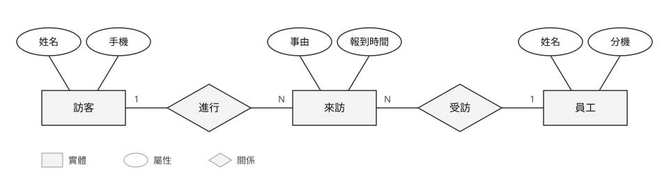
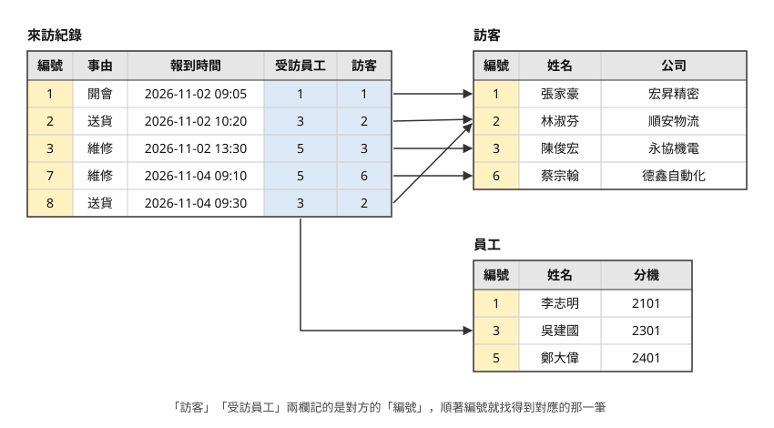
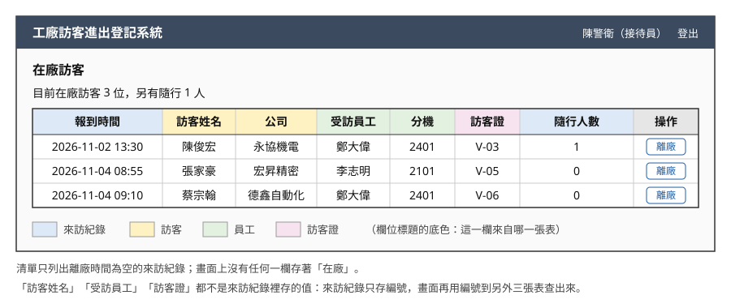
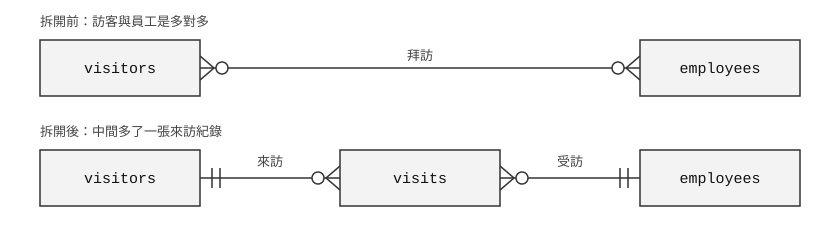
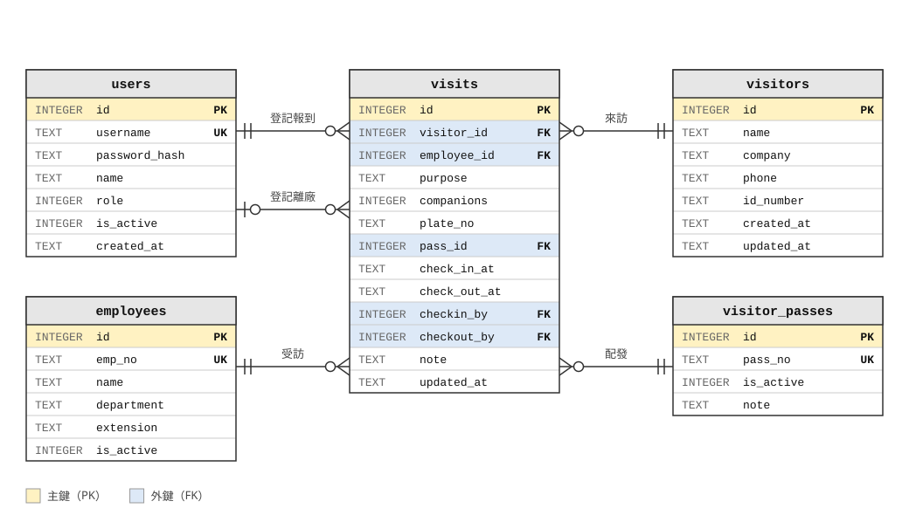

# 資料建模與資料庫設計

## 系統分析與設計（IE226）115-1

授課教師：呂卓勲

本課程教材：[GitHub](https://github.com/billy1125/system-analysis-and-design)

---

## 被覆蓋掉的原值

工廠訪客進出登記系統的來訪紀錄可以修改，但修改時直接覆蓋原值（I-04）。

- 只留一個「最後修改時間」
- 種子資料第 4 筆的備註寫著「受訪人改為黃美玲」，原本是誰已經查不到
- 從今天起補上修改紀錄不難，但被覆蓋的原值沒有資料可以還原

> **資料模型是系統裡最難改的部分，所以要在動工前想清楚。**

---

## 同一個人，兩筆訪客資料

| `id` | `name` | `company` | `phone` | `id_number` |
|---|---|---|---|---|
| 1 | 張家豪 | 宏昇精密 | 0912345678 | A123456789 |
| 7 | 張家豪 | 宏昇精密 | 0911888999 | A123456789 |

- 系統以手機查詢訪客，手機不同就查不到，只能再建一筆（I-02）
- `phone` 與 `id_number` 都沒有設成不能重複，資料庫不會擋
- 11/2 的來訪掛在第 1 筆、11/4 的掛在第 7 筆，只查一筆就少算

---

## 用了兩年才整理

| 要處理的事 | 為什麼麻煩 |
|---|---|
| 找出重複的訪客 | 要先決定以什麼辨識同一個人；手機會換，身分證字號若只存末四碼也不能比對 |
| 合併兩筆訪客資料 | 被併掉那一筆底下的來訪紀錄，都要改指向留下來的那一筆 |
| 確認合併得對不對 | 同名同公司不一定是同一個人，很多筆要人工確認 |

> **一開始就決定用什麼辨識同一位訪客並設成唯一，就不會長出第二筆。**

---

## 本章的例子

- 期末示範的工廠訪客進出登記系統 `SAD-Visitor`（現行版）
- 對應「系統分析完整報告」〈7. 資料需求分析〉
- 編號沿用訪客系統報告：FR-01、UC-01、I-01 起

期末要寫的資料變更，見「修改需求與變更規格」〈七〉。

---

# 一、資料是系統的骨架

前面幾章談的都是動作：誰做什麼、流程怎麼走、系統怎麼回應。動作做完之後，總要有東西被記下來。

要記哪些欄位、哪些欄位不能空白、狀態有哪幾種，靠的是對業務的了解，不是寫程式的能力。本節先看期中要交的三份資料產出，以及它們和功能模型怎麼互相檢查。

系統裡的程式，說到底都在處理資料：資料怎麼存、怎麼算、怎麼顯示。

---

## 三份產出，一份比一份細

| 層次 | 回答的問題 | 產出 |
|---|---|---|
| 1 | 有哪些東西？彼此有什麼關係？ | 實體關聯圖（ERD） |
| 2 | 存成哪幾張表？表和表怎麼連起來？ | Schema 與資料表 |
| 3 | 每一欄到底存什麼？ | 資料字典 |

> **三份要互相對得起來，對不上就代表資料模型還沒想清楚。**

---

## 中間那一層最常被跳過

它只需要一張表，把每張資料表的基本資料交代清楚：

| 資料表 | 用途 | 主鍵 | 對外參照 | 其他約束 |
|---|---|---|---|---|
| `users` | 系統帳號 | `id` | 無 | `username` 唯一 |
| `employees` | 員工名單 | `id` | 無 | `emp_no` 唯一 |
| `visitors` | 訪客主檔 | `id` | 無 | 無 |
| `visits` | 來訪紀錄 | `id` | `visitor_id`、`employee_id`、`pass_id`、`checkin_by`、`checkout_by` | 無 |
| `visitor_passes` | 訪客證 | `id` | 無 | `pass_no` 唯一 |

---

## 「其他約束」放什麼

- 主鍵和外鍵以外的規則，最常見的是「唯一」
- 唯一：這一欄不是主鍵，但不允許兩筆資料重複
- `employees.emp_no` 不是主鍵，但新增重複的員工編號會被擋下：「員工編號已存在」

這一欄常常是空的，但只要有填，那就是一條業務規則。空著也是結論：`visitors` 寫「無」，張家豪才會有兩筆。

---

## 資料模型與功能模型互相檢查

| 檢查 | 對不上代表 |
|---|---|
| 每一項功能都有它讀寫的資料 | 這項功能沒有東西可以處理 |
| 每一份資料都有功能負責建立和維護 | 系統上線時，那張表是空的 |

第二條就是「功能分析」CRUD 矩陣在檢查的事。

---

# 二、實體、屬性與關係

實體關聯模型是 Peter Chen 在 1976 年提出的，只用三個元素描述資料。學會分辨這三個元素，才畫得出 ERD。

本節從三個元素出發，接著講主鍵與外鍵、一對一到多對多的關係，最後看訪客系統完整的 ERD。

---

## 三個基本元素

| 元素 | 意思 | 訪客系統的例子 |
|---|---|---|
| 實體（Entity） | 需要被記錄的人、事、物 | 訪客、來訪、員工、訪客證 |
| 屬性（Attribute） | 實體的特徵 | 手機、事由、報到時間 |
| 關係（Relationship） | 實體之間的關聯 | 一位訪客可以來訪很多次 |

---

## 該不該當成實體

> **這樣東西需要單獨被查詢、被統計，或是有自己的一組屬性嗎？**

- 「來訪」需要：每一次都有自己的報到時間、受訪員工和訪客證，也能單獨查詢和修改
- 「事由」不需要：它只是來訪的一個屬性

---

## 實體、屬性與關係

---

## 存進資料庫之後

實體變成資料表，屬性變成欄位，關係靠一個欄位記下對方的編號。

---

## 系統畫面上看到的在廠訪客

在廠訪客清單，是把來訪紀錄和它指到的三張表串起來顯示。

---

## 主鍵（Primary Key, PK）

每個實體都要有一個屬性，用來分辨每一筆資料。

| 來源 | 例子 | 好處 | 壞處 |
|---|---|---|---|
| 自然鍵 | 身分證字號、員工編號 | 人一看就懂 | 業務規則一改就出問題 |
| 代理鍵 | 系統流水號 000001 | 穩定，不受業務規則影響 | 人看不懂 |

常見做法是兩種都留：代理鍵當主鍵，自然鍵另外設成唯一，例如 `employees` 的 `id` 與 `emp_no`。持護照的外籍訪客沒有身分證字號（I-05），拿它當主鍵就填不出來。

---

## 外鍵（Foreign Key, FK）

- 一張表要指到另一張表的某一筆資料，就把對方的主鍵記下來
- 記下對方主鍵的這一欄，就是外鍵
- 來訪紀錄的 `visitor_id` 記的是訪客的 `id`

> **期中報告不必煩惱該選哪一種主鍵，說得出那套系統用的是哪一種就好。**

---

## 基數：兩邊各對到幾筆

| 基數 | 意思 | 例子 |
|---|---|---|
| 1:1 | 一筆只對到一筆 | 一位員工只有一組登入帳號 |
| 1:N | 一筆對到多筆 | 一位訪客可以來訪很多次，一筆來訪只屬於一位訪客 |
| M:N | 兩邊都是一筆對到多筆 | 一位訪客拜訪多位員工，一位員工接待多位訪客 |

`SAD-Visitor` 沒有一對一：帳號與員工名單互不相連，受訪員工沒有帳號。

---

## 基數在資料庫怎麼實作

| 基數 | 做法 |
|---|---|
| 1:1 | 在其中一張表放外鍵，並把這個外鍵設成唯一 |
| 1:N | 在「多」的那一邊放外鍵，記下「一」那一邊的主鍵 |
| M:N | 不能直接實作，要加一張中間表，放兩個外鍵分別指向兩邊 |

---

## 多對多：加一張中間表

- 訪客和員工的多對多，靠 `visits` 拆開
- 這張表存的是每一次來訪
- 每一筆都記下「誰來」和「找誰」
- 一位訪客對到多筆來訪，一位員工也對到多筆來訪

---

## 多對多拆成兩個一對多

---

## 中間表也有自己的資料

`visits` 記了事由、隨行人數、車牌、報到與離廠時間，還連到用的是哪一張訪客證。

> **看到多對多時，要多問一句：這段關係本身有沒有要記的資料？**

如果有，代表這裡其實藏著一個被漏掉的實體：訪客與員工之間的「拜訪」，拆開來就是「來訪」。

---

## 主檔／明細（master-detail）

- 一張單據上只出現一次的資料（單號、日期）存在主檔
- 一行一行重複的明細，每一行各存一筆到明細表
- 現行系統沒有：隨行人員只記人數，一個整數就存完了（I-07）
- 若要記每一位隨行人員是誰，來訪是主檔，隨行人員是明細

> **判斷方法是問：哪些欄位只會有一份，哪些會有很多份？**

---

## 換個題目只是換個名字

| 主檔 | 明細 | 一行明細代表 |
|---|---|---|
| 訂單 | 訂單明細 | 訂了哪個品項、幾件 |
| 借用單 | 借用明細 | 借了哪一項設備 |
| 活動 | 報名紀錄 | 誰報了這場活動 |
| 來訪（若記隨行人員） | 隨行人員 | 一位隨行人員 |

硬塞成一張表，明細一多，主檔的資料就要跟著重複好幾十次。

---

## 兩種畫法

| 記法 | 長什麼樣子 | 適合用在 |
|---|---|---|
| Chen 記法 | 實體方框、關係菱形、屬性橢圓 | 上課、討論概念 |
| Crow's Foot（鳥爪） | 欄位列在方框裡，基數畫在連線兩端 | 實際工作，多數工具的預設 |

> **本課程以 Crow's Foot 為主，Chen 記法看得懂就好。**

---

## 鳥爪記法的線端符號

| 符號 | 意思 |
|---|---|
| 和連線垂直的短線 | 一 |
| 三叉，像鳥爪 | 多 |
| 圓圈 | 零，也就是可以沒有 |
| 圓圈加鳥爪 | 零或多 |
| 短線加鳥爪 | 一或多 |

---

## 訪客系統的 ERD

---

## 讀這張圖

- `PK` 是主鍵，`FK` 是外鍵，`UK` 是唯一欄位
- 欄位名稱用英文，因為它們就是資料庫裡實際的欄位名稱
- 中文名稱和其他細節，寫在資料字典裡
- `users` 與 `visits` 兩條線：報到登記人一定有，離廠登記人可以沒有
- 五條關聯在資料庫裡都設成了外鍵；別的系統不一定，要查過才能寫

> **圖只畫結構，細節寫在字典裡。**

---

# 五、資料字典

ERD 看得出有哪些東西、彼此怎麼連，但看不出每一欄能填什麼、可不可以空白、空白時存成什麼。這些要寫在資料字典裡。

本節說明資料字典每一欄要交代什麼，再看最能看出有沒有想清楚的兩欄：值域和資料來源。

---

## 資料字典給誰看

| 讀者 | 拿它做什麼 |
|---|---|
| 使用單位的承辦人和主管 | 確認系統要記的資料有沒有漏、有沒有錯 |
| 程式設計師和系統工程師 | 照著它建立資料表、寫程式 |
| 雙方 | 對資料有疑問時，當作共同的依據來討論 |

> **資料字典要清楚到讀的人不會有第二種解讀。**

---

## 每一欄要交代什麼

| 欄位 | 用途 |
|---|---|
| 欄位名稱、中文名稱 | 實際名稱，以及給看不懂英文的人對照 |
| 資料型別與長度 | 文字、數字或日期時間 |
| 是否必填 | 可不可以空白 |
| 值域或格式 | 允許填哪些值、要符合什麼格式 |
| 資料來源 | 使用者輸入、系統產生，或計算出來 |

---

## 例：`visits` 表（1/2）

| 欄位名稱 | 中文名稱 | 型別 | 必填 | 值域／格式 | 資料來源 |
|---|---|---|---|---|---|
| `id` | 來訪編號 | INTEGER | 是 | 主鍵，系統流水號 | 系統產生 |
| `visitor_id` | 訪客編號 | INTEGER | 是 | 對應 `visitors.id` | 登記時選定 |
| `employee_id` | 受訪員工 | INTEGER | 是 | 對應 `employees.id` | 接待員選擇 |
| `purpose` | 事由 | TEXT | 是 | `開會`、`送貨`、`維修`、`參觀`、`面試`、`其他` | 接待員選擇 |
| `companions` | 隨行人數 | INTEGER | 是 | 0–20；預設 0 | 接待員輸入 |
| `plate_no` | 車牌 | TEXT | 否 | 1–10 字 | 接待員輸入 |
| `pass_id` | 訪客證 | INTEGER | 是 | 對應 `visitor_passes.id` | 接待員選擇 |

---

## 例：`visits` 表（2/2）

| 欄位名稱 | 中文名稱 | 型別 | 必填 | 值域／格式 | 資料來源 |
|---|---|---|---|---|---|
| `check_in_at` | 報到時間 | TEXT | 是 | `YYYY-MM-DD HH:MM:SS`，本機時間 | 系統於送出登記時寫入 |
| `check_out_at` | 離廠時間 | TEXT | 否 | 同上；在廠時為 NULL | 系統於離廠登記時寫入 |
| `checkin_by` | 報到登記人 | INTEGER | 是 | 對應 `users.id` | 由登入狀態帶入 |
| `checkout_by` | 離廠登記人 | INTEGER | 否 | 對應 `users.id`；在廠時為 NULL | 由登入狀態帶入 |
| `note` | 備註 | TEXT | 否 | 0–200 字 | 接待員輸入 |
| `updated_at` | 最後修改時間 | TEXT | 否 | 同上；從未修改為 NULL | 系統於修改時寫入 |

---

## 型別盡量寫就好

- 不同的資料庫系統，型別都有些細微差異，例如 Oracle 和 SQL Server
- `SAD-Visitor` 用的 SQLite 只有 `TEXT` 和 `INTEGER`，日期時間存成文字
- 報告裡寫出這一欄存的是文字、整數還是日期時間就可以
- 實際該設成哪個型別，可以交給資訊工程師和程式設計師協助決定

---

## 同一個欄位名稱，意思不一定一樣

| 資料表 | `is_active` 的意思 | 管什麼 |
|---|---|---|
| `users` | 帳號啟用或停用 | 能不能登入（FR-02） |
| `employees` | 在職或離職 | 能不能被選為受訪員工（FR-08） |
| `visitor_passes` | 訪客證啟用或停用 | 能不能拿來發（FR-09） |

> **字典裡要把三者分開寫清楚，讀的人才不會誤解。**

---

## 值域：寫清楚每一欄能填什麼

- `users.role` 有哪幾個值？（`0` 管理員、`1` 接待員，預設 1）
- `visitors.phone` 要符合什麼格式？（`09` 開頭的 10 碼數字）
- `plate_no` 沒填時存成什麼？（NULL，也就是「沒有值」，不是空字串）
- `check_out_at` 是 NULL 代表什麼？（這位訪客還在廠內）

> **值域這一欄最能看出你有沒有想清楚。**

---

## 同一個狀態，出現在三個地方

| 地方 | 訪客系統的「在廠」 |
|---|---|
| 活動圖的判斷 | 該訪客是否不在廠內 |
| 畫面上的文字 | 此訪客目前仍在廠內 |
| 資料表裡 | `check_out_at` 為 NULL（推導規則，不是存的值） |

說法不同沒關係，但要能一一對起來。對不起來就是文件不一致，訪談時很容易被追問。

---

## 值域還可以寫：什麼時候寫入

- `check_out_at` 只寫「系統時間」不夠，要寫「登記離廠時寫入，寫入後不能修改」
- `visits.updated_at` 只在用修改功能改動時寫入，登記離廠不會動到它
- 不寫明，讀的人會以為它是「這一筆最後一次被動到的時間」

> **寫清楚什麼時候寫入，往往比寫允許填什麼，更能說明這一欄代表什麼。**

---

## 用幾個條件組合表示狀態

訪客證的狀態，由一個旗標加上另一張表的條件組合而成：

| `is_active` | 有無在廠的來訪紀錄 | 狀態 | 可否選來登記 |
|:---:|:---:|---|---|
| 1 | 無 | 可用 | 可以 |
| 1 | 有 | 使用中 | 否 |
| 0 | 無 | 停用 | 否 |
| 0 | 有 | 停用但仍在訪客身上 | 否；系統沒有阻止 |

---

## 填完之後，檢查兩件事

- **有沒有兩種組合的結果完全一樣？** 第三、四列都不能登記，但第四列那張證還在訪客身上，要分開寫
- **有沒有哪一種組合根本不該出現？** 第四列就是，系統沒擋（I-09）；要擋，就寫成一條規則

> **畫得出這張表，代表你把系統的狀態規則完整走過一遍。**

---

## 資料來源那一欄在防什麼

| 問題 | 例子 |
|---|---|
| 要使用者提供他手上沒有的資料 | 要接待員輸入受訪人工號，訪客多半只說得出姓名；`SAD-Visitor` 改成從員工名單選擇 |
| 該由系統決定的值，卻讓使用者自己填 | `checkin_by`、`check_in_at` 若開放輸入，就能冒用別人名義登記、把報到時間填早 |

> **把欄位標成「系統產生」或「由登入狀態帶入」，本身就是一個管理上的決定。**

---

# 六、從既有系統反推資料模型

期中與期末分析的都是已經存在的系統，期末第 4 項的現況資料也是這樣整理出來的。這時資料模型不用設計，而是從系統本身看出來。

本節說明可以從哪四個地方看，以及反推時一定要檢查的落差：ERD 上畫得出來的關聯，資料庫裡不一定真的設了外鍵。

---

## 從四個地方看

| 從哪裡看 | 看得出什麼 | 訪客系統的例子 |
|---|---|---|
| 畫面 | 有哪些欄位 | 來訪登記頁的六個欄位（FR-07） |
| 列表和報表 | 資料怎麼存 | 在廠清單上方的隨行人數合計（FR-11） |
| 系統擋下的操作 | 欄位允許填什麼 | 員工編號重複會被擋下 |
| 資料表的定義 | 型別、預設值、唯一、外鍵 | `db/schema.sql` |

> **不看資料表的定義，資料字典會有一半的格子填不出來。**

---

## ERD 有線，資料庫不一定有外鍵

外鍵沒有設，表和表之間怎麼對應，全靠程式自己處理：

- 可以寫入指向不存在資料的紀錄，資料庫不會拒絕
- 刪除一筆被參照的資料，參照它的紀錄不會跟著處理
- 要不要連帶處理，全靠程式寫明，漏寫一處資料就開始不一致

檢查方法：打開資料表的定義，看有沒有 `REFERENCES` 或 `FOREIGN KEY`。

---

## `SAD-Visitor`：外鍵有宣告，也有開啟檢查

- `visits` 的五個外鍵都在 `db/schema.sql` 寫了 `REFERENCES`
- 程式連線時開啟 SQLite 的外鍵檢查（`PRAGMA foreign_keys = ON`）
- SQLite 預設不檢查，只寫 `REFERENCES` 而沒開啟，資料庫一樣不會擋

> **外鍵有沒有設，要打開定義查過才能寫，不能從 ERD 推定。**

---

## 照樣畫，但要寫出落差

- ERD 上照樣要畫出關聯，因為業務上確實有這個關係
- 報告要指出實作和模型之間的落差，並說明後果
- 看不出來的部分，要清楚標示出來

> **寫「這個欄位的用途從畫面看不出來，需要查資料庫或訪談維護人員」，比硬猜一個用途更有用。**

---

## 期末才會用到的部分

本章〈三〉〈四〉期中不必做，留到期末：

- 從需求找實體、正規化、該存還是該算、存值還是參照：只用在這次新增或改動的欄位與資料表
- 期末範例怎麼套用，以及資料變更怎麼寫，見「修改需求與變更規格」〈七〉

> **期末只寫變動的部分，不從需求重新推導整套資料設計。**

---

## 本章重點回顧

- ERD、Schema 與資料字典是同一件事的三個層次，三者要對得起來
- 多對多要拆成中間表，中間表常常藏著一個被漏掉的實體
- 主檔／明細：只有一份的放主檔，有很多份的放明細
- 值域要寫清楚每一欄能填什麼，狀態要能在圖、畫面與資料表之間對起來
- 從既有系統反推資料模型（期中、期末第 4 項），ERD 上的關聯和資料庫的外鍵要分開確認

---

## 下一章

本章決定了資料存成什麼結構。

下一章「系統環境與架構」接著處理這些資料實際放在哪裡：資料庫擺在公司機房還是雲端、使用者從什麼裝置存取、與哪些外部系統相連。
