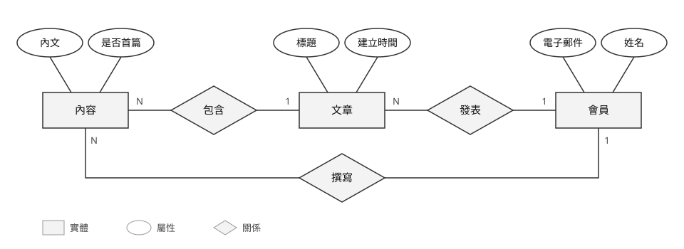
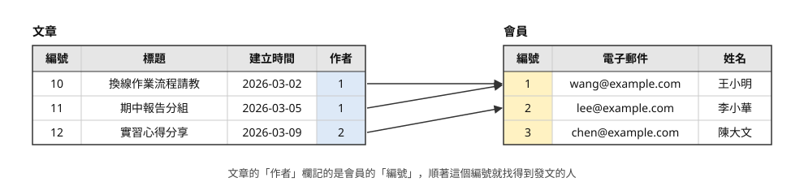
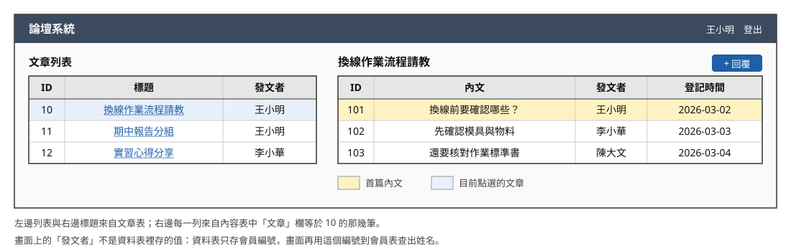
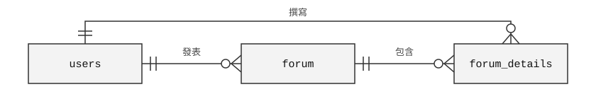
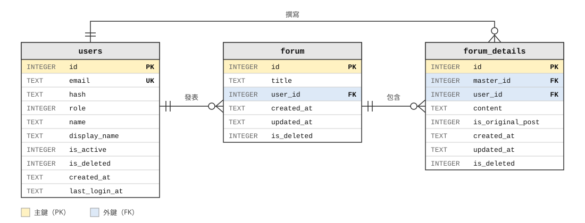

# 資料建模與資料庫設計

## 系統分析與設計（IE226）115-1

授課教師：呂卓勲

本課程教材：[GitHub](https://github.com/billy1125/system-analysis-and-design)

---

## 三年後才發現的事

一套論壇用了三年，管理員想查某個帳號是誰停用的、什麼時候停用的。

- 資料庫只存了一個「是否啟用」的旗標
- 從今天起補上紀錄功能不難
- 但過去三年的停用經過，已經沒有資料可以還原

> **資料模型是系統裡最難改的部分，所以要在動工前想清楚。**

---

## 沒有正規化的看診紀錄

醫院門診系統把病人、醫師、開藥全記在同一張表：

| 看診編號 | 病歷號 | 病人姓名 | 過敏史 | 醫師 | 科別 | 開立藥品 |
|---|---|---|---|---|---|---|
| A-1001 | P-3021 | 林志明 | 盤尼西林 | 陳醫師 | 內科 | Amoxicillin 500mg×3、Panadol |
| A-1187 | P-3021 | 林志明 | 無 | 王醫師 | 骨科 | Celebrex 200mg |

- 過敏史前後矛盾，只看最新一筆可能開出會過敏的藥
- 一格塞好幾種藥，查不到「誰開過 Amoxicillin」，劑量也無法統計
- 查詢變慢：只想找幾筆資料，也要逐筆比對整格文字，或另外寫程式拆開再過濾

---

## 用了兩年才拆表

| 要處理的事 | 為什麼麻煩 |
|---|---|
| 把「開立藥品」拆成處方明細 | 同一種藥有好幾種寫法（Panadol、普拿疼、panadol 500），很多筆要人工對照 |
| 整理過敏史 | 看不出哪一筆才對，只能請醫護人員向病人確認 |
| 修改既有程式與報表 | 健保申報、藥品用量統計都照舊表寫，全部要改寫再驗證 |

> **一開始就拆成病人、醫師、看診紀錄、處方明細四張表，過敏史只存在一個地方。**

---

## 本章的例子

- 課堂範例系統「論壇系統」`SAD-Forum`
- 對應「系統分析範例報告」〈7. 資料需求分析〉
- 編號沿用範例報告：FR-01、NFR-01、UC-01、F-11 起

範例報告沒有的內容（一對一、從需求找實體、正規化、期末的資料設計），改用工廠訪客進出登記系統。

---

# 一、資料是系統的骨架

前面幾章談的都是動作：誰做什麼、流程怎麼走、系統怎麼回應。動作做完之後，總要有東西被記下來。

要記哪些欄位、哪些欄位不能空白、狀態有哪幾種，靠的是對業務的了解，不是寫程式的能力。本節先看期中要交的三份資料產出，以及它們和功能模型怎麼互相檢查。

系統裡的程式，說到底都在處理資料：資料怎麼存、怎麼算、怎麼顯示。

---

## 三份產出，一份比一份細

| 層次 | 回答的問題 | 產出 |
|---|---|---|
| 1 | 有哪些東西？彼此有什麼關係？ | 實體關聯圖（ERD） |
| 2 | 存成哪幾張表？表和表怎麼連起來？ | Schema 與資料表 |
| 3 | 每一欄到底存什麼？ | 資料字典 |

> **三份要互相對得起來，對不上就代表資料模型還沒想清楚。**

---

## 中間那一層最常被跳過

它只需要一張表，把每張資料表的基本資料交代清楚：

| 資料表 | 用途 | 主鍵 | 對外參照 | 其他約束 |
|---|---|---|---|---|
| `users` | 會員帳號 | `id` | 無 | `email` 唯一 |
| `forum` | 文章主檔 | `id` | `user_id` → `users.id` | 無 |
| `forum_details` | 內文與回覆 | `id` | `master_id` → `forum.id`、`user_id` → `users.id` | 無 |

---

## 「其他約束」放什麼

- 主鍵和外鍵以外的規則，最常見的是「唯一」
- 唯一：這一欄不是主鍵，但不允許兩筆資料重複
- `users.email` 是實際登入用的帳號，同一個信箱註冊第二次會被擋下（FR-05）

這一欄常常是空的，但只要有填，那就是一條業務規則。

---

## 資料模型與功能模型互相檢查

| 檢查 | 對不上代表 |
|---|---|
| 每一項功能都有它讀寫的資料 | 這項功能沒有東西可以處理 |
| 每一份資料都有功能負責建立和維護 | 系統上線時，那張表是空的 |

第二條就是「功能分析」CRUD 矩陣在檢查的事。

---

# 二、實體、屬性與關係

實體關聯模型是 Peter Chen 在 1976 年提出的，只用三個元素描述資料。學會分辨這三個元素，才畫得出 ERD。

本節從三個元素出發，接著講主鍵與外鍵、一對一到多對多的關係，最後看論壇系統完整的 ERD。

---

## 三個基本元素

| 元素 | 意思 | 論壇系統的例子 |
|---|---|---|
| 實體（Entity） | 需要被記錄的人、事、物 | 會員、文章、內容 |
| 屬性（Attribute） | 實體的特徵 | 電子郵件、文章標題、建立時間 |
| 關係（Relationship） | 實體之間的關聯 | 一位會員發表多篇文章 |

---

## 該不該當成實體

> **這樣東西需要單獨被查詢、被統計，或是有自己的一組屬性嗎？**

- 「回覆」需要：每一則都有自己的作者、內容和建立時間，也能單獨修改或刪除
- 「標題」不需要：它只是文章的一個屬性

---

## 實體、屬性與關係

---

## 存進資料庫之後

實體變成資料表，屬性變成欄位，關係靠一個欄位記下對方的編號。

---

## 系統畫面上看到的文章

文章 10 號，是把三張表的資料串起來顯示。

---

## 主鍵（Primary Key, PK）

每個實體都要有一個屬性，用來分辨每一筆資料。

| 來源 | 例子 | 好處 | 壞處 |
|---|---|---|---|
| 自然鍵 | 身分證字號、學號 | 人一看就懂 | 業務規則一改就出問題 |
| 代理鍵 | 系統流水號 000001 | 穩定，不受業務規則影響 | 人看不懂 |

常見做法是兩種都留：代理鍵當主鍵，自然鍵另外設成唯一。

---

## 外鍵（Foreign Key, FK）

- 一張表要指到另一張表的某一筆資料，就把對方的主鍵記下來
- 記下對方主鍵的這一欄，就是外鍵
- 文章主檔的 `user_id` 記的是發文會員的 `id`

> **期中報告不必煩惱該選哪一種主鍵，說得出那套系統用的是哪一種就好。**

---

## 基數：兩邊各對到幾筆

| 基數 | 意思 | 例子 |
|---|---|---|
| 1:1 | 一筆只對到一筆 | 一位員工只有一組登入帳號 |
| 1:N | 一筆對到多筆 | 一位會員發表多篇文章，一篇文章只有一位作者 |
| M:N | 兩邊都是一筆對到多筆 | 一位會員在多篇文章下發言，一篇文章有多位會員發言 |

論壇系統沒有一對一，1:1 那一列借用工廠訪客系統的例子。

---

## 基數在資料庫怎麼實作

| 基數 | 做法 |
|---|---|
| 1:1 | 在其中一張表放外鍵，並把這個外鍵設成唯一 |
| 1:N | 在「多」的那一邊放外鍵，記下「一」那一邊的主鍵 |
| M:N | 不能直接實作，要加一張中間表，放兩個外鍵分別指向兩邊 |

---

## 多對多：加一張中間表

- 會員和文章的多對多，靠 `forum_details` 拆開
- 這張表存的是論壇裡的每一則發言
- 每一則都記下「誰寫的」和「寫在哪一篇文章底下」
- 一位會員對到多則發言，一篇文章也對到多則發言

---

## 多對多拆成兩個一對多

---

## 中間表也有自己的資料

`forum_details` 記了內容、建立時間、最後編輯時間，以及是不是首篇內文。

> **看到多對多時，要多問一句：這段關係本身有沒有要記的資料？**

如果有，代表這裡其實藏著一個被漏掉的實體。

---

## 主檔／明細（master-detail）

- 一張單據上只出現一次的資料（單號、日期）存在主檔
- 一行一行重複的明細，每一行各存一筆到明細表
- `forum` 存標題，`forum_details` 存每一則發言
- 首篇內文和回覆都在明細表，用 `is_original_post` 分辨

> **判斷方法是問：哪些欄位只會有一份，哪些會有很多份？**

---

## 換個題目只是換個名字

| 主檔 | 明細 | 一行明細代表 |
|---|---|---|
| 訂單 | 訂單明細 | 訂了哪個品項、幾件 |
| 借用單 | 借用明細 | 借了哪一項設備 |
| 活動 | 報名紀錄 | 誰報了這場活動 |
| 討論主題 | 主題內容與回覆 | 一則發言 |

硬塞成一張表，明細一多，主檔的資料就要跟著重複好幾十次。

---

## 兩種畫法

| 記法 | 長什麼樣子 | 適合用在 |
|---|---|---|
| Chen 記法 | 實體方框、關係菱形、屬性橢圓 | 上課、討論概念 |
| Crow's Foot（鳥爪） | 欄位列在方框裡，基數畫在連線兩端 | 實際工作，多數工具的預設 |

> **本課程以 Crow's Foot 為主，Chen 記法看得懂就好。**

---

## 鳥爪記法的線端符號

| 符號 | 意思 |
|---|---|
| 和連線垂直的短線 | 一 |
| 三叉，像鳥爪 | 多 |
| 圓圈 | 零，也就是可以沒有 |
| 圓圈加鳥爪 | 零或多 |
| 短線加鳥爪 | 一或多 |

---

## 論壇系統的 ERD

---

## 讀這張圖

- `PK` 是主鍵，`FK` 是外鍵，`UK` 是唯一欄位
- 欄位名稱用英文，因為它們就是資料庫裡實際的欄位名稱
- 中文名稱和其他細節，寫在資料字典裡
- 三條關聯在資料庫裡其實都沒有設定外鍵，報告要寫出這個落差

> **圖只畫結構，細節寫在字典裡。**

---

# 五、資料字典

ERD 看得出有哪些東西、彼此怎麼連，但看不出每一欄能填什麼、可不可以空白、空白時存成什麼。這些要寫在資料字典裡。

本節說明資料字典每一欄要交代什麼，再看最能看出有沒有想清楚的兩欄：值域和資料來源。

---

## 資料字典給誰看

| 讀者 | 拿它做什麼 |
|---|---|
| 使用單位的承辦人和主管 | 確認系統要記的資料有沒有漏、有沒有錯 |
| 程式設計師和系統工程師 | 照著它建立資料表、寫程式 |
| 雙方 | 對資料有疑問時，當作共同的依據來討論 |

> **資料字典要清楚到讀的人不會有第二種解讀。**

---

## 每一欄要交代什麼

| 欄位 | 用途 |
|---|---|
| 欄位名稱、中文名稱 | 實際名稱，以及給看不懂英文的人對照 |
| 資料型別與長度 | 文字、數字或日期時間 |
| 是否必填 | 可不可以空白 |
| 值域或格式 | 允許填哪些值、要符合什麼格式 |
| 資料來源 | 使用者輸入、系統產生，或計算出來 |

---

## 例：`users` 表（1/2）

| 欄位名稱 | 中文名稱 | 型別 | 必填 | 值域／格式 | 資料來源 |
|---|---|---|---|---|---|
| `id` | 會員編號 | INTEGER | 是 | 主鍵，系統流水號 | 系統產生 |
| `email` | 電子郵件 | TEXT | 是 | 唯一；須含 `@` 與一個點 | 使用者輸入 |
| `hash` | 密碼雜湊 | TEXT | 是 | 雜湊字串，非明文 | 系統產生 |
| `role` | 角色 | INTEGER | 是 | `0` 管理員、`1` 一般會員；預設 1 | 系統預設或管理員指定 |
| `name` | 姓名 | TEXT | 否 | 空白存為 NULL | 使用者輸入 |

---

## 例：`users` 表（2/2）

| 欄位名稱 | 中文名稱 | 型別 | 必填 | 值域／格式 | 資料來源 |
|---|---|---|---|---|---|
| `display_name` | 顯示名稱 | TEXT | 否 | 空白存為 NULL | 使用者輸入 |
| `is_active` | 是否啟用 | INTEGER | 是 | `1` 啟用、`0` 停用；預設 1 | 系統預設或管理員切換 |
| `is_deleted` | 是否已刪除 | INTEGER | 是 | `1` 已刪除、`0` 未刪除；預設 0 | 管理員執行刪除 |
| `created_at` | 建立時間 | TEXT | 是 | `YYYY-MM-DD HH:MM:SS`，UTC | 系統產生 |
| `last_login_at` | 最後登入時間 | TEXT | 否 | 同上；從未登入時為 NULL | 系統於登入成功時寫入 |

---

## 型別盡量寫就好

- 不同的資料庫系統，型別都有些細微差異，例如 Oracle 和 SQL Server
- 論壇系統用的 SQLite 只有 `TEXT` 和 `INTEGER`，日期時間存成文字
- 報告裡寫出這一欄存的是文字、整數還是日期時間就可以
- 實際該設成哪個型別，可以交給資訊工程師和程式設計師協助決定

---

## 同一個欄位名稱，意思不一定一樣

| 資料表 | `updated_at` 的意思 | 什麼時候更新 |
|---|---|---|
| `forum` | 最後活動時間 | 有新回覆或修改標題時 |
| `forum_details` | 最後編輯時間 | 只有內容被修改時 |

這個差別決定了文章列表怎麼排序：有新回覆的文章會移到最上面（FR-12、FR-15）。

> **字典裡要把兩者分開寫清楚，讀的人才不會誤解。**

---

## 值域：寫清楚每一欄能填什麼

- `role` 有哪幾個值？（`0` 管理員、`1` 一般會員，新帳號預設 1）
- `email` 要符合什麼格式？（須含 `@` 與一個點）
- `name` 送出空白時存成什麼？（NULL，也就是「沒有值」，不是空字串）
- `last_login_at` 是 NULL 代表什麼？（這個帳號從來沒有登入過）

> **值域這一欄最能看出你有沒有想清楚。**

---

## 同一個狀態，出現在三個地方

| 地方 | 論壇系統的「停用」 |
|---|---|
| 活動圖的判斷 | 帳號是否啟用 |
| 畫面上的文字 | 帳號已停用 |
| 資料表裡的值 | `is_active = 0` |

說法不同沒關係，但要能一一對起來。對不起來就是文件不一致，訪談時很容易被追問。

---

## 值域還可以寫：什麼時候寫入

- `last_login_at` 只寫「系統時間」不夠
- 要寫「登入成功時寫入，每次登入都蓋掉前一次」
- `forum.updated_at` 寫明「有新回覆或修改標題時更新」，才看得出它和另一張表不同

> **寫清楚什麼時候寫入，往往比寫允許填什麼，更能說明這一欄代表什麼。**

---

## 用旗標表示狀態

旗標是只存 1 或 0 的欄位。兩個旗標有四種組合，要一格一格填：

| `is_active` | `is_deleted` | 狀態 | 可否登入 | 可執行的管理動作 |
|:---:|:---:|---|---|---|
| 1 | 0 | 正常 | 可以 | 停用、調整角色、刪除 |
| 0 | 0 | 停用中 | 否，「帳號已停用」 | 啟用、調整角色、刪除 |
| 1 | 1 | 已刪除 | 否，「帳號或密碼錯誤」 | 無 |
| 0 | 1 | 已刪除 | 否，「帳號或密碼錯誤」 | 無 |

---

## 填完之後，檢查兩件事

- **有沒有兩種組合的結果完全一樣？** 最後兩列就是，代表帳號刪除後，「是否啟用」就沒有意義了，報告要寫明
- **有沒有哪一種組合根本不會出現？** 有的話，代表有一條規則擋著它，寫下來就是一條非功能需求

> **畫得出這張表，代表你把系統的狀態規則完整走過一遍。**

---

## 資料來源那一欄在防什麼

| 問題 | 例子 |
|---|---|
| 要使用者提供他手上沒有的資料 | 訪客申請時要填受訪人工號，但訪客只有對方的名片 |
| 該由系統決定的值，卻讓使用者自己填 | `forum.user_id` 若開放輸入，就能冒用別人名義發文 |

> **把欄位標成「系統產生」或「系統預設」，本身就是一個管理上的決定。**

---

# 六、期中：從既有系統反推資料模型

期中分析的是已經存在的系統。這時資料模型不用設計，而是從系統本身看出來。

本節說明可以從哪四個地方看，以及反推時一定要檢查的落差：ERD 上畫得出來的關聯，資料庫裡不一定真的設了外鍵。

---

## 從四個地方看

| 從哪裡看 | 看得出什麼 | 論壇系統的例子 |
|---|---|---|
| 畫面 | 有哪些欄位 | 個人資料頁的六個欄位（FR-09） |
| 列表和報表 | 資料怎麼存 | 依最後活動時間排序（FR-12、FR-15） |
| 系統擋下的操作 | 欄位允許填什麼 | 同一個信箱不能註冊兩次（FR-05） |
| 資料表的定義 | 型別、預設值、唯一、外鍵 | `db/__init__.py`、`db/forum.py` |

> **不看資料表的定義，資料字典會有一半的格子填不出來。**

---

## ERD 有線，資料庫不一定有外鍵

論壇系統三張資料表之間沒有任何外鍵限制，`forum.user_id` 怎麼對到 `users.id`，全靠程式自己處理。

- 可以寫入一篇指向不存在會員的文章，資料庫不會拒絕
- 刪除一位會員，不會連帶處理他的文章和回覆
- 刪除文章時要不要一起刪回覆，要靠程式寫明（FR-17）

檢查方法：打開資料表的定義，看有沒有 `FOREIGN KEY`。

---

## 照樣畫，但要寫出落差

- ERD 上照樣要畫出關聯，因為業務上確實有這個關係
- 報告要指出實作和模型之間的落差，並說明後果
- 看不出來的部分，要清楚標示出來

> **寫「這個欄位的用途從畫面看不出來，需要查資料庫或訪談維護人員」，比硬猜一個用途更有用。**

---

## 期末才會用到的部分

本章〈三〉〈四〉〈七〉期中不必做，留到期末：

- 從需求找實體：名詞分析法，再用 CRUD 矩陣和狀態機圖檢查
- 正規化：拆到同一件事只存在一個地方，做到 3NF
- 算出來的值要存還是要算：看計算的依據會不會隨時間改變
- Schema 落地、畫面與資料的對照表、推導欄位清單

這幾節以工廠訪客進出登記系統為例，期末設計階段再講。

---

## 本章重點回顧

- ERD、Schema 與資料字典是同一件事的三個層次，三者要對得起來
- 多對多要拆成中間表，中間表常常藏著一個被漏掉的實體
- 主檔／明細：只有一份的放主檔，有很多份的放明細
- 值域要寫清楚每一欄能填什麼，狀態要能在圖、畫面與資料表之間對起來
- 期中從既有系統反推，ERD 上的關聯和資料庫的外鍵要分開確認

---

## 下一章

本章決定了資料存成什麼結構。

下一章「系統環境與架構」接著處理這些資料實際放在哪裡：資料庫擺在公司機房還是雲端、使用者從什麼裝置存取、與哪些外部系統相連。
