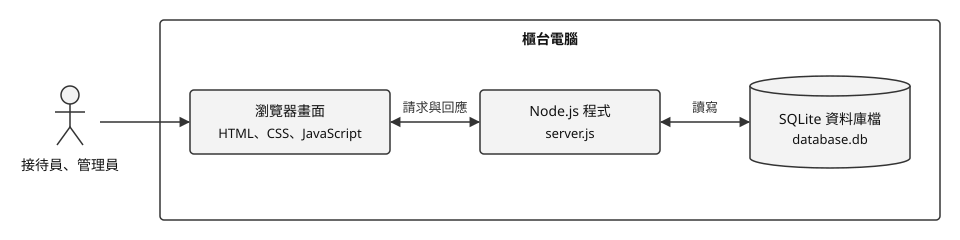
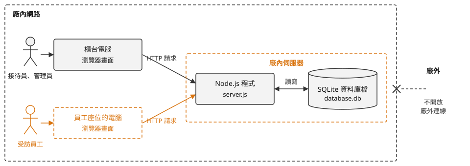
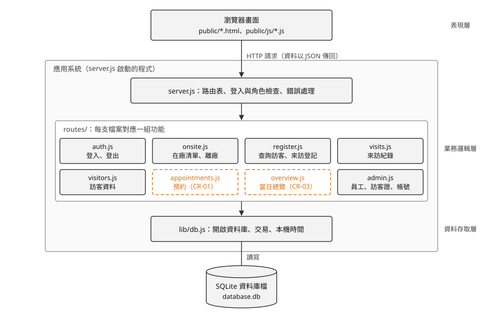

# 系統環境與架構

到目前為止，系統在報告裡一直是一個抽象的東西：它有功能、有流程、有資料，但它到底「放在哪裡」？受訪員工在自己座位上打開「我的預約」，那份清單是從哪裡來的？接待員在大門櫃台按下「報到」之後，資料跑去哪裡了？訪客明明已經報到，員工畫面上那筆預約為什麼還是「已預約」？

這些問題的答案就是系統架構。**架構回答的是「這套系統由哪些部分組成、各部分放在哪裡、彼此怎麼連」**，它把前面幾章的抽象分析，落到看得見摸得著的機器、網路與地點上。

對工業工程背景的人來說，這一章其實比想像中親切。你已經很習慣畫廠房布置圖、物料流動圖——哪個工站在哪裡、東西怎麼從 A 送到 B、中間有沒有瓶頸。系統架構圖是同一種思考方式，只是流動的東西從物料換成資料。

本章不打算把你變成軟體架構師。**期中要能看懂既有系統怎麼組成**；期末各題的架構相同，只在第 1 項用一句話交代執行環境，修改需求動到系統放在哪裡時（例如期末範例的 CR-01-5），才用到〈四〉的判斷。微服務、負載平衡這些字眼會出現，但只是讓你聽得懂別人在講什麼，不是要你在報告裡用上。

> **前情提要**：本章假設你已讀過[「系統分析與設計導論」](01-Systems-and-Analysis.md)〈二、2.3〉工廠常見的資訊系統，並完成[「資料建模與資料庫設計」](07-Data-Modeling.md)的資料模型。本章的例子是工廠訪客進出登記系統依[「期末範例報告」](../04-Final-Project-Example-Reports/Final-Phase-Sample-Report.md)修改後的版本 `SAD-Visitor-Revised`：系統從櫃台的一台電腦搬到廠內伺服器，櫃台與員工座位的電腦都用瀏覽器連線（範例〈9.1〉NFR-02）。修改前的樣子取自同一套系統的[「系統分析完整報告」](../04-Final-Project-Example-Reports/Visitor-System-Full-Analysis.md)〈8. 系統環境與整體架構理解〉，以下簡稱「系統分析報告」。兩者對照，看得出「放在哪裡」一改，架構圖上有哪些東西跟著變。

> **延伸閱讀**：兩套系統之間實際交換什麼資料、什麼時候換、失敗了怎麼辦，屬於介面設計的範圍，本章只處理「誰跟誰連」這一層。

> **必讀標記**：標題後加註 🔴 期中必讀 的小節，是期中小組報告九項產出直接會用到的內容；加註 🔵 期末必讀 的，是期末報告直接會用到的。判準與成品的樣子，期中見[「系統分析範例報告說明」](../02-Midterm-Project-Example-Reports/Analysis-Phase-Deliverables.md)與[「系統分析範例報告」](../02-Midterm-Project-Example-Reports/Analysis-Phase-Sample-Report.md)，期末見[「期末範例報告」](../04-Final-Project-Example-Reports/Final-Phase-Sample-Report.md)。未標記的小節仍屬課程範圍，只是報告不會直接產出。

## 一、架構在回答什麼 🔴 期中必讀 🔵 期末必讀

### 1.1 四個問題 🔴 期中必讀 🔵 期末必讀

一張合格的系統架構圖要回答四個問題：

| 問題 | 圖上要畫出來的東西 |
|---|---|
| 系統由哪些部分組成 | 使用者端、應用系統、資料庫，以及要串接的外部系統 |
| 每個部分放在哪裡 | 放在現場、公司機房還是雲端；哪些在公司裡面，哪些在外面 |
| 各部分怎麼連起來 | 哪一方向哪一方送出要求、資料往哪個方向傳、透過什麼網路傳 |
| 誰主動 | 用箭頭方向表示哪一方先送出要求，另一方只負責回應 |

**第二個問題最常被學生略過，卻是實務上最重要的。** 系統放在公司機房或放在雲端，決定了網路斷線時還能不能用、資料出不出得了公司、要不要租頻寬。這些不是技術偏好，是會影響現場作業的決定。

第四個問題常被當成小事，答案卻會影響使用者看到什麼。多數用瀏覽器操作的系統，都是使用者先送出要求，系統才回應，系統不會自己把新資料送到畫面上。因此使用者不重新整理畫面，就看不到別人剛做的變動。訪客系統就是這樣：系統分析報告〈8.1〉在「誰主動」一列寫的是「一律由使用者在畫面上操作，系統不主動做任何事」，修改版也沒有改變這一點。所以受訪員工開著「我的預約」時，接待員剛在櫃台替他的訪客報到，他畫面上那筆預約仍是「已預約」，要重新載入才會變成「已報到」。把這點寫進報告，就能說明為什麼畫面上的資料常常不是最新的。如果牽涉到兩套系統，這個問題更要問清楚：是甲系統主動把資料送給乙系統，還是乙系統定時去甲系統拿？答案不同，傳送失敗時該由哪一方重送也不同。

### 1.2 架構決策的特徵

架構決策與一般的設計決策有兩個差別：**難改**，以及 **影響全局**。

按鈕的顏色不喜歡可以隨時換，但「系統放在哪裡」一改，牽動的範圍就大得多。期末範例的 CR-01-5 把系統從櫃台電腦搬到廠內伺服器，畫面一個都沒改，追溯表上也沒有對應的流程、資料與畫面（範例〈16.1〉），卻改了非功能需求 NFR-02、多了驗收案例 TC-09，管理員要負責伺服器上的資料庫檔，資訊單位要提供伺服器、開放廠內網路並定期備份（範例〈7.1〉〈13.1〉）。同樣地，架構決定會限制後面所有的設計：搬到伺服器之後，櫃台能不能登記，取決於伺服器與廠內網路是否正常；如果當初選的是雲端，大門對外網路的品質就成了系統可用性的上限。

判斷一個決定是不是架構決策，可以問：**如果三個月後想改，要動到幾個地方？** 答案是「很多地方」的，就是架構層級的。

## 二、最基本的三段結構 🔴 期中必讀 🔵 期末必讀

### 2.1 使用者端、應用系統、資料庫 🔴 期中必讀 🔵 期末必讀

幾乎所有的商用資訊系統都可以先拆成三段：

| 段 | 負責什麼 | 訪客系統（修改版）的例子 |
|---|---|---|
| 使用者端（前端） | 顯示畫面、接收操作 | 櫃台電腦與員工座位電腦上的瀏覽器畫面 |
| 應用系統（後端） | 執行業務規則、處理請求 | 檢查登入與角色、擋下受訪員工存取別人的預約、擋下管理員停用自己 |
| 資料庫 | 儲存與查詢資料 | 7 張資料表，存在單一檔案 `database.db` 裡 |

三段各管各的事。使用者端只負責顯示畫面、讓使用者輸入，不做任何判斷。所有業務規則都放在應用系統。使用者端要讀寫資料時，一定要透過應用系統，不能直接連到資料庫。實務上常把應用系統和資料庫合稱為「後端」。

修改版的權限檢查就是這樣做的：每一個請求進來，`server.js` 先依登入帳號的角色判斷能不能使用這個功能，畫面上的選單只是方便，不是防線。範例把這一點寫成 NFR-07「受訪員工帳號只能存取自己的預約，由伺服器端檢查，不靠畫面隱藏」，驗收的 TC-03 也不從畫面操作，而是直接呼叫修改別人預約的功能，確認會被拒絕（範例〈9.1〉〈12.1〉）。

### 2.2 主從式架構

**[主從式架構](https://zh.wikipedia.org/wiki/主从式架构)（Client-Server）是最常見的組合方式**：使用者端（Client）發出請求，伺服器（Server）處理後回應。你用瀏覽器開任何一個網站，都是這個模式。

線上遊戲也是這個模式。你手機或電腦上的遊戲程式是使用者端，只負責畫出畫面、接收你按下的按鍵；你按下「攻擊」時，它把這個動作送給遊戲公司的伺服器。有沒有打中、扣多少血、掉了什麼寶物，都由伺服器計算後回傳，再同步給同場的其他玩家。多數線上遊戲把這些判斷放在伺服器，是因為使用者端的程式在玩家手上，可能被改寫；如果交給使用者端判斷，玩家改了程式就能作弊。

本課程分析的系統都是這一類：使用者開瀏覽器操作，資料存在後端資料庫。訪客系統修改前，三段全在櫃台的一台電腦上（系統分析報告〈8.1〉）：

*本圖由作者自製*

瀏覽器和 `server.js` 在同一台電腦上，仍然是主從式架構：瀏覽器送出請求，`server.js` 處理後回應。**主從式講的是兩支程式的分工，不一定是兩台機器。** 現行版的 `server.js` 只接受同一台電腦送來的請求，其他電腦連不進來，這是受訪員工在座位上用不到系統的技術原因。

修改版把應用系統與資料庫檔搬到廠內伺服器，櫃台與員工座位的電腦都透過廠內網路送出 HTTP 請求（HTTP 是瀏覽器向伺服器要資料時遵守的通訊規則）。圖中橘色是修改後才有的部分：

*本圖由作者自製*

這張圖把〈一、1.1〉的四個問題都畫上去了：有哪些部分（兩種使用者端、`server.js`、資料庫檔，沒有外部系統）、各部分在哪裡（廠內伺服器與各自的電腦，廠外連不進來）、彼此怎麼連（透過廠內網路）、誰主動（箭頭一律從瀏覽器出發）。**期中報告的最低要求就是畫得出這種圖**，並且說得出每個方框放在哪裡。期末範例報告本身沒有畫架構圖（期末不要求，見〈六、6.2〉），這張是依 NFR-02 與修改版的原始碼畫的。

### 2.3 分層式架構

把應用系統內部再切開，就是分層式架構。常見的切法是三層：

| 層 | 負責 |
|---|---|
| 表現層（Presentation） | 產生畫面、處理使用者輸入 |
| 業務邏輯層（Business Logic） | 執行規則、計算、流程控制 |
| 資料存取層（Data Access） | 與資料庫溝通 |

分層的目的是 **讓改動侷限在一層裡**。換一套資料庫，理論上只要改資料存取層；改一條業務規則，只動業務邏輯層。這與[「功能分析」](05-Functional-Analysis.md)〈四、4.2〉模組劃分講的高內聚、低耦合是同一個原則，只是切的方向不同——模組是依業務領域縱向切，分層是依技術職責橫向切。

**期中不必推導分層決策**，那是從零設計系統時才要做的選擇，本課程的兩份報告都不做。但既有系統若明顯看得出這種分工，把它畫進架構圖裡會讓那張圖有內容得多，因為它同時說明了「業務規則放在哪一層」。訪客系統（修改版）可以這樣拆：

*本圖由作者自製*

這種分工在資料夾結構裡看得出來（系統 `README.md`〈資料夾結構〉）：畫面在 `public/`，`server.js` 統一做登入與角色檢查，`routes/` 底下每支檔案負責一組功能，開啟資料庫與交易集中在 `lib/db.js`。和上表不同的是，這套系統的表現層在瀏覽器裡執行：畫面檔是固定的，由 `public/js/` 的程式向伺服器拿資料，再填進畫面。修改時也看得出分層的好處：CR-01 的預約與 CR-03 的當日總覽，各是 `routes/` 底下新增的一支檔案（圖中橘色）。

**看不出來的地方也照實寫。** 讀寫資料表的 SQL 指令（向資料庫查詢與寫入資料的語言）其實寫在 `routes/` 各檔裡，`lib/db.js` 只負責連線與交易，所以這套系統的資料存取層沒有完全獨立。架構圖要畫的是系統實際的樣子，不是教科書上的理想分層。

> **延伸閱讀**：另一種常見的切法是 [MVC](https://zh.wikipedia.org/wiki/MVC)（Model-View-Controller），把程式分成三部分：Model 管資料與規則，View 管畫面，Controller 接收使用者的操作，決定要 Model 做什麼，再交給哪個 View 顯示。它和三層式架構一樣是依職責切開程式，差別在 MVC 著重畫面與資料之間怎麼分工。許多網頁開發框架以它為基礎，本課程的報告不要求使用。

## 三、外部系統與現場設備

### 3.1 系統很少單獨存在

工廠裡的資訊系統多半要與別的系統往來：員工名單來自人資系統，訂單與物料來自 ERP（企業資源規劃系統，整合訂單、物料、財務等資料的公司核心系統）。這些在系統邊界之外、和本系統交換資料的系統，就是外部系統。架構圖要把它們畫在邊界外，並用箭頭標出資料往哪個方向流。

**查過之後一個都沒有，也要寫出來。** 訪客系統就是這樣：期末範例報告〈3.4〉寫明「系統沒有任何外部系統或設備介接」，修改後仍然沒有。有兩個地方看起來像外部系統，其實不是：

- 人資部提供需要開帳號的員工名單（範例〈13.1〉），但名單是交給管理員，由他在系統裡建立帳號（範例〈14.1〉），兩套系統之間沒有連線。
- CR-03-2 匯出的 CSV 檔由管理員下載留存（範例〈11.3〉），接收的是人，不是另一套系統。

所以〈二、2.2〉的圖上沒有外部系統。反過來說，**把界外的功能納入系統，架構圖就會多一個方框**：範例〈3.4〉把「與人資系統同步」列在界外，如果要把它納入，人資系統就要畫在邊界之外，並標出員工名單從人資系統流進訪客系統，是單向。

### 3.2 現場設備要單獨標出來

一般的商用系統架構圖只有電腦與伺服器，但工廠場域多了一類東西：**與實體世界接觸的設備**，例如掃碼槍、讀卡機、標籤印表機、工業平板。這些設備要畫進架構圖，因為它們會帶來一般辦公室系統沒有的限制：輸入格式是否對得上、耗材有沒有人補、設備接在哪一台電腦、那台電腦停電時怎麼辦。分析階段忽略它們，設計出來的系統到現場就用不了。

訪客系統沒有接任何設備。訪客證是實物，由接待員親手收發，系統只記錄哪一張證綁在哪一筆來訪（範例〈3.4〉）。如果要把「訪客證實體的收發」納入系統，例如用讀卡設備讀取訪客證，那台設備就要畫在櫃台電腦旁，並標出它把資料送給誰。

### 3.3 介接的方向與責任

兩套系統相連時，圖上的箭頭方向代表誰主動。以〈3.1〉的人資系統同步為例，人資系統把員工名單「推」給訪客系統，與訪客系統定時去人資系統「拉」名單，是兩種不同的設計，維護責任也不同。

**期中只要標出誰跟誰連、資料往哪個方向流就夠了。** 交換的內容、頻率、失敗怎麼處理，屬於介面設計的範圍。期末只有修改方向涉及資料匯出或匯入時，才要寫出檔案的欄位與格式，見[「報告內容」](../00-Course-Introduction/Report-Contents.md)期末第 11 項；範例 CR-03-2 的 CSV 格式寫在範例〈11.3〉。

## 四、系統放在哪裡 🔵 期末必讀

### 4.1 地端、雲端與混合 🔵 期末必讀

| 型態 | 意思 | 特點 |
|---|---|---|
| 地端（On-premises） | 伺服器放在自己的機房 | 資料不出公司、網路斷了內部仍可用、要自己維護 |
| 雲端（Cloud） | 租用外部的運算與儲存服務 | 不必自購硬體、可彈性擴充、依賴對外網路 |
| 混合（Hybrid） | 兩者並用 | 敏感資料留地端，其他放雲端 |

[雲端運算](https://zh.wikipedia.org/wiki/云计算)在一般商用系統已是主流，但 **製造現場有兩個因素會把天平拉回地端**：

**網路可靠度。** 大門不能因為對外網路斷線就停止放行訪客。如果系統完全依賴雲端，斷網時接待員就無法報到——除非設計本機暫存與後續同步，而那是額外的複雜度。

**資料敏感度。** 生產數量、良率、客戶訂單是製造業的核心機密，有些公司的政策就是不出廠區。這不是技術問題，是管理決策，分析時要問清楚。訪客系統存的也不只是名字：`visitors` 表存了訪客的手機與完整身分證字號（範例〈4.5〉）。

範例的 NFR-02 選的是地端：系統裝在廠內一台伺服器，不開放廠外連線（範例〈9.1〉）。

### 4.2 網路環境要看清楚 🔵 期末必讀

工廠的網路通常不是一整片，而是分區的：辦公網段、生產網段、機台控制網段之間可能有防火牆隔開，甚至完全不通。

**這件事在期中分析時要問；期末的修改需求動到系統放在哪裡時，也要問清楚新的位置哪些網段連得到。** 一個把伺服器放在辦公網段、卻要讓生產網段的平板連線的設計，可能在技術上完全行得通，但公司的資安政策不允許。到了實際導入才發現，就得整套重來。範例要讓大門櫃台與各部門座位上的電腦都連得到伺服器，所以把「開放廠內網路連線」列為資訊單位要做的事（範例〈13.1〉）；大門與辦公室如果在不同網段，這件事就要資安政策允許，不是設定一下而已。

## 五、架構受什麼限制

### 5.1 非功能需求決定架構

架構不是憑喜好選的，是被非功能需求逼出來的。[「系統需求分析」](04-System-Requirements-Analysis.md)〈三〉整理的那些非功能需求，每一條都可能轉成架構上的要求。以訪客系統修改後的三條為例：

| 非功能需求 | 對架構的要求 |
|---|---|
| NFR-02 系統裝在廠內一台伺服器，櫃台與員工座位的電腦以瀏覽器連線；不開放廠外連線 | 應用系統與資料庫檔放在伺服器上，並開放其他電腦連線（系統 `README.md`〈讓其他電腦連線〉）；廠外連不連得到，由廠內網路的設定決定，程式本身管不到 |
| NFR-07 受訪員工帳號只能存取自己的預約，由伺服器端檢查 | 權限檢查放在應用系統，每個請求都檢查，不靠畫面隱藏（〈二、2.1〉） |
| NFR-05 時間一律記錄本機時間，精確到秒（不變） | 搬到伺服器後，「本機」指的是伺服器：報到與離廠時間由伺服器的時鐘寫入（`lib/db.js`），不是櫃台電腦的時鐘 |

第三列提醒一件事：**需求的文字沒變，架構一改，意思可能就變了。** 範例沒有修改 NFR-05（範例〈7〉：「其餘 FR、NFR 不變」），但寫入時間的那台電腦已經從櫃台電腦換成伺服器。

**說明架構時要寫的是這種對照**：不是說「我們採用主從式架構」，而是說「因為受訪員工要在自己的座位上登錄預約（CR-01-5），所以系統從櫃台電腦搬到廠內伺服器，各電腦以瀏覽器連線」。

### 5.2 取捨無法避免

非功能需求之間會互相衝突，架構就是在衝突之間做取捨：

- 要高可用性，就要多備一套，成本上升。
- 要資料不出廠區，就放棄雲端的彈性與免維護。
- 要回應快，可能要犧牲一部分資料的即時一致性。

**說明架構時要說得出選了什麼、放棄了什麼、為什麼。** 只寫選了什麼而不寫代價，代表沒有真的比較過。

範例的 CR-01-5 也有代價。修改前系統「不需要網路」（系統分析報告〈8.2〉），櫃台那台電腦開著就能登記；修改後櫃台要能登記，伺服器與廠內網路都要正常，資料庫檔的備份也從「沒有備份機制」變成管理員與資訊單位的工作（範例〈13.1〉）。範例〈8.1〉的代價只寫了受訪員工要學一個新畫面，沒有提到這一項；上線當天登記如果因此停擺，由範例〈15.1〉的回復條件處理：來訪登記無法使用超過 15 分鐘，就退回舊版。

### 5.3 現場條件是硬限制

前面幾項還可以談，現場條件則多半沒得商量：哪裡有網路線、哪個位置有插座與不斷電系統、螢幕會不會被日照直射、現場吵不吵。

訪客系統的例子是螢幕與座位。修改版的畫面只針對 1280 像素以上的桌上型電腦螢幕設計（系統分析報告〈4.2〉NFR-06；系統 `README.md`〈常見問題〉），所以 CR-01 能成立的前提，是受訪員工的座位上有一台電腦。座位上沒有電腦的員工怎麼登錄預約，就是要先問清楚的現場條件。

這些限制在架構階段就要納入，因為它們會直接推翻某些方案。**這也是工管背景的人在架構討論裡最有貢獻的時候**——資訊人員很難憑空知道那一區為什麼不能放設備。

## 六、期中與期末各做到哪裡 🔴 期中必讀 🔵 期末必讀

### 6.1 期中：反推既有系統的組成 🔴 期中必讀

期中分析的是已經存在的系統，架構不是你們設計的，而是從系統上觀察出來的。可以從三個地方找線索：

**看使用情境。** 使用者用什麼裝置操作？辦公室電腦、現場平板，還是手機？有幾種裝置，使用者端就有幾種。

**看網址與登入方式。** 網址只有公司內部連得到，還是外面也連得到，可以用來推測系統放在地端還是雲端。如果要先連 VPN（從外部安全連進公司內部網路的方式）才能用，代表公司把網路分成內外不同的區域。課程分配的題目都在你們自己的電腦上執行，從網址看不出這些，這時改看啟動方式與設定。訪客系統現行版的 `server.js` 只接受同一台電腦的連線，系統分析報告〈4.2〉NFR-02 的依據就寫「系統沒有任何網路設定」，〈8.1〉「各部分在哪裡」那一列寫的是「全部在櫃台的一台電腦上」。修改版多了一項啟動設定，設定後其他電腦才連得進來（系統 `README.md`〈讓其他電腦連線〉），這就是修改後 NFR-02 在程式上的對應。

**看資料來源。** 系統裡有沒有從別的地方帶進來的資料？提供這些資料的系統就是外部系統（見〈三、3.1〉）。查過之後一個都沒有，也要寫出來。訪客系統就是這樣：系統分析報告〈5.3〉檢查過畫面、程式與資料表，確認所有資料都由櫃台人員在這台電腦上輸入，所以〈8.1〉的架構圖上沒有外部系統，表格裡也明寫「無外部系統」，而不是略過不提。

期中的最低要求，是畫出使用者端、應用系統、資料庫與外部系統之間的關係，並在圖上回答〈一、1.1〉的四個問題：有哪些部分、各部分在哪裡、彼此怎麼連、誰主動。**不必分析微服務、負載平衡或複雜的雲端服務設計**，這些從既有系統上看不出來，也不是期中的重點。

除了架構圖，還要用一張表說明 **使用環境**。這一段常被寫成「使用者用電腦操作」一句話就結束，但至少要回答下面四件事。右邊兩欄是訪客系統修改前後的答案，修改前取自系統分析報告〈8.2〉，修改後依範例 NFR-02 與修改版的系統 `README.md`：

| 面向 | 要回答的 | 修改前 | 修改後 |
|---|---|---|---|
| 使用裝置 | 桌機、筆電、現場平板還是手機 | 櫃台的一台桌上型電腦 | 櫃台與員工座位的電腦，用瀏覽器連線 |
| 行動裝置 | 版面有沒有針對小螢幕調整，手機上能不能實際操作 | 不支援 | 不支援，畫面只針對 1280 像素以上的桌上型電腦螢幕設計 |
| 網路 | 一定要連線嗎，斷線時能不能暫存、事後補送 | 不需要網路 | 需要廠內網路，斷線時無法操作，也沒有暫存；不開放廠外連線 |
| 畫面產生方式 | 整頁重新載入，還是在原地更新 | 在原地更新 | 在原地更新 |

系統分析報告〈8.2〉另外寫了「使用地點」與「資料備份」兩列，答案是「其他地點無法使用」與「沒有備份機制」，正好是 CR-01-5 與範例〈13.1〉要處理的事，這種與題目相關的面向值得多寫。最後一列「畫面產生方式」兩份報告都沒有寫，表中是依原始碼填的。

這一列要多解釋一下，沒做過系統的人不容易注意到這個差別。**有些系統每做一次操作，伺服器就重新產生一整頁畫面傳回來**，所以按下任何按鈕，整個畫面都會閃一下，網址也跟著變。**另一些系統的畫面檔是固定的，只在背景向伺服器拿回需要的資料，填進畫面**，畫面其他地方不動，用起來像在同一頁上直接修改。分辨的方法是按下送出鍵，看整頁有沒有重新載入、網址有沒有變。訪客系統屬於後者：在廠清單按下「離廠」之後，只有清單重新整理，頁面沒有換。

這一列值得寫，因為它解釋了畫面為什麼會這樣動，這是架構造成的結果。它也會影響後面的判斷：不論整頁重新載入還是原地更新，只要系統不主動推送，使用者看到的就是他上次向伺服器拿資料時的樣子，別人剛改的內容不會自動出現。這就是〈一、1.1〉第四個問題「誰主動」反映在使用者身上的結果。

### 6.2 期末：架構一句話交代 🔵 期末必讀

期末不列架構項目，也不用畫架構圖。各題的系統架構相同：畫面用 HTML、CSS 與 JavaScript 寫成，在瀏覽器裡執行；一支 Node.js 小程式讀寫 SQLite 資料庫檔，在本機端執行。所以只要在第一部分第 1 項用一句話交代，見[「報告內容」](../00-Course-Introduction/Report-Contents.md)期末第 1 項。[「期末範例報告」](../04-Final-Project-Example-Reports/Final-Phase-Sample-Report.md)〈1.1〉是這樣寫的：「系統裝在櫃台的一台電腦上：畫面是 HTML、CSS、JavaScript，在瀏覽器裡執行；同一台電腦上的一支本機程式負責讀寫 SQLite 資料庫檔。系統不連接其他系統。」這句話回答了〈一、1.1〉四個問題中的三個：有哪些部分、放在哪裡、和誰連。

架構相同，〈二、2.1〉的分工還是用得上。修改需求加了權限限制時，要寫明由伺服器端檢查，範例 CR-01 的 NFR-07 與 TC-03 就是這樣寫的（見〈二、2.1〉）。

**修改需求動到系統放在哪裡時，就不只是一句話。** 範例的 CR-01 要讓受訪員工在自己的座位上登錄預約，但現行系統只裝在櫃台一台電腦上，員工用不到。範例把搬移系統列成一項變更需求 CR-01-5，並在後面各項接著寫：

| 期末項目 | 範例寫了什麼 |
|---|---|
| 第 5 項 修改需求整理 | CR-01-5：系統從櫃台電腦移到廠內伺服器，員工從自己座位的電腦用瀏覽器使用；註明它是 CR-01-1 的前提 |
| 第 9 項 修改後的需求與功能規格 | 修改 NFR-02：系統裝在廠內一台伺服器，櫃台與員工座位的電腦以瀏覽器連線使用；不開放廠外連線 |
| 第 12 項 驗收標準與測試案例 | TC-09：從另一台員工電腦的瀏覽器開啟系統網址，可以登入使用 |
| 第 13 項 作業與組織衝擊 | 資訊單位提供廠內伺服器、開放廠內網路連線、定期備份資料庫檔 |

這時〈四〉的問題就要回答：系統放在廠內還是雲端（〈四、4.1〉）、哪些網段連得到（〈四、4.2〉）。範例選了廠內伺服器、不開放廠外連線，並把開放廠內網路列為要和資訊單位協調的事。範例報告沒有附架構圖，把這幾項畫成圖，就是〈二、2.2〉修改後的那一張。

## 七、聽得懂就好的進階概念

以下幾個名詞在業界討論中常出現，本課程 **不要求在報告裡使用**，但你應該聽得懂。

**單體與[微服務](https://zh.wikipedia.org/wiki/微服務)。** 單體（Monolithic）是把整套應用做成一個程式；微服務是拆成許多獨立的小服務，各自可以單獨更新與擴充。微服務適合超大型、多團隊並行開發的系統，代價是維運複雜度大幅上升。**課程規模的題目一律用單體就好**，在報告裡提微服務多半會在訪談時被追問到答不出來。

**[負載平衡](https://zh.wikipedia.org/wiki/负载均衡)。** 把大量請求分散到多台伺服器，避免單台被打爆。同時上線人數不多的系統用不到。

**高可用性（High Availability）。** 用備援設計讓系統在部分故障時仍能運作，例如兩台伺服器互為備援。要不要做，取決於停機一小時的損失有多大——這是成本效益問題，不是技術問題。

**這一節的用意是劃界線。** 這些概念本身沒有錯，但用在規模不對的題目上，會讓報告看起來像在堆名詞。**選一個做得到、說得清楚、對得上需求的架構，比選一個聽起來厲害的架構更能拿分。**

## 八、學習重點總結

讀完本章後，你應該能夠理解以下核心概念，並將其應用於工業場域的思考與決策：

**架構回答的是「放在哪裡、怎麼連」**

前面各章把系統當成一個抽象的東西來分析，架構則把它落到看得見的機器、網路與地點上。一張合格的架構圖要看得出系統由哪些部分組成、各部分在哪裡、彼此怎麼連——其中「在哪裡」最常被略過，卻直接決定了斷網時能不能用、資料出不出得了公司。

**架構決策的特徵是難改且影響全局**

判斷一個決定是不是架構層級，問「三個月後想改要動到幾個地方」。系統裝在櫃台電腦還是廠內伺服器、資料庫放廠內還是雲端，這類決定一旦做了就會限制後面所有的設計；訪客系統只是換了放的位置，就牽動非功能需求、驗收案例、管理員的工作與資訊單位的協調。按鈕顏色、欄位排列則隨時可以換。難改的決定值得在分析階段多花時間確認。

**業務規則要放在應用系統，不能放在使用者端**

三段結構裡，使用者端只管顯示與收集輸入，判斷與規則集中在應用系統。把「管理員不能停用自己」「受訪員工只能看自己的預約」這種規則只寫在畫面上，繞過畫面就能做到規則禁止的事。所以你在分析階段整理出來的那些需求，多數的歸屬地是中間那一段——這也是為什麼看不懂架構圖的人，往往也說不清楚自己的需求最後由誰負責實現。

**外部系統、現場設備與網路要單獨標出來，沒有也要寫明**

一般商用系統的架構圖只有電腦與伺服器，工廠場域多了人資、ERP 這類外部系統，掃碼槍、讀卡機、工業平板這類與實體世界接觸的設備，以及分區隔離的網路。這些會帶來一般辦公室系統沒有的限制，分析時忽略它們，設計出來的系統到現場就用不了。查過之後一個都沒有，也要寫出來，讀者才分得出是沒有還是漏看。

**架構是被非功能需求逼出來的，不是選喜歡的**

可用率、回應時間、資料不得外流、使用者在哪裡操作，每一條非功能需求都可能轉成架構上的要求；架構一改，原本沒動的需求意思也可能跟著變。說出架構的名稱只是分類，說得出是哪一條需求逼出這個選擇，才算設計。放棄了什麼也要一併寫——比較過才有取捨可寫，只寫選擇、不寫放棄的說明等於承認沒比較。

**規模不對的架構是扣分不是加分**

微服務、負載平衡、高可用性這些概念本身沒錯，但用在課程規模的題目上，會讓報告看起來像在堆名詞，而且訪談時容易被追問到答不出來。選一個做得到、說得清楚、對得上需求的架構，永遠比選一個聽起來厲害的架構有價值。

> **銜接提示**：系統放在哪裡、和誰連接交代清楚之後，對既有系統的分析就完整了。下一章[「修改需求與變更規格」](09-Change-Specification.md)轉到期末的修改建議書：把修改方向整理成變更需求，比對修改前後的流程，列出每項變更動到什麼，再寫出修改後的需求、規格與資料。本章的 CR-01-5 就是其中一項，只是它改的是系統放的位置。

## 參考文獻

- Bass, L., Clements, P., & Kazman, R. (2021). *Software architecture in practice* (4th ed.). Addison-Wesley.
- Bengtsson, P., Lassing, N., Bosch, J., & van Vliet, H. (2004). Architecture-level modifiability analysis (ALMA). *Journal of Systems and Software*, *69*(1–2), 129–147. https://doi.org/10.1016/S0164-1212(03)00080-3
- Buschmann, F., Meunier, R., Rohnert, H., Sommerlad, P., & Stal, M. (1996). *Pattern-oriented software architecture: A system of patterns*. Wiley.
- Clements, P., Bachmann, F., Bass, L., Garlan, D., Ivers, J., Little, R., Merson, P., Nord, R., & Stafford, J. (2010). *Documenting software architectures: Views and beyond* (2nd ed.). Addison-Wesley.
- Dennis, A., Wixom, B. H., & Roth, R. M. (2018). *Systems analysis and design* (7th ed.). Wiley.
- Fowler, M. (2002). *Patterns of enterprise application architecture*. Addison-Wesley.
- Hohpe, G., & Woolf, B. (2003). *Enterprise integration patterns: Designing, building, and deploying messaging solutions*. Addison-Wesley.
- International Organization for Standardization. (2011). *ISO/IEC/IEEE 42010:2011 — Systems and software engineering: Architecture description*. ISO.
- Kendall, K. E., & Kendall, J. E. (2019). *Systems analysis and design* (10th ed.). Pearson.
- Kruchten, P. (1995). The 4+1 view model of architecture. *IEEE Software*, *12*(6), 42–50. https://doi.org/10.1109/52.469759
- Laudon, K. C., & Laudon, J. P. (2020). *Management information systems: Managing the digital firm* (16th ed.). Pearson.
- Mell, P., & Grance, T. (2011). *The NIST definition of cloud computing* (NIST Special Publication 800-145). National Institute of Standards and Technology. https://doi.org/10.6028/NIST.SP.800-145
- Newman, S. (2021). *Building microservices: Designing fine-grained systems* (2nd ed.). O'Reilly Media.
- Nygard, M. T. (2018). *Release it! Design and deploy production-ready software* (2nd ed.). Pragmatic Bookshelf.
- Parnas, D. L. (1972). On the criteria to be used in decomposing systems into modules. *Communications of the ACM*, *15*(12), 1053–1058. https://doi.org/10.1145/361598.361623
- Richards, M., & Ford, N. (2020). *Fundamentals of software architecture: An engineering approach*. O'Reilly Media.
- Rozanski, N., & Woods, E. (2011). *Software systems architecture: Working with stakeholders using viewpoints and perspectives* (2nd ed.). Addison-Wesley.
- Scholten, U. (2007). *The road to integration: A guide to applying the ISA-95 standard in manufacturing*. ISA.
- Sommerville, I. (2016). *Software engineering* (10th ed.). Pearson.
- Tanenbaum, A. S., & van Steen, M. (2017). *Distributed systems: Principles and paradigms* (3rd ed.). Pearson.
- Whitten, J. L., & Bentley, L. D. (2007). *Systems analysis and design methods* (7th ed.). McGraw-Hill.

---

*本章把前面各章的抽象分析落到實體的機器、網路與地點上。建議的延伸練習是：畫出你實習或打工場域裡某一套系統的架構圖，標出使用者端、應用系統、資料庫與所有外部系統，然後問三個問題——網路斷了還能不能用、資料存在公司內還是外面、哪一個方框壞掉會讓整套系統停擺。第三個問題如果指向某一個方框，那就是這套系統的單點，值得問問看有沒有人為它做過準備。*
