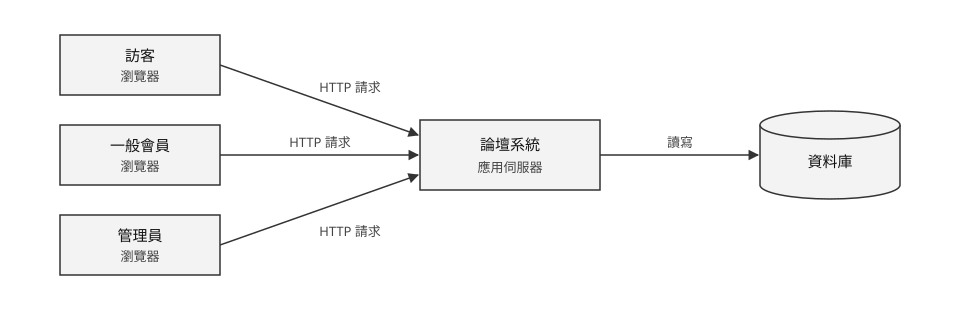
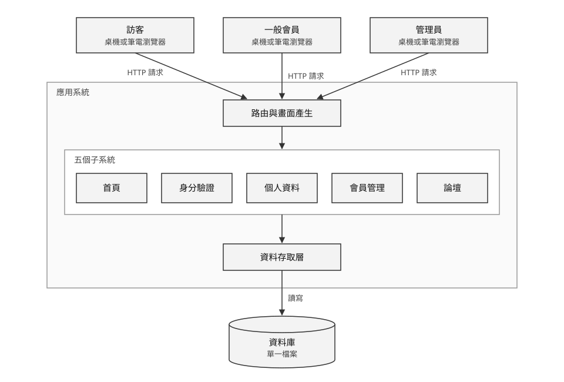
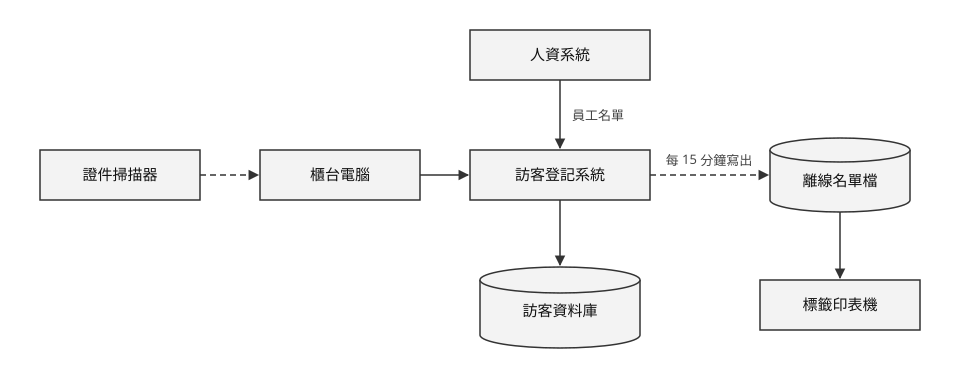

# 系統環境與架構

## 系統分析與設計（IE226）115-1

授課教師：呂卓勲

本課程教材：[GitHub](https://github.com/billy1125/system-analysis-and-design)

---

## 別人剛回的那一則在哪裡

會員停在某篇文章上，另一位會員剛送出一則回覆。

- 他的畫面上看不到這則回覆
- 重新整理之後才出現
- 系統沒有壞，架構本來就是這樣運作

> **架構回答的是：系統由哪些部分組成、各部分放在哪裡、彼此怎麼連。**

---

## 跟廠房布置圖是同一種思考

- 廠房布置圖：哪個工站在哪裡、東西怎麼從 A 送到 B
- 系統架構圖：同一種思考，流動的東西從物料換成資料
- 期中：看懂既有系統怎麼組成
- 期末：決定新系統放在哪裡、和誰連接

微服務、負載平衡這些名詞會出現，但只要聽得懂，不必用在報告裡。

---

## 本章的例子

- 課堂範例系統「論壇系統」`SAD-Forum`
- 對應「系統分析範例報告」〈8. 系統環境與整體架構理解〉

範例報告沒有的內容（架構決策的特徵、外部系統與現場設備、系統放在哪裡、架構受什麼限制、期末的架構決定），改用工廠訪客進出登記系統。

---

# 一、架構在回答什麼

到目前為止，系統在報告裡一直是抽象的東西：有功能、有流程、有資料。但它到底放在哪裡？會員按下送出之後，資料跑去哪裡了？

本節先看一張架構圖要回答的四個問題，再看為什麼架構層級的決定特別難改。

---

## 四個問題

| 問題 | 圖上要畫出來的東西 |
|---|---|
| 系統由哪些部分組成 | 使用者端、應用系統、資料庫，以及要串接的外部系統 |
| 每個部分放在哪裡 | 現場、公司機房還是雲端；哪些在公司裡面，哪些在外面 |
| 各部分怎麼連起來 | 哪一方向哪一方送出要求、資料往哪個方向傳、透過什麼網路 |
| 誰主動 | 用箭頭方向表示哪一方先送出要求，另一方只負責回應 |

---

## 「放在哪裡」最常被略過

系統放在公司機房還是雲端，決定了：

- 網路斷線時還能不能用
- 資料出不出得了公司
- 要不要租頻寬

> **這不是技術偏好，是會影響現場作業的決定。**

---

## 誰主動

- 瀏覽器操作的系統：使用者先送出要求，系統才回應
- 系統不會自己把新資料送到畫面上
- 論壇系統：「一律由瀏覽器發起，系統不主動推送」（範例報告〈8.1〉）
- 兩套系統相連時：甲系統主動送過去，還是乙系統定時去拿？

> **答案不同，傳送失敗時該由哪一方重送也不同。**

---

## 架構決策：難改，影響全局

- 按鈕顏色不喜歡，隨時可以換
- 「資料庫放在雲端」要改，就得搬資料、改連線、重新測試、重談網路合約
- 停電時也要拿得到在廠名單：多一條把資料寫到櫃台本機的路徑
- 選了純雲端：大門的網路品質就是系統可用性的上限

> **判斷方法：三個月後想改，要動到幾個地方？**

---

# 二、最基本的三段結構

幾乎所有商用資訊系統，都能先拆成使用者端、應用系統、資料庫三段。三段怎麼分工，決定了業務規則擋不擋得住。

本節從三段結構出發，接著看主從式架構與分層式架構，並對照論壇系統的原始碼。

---

## 使用者端、應用系統、資料庫

| 段 | 負責什麼 | 論壇系統的例子 |
|---|---|---|
| 使用者端（前端） | 顯示畫面、接收操作 | 訪客、會員與管理員電腦上的瀏覽器畫面 |
| 應用系統（後端） | 執行業務規則、處理請求 | 檢查權限、比對驗證碼、擋下管理員停用自己 |
| 資料庫 | 儲存與查詢資料 | `users`、`forum`、`forum_details` 三張表，存在單一檔案裡 |

實務上常把應用系統和資料庫合稱為「後端」。

---

## 業務規則放在應用系統

- 使用者端只顯示畫面、讓使用者輸入，不做判斷
- 讀寫資料一定透過應用系統，不直接連資料庫
- 「管理員不能停用自己」只靠藏起按鈕：繞過畫面直接送出請求，就能停用自己
- 寫在應用系統才擋得住（範例報告〈8.2〉）

> **分析階段整理出來的需求，多數落在中間那一段。**

---

## 主從式架構（Client-Server）

- 使用者端（Client）發出請求，伺服器（Server）處理後回應
- 用瀏覽器開任何一個網站，都是這個模式
- 本課程期中分析的系統多半是這一類：使用者開瀏覽器操作，資料存在後端資料庫

---

## 線上遊戲也是主從式

- 遊戲程式是使用者端，只畫畫面、接收按鍵
- 按下「攻擊」，這個動作送到遊戲公司的伺服器
- 有沒有打中、扣多少血、掉了什麼寶物，由伺服器計算後回傳，再同步給同場玩家

> **判斷放在伺服器，因為玩家手上的程式可能被改寫。**

---

## 論壇系統的主從式架構

期中報告的最低要求：畫得出這張圖，說得出每個方框放在哪裡。

---

## 分層式架構

把應用系統內部再切開：

| 層 | 負責 |
|---|---|
| 表現層（Presentation） | 產生畫面、處理使用者輸入 |
| 業務邏輯層（Business Logic） | 執行規則、計算、流程控制 |
| 資料存取層（Data Access） | 與資料庫溝通 |

> **分層的目的是讓改動侷限在一層裡。**

---

## 分層與模組劃分

- 換一套資料庫，理論上只要改資料存取層
- 改一條業務規則，只動業務邏輯層
- 和「功能分析」模組劃分是同一個原則：高內聚、低耦合
- 模組依業務領域縱向切，分層依技術職責橫向切

---

## 論壇系統的分層

---

## 在原始碼裡看得出來

- 路由與畫面產生：表現層
- 五個子系統：業務邏輯層，各是 `blueprints/` 底下的一個資料夾
- 資料存取層：集中在 `db/`，不散在各子系統裡

> **期中不必推導分層決策，但看得出分工就畫進去，圖就說明了規則放在哪一層。**

---

## 延伸：MVC

- Model 管資料與規則，View 管畫面
- Controller 接收使用者的操作，決定要 Model 做什麼，再交給哪個 View 顯示
- 和三層式架構一樣是依職責切開程式，差別在 MVC 著重畫面與資料之間怎麼分工
- 許多網頁開發框架以它為基礎，報告不要求使用

---

# 三、外部系統與現場設備

工廠裡的資訊系統很少單獨存在，要和人資、ERP 等系統往來，還要接掃描器、印表機這些實體設備。

本節以訪客登記系統為例，說明外部系統與現場設備怎麼畫，以及為什麼要單獨標出來。

---

## 系統很少單獨存在

---

## 圖上要標出三件事

- 哪些是外部系統：人資系統在系統邊界之外
- 資料往哪個方向流：員工名單進來，是單向
- 哪些是現場設備：證件掃描器、標籤印表機

---

## 那條指向離線名單檔的虛線

- 不接任何外部系統，也不是使用者操作的路徑
- 存在的理由：需要在廠名單的時刻，正好是系統可能不能用的時刻

> **非功能需求會在圖上留下看起來多餘的線，把它畫出來並說明。**

---

## 現場設備要單獨標出來

| 設備 | 在架構上的角色 |
|---|---|
| 證件掃描器 | 輸入裝置，多半接在櫃台電腦上 |
| 門禁讀卡機 | 資料來源，可能自動送出刷卡紀錄（本次界外） |
| 標籤印表機 | 輸出裝置，印訪客證貼紙與離線名單 |
| 櫃台電腦 | 使用者端，但沒有不斷電系統 |

---

## 設備帶來的限制

- 掃描器的輸入格式
- 印表機的紙張與碳粉有沒有人補
- 櫃台電腦停電時完全不能用

> **分析時忽略它們，設計出來的系統到現場就用不了。**

---

## 推還是拉

- 人資系統把名單「推」過來，或訪客系統定時去「拉」：兩種設計，維護責任不同
- 期中：標出誰跟誰連、資料往哪個方向流就夠了
- 交換的內容、頻率、失敗怎麼處理：期末介面設計，題目有外部系統時才要交

---

# 四、系統放在哪裡

同一套系統，放在公司機房或放在雲端，斷線時能不能用、資料出不出得了公司，答案完全不同。

本節比較地端、雲端與混合三種型態，再看工廠網路分區帶來的限制。

---

## 地端、雲端與混合

| 型態 | 意思 | 特點 |
|---|---|---|
| 地端（On-premises） | 伺服器放在自己的機房 | 資料不出公司、網路斷了內部仍可用、要自己維護 |
| 雲端（Cloud） | 租用外部的運算與儲存服務 | 不必自購硬體、可彈性擴充、依賴對外網路 |
| 混合（Hybrid） | 兩者並用 | 敏感資料留地端，其他放雲端 |

---

## 製造現場會把天平拉回地端

- 網路可靠度：大門不能因為對外網路斷線就停止放行訪客
- 純雲端要撐過斷網，就得多設計本機暫存與事後同步
- 資料敏感度：生產數量、良率、客戶訂單，有些公司規定不出廠區

> **資料出不出廠區是管理決策，不是技術問題，分析時要問清楚。**

---

## 工廠網路是分區的

- 辦公網段、生產網段、機台控制網段之間可能有防火牆，甚至完全不通
- 伺服器放在辦公網段、平板在生產網段：技術上行得通，資安政策可能不允許

> **期中要問，期末要納入考量。導入時才發現，就得整套重來。**

---

# 五、架構受什麼限制

架構不是憑喜好選的。每一條非功能需求、每一個現場條件，都會在架構上留下痕跡。

本節說明非功能需求怎麼轉成架構要求、取捨怎麼寫，以及哪些現場條件沒得商量。

---

## 非功能需求決定架構

| 非功能需求 | 對架構的要求 |
|---|---|
| 生產時段可用率 99.5% | 不能有單點故障，或至少要能快速復原 |
| 現場斷網仍可回報 | 使用者端要有本機暫存能力 |
| 單次報到 60 秒內完成 | 伺服器要放得夠近，或減少不必要的查詢 |
| 來訪紀錄要留修改軌跡 | 資料庫要有異動紀錄的設計 |

---

## 寫理由，不是寫名稱

不要只寫「我們採用三層式架構」。說出架構的名稱只是分類。

> **要寫：「因為要求現場斷網仍可回報，所以使用者端採用可離線暫存的設計。」**

---

## 取捨無法避免

- 要高可用性，就要多備一套，成本上升
- 要資料不出廠區，就放棄雲端的彈性與免維護
- 要回應快，可能要犧牲一部分資料的即時一致性

> **說得出選了什麼、放棄了什麼、為什麼。**

---

## 現場條件沒得商量

- 大門櫃台沒有不斷電系統
- 警衛室白天日照直射螢幕
- 訪客在廠外只有行動網路
- 門口車輛太吵，聽不到提示音

> **這是工管背景的人在架構討論中最有貢獻的時候。**

---

# 六、期中與期末各做到哪裡

期中分析的是已經存在的系統，架構是從系統上觀察出來的；期末設計新系統，架構要自己決定，並說明理由。

本節分別說明兩個階段要交出什麼，以及使用環境表要回答哪些問題。

---

## 期中：從三個地方找線索

| 看什麼 | 看得出什麼 | 論壇系統 |
|---|---|---|
| 使用情境 | 使用者端有哪幾種 | 桌上型或筆記型電腦的瀏覽器 |
| 網址與登入方式 | 放在地端還是雲端、網路有沒有分區 | 在自己電腦上執行，改看 `docker-compose.yml`：只有一個服務 |
| 資料來源 | 有哪些外部系統 | 所有資料都由系統自己產生，寫明「無外部系統」 |

---

## 期中的最低要求

- 畫出使用者端、應用系統、資料庫與外部系統的關係
- 圖上回答四個問題：有哪些部分、在哪裡、怎麼連、誰主動
- 不必分析微服務、負載平衡或複雜的雲端服務設計

> **查過之後沒有外部系統，也要寫出來，不要略過不提。**

---

## 使用環境表

| 面向 | 要回答的 | 論壇系統（範例報告〈8.2〉） |
|---|---|---|
| 使用裝置 | 桌機、筆電、現場平板還是手機 | 桌上型或筆記型電腦的瀏覽器 |
| 行動裝置 | 版面有沒有針對小螢幕調整 | 未針對小螢幕調整，手機可開啟但操作不便 |
| 網路 | 一定要連線嗎，斷線時能不能暫存 | 需連線才能操作，無離線暫存 |
| 畫面產生方式 | 整頁重新載入，還是在原地更新 | 每次操作整頁重新載入 |

---

## 整頁重新載入，還是原地更新

- 整頁重新載入：伺服器每次產生一整頁畫面，畫面閃一下，網址跟著變
- 原地更新：只在背景拿回變動的那一小塊資料，畫面其他地方不動
- 分辨方法：按下送出，看整頁有沒有重新載入、網址有沒有變
- 論壇系統送出回覆後整頁重新載入，屬於前者

> **整頁重新載入的系統，使用者看到的永遠是上次載入時的資料。**

---

## 期末：決定新系統的架構

| 要說明 | 具體內容 |
|---|---|
| 系統放在哪裡 | 地端、雲端或兩者混合，以及為什麼 |
| 和誰連接 | 外部系統與現場設備，資料往哪個方向流，由誰主動 |
| 主要資料怎麼流動 | 資料從輸入、儲存到查詢，經過哪些部分 |
| 業務規則放在哪一層 | 檢查與判斷由哪一層負責，使用者端要不要做判斷 |
| 為什麼選這種架構 | 對應到哪幾條非功能需求或現場限制 |

---

## 理由是分數的關鍵

- 沒有寫理由的架構圖，只是一張示意圖
- 理由要接回非功能需求與現場限制
- 把非功能需求一條一條拿出來，說明每一條讓架構多了什麼或改了什麼

> **〈五、5.1〉那張對照表，就是這一段的大綱。**

---

## 靠架構避開可靠性問題

- 同步安排成「使用者操作時順便去查一次」：對方系統一慢，現場作業就卡住
- 改成定時在背景執行的同步流程：使用者操作時不必等對方回應

> **「外部系統掛掉會不會讓現場停工」，在架構上就解決了。**

---

## 期末的使用環境表多了什麼

期中那四項之外，再加上：

- 使用場域的物理條件、操作者狀態
- 同時使用人數與尖峰時段、資料量與保存年限、備份方式
- 「尖峰在交班前十分鐘，二十台終端同時送出」，會直接變成風險分析估計機率的依據

> **這幾項不是背景介紹，是設計時必須滿足的條件。**

---

# 七、聽得懂就好的進階概念

微服務、負載平衡、高可用性這些名詞在業界常出現。本課程不要求在報告裡使用，但要聽得懂。

這一節的用意是劃界線：用在規模不對的題目上，只會讓報告看起來像在堆名詞。

---

## 三個常聽到的名詞

| 名詞 | 意思 | 本課程 |
|---|---|---|
| 單體與微服務 | 整套做成一個程式，或拆成許多可單獨更新的小服務 | 課程規模一律用單體 |
| 負載平衡 | 把大量請求分散到多台伺服器 | 同時上線人數不多，用不到 |
| 高可用性 | 用備援讓系統在部分故障時仍能運作 | 看停機一小時的損失有多大 |

> **選一個做得到、說得清楚、對得上需求的架構。**

---

## 本章重點回顧

- 架構圖回答四個問題：有哪些部分、放在哪裡、怎麼連、誰主動
- 業務規則放在應用系統，不能只靠畫面擋
- 工廠的外部系統、現場設備與分區網路要單獨標出來
- 架構是被非功能需求逼出來的，選了什麼、放棄了什麼都要寫
- 規模不對的架構是扣分不是加分

---

## 下一章

本章決定了系統放在哪裡、和誰連接。

下一章「可行性、限制與風險分析」把設計拿去和現實對帳：預算、時程、人力、場地與組織條件撐不撐得住，哪些既定限制不能碰，哪些事情可能出錯。
