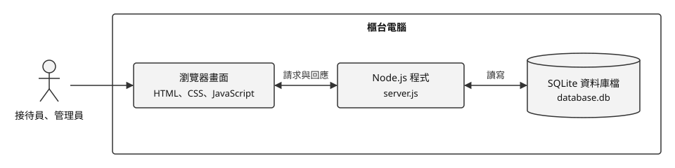
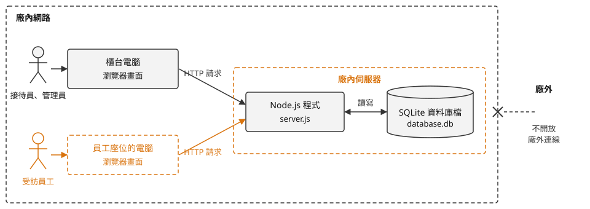
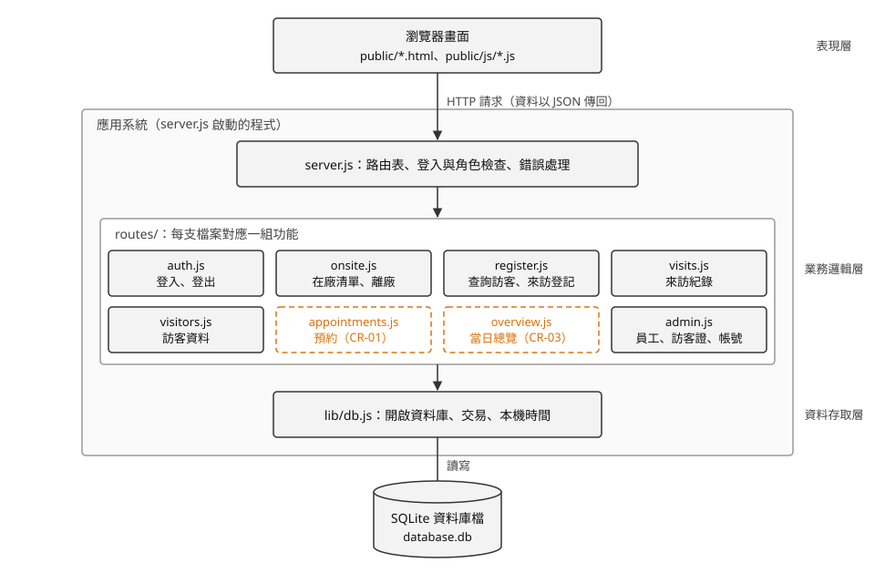

# 系統環境與架構

## 系統分析與設計（IE226）115-1

授課教師：呂卓勲

本課程教材：[GitHub](https://github.com/billy1125/system-analysis-and-design)

---

## 訪客報到了，預約為什麼還是「已預約」

受訪員工開著「我的預約」，接待員剛在櫃台替他的訪客報到。

- 他的畫面上，那筆預約仍是「已預約」
- 重新整理之後才變成「已報到」
- 系統沒有壞，架構本來就是這樣運作

> **架構回答的是：系統由哪些部分組成、各部分放在哪裡、彼此怎麼連。**

---

## 跟廠房布置圖是同一種思考

- 廠房布置圖：哪個工站在哪裡、東西怎麼從 A 送到 B
- 系統架構圖：同一種思考，流動的東西從物料換成資料
- 期中：看懂既有系統怎麼組成
- 期末：第 1 項一句話交代；修改動到系統放在哪裡時，才用到「系統放在哪裡」的判斷

微服務、負載平衡這些名詞會出現，但只要聽得懂，不必用在報告裡。

---

## 本章的例子

- 工廠訪客進出登記系統的修改版 `SAD-Visitor-Revised`
- 依「期末範例報告」修改：系統從櫃台的一台電腦搬到廠內伺服器（CR-01-5、NFR-02）
- 修改前的樣子取自「系統分析報告」〈8. 系統環境與整體架構理解〉

兩者對照，看得出「放在哪裡」一改，架構圖上有哪些東西跟著變。

---

# 一、架構在回答什麼

到目前為止，系統在報告裡一直是抽象的東西：有功能、有流程、有資料。但它到底放在哪裡？接待員按下報到之後，資料跑去哪裡了？

本節先看一張架構圖要回答的四個問題，再看為什麼架構層級的決定特別難改。

---

## 四個問題

| 問題 | 圖上要畫出來的東西 |
|---|---|
| 系統由哪些部分組成 | 使用者端、應用系統、資料庫，以及要串接的外部系統 |
| 每個部分放在哪裡 | 現場、公司機房還是雲端；哪些在公司裡面，哪些在外面 |
| 各部分怎麼連起來 | 哪一方向哪一方送出要求、資料往哪個方向傳、透過什麼網路 |
| 誰主動 | 用箭頭方向表示哪一方先送出要求，另一方只負責回應 |

---

## 「放在哪裡」最常被略過

系統放在公司機房還是雲端，決定了：

- 網路斷線時還能不能用
- 資料出不出得了公司
- 要不要租頻寬

> **這不是技術偏好，是會影響現場作業的決定。**

---

## 誰主動

- 瀏覽器操作的系統：使用者先送出要求，系統才回應
- 系統不會自己把新資料送到畫面上
- 訪客系統：「一律由使用者在畫面上操作，系統不主動做任何事」（系統分析報告〈8.1〉），修改版也一樣
- 兩套系統相連時：甲系統主動送過去，還是乙系統定時去拿？

> **答案不同，傳送失敗時該由哪一方重送也不同。**

---

## 架構決策：難改，影響全局

範例 CR-01-5 只把系統從櫃台電腦搬到廠內伺服器，畫面一個都沒改，卻牽動：

- 非功能需求 NFR-02、驗收案例 TC-09
- 管理員要負責伺服器上的資料庫檔
- 資訊單位要提供伺服器、開放廠內網路、定期備份

> **判斷方法：三個月後想改，要動到幾個地方？**

---

# 二、最基本的三段結構

幾乎所有商用資訊系統，都能先拆成使用者端、應用系統、資料庫三段。三段怎麼分工，決定了業務規則擋不擋得住。

本節從三段結構出發，接著看主從式架構與分層式架構，並對照訪客系統修改前後的架構與原始碼。

---

## 使用者端、應用系統、資料庫

| 段 | 負責什麼 | 訪客系統（修改版）的例子 |
|---|---|---|
| 使用者端（前端） | 顯示畫面、接收操作 | 櫃台電腦與員工座位電腦上的瀏覽器畫面 |
| 應用系統（後端） | 執行業務規則、處理請求 | 檢查登入與角色、擋下受訪員工存取別人的預約、擋下管理員停用自己 |
| 資料庫 | 儲存與查詢資料 | 7 張資料表，存在單一檔案 `database.db` 裡 |

實務上常把應用系統和資料庫合稱為「後端」。

---

## 業務規則放在應用系統

- 使用者端只顯示畫面、讓使用者輸入，不做判斷
- 讀寫資料一定透過應用系統，不直接連資料庫
- 每個請求進來，`server.js` 先依角色判斷能不能用這個功能
- 範例 NFR-07：受訪員工只能存取自己的預約，由伺服器端檢查；TC-03 直接呼叫修改別人預約的功能，確認被拒絕

> **分析階段整理出來的需求，多數落在中間那一段。**

---

## 主從式架構（Client-Server）

- 使用者端（Client）發出請求，伺服器（Server）處理後回應
- 用瀏覽器開任何一個網站，都是這個模式
- 本課程分析的系統都是這一類：使用者開瀏覽器操作，資料存在後端資料庫

---

## 線上遊戲也是主從式

- 遊戲程式是使用者端，只畫畫面、接收按鍵
- 按下「攻擊」，這個動作送到遊戲公司的伺服器
- 有沒有打中、扣多少血、掉了什麼寶物，由伺服器計算後回傳，再同步給同場玩家

> **判斷放在伺服器，因為玩家手上的程式可能被改寫。**

---

## 修改前：全在櫃台的一台電腦上

> **瀏覽器和 server.js 在同一台電腦，仍是主從式：講的是兩支程式的分工，不一定是兩台機器。**

---

## 修改後：搬到廠內伺服器

橘色是修改後才有的部分。期中報告的最低要求：畫得出這種圖，說得出每個方框放在哪裡。

---

## 這張圖回答了四個問題

- 有哪些部分：兩種使用者端、`server.js`、資料庫檔，沒有外部系統
- 在哪裡：廠內伺服器與各自的電腦，廠外連不進來
- 怎麼連：透過廠內網路送出 HTTP 請求
- 誰主動：箭頭一律從瀏覽器出發

期末範例報告沒有畫架構圖，這張是依 NFR-02 與修改版的原始碼畫的。

---

## 分層式架構

把應用系統內部再切開：

| 層 | 負責 |
|---|---|
| 表現層（Presentation） | 產生畫面、處理使用者輸入 |
| 業務邏輯層（Business Logic） | 執行規則、計算、流程控制 |
| 資料存取層（Data Access） | 與資料庫溝通 |

> **分層的目的是讓改動侷限在一層裡。**

---

## 分層與模組劃分

- 換一套資料庫，理論上只要改資料存取層
- 改一條業務規則，只動業務邏輯層
- 和「功能分析」模組劃分是同一個原則：高內聚、低耦合
- 模組依業務領域縱向切，分層依技術職責橫向切

---

## 訪客系統（修改版）的分層

---

## 在資料夾結構裡看得出來

- 表現層：`public/` 的畫面，在瀏覽器裡執行，向伺服器拿資料再填進畫面
- 業務邏輯層：`server.js` 統一檢查登入與角色，`routes/` 每支檔案負責一組功能
- 資料存取：`lib/db.js` 負責連線與交易，但 SQL 寫在 `routes/` 各檔裡
- CR-01 的預約、CR-03 的當日總覽，各是 `routes/` 新增的一支檔案

> **看得出分工就畫進去；看不出來的地方也照實寫。**

---

## 延伸：MVC

- Model 管資料與規則，View 管畫面
- Controller 接收使用者的操作，決定要 Model 做什麼，再交給哪個 View 顯示
- 和三層式架構一樣是依職責切開程式，差別在 MVC 著重畫面與資料之間怎麼分工
- 許多網頁開發框架以它為基礎，報告不要求使用

---

# 三、外部系統與現場設備

工廠裡的資訊系統多半要和人資、ERP 等系統往來，還可能接掃碼槍、讀卡機這些實體設備。

本節說明外部系統與現場設備怎麼標，以及查過之後一個都沒有時，為什麼也要寫出來。

---

## 查過沒有，也要寫出來

- 範例〈3.4〉：「系統沒有任何外部系統或設備介接」，修改後仍然沒有
- 人資部提供員工名單：交給管理員在系統裡建帳號，兩套系統之間沒有連線
- CR-03-2 匯出的 CSV：管理員下載留存，接收的是人，不是另一套系統

> **把界外的功能納入，架構圖就多一個方框：例如「與人資系統同步」。**

---

## 現場設備要單獨標出來

- 工廠多了一類與實體世界接觸的設備：掃碼槍、讀卡機、標籤印表機、工業平板
- 帶來辦公室系統沒有的限制：輸入格式、耗材、接在哪台電腦、停電怎麼辦
- 訪客系統沒有接設備：訪客證由接待員親手收發，系統只記錄綁在哪筆來訪

> **分析時忽略它們，設計出來的系統到現場就用不了。**

---

## 推還是拉

- 人資系統把名單「推」過來，或訪客系統定時去「拉」：兩種設計，維護責任不同
- 期中：標出誰跟誰連、資料往哪個方向流就夠了
- 交換的內容、頻率、失敗怎麼處理：屬於介面設計
- 期末只有修改方向涉及匯出或匯入時，才在第 11 項寫出檔案的欄位與格式（範例〈11.3〉的 CSV）

---

# 四、系統放在哪裡

同一套系統，放在公司機房或放在雲端，斷線時能不能用、資料出不出得了公司，答案完全不同。

本節比較地端、雲端與混合三種型態，再看工廠網路分區帶來的限制。

---

## 地端、雲端與混合

| 型態 | 意思 | 特點 |
|---|---|---|
| 地端（On-premises） | 伺服器放在自己的機房 | 資料不出公司、網路斷了內部仍可用、要自己維護 |
| 雲端（Cloud） | 租用外部的運算與儲存服務 | 不必自購硬體、可彈性擴充、依賴對外網路 |
| 混合（Hybrid） | 兩者並用 | 敏感資料留地端，其他放雲端 |

---

## 製造現場會把天平拉回地端

- 網路可靠度：大門不能因為對外網路斷線就停止放行訪客
- 資料敏感度：訪客系統存了手機與完整身分證字號（範例〈4.5〉）
- 範例的 NFR-02 選地端：廠內一台伺服器，不開放廠外連線

> **資料出不出廠區是管理決策，不是技術問題，分析時要問清楚。**

---

## 工廠網路是分區的

- 辦公網段、生產網段、機台控制網段之間可能有防火牆，甚至完全不通
- 範例要讓大門櫃台與各部門座位的電腦都連得到伺服器
- 所以「開放廠內網路連線」列給資訊單位（範例〈13.1〉）

> **期中要問；期末修改動到系統放在哪裡時也要問。導入時才發現，就得整套重來。**

---

# 五、架構受什麼限制

架構不是憑喜好選的。每一條非功能需求、每一個現場條件，都會在架構上留下痕跡。

本節說明非功能需求怎麼轉成架構要求、取捨怎麼寫，以及哪些現場條件沒得商量。

---

## 非功能需求決定架構

| 非功能需求 | 對架構的要求 |
|---|---|
| NFR-02 廠內伺服器、瀏覽器連線、不開放廠外 | 應用系統與資料庫檔放伺服器並開放其他電腦連線；廠外連不連得到，由廠內網路設定決定 |
| NFR-07 受訪員工只能存取自己的預約 | 權限檢查放在應用系統，每個請求都檢查 |
| NFR-05 時間記錄本機時間（不變） | 「本機」變成伺服器：時間由伺服器的時鐘寫入 |

> **需求的文字沒變，架構一改，意思可能就變了。**

---

## 寫理由，不是寫名稱

不要只寫「我們採用主從式架構」。說出架構的名稱只是分類。

> **要寫：「因為受訪員工要在座位上登錄預約，所以系統從櫃台電腦搬到廠內伺服器。」**

---

## 取捨無法避免

- 要高可用性，就要多備一套，成本上升
- 要資料不出廠區，就放棄雲端的彈性與免維護
- CR-01-5 的代價：修改前不需要網路；修改後伺服器與廠內網路都要正常，櫃台才能登記
- 上線當天登記停擺超過 15 分鐘，就退回舊版（範例〈15.1〉）

> **說得出選了什麼、放棄了什麼、為什麼。**

---

## 現場條件沒得商量

- 哪裡有網路線、插座與不斷電系統
- 螢幕會不會被日照直射、現場吵不吵
- 訪客系統只支援 1280 像素以上的桌機螢幕：受訪員工的座位上要有電腦

> **這是工管背景的人在架構討論中最有貢獻的時候。**

---

# 六、期中與期末各做到哪裡

期中分析的是已經存在的系統，架構是從系統上觀察出來的；期末各題的架構相同，不列架構項目，一句話交代就好。

本節先說明期中要交出什麼、使用環境表要回答哪些問題，再看期末什麼時候不只一句話。

---

## 期中：從三個地方找線索

| 看什麼 | 看得出什麼 | 訪客系統 |
|---|---|---|
| 使用情境 | 使用者端有哪幾種 | 修改前只有櫃台電腦；修改後多了員工座位的電腦 |
| 網址與啟動方式 | 放在地端還是雲端、其他電腦連不連得進來 | 現行版只接受同一台電腦的連線；修改版多一項啟動設定，其他電腦才連得進來 |
| 資料來源 | 有哪些外部系統 | 所有資料都由櫃台人員輸入，寫明「無外部系統」 |

---

## 期中的最低要求

- 畫出使用者端、應用系統、資料庫與外部系統的關係
- 圖上回答四個問題：有哪些部分、在哪裡、怎麼連、誰主動
- 不必分析微服務、負載平衡或複雜的雲端服務設計

> **查過之後沒有外部系統，也要寫出來，不要略過不提。**

---

## 使用環境表

| 面向 | 要回答的 | 修改前 | 修改後 |
|---|---|---|---|
| 使用裝置 | 桌機、筆電、現場平板還是手機 | 櫃台的一台桌上型電腦 | 櫃台與員工座位的電腦 |
| 行動裝置 | 版面有沒有針對小螢幕調整 | 不支援 | 不支援，只針對 1280 像素以上的桌機螢幕 |
| 網路 | 一定要連線嗎，斷線時能不能暫存 | 不需要網路 | 需要廠內網路，無暫存；不開放廠外 |
| 畫面產生方式 | 整頁重新載入，還是在原地更新 | 在原地更新 | 在原地更新 |

---

## 整頁重新載入，還是原地更新

- 整頁重新載入：伺服器每次產生一整頁畫面，畫面閃一下，網址跟著變
- 原地更新：畫面檔固定，只在背景拿回需要的資料填進畫面
- 分辨方法：按下送出，看整頁有沒有重新載入、網址有沒有變
- 訪客系統在廠清單按「離廠」後，只有清單重新整理，屬於後者

> **只要系統不主動推送，使用者看到的就是上次拿資料時的樣子。**

---

## 期末：一句話交代架構

- 各題架構相同：HTML + CSS + JS 畫面，一支 Node.js 小程式讀寫 SQLite 資料庫檔，本機端執行
- 期末不列架構項目、不畫架構圖，在第 1 項用一句話交代
- 範例報告〈1.1〉：「系統裝在櫃台的一台電腦上……系統不連接其他系統。」
- 權限類的修改，仍要寫明由伺服器端檢查（範例 NFR-07、TC-03）

---

## 修改動到系統放在哪裡

範例 CR-01-5：系統從櫃台電腦移到廠內伺服器，受訪員工才用得到。

| 期末項目 | 範例寫了什麼 |
|---|---|
| 第 5 項 | 列成變更需求，註明是 CR-01-1 的前提 |
| 第 9 項 | 修改 NFR-02：廠內伺服器、瀏覽器連線、不開放廠外連線 |
| 第 12 項 | TC-09：從另一台員工電腦開啟系統網址 |
| 第 13 項 | 資訊單位提供伺服器、開放廠內網路、定期備份 |

> **這時〈四〉的問題就要回答：放在哪裡、哪些網段連得到。**

---

# 七、聽得懂就好的進階概念

微服務、負載平衡、高可用性這些名詞在業界常出現。本課程不要求在報告裡使用，但要聽得懂。

這一節的用意是劃界線：用在規模不對的題目上，只會讓報告看起來像在堆名詞。

---

## 三個常聽到的名詞

| 名詞 | 意思 | 本課程 |
|---|---|---|
| 單體與微服務 | 整套做成一個程式，或拆成許多可單獨更新的小服務 | 課程規模一律用單體 |
| 負載平衡 | 把大量請求分散到多台伺服器 | 同時上線人數不多，用不到 |
| 高可用性 | 用備援讓系統在部分故障時仍能運作 | 看停機一小時的損失有多大 |

> **選一個做得到、說得清楚、對得上需求的架構。**

---

## 本章重點回顧

- 架構圖回答四個問題：有哪些部分、放在哪裡、怎麼連、誰主動
- 業務規則放在應用系統，不能只靠畫面擋
- 外部系統、現場設備與分區網路要單獨標出來，沒有也要寫明
- 架構是被非功能需求逼出來的，選了什麼、放棄了什麼都要寫
- 規模不對的架構是扣分不是加分

---

## 下一章

本章交代了系統放在哪裡、和誰連接，對既有系統的分析就完整了。

下一章「修改需求與變更規格」轉到期末的修改建議書：整理變更需求、比對修改前後的流程、列出每項變更動到什麼，再寫出修改後的需求、規格與資料。
