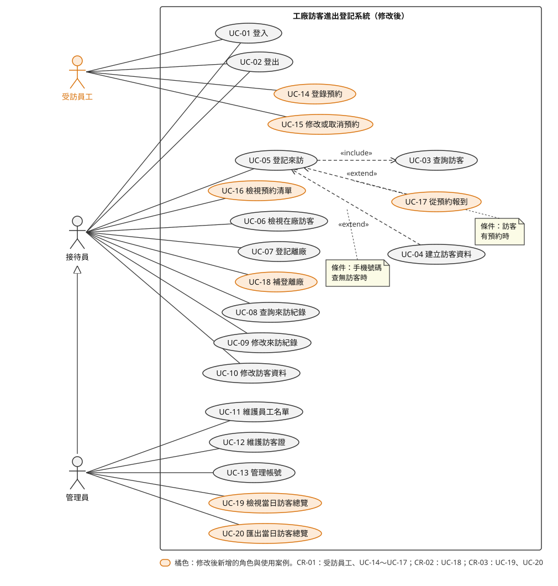
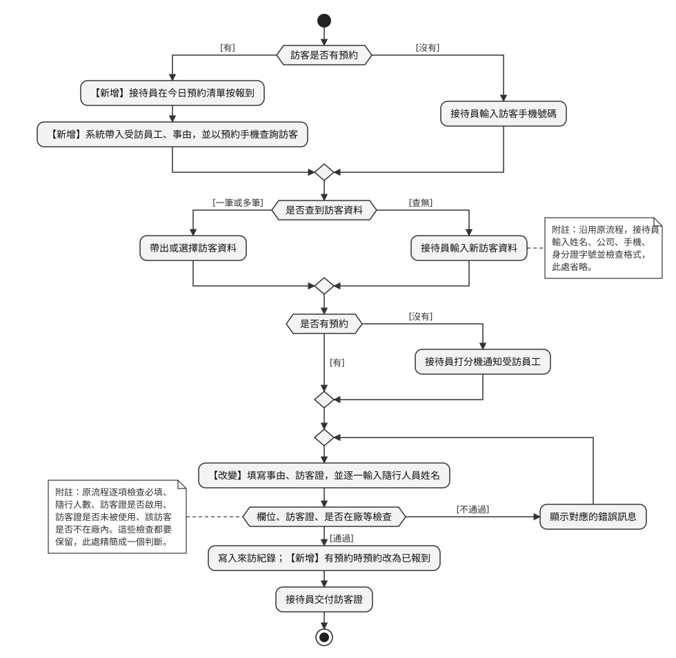
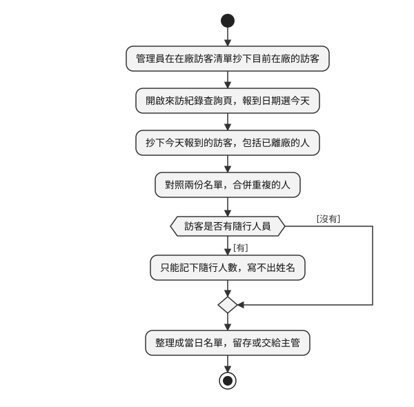
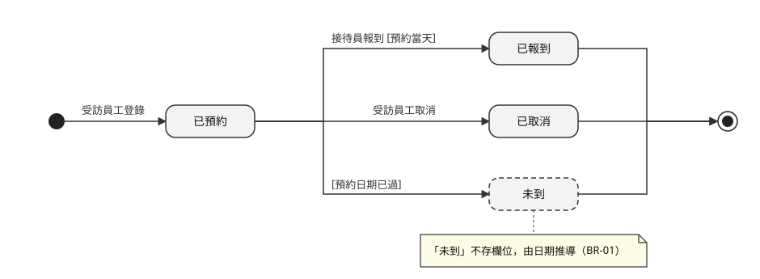
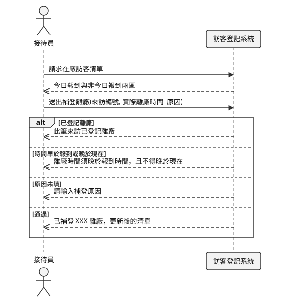
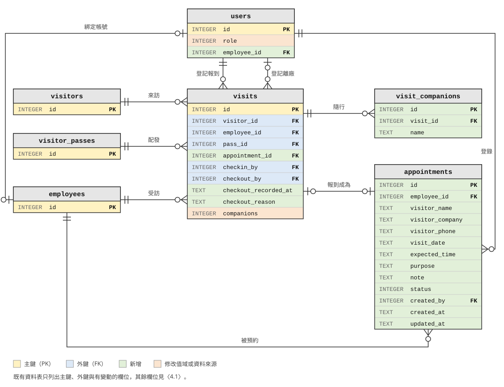

# 修改需求與變更規格

系統上線之後，需求還會再變：作業方式改了，主管希望系統多做一件當初沒規劃的事，工廠就依維護合約提出修改需求。這時不必重寫一份系統需求規格，也不是從零設計新系統，而是在既有的流程、需求與資料上交代 **哪些要新增、哪些要修改、哪些維持原樣**，讓每一次變更都被記錄、被評估、被決定（見[「系統需求分析」](04-System-Requirements-Analysis.md)〈六、6.2〉）。

本章處理期末報告中把「修改方向」變成「照著改、照著驗收的規格」的幾項：先重新看懂系統現在怎麼運作（第 1–4 項），再整理修改需求、對照修改前後的差異、列出會牽動什麼，最後寫出修改後的需求與資料（第 5、6、7、9、10 項）。這些項目用的方法大多在第 1–7 章學過，只是對象從「系統現在怎麼做」換成「改完之後怎麼做」，本章只補變更多出來的部分。

> **前情提要**：本章假設你已熟悉[「行為建模」](06-Behavioral-Modeling.md)〈二〉〈四〉的活動圖與循序圖、[「系統需求分析」](04-System-Requirements-Analysis.md)〈二〉〈三〉的需求寫法，以及[「資料建模與資料庫設計」](07-Data-Modeling.md)〈五〉的資料字典。例子全部取自[「期末範例報告」](../04-Final-Project-Example-Reports/Final-Phase-Sample-Report.md)，它依據的是[「工廠訪客進出登記系統：修改需求提案書」](../05-Final-Project-Topics/Change-Proposals/Visitor-System-Change-Proposal.md)，處理三項修改需求：CR-01「事前來訪預約與受訪員工確認」、CR-02「未離廠追蹤」與 CR-03「當日訪客總覽與匯出」。範例處理三項是上課講解用的，各組的提案書只有一項。依範例改完的系統見[「工廠訪客進出登記系統（修改版，SAD-Visitor-Revised）」](../05-Final-Project-Topics/Example-Systems/SAD-Visitor-Revised/README.md)。本章提到範例報告的小節一律寫成「範例〈x〉」，沒有加「範例」的〈〉指本章的小節。

> **延伸閱讀**：各項在報告中要交出什麼，見[「報告內容」](../00-Course-Introduction/Report-Contents.md)〈2.1 書面應包含的內容〉。

> **期末必讀標記**：標題後加註 🔵 期末必讀 的小節，是期末報告直接會用到的內容。判準與成品的樣子見[「期末範例報告」](../04-Final-Project-Example-Reports/Final-Phase-Sample-Report.md)。未標記的小節仍屬課程範圍，只是期末不會直接產出。

## 一、遇到系統修改需求時怎麼處理 🔵 期末必讀

### 1.1 你接到的工作 🔵 期末必讀

一間中型電子零件廠的大門櫃台，每天用一套訪客登記系統登記來訪、發訪客證、登記離廠。系統運作正常，但用了一段時間，三個單位各有抱怨：生產部經理說訪客到了才找人，找不到人就在門口等；工安課說在廠名單不準；總務課要掌握當天有哪些外來人員，得在幾個畫面之間自己對照。工廠依維護合約，把這三件事寫成一份修改需求提案書（提案書〈二〉）。

你是當初開發這套系統的公司派駐工廠的系統分析師。負責這套系統的同事已經離職，留下的文件也不完整，所以第一件事是 **重新看懂系統現在怎麼運作**：自己操作一遍，讀系統的 `README.md`，把流程、需求與資料整理出來。看懂之後，才把提案書整理成 **修改建議書**，寫清楚要改哪裡、怎麼改、改完怎麼驗收。

建議書寫好，要和主管與資深員工逐項討論，**經工廠簽核，開發才能開始**。你把建議書帶回公司，工程師照著它改程式，不清楚的地方回頭問你；系統改完，你再回到工廠，陪使用者照建議書裡的驗收標準逐項測試，通過了才上線。工程師照建議書寫程式，使用者照建議書驗收，建議書寫得含糊，後面每一步都會跟著錯。

> **延伸閱讀**：這段情境的完整版本與整個流程的漫畫，見[「報告內容」](../00-Course-Introduction/Report-Contents.md)〈二〉〈撰寫要點〉。

### 1.2 處理的順序 🔵 期末必讀

期末報告的 16 項，就是這份工作依序要做的事。後面每一項都要指回前面的編號，前面沒寫清楚，後面就沒有東西可以對。

| 步驟 | 要回答的問題 | 報告項目 | 教在哪裡 |
|:--:|---|---|---|
| 1 | 系統現在長什麼樣 | 第 1–4 項（第一部分） | 本章〈二〉 |
| 2 | 提案書要什麼，拆成哪幾條驗收得了的變更 | 第 5 項 修改需求整理 | 本章〈三〉 |
| 3 | 流程哪裡變了、哪裡沒變 | 第 6 項 差異分析 | 本章〈四〉 |
| 4 | 會牽動哪些角色、流程、需求、畫面與資料表 | 第 7 項 影響分析 | 本章〈五〉 |
| 5 | 值不值得改 | 第 8 項 效益評估 | [效益評估與上線準備](10-Benefit-and-Go-Live.md)〈二〉 |
| 6 | 改完之後系統要做到什麼 | 第 9 項 修改後的需求與功能規格 | 本章〈六〉 |
| 7 | 要新增或改動哪些欄位與資料表 | 第 10 項 資料變更 | 本章〈七〉 |
| 8 | 畫面怎麼改；匯出的檔案有哪些欄位 | 第 11 項 畫面設計 | [使用者介面設計](12-UI-Design.md)；匯出檔見[系統介面與資料交換設計](11-System-Interface-and-Data-Exchange.md)〈八〉 |
| 9 | 怎麼證明改對了 | 第 12 項 驗收標準與測試案例 | [系統設計規格與追溯](13-Design-Specification.md)〈四〉 |
| 10 | 現場怎麼換過去、出事怎麼退回 | 第 13–15 項 作業與組織衝擊、資料轉換規則、上線切換與回復原則 | [效益評估與上線準備](10-Benefit-and-Go-Live.md)〈三〉〈四〉〈五〉 |
| 11 | 每一項變更都追得回來嗎 | 第 16 項 需求追溯 | [系統設計規格與追溯](13-Design-Specification.md)〈三〉 |

有兩處要特別注意順序。**第 5 項的決議要最先定**：提案書留給各組決定的問題，例如預約有幾個狀態，會直接決定後面的資料表、畫面與驗收（見〈3.3〉）。**第 7 項是後面幾項的清單**：第 9–11、13、16 項要處理的需求、畫面、資料表與角色，都從影響分析接過來（見〈5.4〉）。寫到後面才發現影響分析漏了一項，要回頭補進影響分析，不要只補在後面。

### 1.3 修改的範圍 🔵 期末必讀

動手之前，有三件事先講清楚。

**「修改」是加入新功能，不是修正錯誤。** 提案書的三項都是工廠要系統多做的事：事前預約、補登離廠、當日總覽與匯出。系統本身還有其他問題，提案書〈六〉寫明這次不處理。

**你不寫程式。** 報告寫到需求、流程、資料與畫面為止（提案書〈六〉），工程師看報告就知道要動哪些畫面、欄位與規則。依建議書實際修改系統是可選的第 17 項，屬於[「額外投入加分」](../00-Course-Introduction/Bonus-Rules.md)。範例依建議書改完的結果就是 `SAD-Visitor-Revised`，操作它可以看到建議書的每一條改完長什麼樣子。

**提案書沒要求的，不要自己加。** 提案書〈六〉的限制是範圍只到這三項，改的時候碰到其他問題，寫出影響即可。範例的 CR-01 讓受訪員工登入，帳號要綁定員工名單裡的一位員工；員工名單仍由管理員手動維護，範例沒有順手把「與人資系統同步」做進來（範例〈3.4〉把它列在界外），而是在作業衝擊寫明由人資部提供名單、員工離職時通知管理員（範例〈13.1〉）。要和「自己加」分開的是 **不做就改不下去的前提**：CR-01-5 把系統搬到廠內伺服器，提案書沒有列成修改方向，但不搬，受訪員工在座位上就用不到預約功能。這種前提要列成變更需求，並寫明它是哪一條的前提（見〈3.2〉）。

## 二、先看懂現在的系統：第一部分由期中濃縮 🔵 期末必讀

第一部分「既有系統分析簡要報告」回答系統現在長什麼樣。四項都是期中做過的方法，只是篇幅縮小，各項由期中哪幾項濃縮見[「報告內容」](../00-Course-Introduction/Report-Contents.md)〈第一部分是期中的濃縮版〉。方法分別在這幾章：

| 期末項目 | 方法在哪裡 |
|---|---|
| 1 系統背景與角色 | [問題定義與現況分析](02-Problem-Definition.md)；[使用者分析](03-User-Analysis.md)〈四〉〈五〉 |
| 2 現況流程 | [行為建模](06-Behavioral-Modeling.md)〈二〉 |
| 3 現況功能與需求 | [系統需求分析](04-System-Requirements-Analysis.md)〈二〉〈三〉；[功能分析](05-Functional-Analysis.md)〈二〉〈三〉 |
| 4 現況資料 | [資料建模與資料庫設計](07-Data-Modeling.md) |

第一部分在整份報告裡是 **基準**。第二部分寫「FR-11 修改」「`visits` 新增一欄」「UI-02 多一個按鈕」，都要指回第一部分的編號與資料字典。下面兩節是第 3 項和期中寫法不同的兩處。

### 2.1 需求只列與修改有關的 🔵 期末必讀

第 3 項的需求清單，找法與寫法同[「系統需求分析」](04-System-Requirements-Analysis.md)〈二〉〈三〉，差別在範圍：只列與修改需求提案書有關的需求（範圍見[「報告內容」](../00-Course-Introduction/Report-Contents.md)〈2.1 書面應包含的內容〉第 3 項）。範例〈3.2〉列了 11 條功能需求，範例〈3.3〉列了 4 條非功能需求，其餘沒有列。

**編號跳號不是漏寫。** 範例的編號沿用同一套系統[「系統分析完整報告」](../04-Final-Project-Example-Reports/Visitor-System-Full-Analysis.md)〈4.1〉的編號，只挑出有關的幾條，所以範例〈3.2〉從 FR-12 直接跳到 FR-14、FR-18。不要為了連續而重新編號：第二部分寫「FR-11 修改」「新增的從 FR-19 開始」，都以這份編號為基準（見〈6.1〉）。

**功能需求表的第三欄換成「對應功能」**，填功能階層圖上的功能代號，把每條需求接到第 3 項的那張圖上。範例〈3.2〉節錄：

| 編號 | 功能需求 | 對應功能 |
|---|---|---|
| FR-07 | 接待員可登記來訪，填寫受訪員工、事由、隨行人數、車牌、備註並選擇訪客證，送出即記錄報到時間 | F-23 |
| FR-11 | 系統應列出所有在廠的訪客，並顯示在廠人數與隨行人數合計 | F-31 |
| FR-18 | 管理員可新增帳號、設定角色、啟用或停用帳號，但不得停用自己或修改自己的角色 | F-63 |

**非功能需求表的第三欄換成「與修改方向的關係」**，寫出這一條為什麼被挑出來：不是這次要改的，就是改的時候不能破壞的。範例〈3.3〉節錄：

| 編號 | 非功能需求 | 與修改方向的關係 |
|---|---|---|
| NFR-02 | 系統在櫃台的一台電腦上執行，資料存在同一台電腦的資料庫檔 | CR-01 要讓受訪員工在座位上使用，這一條必須改 |
| NFR-04 | 來訪紀錄不得刪除 | CR-02 處理忘記離廠的紀錄時，只能補登，不能刪掉重來 |

NFR-02 到了第二部分，在範例〈9.1〉標「修改」（見〈6.1〉）。NFR-04 沒有出現在第二部分，但它決定了 CR-02 的做法：忘記離廠的紀錄只能補登（FR-24），不能刪掉重來。第一部分先寫出這層關係，第二部分的寫法才有來處。

### 2.2 系統邊界用一段文字寫 🔵 期末必讀

第 3 項的系統邊界，只要用一段文字說明系統不做什麼（見[「報告內容」](../00-Course-Introduction/Report-Contents.md)〈2.1 書面應包含的內容〉第 3 項）。找法仍是[「功能分析」](05-Functional-Analysis.md)〈二、2.2〉的找痕跡：[「系統分析完整報告」](../04-Final-Project-Example-Reports/Visitor-System-Full-Analysis.md)〈5.3〉把界內、界外與如何確認列成表，範例〈3.4〉把那張表濃縮成一段話：

> 系統只處理訪客到廠後的現場登記、在廠與離廠，以及相關基本資料的維護。事前預約、通知受訪員工、訪客證實體的收發、隨行人員的個別資料、與人資系統同步、報表匯出都不在系統內：受訪員工由接待員打分機通知，訪客證由接待員親手收發，員工名單由管理員手動維護。系統沒有任何外部系統或設備介接。

這段話依序做了三件事。

**第一句寫界內。** 一句話交代系統負責的範圍。

**第二句列界外，並寫出這些事現在由誰處理。** 界外不等於沒人做：受訪員工靠接待員打分機通知，訪客證靠接待員親手收發，員工名單靠管理員手動維護。寫出由誰處理，第二部分才看得出修改會把哪一件事搬進系統。這段列出的界外事項中，事前預約（CR-01）、隨行人員的個別資料（CR-03-3）、報表匯出（CR-03-2）正是這次的修改方向。

**最後一句確認沒有外部介接。** 查過、確認沒有，也要寫出來，理由同[「功能分析」](05-Functional-Analysis.md)〈二、2.3〉：「查證後確認沒有」與「沒查所以沒寫」在文件上長得一模一樣。

## 三、修改需求整理 🔵 期末必讀

第 5 項「修改需求整理」把提案書的修改方向寫成正式的變更需求，並回答提案書留給各組決定的問題。做法分三步：先摘要提案書，再把每一項方向拆成變更需求，最後回答待決問題。變更需求的寫法沿用[「系統需求分析」](04-System-Requirements-Analysis.md)的需求寫法，本節只補變更多出來的部分。

### 3.1 先用自己的話摘要提案書 🔵 期末必讀

範例〈5.1〉每項修改方向寫一段，交代三件事：現況發生什麼問題、工廠希望改成什麼樣子、小組自己補上的前提。CR-01 那段的最後一句「系統目前只裝在櫃台一台電腦上，員工在座位上用不到，所以我們把系統移到廠內伺服器也列成一項變更需求」就是第三件；CR-03 那段的「做了 CR-01 之後，今天預約但還沒到、以及今天已取消的預約也要列進來」，則是小組看出的兩項修改方向之間的關係。三段之後用一句話交代去向：「三項需求在〈5.2〉拆成 10 項變更需求，提案書留給各組決定的問題在〈5.3〉回答」。

### 3.2 把修改方向拆成變更需求 🔵 期末必讀

修改需求提案書寫的是方向，例如 CR-01「事前來訪預約與受訪員工確認」。這一句話還不能驗收：誰來預約、預約後接待員怎麼用、沒有預約的訪客怎麼辦，都沒有說。修改需求整理要做的，是把一項方向拆成幾條 **變更需求**，每一條寫四個欄位：

| 欄位 | 寫什麼 |
|---|---|
| 編號 | 沿用提案書的編號再往下分，例如 CR-01 拆成 CR-01-1 到 CR-01-5 |
| 變更內容 | 系統要多做或改做的一件事，寫法同[系統需求分析](04-System-Requirements-Analysis.md)〈2.2〉的功能需求 |
| 理由 | 現場發生了什麼事，或它是哪一條變更需求的前提 |
| 優先順序 | 這一條排在哪一級 |

範例〈5.2〉的部分變更需求：

| 編號 | 變更內容 | 理由 | 優先順序 |
|---|---|---|:--:|
| CR-01-1 | 受訪員工以自己的帳號登入，登錄、修改、取消自己的來訪預約 | 現在訪客到了才打分機找人，找不到人時訪客在門口等 | 高 |
| CR-01-3 | 沒有預約的訪客仍可現場登記 | 送貨、臨時維修不可能都事先預約 | 高 |
| CR-01-5 | 系統從櫃台電腦移到廠內伺服器，員工從自己座位的電腦用瀏覽器使用 | CR-01-1 的前提。系統只在櫃台一台電腦上，受訪員工用不到 | 高 |
| CR-02-2 | 交班時核對未離廠紀錄，補登實際離廠時間與原因，系統記錄補登人 | 現在只能按「離廠」，離廠時間會變成補登當下，不是實際離開的時間 | 高 |
| CR-03-2 | 當日訪客總覽可匯出成 CSV | 總覽只能在畫面上看，要留存只能手抄 | 中 |

**一條變更需求只寫一件事，而且要寫到可驗證。**[「系統需求分析」](04-System-Requirements-Analysis.md)〈四〉的六項準則同樣適用。對照下面這種寫法：

> ❌ 讓管理員掌握當天的外來人員。

「掌握」可以是一個查詢畫面、可以是匯出、也可以是每天寄一份報表，驗收時說不清楚做到了沒有。範例把它拆成 CR-03-1「當日訪客總覽」與 CR-03-2「匯出成 CSV」兩條，各自驗收得了。

**提案書沒有列成修改方向、但不做就改不下去的前提，也要列成一條。** CR-01-5 就是這樣來的：提案書要受訪員工在座位上預約，也在缺點與〈待小組決議的問題〉提到系統只裝在櫃台一台電腦上，卻沒有要求搬移。不先搬到廠內伺服器，CR-01-1 根本做不了。範例因此在清單下方補一句先後順序：「CR-01-5 完成後才能做 CR-01-1，CR-01-1 完成後才能做 CR-01-2」。依賴寫出來，排上線順序時才知道哪幾條要一起上、哪幾條可以先上。

**優先順序分幾級沒有規定。** 範例只用「高」「中」兩級，也可以用[「系統需求分析」](04-System-Requirements-Analysis.md)〈五、5.1〉的 MoSCoW。要注意的是依賴關係：被依賴的那一條，優先順序不能比依賴它的低。CR-01-1 排高，它依賴的 CR-01-5 也必須排高。

### 3.3 回應待小組決議的問題 🔵 期末必讀

修改需求提案書只寫要解決什麼問題，不寫要怎麼改；每項需求的最後一節〈待小組決議的問題〉，把會影響後面寫法的選擇留給各組。這些問題沒有標準答案，但每一個都要回答，寫出 **決議** 與 **理由**。範例〈5.3〉的其中三題：

| 問題 | 決議 | 理由 |
|---|---|---|
| 預約的狀態有幾個 | 存三個：已預約、已報到、已取消。「未到」不存，由「預約日期早於今天且仍為已預約」推導 | 未到只是時間過了，不是有人做了什麼動作。存成欄位就要有人或排程每天去改 |
| 隨行人員要不要逐一建檔 | 只記姓名，不記手機與證件 | 總覽只需要知道廠內有誰。多記證件會拖慢登記速度，也會增加個資 |
| 補登的離廠時間怎麼驗證 | 必須晚於報到時間，且不得晚於補登當下；原因必填 | 這兩個條件擋得住明顯錯誤。時間是否真實無法由系統判斷，因此要求寫原因並記錄補登人，事後可以追問 |

**理由要寫出放棄了什麼。** 第一列沒有只寫「三個」，而是說明「未到」為什麼不存成狀態；第二列說明為什麼不記證件。這和[「系統需求分析」](04-System-Requirements-Analysis.md)〈三、3.4〉替每一條非功能需求寫出「它否決了什麼」是同一個寫法，沒寫放棄了什麼，讀者看不出這個決議的份量。

**先回答這些問題，再往下寫。** 決議會直接決定後面的資料表、畫面與驗收：預約狀態決定新資料表的狀態欄位有哪幾個值，隨行人員記多細決定新的隨行人員資料表有哪些欄位。決議定在第二部分的開頭，後面各項照著寫，前後才不會矛盾。

**每一個問題都要找得到答案寫在哪裡。** 範例的提案書共 12 個問題，範例〈5.3〉的表格只列 10 個：「系統只裝在櫃台電腦上」寫成了變更需求 CR-01-5，CSV 的欄位與匯出失敗的處理寫在畫面設計那一節（範例〈11.3〉）。表格前面用一段話交代共幾題、表格列了幾題，那 2 個寫在哪裡則註明在所屬的表格下方，讀者才不會以為漏答。

## 四、差異分析 🔵 期末必讀

期末分析的是一套已經在用的系統，行為模型要畫兩個版本：第一部分第 2 項畫 **現況（As-Is）** 的活動圖，第二部分第 6 項畫 **修改後（To-Be）** 的活動圖，並與現況對照。畫法和[「行為建模」](06-Behavioral-Modeling.md)〈二〉相同，多出來的要求只有一個：**讀者要看得出哪裡變了、哪裡沒變。** 修改後的循序圖屬於第 9 項，見〈6.3〉。

### 4.1 修改後的使用案例圖 🔵 期末必讀

修改後多出角色或使用案例時，第 6 項要附修改後的使用案例圖，放在這一項的開頭、活動圖之前；角色與使用案例都沒有增加，就不必畫。範例的修改多了一個角色與七個使用案例，畫法有三個要點：

- **整張重畫，新增的部分上色。** 不是只畫新增的那幾個橢圓，讀者要看得到新的使用案例和既有的接在哪裡。範例用橘色標出新增的角色與使用案例，現況的圖則留在第一部分（範例〈1.3〉）。
- **新的使用案例接續原本的編號。** 現況是 UC-01～UC-13，新增的從 UC-14 編起，舊的編號不動，第一部分的對照才不會亂掉。
- **附一張對照表，寫出每一項修改需求帶來哪些角色與使用案例。**

*本圖由作者自製*

| 需求 | 新增的角色與使用案例 |
|---|---|
| CR-01 | 角色「受訪員工」；UC-14 登錄預約、UC-15 修改或取消預約、UC-16 檢視預約清單、UC-17 從預約報到 |
| CR-02 | UC-18 補登離廠 |
| CR-03 | UC-19 檢視當日訪客總覽、UC-20 匯出當日訪客總覽 |

新增的關係也要畫對。UC-17「從預約報到」是登記來訪的另一種開始方式，只在訪客有預約時發生，所以畫成延伸 UC-05「登記來訪」，和現況的 UC-04「建立訪客資料」同一種關係（延伸關係見[「使用者分析」](03-User-Analysis.md)〈五、5.3〉）。受訪員工在第一部分是「不操作系統但受影響的人」，修改後變成使用者，這一點也要寫進第 7 項影響分析（範例〈7.1〉，見〈5.2〉）。

### 4.2 As-Is 與 To-Be 活動圖對照 🔵 期末必讀

**As-Is 是系統現在怎麼做，To-Be 是改完之後怎麼做。** As-Is 圖是操作既有系統整理出來的，畫法和期中的現況流程一樣。To-Be 圖則是拿 As-Is 圖來改：沒變的步驟保留，新的步驟加進去，做法不同的步驟改寫，再在方框前面加上標記：

| 標記 | 意思 | 範例報告的例子 |
|---|---|---|
| 【新增】 | 現況沒有的步驟 | 【新增】接待員在今日預約清單按報到 |
| 【改變】 | 現況有，但做法不同 | 【改變】填寫事由、訪客證，並逐一輸入隨行人員姓名（現況只填隨行人數） |
| 不加標記 | 沒有變 | 接待員輸入訪客手機號碼 |

標記不一定加在整個方框前面。一個方框裡只有一部分是新的，就只標那一部分，例如範例的「寫入來訪紀錄；【新增】有預約時預約改為已報到」；新的是一整條分支時，可以標在分支條件上，例如範例〈6.2〉離廠流程的「【新增】交班」。

先看範例〈2.1〉現況的來訪登記與發證：

*本圖由作者自製*

再看範例〈6.1〉修改後的同一條流程：

*本圖由作者自製*

兩張對照著看，有三件事要注意。

**整條舊流程可以變成新流程的一個分支。** 修改後的圖一開始多了「訪客是否有預約」的判斷，「有」的那一邊是新增的步驟，「沒有」的那一邊就是原本的現場登記。變更需求要求保留現場登記（CR-01-3），舊流程因此整條留下來。

**有些改變不在方框上，而在走法上。**「接待員打分機通知受訪員工」在兩張圖上寫法一樣，但修改後只有沒預約時才要打，有預約的訪客不必打分機。這種改變標不到方框上，要寫進差異對照表（見〈4.3〉）。

**沒變的部分可以畫得簡略，但不能拿掉。** 現況圖把必填與隨行人數、訪客證是否啟用、是否未被使用、該訪客是否不在廠內分成四個判斷，修改後的圖合成一個判斷，用附註寫明這些檢查都要保留；查無訪客時的建檔與格式檢查也一樣，用附註寫「沿用原流程」。這幾項檢查沒有改，細節回頭看 As-Is 圖就有。整段拿掉就不行，讀者會看不出新的步驟接在哪裡。

### 4.3 差異對照表 🔵 期末必讀

**刪除的步驟要另外交代。** 被刪除的步驟在 To-Be 圖上已經不存在，沒有方框可以加標記，所以圖畫完之後，要再整理一張差異對照表，每一條流程分新增、刪除、改變三欄寫。下表是範例〈6.1〉差異對照表的其中一列：

| 流程 | 新增 | 刪除 | 改變 |
|---|---|---|---|
| 來訪登記 | 從預約報到的分支；登記完成後更新預約狀態 | 無 | 有預約時省略打分機 |

完全新增的流程（例如受訪員工登錄預約）沒有 As-Is 圖可以對照，「新增」欄寫「整條流程」就好。CR-01 沒有刪除任何步驟，「刪除」欄寫「無」，範例在表下說明原因：現場登記要保留，舊流程整條都還在。**「刪除」欄寫「無」也是一個結論，要說得出為什麼。** 流程畫成泳道圖時，也可以照[「行為建模」](06-Behavioral-Modeling.md)〈二、2.3〉的方法，數一數修改前後跨泳道的箭頭差了幾條。

**現況沒有系統功能時，把人工流程畫成 As-Is。** 範例的 CR-03 要新增當日訪客總覽，現行系統沒有這個功能，管理員是在兩個畫面之間自己對照、手抄。範例〈6.3〉就把這段人工作業畫成 As-Is：

*本圖由作者自製*

這時「刪除」欄就不是「無」了，要填被系統取代的人工步驟：

| 流程 | 新增 | 刪除 | 改變 |
|---|---|---|---|
| 整理當日名單 | 開啟當日訪客總覽、匯出 CSV、匯出失敗時列印 | 在兩個畫面之間抄寫與對照 | 無 |

**一項修改需求的改變，可能出現在另一項的圖上。**〈4.2〉CR-01 的 To-Be 來訪登記圖裡，「逐一輸入隨行人員姓名」那一步其實屬於 CR-03-3。範例沒有為 CR-03 再畫一次來訪登記，而是兩邊各寫一句互相指引：CR-01 的圖下註明這一步屬於 CR-03-3；CR-03 那一節寫明它也改變了來訪登記，請讀者回頭看 CR-01 那張圖標【改變】的那一步，並在 CR-03 的差異對照表多列一行「來訪登記｜無｜無｜隨行人數改為逐一輸入姓名」。同一條流程只畫一次，每一項改變仍然找得到是哪一項修改需求造成的。

對照表寫完，再做兩項檢查：

- **圖上每一個【新增】【改變】，都要對得到一項變更需求。** 對不上，就是圖上改了變更需求沒要求的東西，或是變更需求漏寫了一項。
- **每一項會改變流程的變更需求，都要在某張 To-Be 圖上看得到。** 範例的 CR-01-5 只改系統的安裝位置，流程沒有變，所以需求追溯表範例〈16.1〉的流程欄寫「—」。

## 五、影響分析 🔵 期末必讀

差異分析畫出了流程怎麼變。但流程一變，牽動的不只流程：誰要多做事、哪條需求要改寫、哪個畫面要多一個按鈕、哪張資料表要多一個欄位。第 7 項影響分析把這些逐項列成一張清單。[「報告內容」](../00-Course-Introduction/Report-Contents.md)〈2.1 書面應包含的內容〉把第 7 項列為評「分析或設計深度」的主要材料。

### 5.1 一項 CR 一張表 🔵 期末必讀

範例每項 CR 一張表，四欄是「類別｜受影響的項目｜影響｜來自」。範例〈7.2〉CR-02 的那張最短，看得出完整的樣子：

| 類別 | 受影響的項目 | 影響 | 來自 |
|---|---|---|---|
| 角色 | 接待員 | 交班工作變多 | CR-02-1、2 |
| 流程 | 離廠登記 | 新增交班核對與補登離廠（範例〈6.2〉） | CR-02-1、2 |
| 需求 | FR-11 | 修改：在廠清單分成今日與非今日兩區 | CR-02-1 |
| 需求 | FR-12 | 修改：離廠多記錄登記時間 | CR-02-2 |
| 畫面 | UI-02 在廠訪客清單 | 修改：分區顯示、補登離廠按鈕 | CR-02-1、2 |
| 畫面 | UI-05 來訪明細與修改頁 | 修改：顯示離廠方式與離廠登記時間 | CR-02-2 |
| 資料表 | `visits` | 修改：新增 `checkout_recorded_at`、`checkout_reason`；`check_out_at` 改為實際離廠時間 | CR-02-2 |

| 欄位 | 寫什麼 |
|---|---|
| 類別 | 角色、流程、需求、畫面、資料表五類，依這個順序排 |
| 受影響的項目 | 既有的項目用第一部分的名稱與編號；新增的畫面接續編號，新增的資料表寫表名 |
| 影響 | 需求、畫面、資料表寫「新增」或「修改：改了什麼」；角色與流程直接寫改變的內容，流程註明在差異分析的哪一節 |
| 來自 | 這一列是哪一項變更需求造成的，寫到 CR-02-1 這一層 |

**受影響的項目一律用第一部分的編號。** 需求寫 FR-11，不寫「在廠清單功能」；畫面沿用系統 `README.md` 畫面對照表的編號，訪客系統是 UI-01～UI-09。第二部分每一處講的 FR-11 才會是同一條，讀者也能翻回第一部分看它原本的樣子。

**影響要寫到改了什麼。**「UI-02 受影響」只說了它會變；「修改：分區顯示、補登離廠按鈕」才告訴畫面設計要畫什麼。

### 5.2 從差異分析逐類找 🔵 期末必讀

找法是拿第 6 項差異分析標了【新增】【改變】的步驟，一個一個問下面五個問題：

| 類別 | 要問的 | 去哪裡對 |
|---|---|---|
| 角色 | 這個步驟誰做？他原本就做這件事嗎 | 第一部分的角色與權限表 |
| 流程 | 這個步驟屬於哪一條流程 | 第 6 項差異分析 |
| 需求 | 第一部分哪一條需求的文字要改寫 | 第一部分的功能需求與非功能需求清單 |
| 畫面 | 使用者在哪個畫面上做這個步驟 | 系統 `README.md` 的畫面對照表 |
| 資料表 | 這個步驟要記下什麼新資料，存在哪張表、哪一欄 | 第一部分的資料字典 |

角色這一類最容易漏掉兩種人。一種是 **從不操作系統變成使用者的人**：範例第一部分把受訪員工列在不操作系統但受影響的人，CR-01 讓他們登入系統，範例〈7.1〉第一列就寫「從『不操作系統的人』變成使用者，新增角色『受訪員工』」。另一種是 **畫面沒變、工作卻變了的人**：CR-01-5 把系統搬到廠內伺服器，管理員的畫面一個都沒改，影響分析仍寫了「要負責伺服器上的資料庫檔；需要資訊單位協助」。

**需求只列第一部分已有編號的。** 這次新增的需求還沒有編號，到第 9 項才編。CR-02-2 的補登離廠，在範例〈7.2〉寫成流程的新增與 FR-12、UI-02 的修改，到範例〈9.2〉才編成新的 FR-24。畫面與資料表則連新增的也列，標「新增」，例如 UI-10 預約清單與 `appointments` 資料表。

**同一個項目被兩項 CR 動到時，兩張表各列一次。** UI-03 來訪登記頁在範例〈7.1〉寫「修改：可由預約帶入」，在範例〈7.3〉寫「修改：隨行人數改為隨行人員姓名」，各寫各的改變，「來自」欄指向各自的變更需求。

**某一項變更在表裡沒有對應的列，也寫一句。** 範例在表下寫了「CR-01-4 只改顯示，沒有新流程」「CR-03-1、CR-03-2 只讀取既有資料，不新增欄位」。少了這一句，讀者分不出是沒有影響還是漏寫。

### 5.3 沒有動到的也要寫 🔵 期末必讀

三張表之後，範例用一段話交代沒有動到的部分：「三項都沒有動到的：其餘 FR、NFR 不變；`employees`、`visitors`、`visitor_passes` 三張表不變。修改後共 7 張資料表，定義見〈10〉。」

這一句證明其餘部分是查過的，不是漏了。寫法是拿第一部分的需求清單與資料表清單，把三張表都沒出現的項目整理成一句；資料表要寫出名稱，修改後的總數也要和第 10 項的實體關聯圖對得起來。

### 5.4 後面各項從這張表接 🔵 期末必讀

影響分析是後面幾項的清單，每一類都有一個去處：

| 後面的項目 | 從影響分析接什麼 | 範例 |
|---|---|---|
| 第 9 項 修改後的需求與功能規格（本章〈六〉） | 「需求」類，逐條改寫並標「修改」 | 範例〈7.2〉列了 FR-11、FR-12，範例〈9.2〉就有這兩條的修改版 |
| 第 10 項 資料變更（本章〈七〉） | 「資料表」類，逐欄寫出定義 | 範例〈7.2〉`visits` 的三處變動，就是範例〈10.2〉既有資料表變更的三列 |
| 第 11 項 畫面設計 | 「畫面」類，要畫的畫面就是這些 | 三張表共列了 7 個畫面，範例〈11〉逐一畫出 |
| 第 13 項 作業與組織衝擊 | 「角色」類，就是受訓對象 | 接待員、受訪員工、管理員，就是範例〈13〉的三類受訓對象 |
| 第 16 項 需求追溯 | 「需求」「資料表」「畫面」三類，對到追溯表的需求、資料、畫面三欄 | 範例〈7.2〉CR-02-2 的 FR-12、`visits` 欄位、UI-02 與 UI-05，在範例〈16.2〉CR-02-2 那一列都找得到 |

反過來說，後面任何一項出現影響分析沒有列的畫面、欄位或角色，不是影響分析漏了，就是後面多做了。交件前怎麼兩頭對，見[「系統設計規格與追溯」](13-Design-Specification.md)〈三〉。

## 六、修改後的需求與規格 🔵 期末必讀

變更需求說的是「要改什麼」，修改後的需求是「改完之後的規格」。第 9 項「修改後的需求與功能規格」把變更需求落回第一部分的需求清單，包含三塊：新增或修改的功能需求與非功能需求、業務規則、1–2 張修改後的循序圖。需求的寫法同[「系統需求分析」](04-System-Requirements-Analysis.md)〈二〉〈三〉，本節只補變更多出來的部分。

### 6.1 新增、修改、刪除 🔵 期末必讀

每一條修改後的需求，都要標明是哪一種變動：

| 類型 | 編號怎麼給 | 內容怎麼寫 |
|---|---|---|
| 新增 | 接續現況的最後一號。範例的現況到 FR-18，新增的從 FR-19 開始 | 完整的需求敘述 |
| 修改 | 保留原編號 | 修改後的完整敘述，不只寫改了哪裡 |
| 刪除 | 保留原編號，這個號碼不再給別的需求使用 | 刪除的理由 |

範例〈9〉的部分功能需求：

| 編號 | 類型 | 功能需求 | 來自 |
|---|---|---|---|
| FR-11 | 修改 | 在廠清單分成「今日報到」與「非今日報到」兩區，上方分別顯示人數，並顯示在廠隨行人數合計 | CR-02-1 |
| FR-19 | 新增 | 受訪員工可登錄預約：訪客姓名、公司、手機、預約日期、預計到達時間、事由與備註。預約日期不得早於今天 | CR-01-1 |
| FR-24 | 新增 | 接待員可對在廠紀錄補登離廠：輸入實際離廠時間與原因，系統記錄補登人與補登當下的時間 | CR-02-2 |

FR-11 的現況是「系統應列出所有在廠的訪客，並顯示在廠人數與隨行人數合計」。修改後寫的是整句新的敘述，不是「多分兩區」四個字。工程師照這份清單改程式、使用者照它驗收，只寫差異的話，他們得回頭翻第一部分把原句拼回來。

**編號不能重排。** 第一部分的需求編號是第二部分對照的基準：影響分析寫「FR-11 要改」，測試案例寫「驗證 FR-24」，編號一重排，這些對照全部對不上。刪除的需求保留編號，也是同一個道理。範例沒有刪除的需求，三項修改方向都只新增或修改功能。差異分析裡被刪除的只有 CR-03 取代的人工步驟「在兩個畫面之間抄寫與對照」（範例〈6.3〉），那是系統外的人工作業，需求清單上沒有對應的需求可刪。

**「來自」欄把每一條需求指回變更需求。** 一條變更需求可以產生好幾條需求：CR-01-1 新增了 FR-19、FR-20，也修改了 FR-04、FR-18。也可以一條都不產生：CR-01-3「沒有預約的訪客仍可現場登記」沿用現況的 FR-05～FR-10，範例就寫一句「不另立需求」交代。沒有任何需求指回的變更需求，要像這樣寫出原因，否則讀者會以為漏寫了。這一欄也是第 16 項需求追溯的起點。

**非功能需求同樣標類型，範例另外用了「不變」。** NFR-03「來訪登記應在單一頁面完成」這次沒有改，但 CR-01-2 新增的從預約報到也要遵守它，所以列出來標「不變」，提醒改的人不能破壞這一條。

### 6.2 業務規則 🔵 期末必讀

第 9 項除了功能需求與非功能需求，還要把 **業務規則（Business Rule, BR）** 寫清楚。業務規則是作業上的規定，不管畫面怎麼做都成立：功能需求說系統做什麼，業務規則說做的時候要守什麼。範例的業務規則表只有三欄：

| 欄位 | 寫什麼 |
|---|---|
| 編號 | BR 加兩位數 |
| 規則 | 一句話寫出規定 |
| 用在 | 哪幾條功能需求要遵守它；規則決定畫面上的顯示時，也寫畫面編號 |

範例〈9.2〉的三條：

| 編號 | 規則 | 用在 |
|---|---|---|
| BR-03 | 補登的離廠時間必須晚於報到時間，且不得晚於補登當下 | FR-24 |
| BR-04 | 一筆來訪紀錄是「補登離廠」，若且唯若補登原因有值 | FR-24、UI-05 |
| BR-07 | 「在廠」與「訪客證使用中」的推導規則不變，仍由離廠時間是否為空判斷 | FR-11、FR-24 |

**被好幾條需求共用的規定，抽出來寫一次。** BR-01 規定預約只有已預約、已報到、已取消三個狀態，用在 FR-19～FR-23 五條，寫進每一條，改一次就要改五處。BR-03 雖然只用在 FR-24，抽出來之後，測試案例 TC-12 才有明確的檢查對象。

**推導出來的狀態，要寫成規則。**〈3.3〉的決議是「未到」不存欄位，那畫面上的「未到」從哪來？BR-01 寫明由日期推導，FR-23 照著顯示。範例〈9.1〉在業務規則之後附了預約的狀態轉移圖，「未到」畫成虛線框，表示它不存成狀態值：

*本圖由作者自製*

BR-08 也一樣，把當日訪客總覽的五種狀態逐一寫出判斷條件。狀態不存欄位，規則就是它唯一的定義；沒寫下來，工程師和測試的人只能各自猜。狀態機圖的畫法見[「行為建模」](06-Behavioral-Modeling.md)〈五〉，期末列為可選項目。

**用業務的說法寫，不寫程式邏輯。** BR-08 寫的是「預約日期是今天且為『已預約』是『預約中』」，不是資料庫查詢語法或程式的判斷式。這是[「報告內容」](../00-Course-Introduction/Report-Contents.md)〈2.1 書面應包含的內容〉第 9 項的要求。

**沒有改的規則，也可能要寫。** CR-02-2 動到了 `check_out_at`，而「在廠」的判斷正好依賴這一欄。BR-07 明寫推導規則不變，讀者就不必自己猜。這和〈6.1〉非功能需求標「不變」是同一個用意。

**編號在整份報告中連續。** 第一部分沒有業務規則，範例從 BR-01 開始編到 BR-08。分到三項修改方向底下時編號不一定相連：範例〈9.1〉是 BR-01、BR-02、BR-06，範例〈9.2〉是 BR-03、BR-04、BR-07。範例〈9〉的開頭用一句話交代這件事，新增的非功能需求 NFR-07、NFR-08 也一樣。

### 6.3 修改後的循序圖 🔵 期末必讀

第 9 項要畫一到兩張修改後的循序圖。畫法和[「行為建模」](06-Behavioral-Modeling.md)〈四〉相同：系統仍是黑箱，訊息要寫出參數，每一條送進系統的訊息都要有回應，從使用者打開這個功能開始畫。

**和期中不同的是挑法：只畫受修改影響的互動。** 登入、現場登記這類修改沒碰到的互動，系統的行為沒有變，重畫一次只是把現況再抄一遍。範例挑的是 FR-22「從預約報到」與 FR-24「補登離廠」，兩個都是新增的功能，各有好幾種例外回應，又分別來自 CR-01 與 CR-02。

循序圖跟著修改需求分節放：範例的第 9 項依 CR-01、CR-02、CR-03 分成三節，每一節最後放該項的循序圖，標題寫出畫的是哪一條功能需求，例如「修改後的循序圖：補登離廠（FR-24）」。CR-03 沒有畫，那一節就寫一句不畫的理由，見[「行為建模」](06-Behavioral-Modeling.md)〈四、4.4〉。

下圖是範例〈9.2〉的補登離廠：

*本圖由作者自製*

圖上每一處，都對得回第二部分的其他項目：

| 圖上的位置 | 對回範例報告的哪裡 |
|---|---|
| 第一條回傳「今日報到與非今日報到兩區」 | 範例〈9.2〉修改後的 FR-11：在廠清單分兩區顯示 |
| `送出補登離廠(來訪編號, 實際離廠時間, 原因)` 的參數 | 範例〈10.2〉資料變更：`check_out_at` 改成實際離廠時間，新增 `checkout_reason` |
| `alt` 的「時間早於報到或晚於現在」 | 範例〈9.2〉業務規則 BR-03 |
| `alt` 的「已登記離廠」 | 現況就有的檢查（範例〈2.2〉），修改後沿用 |
| `alt` 裡時間與原因的錯誤回應 | 範例〈12.2〉測試案例 TC-12 的預期結果 |

**期末不必把黑箱打開。** 把系統拆成模組、畫出內部讀寫哪些資料表，屬於「程式要怎麼改」，依[「報告內容」](../00-Course-Introduction/Report-Contents.md)〈期末技術深度原則〉不列入必做。改了哪些資料表與欄位，寫在第 10 項資料變更（見〈七〉），不要畫進循序圖。

### 6.4 依修改方向分節 🔵 期末必讀

範例的第 9 項依 CR 分成範例〈9.1〉到〈9.3〉三節，每一節依序是四塊：功能需求、業務規則、非功能需求、修改後的循序圖。編號規則照〈6.1〉：新增的接續編號，修改的保留原編號並標類型。分節時有兩件事要處理。

**同一條需求受兩項修改方向影響，只列一次。** FR-07 同時被 CR-01-2（從預約報到時連結預約）與 CR-03-3（隨行人數改為隨行人員姓名）修改。這一條只在範例〈9.3〉列一次，敘述把兩處修改寫在同一句裡，「來自」欄寫「CR-01-2、CR-03-3」；範例〈9.1〉的功能需求表下方再用一句話交代「FR-07 同時受 CR-01-2 與 CR-03-3 影響，列在〈9.3〉」。兩節各列一次，就會出現兩個版本的 FR-07，工程師不知道照哪一個改。

**某一塊沒有變動，也寫一句話。** 範例〈9.2〉的非功能需求只有一句「CR-02 沒有新增或修改非功能需求」，範例〈9.3〉不畫循序圖，也寫了理由。空著不寫，讀者分不出是沒有，還是漏了。

> **延伸閱讀**：從變更需求一路連到流程、資料、畫面與測試案例的追溯鏈，見[「系統設計規格與追溯」](13-Design-Specification.md)〈三〉。

## 七、資料變更 🔵 期末必讀

期末的系統已經存在。第一部分第 4 項整理出的 ERD、Schema 與資料字典就是現況，做法和[「資料建模與資料庫設計」](07-Data-Modeling.md)〈六〉相同。第二部分第 10 項「資料變更」只寫這次修改要新增或改動的欄位與資料表：沒有動到的不重抄，也不從需求重新推導整套資料設計。本節的例子取自範例〈10〉資料變更與範例〈11〉畫面設計。

### 7.1 在既有資料字典上增修 🔵 期末必讀

**依修改需求分節寫。** 範例〈10〉依 CR-01、CR-02、CR-03 分成三節，每一節再分「新增資料表」與「既有資料表的變更」兩塊。某一塊沒有東西也要寫一句，例如「CR-02 沒有新增資料表」「CR-03-1、CR-03-2 只讀取既有資料，不新增欄位」，讀者才知道這是查過的結果，不是漏寫。

**新增的資料表，每一欄都要寫齊。** 新增的表在現況裡找不到，要照[「資料建模與資料庫設計」](07-Data-Modeling.md)〈五、5.1〉的格式一欄一欄寫。範例新增了 `appointments`（預約）與 `visit_companions`（隨行人員）兩張表，後者最短：

| 欄位名稱 | 中文名稱 | 型別 | 必填 | 值域／格式 | 資料來源 |
|---|---|---|---|---|---|
| `id` | 隨行人員編號 | INTEGER | 是 | 主鍵，系統流水號 | 系統產生 |
| `visit_id` | 來訪編號 | INTEGER | 是 | 對應 `visits.id` | 登記時帶入 |
| `name` | 隨行人員姓名 | TEXT | 是 | 1–20 字 | 接待員輸入 |

新增的表要接回既有的表，外鍵直接寫在值域欄，例如 `visit_id` 對應 `visits.id`。

**既有的資料表，只列有變動的欄位。** 欄位是資料字典的六欄前面加「資料表」、中間加「變更」，共八欄：資料表、欄位、變更、中文名稱、型別、必填、值域／格式、資料來源。「變更」寫明是哪一種改法。範例〈10〉三項需求的「既有資料表的變更」一共用到四種（節錄，省略中文名稱、型別與必填）：

| 資料表 | 欄位 | 變更 | 值域／格式 | 資料來源 |
|---|---|---|---|---|
| `visits` | `appointment_id` | 新增 | 對應 `appointments.id`；唯一；現場登記為 NULL | 從預約報到時寫入 |
| `users` | `role` | 修改值域 | `0` 管理員、`1` 接待員、`2` 受訪員工 | 管理員指定 |
| `visits` | `check_out_at` | 修改意義 | 改為「實際離廠時間」；補登時為接待員輸入的時間 | 系統寫入或接待員輸入 |
| `visits` | `companions` | 修改來源 | 0–20 | 改由系統依 `visit_companions` 的筆數寫入；舊資料保留原值 |

**後兩種最容易漏掉。** 欄位名稱和型別都沒變，看起來不必寫，但意思或來源變了，讀這一欄的畫面與報表都會受影響。這和[「資料建模與資料庫設計」](07-Data-Modeling.md)〈五、5.1〉提醒的「同一個欄位名稱，意思不一定一樣」是同一件事，只是發生在修改前後。

**既有的表加欄位時，要先問舊資料這一欄填什麼。** 上線前的紀錄沒有這一欄的值，範例在既有資料表新增的四個欄位都允許空白，並寫明空白代表什麼，例如 `appointment_id` 為 NULL 代表現場登記。範例的 `companions` 沒有改成查詢時推導，也是因為舊紀錄只有人數、沒有姓名。舊資料實際怎麼處理，寫在第 14 項資料轉換規則，見[「效益評估與上線準備」](10-Benefit-and-Go-Live.md)〈四〉。

### 7.2 與畫面的對應 🔵 期末必讀

期末第 11 項要求畫面上的欄位對回資料字典，對照表的寫法與會抓出的錯誤見[「使用者介面設計」](12-UI-Design.md)〈五〉。

從資料這一端看，要多注意一種情況：**畫面上的狀態，可能由好幾張表的欄位組合推導出來。** 範例新增的當日訪客總覽（UI-12）列出預約中、已取消、在廠、已離廠等狀態，沒有任何一張表有這個欄位。範例把它寫成業務規則 BR-08：預約日期是今天且為「已預約」是「預約中」，為「已取消」是「已取消」；來訪的離廠時間有值是「已離廠」，為空時依報到日期分成「在廠」與「在廠（非今日報到）」。用到的是 `appointments.status`、`appointments.visit_date`、`visits.check_in_at`、`visits.check_out_at` 兩張表的四個欄位。

範例〈5.3〉決定不存這個狀態，理由是它完全由既有欄位決定，存成欄位就要在每次登記、離廠、取消時同步更新，和「在廠」「未到」的推導方式一致比較好維護。這是[「資料建模與資料庫設計」](07-Data-Modeling.md)〈四、4.3〉那條標準的延伸：一個值只要算得出來、算的依據也不會被人改，即使要跨好幾張表才算得出來，也一樣用算的，只是推導規則要寫得更完整，每一種組合對應哪個狀態都要寫出來。

### 7.3 修改後的 ERD 🔵 期末必讀

資料表有增減時，才要附修改後的 ERD。範例〈10〉開頭的 ERD 只畫新增的資料表與變動的欄位，既有的表只留主鍵、外鍵與有變動的欄位，其餘欄位用一句「見〈4.1〉」指回第一部分，不把整張現況 ERD 重畫一次：

*本圖由作者自製*

圖例除了主鍵與外鍵，還把變動分成兩種顏色：「新增」標新的資料表與欄位，例如 `appointments`、`visits.appointment_id`；「修改值域或資料來源」標欄位名稱沒變、但內容改了的欄位，例如 `users.role` 多了一個值、`visits.companions` 改由隨行人員筆數寫入。這和使用案例圖剛好相反：使用案例圖整張重畫再標出新增的部分（見〈4.1〉），ERD 只畫有變動的部分。

新表和既有表之間的連線一定要畫，基數也要重新判斷。範例的 `visits.appointment_id` 設成唯一，因為一筆預約最多連結一筆來訪（BR-02），所以預約和來訪是一對一，不是一對多；`users.employee_id` 也設成唯一，一位員工最多綁定一個帳號。一對一怎麼實作，見[「資料建模與資料庫設計」](07-Data-Modeling.md)〈二、2.3〉。

### 7.4 不必做到的部分

索引（Index）、觸發程序（Trigger）、預存程序（Stored Procedure）、分割表、效能調校，這些是讓資料庫跑得更快，或在資料庫裡自動執行動作的技術，屬於資料庫實作的層次，**本課程列為可選**。做了不會在必做項目上加分；但報告裡如果寫了，訪談時要能說明為什麼需要。

分界是：**會影響「資料代表什麼意思」的，是必做；只影響「資料庫跑得快不快」的，是可選。** 主鍵、外鍵、必填、值域屬於前者；索引屬於後者。

資料庫遷移程式也不用寫。把既有資料庫改成新結構的程式，屬於「程式要怎麼改」的內容，不列入必做，見[「報告內容」](../00-Course-Introduction/Report-Contents.md)〈期末技術深度原則〉。

## 八、學習重點總結

讀完本章後，你應該能夠理解以下核心概念，並將其應用於工業場域的思考與決策：

**修改建議書是開發與驗收的共同依據**

工廠提出的修改需求，要經過系統分析師整理成修改建議書，和主管與資深員工逐項討論、簽核之後，工程師才照它改程式，使用者也照它驗收。「修改」是在既有系統上加入新功能，不是修正錯誤，分析師也不寫程式；提案書沒有要求的不自己加，但不做就改不下去的前提要列出來。建議書寫得含糊，後面每一步都會跟著錯。

**先看懂現況，現況的編號就是基準**

原開發者離職、文件不完整，是維護工作的常態，所以第一步是重新整理系統現在怎麼運作。第一部分由期中濃縮，流程與需求只寫與提案書有關的部分，但編號沿用完整分析，不為了連續而重排。第二部分講的每一處修改，都要指回這份編號與資料字典；邊界寫出界外的事現在由誰處理，才看得出修改把哪件事搬進系統。

**方向要拆成驗收得了的變更，決議要最先定**

提案書寫的是方向，一句話還不能驗收。修改需求整理把每一項方向拆成一條只寫一件事、可以驗證的變更需求，寫出理由、優先順序與彼此的依賴。提案書留給各組的問題要逐一回答，理由寫出放棄了什麼；這些決議決定了後面的資料表、畫面與驗收，定得越早，前後越不會矛盾。

**差異分析要讓人看出哪裡變了、哪裡沒變**

To-Be 圖是拿 As-Is 圖來改，新增與改變的步驟加上標記，刪除的步驟寫進對照表。「刪除」欄寫「無」也是一個結論，要說得出為什麼；現況沒有系統功能時，把人工作業畫成 As-Is，被取代的人工步驟才有地方寫。圖上每一個標記都要對得到一項變更需求，每一項會改變流程的變更需求也都要在圖上看得到。

**影響分析是後面各項的清單**

流程一變，牽動的是角色、需求、畫面與資料表。影響分析用第一部分的編號逐類列出，寫到改了什麼，沒動到的也寫一句。後面的規格、資料、畫面、教育訓練與需求追溯都從這張表接；後面冒出表上沒有的項目，不是這裡漏了，就是後面多做了。

**修改後的規格要完整，規則與資料的改變不能只看名稱**

修改後的需求寫整句新的敘述，保留原編號並標類型，「來自」欄指回變更需求。共用的規定抽成業務規則寫一次，推導出來的狀態一定要寫成規則，沒改的規則必要時也要寫明不變。資料變更只寫動到的欄位與資料表，但欄位名稱沒變、意義或來源變了的也算，加欄位時還要先想好舊資料這一欄代表什麼。

> **銜接提示**：本章寫出了系統要改成什麼樣子。下一章[「效益評估與上線準備」](10-Benefit-and-Go-Live.md)處理規格之外的問題：這次修改值不值得做，改好的系統要怎麼讓現場真的換過去。

## 參考文獻

- Ambler, S. W., & Sadalage, P. J. (2006). *Refactoring databases: Evolutionary database design*. Addison-Wesley.
- Bennett, K. H., & Rajlich, V. T. (2000). Software maintenance and evolution: A roadmap. In *Proceedings of the Conference on the Future of Software Engineering* (pp. 73–87). ACM. https://doi.org/10.1145/336512.336534
- Bohner, S. A., & Arnold, R. S. (Eds.). (1996). *Software change impact analysis*. IEEE Computer Society Press.
- Chen, P. P.-S. (1976). The entity-relationship model: Toward a unified view of data. *ACM Transactions on Database Systems*, *1*(1), 9–36. https://doi.org/10.1145/320434.320440
- Cockburn, A. (2001). *Writing effective use cases*. Addison-Wesley.
- Dennis, A., Wixom, B. H., & Roth, R. M. (2018). *Systems analysis and design* (7th ed.). Wiley.
- Dumas, M., La Rosa, M., Mendling, J., & Reijers, H. A. (2018). *Fundamentals of business process management* (2nd ed.). Springer. https://doi.org/10.1007/978-3-662-56509-4
- Fowler, M. (2003). *UML distilled: A brief guide to the standard object modeling language* (3rd ed.). Addison-Wesley.
- Gotel, O. C. Z., & Finkelstein, A. C. W. (1994). An analysis of the requirements traceability problem. In *Proceedings of the IEEE International Conference on Requirements Engineering* (pp. 94–101). IEEE. https://doi.org/10.1109/ICRE.1994.292398
- Hammer, M. (1990). Reengineering work: Don't automate, obliterate. *Harvard Business Review*, *68*(4), 104–112.
- Institute of Electrical and Electronics Engineers. (1998). *IEEE recommended practice for software requirements specifications* (IEEE Std 830-1998). IEEE. https://doi.org/10.1109/IEEESTD.1998.88286
- International Organization for Standardization. (2018). *ISO/IEC/IEEE 29148:2018 Systems and software engineering — Life cycle processes — Requirements engineering*. ISO.
- International Organization for Standardization. (2022). *ISO/IEC/IEEE 14764:2022 Software engineering — Software life cycle processes — Maintenance*. ISO.
- Kendall, K. E., & Kendall, J. E. (2019). *Systems analysis and design* (10th ed.). Pearson.
- Lehman, M. M. (1980). Programs, life cycles, and laws of software evolution. *Proceedings of the IEEE*, *68*(9), 1060–1076. https://doi.org/10.1109/PROC.1980.11805
- Lientz, B. P., & Swanson, E. B. (1980). *Software maintenance management*. Addison-Wesley.
- Object Management Group. (2017). *OMG unified modeling language (OMG UML), version 2.5.1*. https://www.omg.org/spec/UML/2.5.1/
- Pressman, R. S., & Maxim, B. R. (2020). *Software engineering: A practitioner's approach* (9th ed.). McGraw-Hill.
- Ross, R. G. (2003). *Principles of the business rule approach*. Addison-Wesley.
- Satzinger, J. W., Jackson, R. B., & Burd, S. D. (2016). *Systems analysis and design in a changing world* (7th ed.). Cengage Learning.
- Sommerville, I. (2016). *Software engineering* (10th ed.). Pearson.
- Swanson, E. B. (1976). The dimensions of maintenance. In *Proceedings of the 2nd International Conference on Software Engineering* (pp. 492–497). IEEE Computer Society Press.
- von Halle, B. (2002). *Business rules applied: Building better systems using the business rules approach*. Wiley.
- Wiegers, K., & Beatty, J. (2013). *Software requirements* (3rd ed.). Microsoft Press.

---

*本章處理修改建議書中把修改方向寫成規格的幾項：從看懂現況、整理變更需求，到差異、影響、修改後的需求與資料。建議的延伸練習是：拿自己組的提案書，把修改方向拆成變更需求，每一條都問一次「驗收時怎麼證明」；再拿影響分析的每一列，到第 9、10、11 項找它的去處。找不到去處的那一列，就是規格還沒寫完的地方。*
