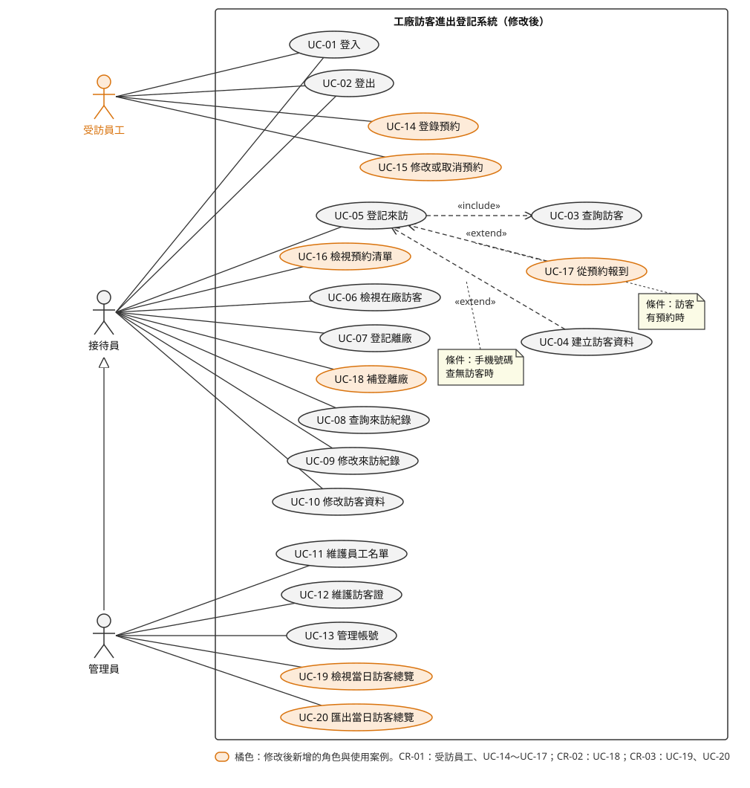
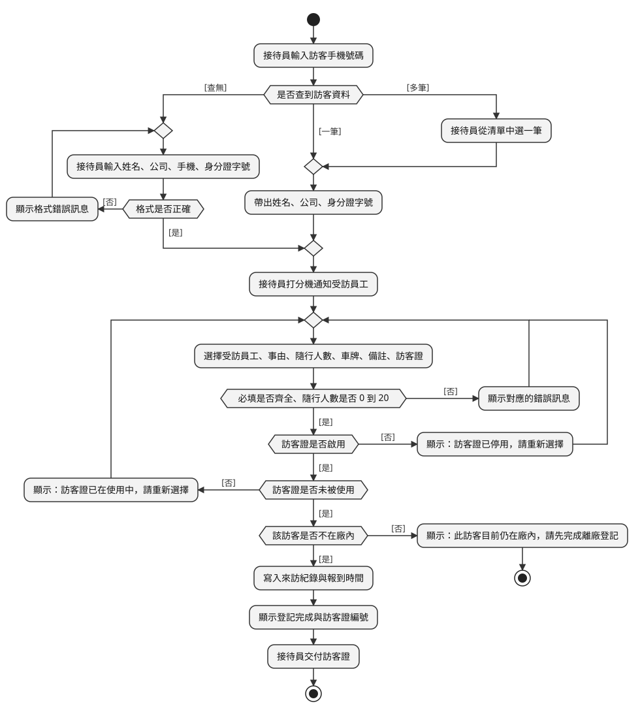
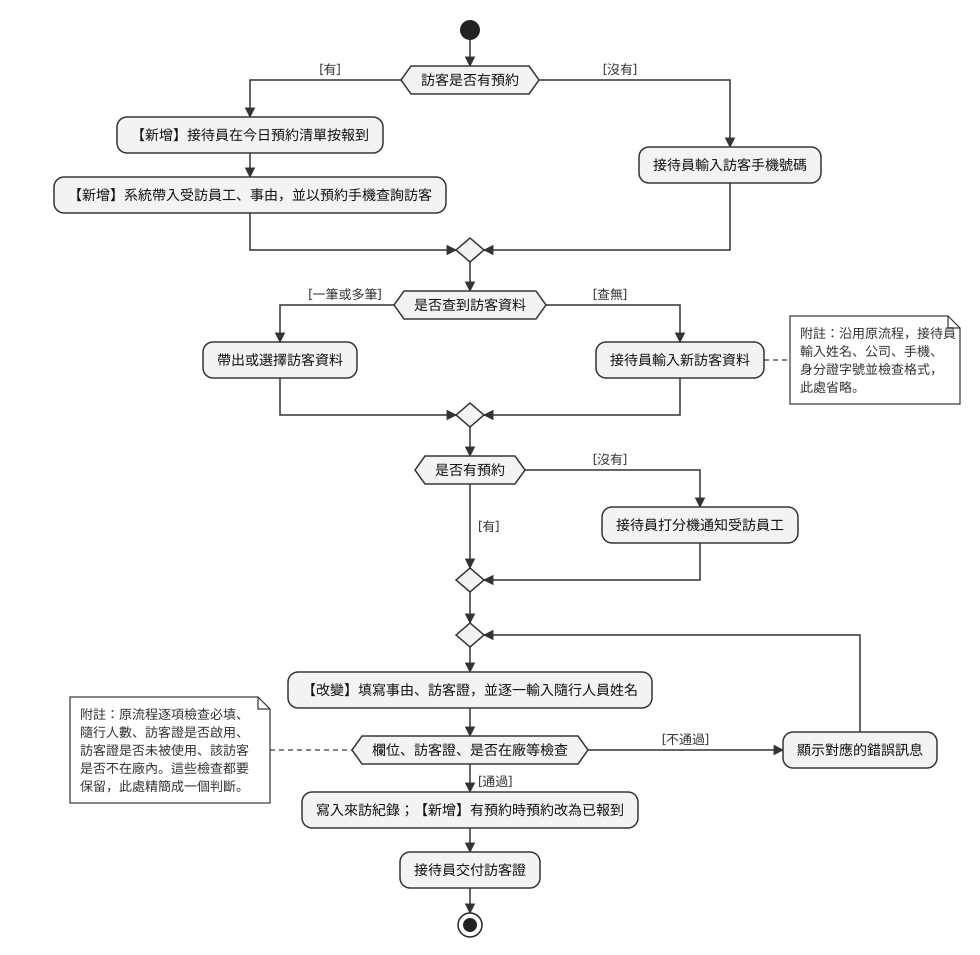
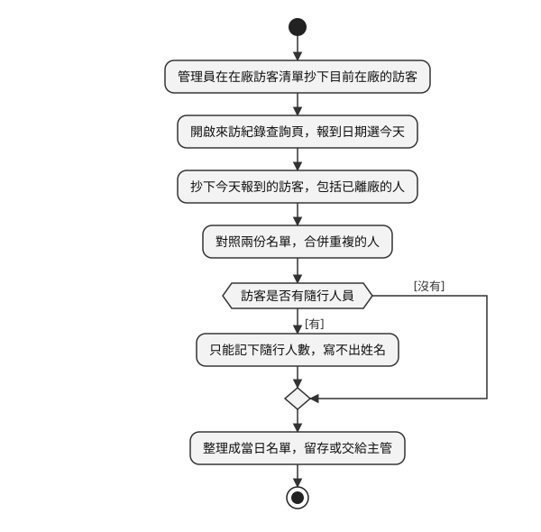
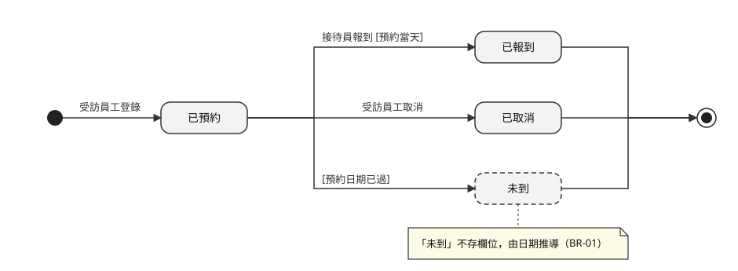
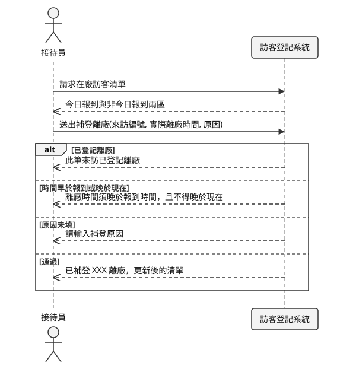
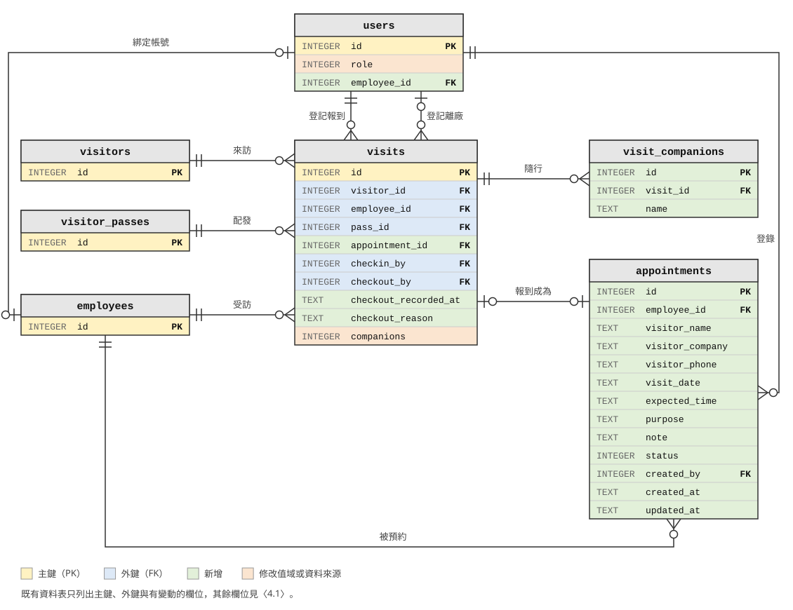

# 修改需求與變更規格

## 系統分析與設計（IE226）115-1

授課教師：呂卓勲

本課程教材：[GitHub](https://github.com/billy1125/system-analysis-and-design)

---

## 系統運作正常，工廠卻要改

訪客登記系統用了一段時間，三個單位各有抱怨：

- 生產部經理：訪客到了才找人，找不到人就在門口等
- 工安課：在廠名單不準
- 總務課：當天有哪些外來人員，要在幾個畫面之間自己對照

> **修改不是重寫系統，而是交代哪些要新增、哪些要修改、哪些維持原樣。**

---

## 本章的例子

- 「期末範例報告」，依據「工廠訪客進出登記系統：修改需求提案書」
- 三項修改需求：CR-01 事前來訪預約與受訪員工確認、CR-02 未離廠追蹤、CR-03 當日訪客總覽與匯出
- 範例處理三項是上課講解用的，各組的提案書只有一項
- 依範例改完的系統：`SAD-Visitor-Revised`

投影片寫「範例〈x〉」，指範例報告的小節。

---

# 一、遇到系統修改需求時怎麼處理

工廠依維護合約提出修改需求時，你要交出的是一份修改建議書：工程師照它改程式，使用者照它驗收。建議書寫得含糊，後面每一步都會跟著錯。

本節先看你接到的是什麼工作，再看期末報告 16 項的處理順序，最後劃清修改的範圍。

---

## 你接到的工作

- 你是開發公司派駐工廠的系統分析師
- 原本負責的同事已經離職，留下的文件不完整
- 第一件事：重新看懂系統現在怎麼運作
- 看懂之後，才把提案書整理成修改建議書

---

## 建議書是後面每一步的依據

- 和主管與資深員工逐項討論，**經工廠簽核，開發才能開始**
- 工程師照建議書改程式，不清楚的地方回頭問你
- 使用者照建議書的驗收標準逐項測試，通過了才上線

> **工程師照它寫程式，使用者照它驗收。**

---

## 處理的順序（一）

| 步驟 | 要回答的問題 | 報告項目 |
|:--:|---|---|
| 1 | 系統現在長什麼樣 | 第 1–4 項（第一部分） |
| 2 | 提案書要什麼，拆成哪幾條驗收得了的變更 | 第 5 項 修改需求整理 |
| 3 | 流程哪裡變了、哪裡沒變 | 第 6 項 差異分析 |
| 4 | 會牽動哪些角色、流程、需求、畫面與資料表 | 第 7 項 影響分析 |
| 5 | 值不值得改 | 第 8 項 效益評估 |
| 6 | 改完之後系統要做到什麼 | 第 9 項 修改後的需求與功能規格 |

---

## 處理的順序（二）

| 步驟 | 要回答的問題 | 報告項目 |
|:--:|---|---|
| 7 | 要新增或改動哪些欄位與資料表 | 第 10 項 資料變更 |
| 8 | 畫面怎麼改；匯出的檔案有哪些欄位 | 第 11 項 畫面設計 |
| 9 | 怎麼證明改對了 | 第 12 項 驗收標準與測試案例 |
| 10 | 現場怎麼換過去、出事怎麼退回 | 第 13–15 項 |
| 11 | 每一項變更都追得回來嗎 | 第 16 項 需求追溯 |

本章教第 1–7、9、10 項；第 8、13–15 項在下一章。

---

## 兩處要特別注意順序

- **第 5 項的決議要最先定**：例如預約有幾個狀態，會直接決定後面的資料表、畫面與驗收
- **第 7 項是後面幾項的清單**：第 9–11、13、16 項都從影響分析接過來
- 寫到後面才發現漏了一項，回頭補進影響分析，不要只補在後面

---

## 修改的範圍：三件事先講清楚

| 原則 | 意思 |
|---|---|
| 修改是加入新功能 | 不是修正錯誤；系統的其他問題這次不處理（提案書〈六〉） |
| 你不寫程式 | 報告寫到需求、流程、資料與畫面為止；實際改系統是可選的第 17 項 |
| 提案書沒要求的，不要自己加 | 改的時候碰到其他問題，寫出影響即可 |

---

## 不做就改不下去的前提，要列出來

- 範例沒有把「與人資系統同步」做進來，而是在作業衝擊寫明由人資部提供名單（範例〈13.1〉）
- CR-01-5 把系統搬到廠內伺服器：提案書沒有列成修改方向，但不搬，受訪員工在座位上用不到預約
- 這種前提要列成變更需求，並寫明它是哪一條的前提

> **自己加功能和補上前提，是兩回事。**

---

# 二、先看懂現在的系統

第一部分「既有系統分析簡要報告」回答系統現在長什麼樣。四項都是期中做過的方法，只是篇幅縮小。

第一部分在整份報告裡是基準。第二部分寫「FR-11 修改」「`visits` 新增一欄」，都要指回這裡的編號與資料字典。

---

## 第一部分的四項

| 期末項目 | 方法在哪一章 |
|---|---|
| 1 系統背景與角色 | 第 2 章；第 3 章〈四〉〈五〉 |
| 2 現況流程 | 第 6 章〈二〉 |
| 3 現況功能與需求 | 第 4 章〈二〉〈三〉；第 5 章〈二〉〈三〉 |
| 4 現況資料 | 第 7 章 |

和期中寫法不同的只有第 3 項的兩處：需求的範圍與系統邊界。

---

## 需求只列與修改有關的

- 範例〈3.2〉列了 11 條功能需求，〈3.3〉列了 4 條非功能需求
- 編號沿用「系統分析完整報告」，所以從 FR-12 跳到 FR-14、FR-18
- 跳號不是漏寫，不要為了連續而重新編號
- 第二部分新增的從 FR-19 開始，都以這份編號為基準

---

## 需求表的第三欄換掉

| 表 | 第三欄 | 範例 |
|---|---|---|
| 功能需求 | 對應功能：功能階層圖上的代號 | FR-07 → F-23 |
| 非功能需求 | 與修改方向的關係 | NFR-02「系統在櫃台的一台電腦上執行」：CR-01 要讓受訪員工在座位上使用，這一條必須改 |

NFR-04「來訪紀錄不得刪除」決定了 CR-02 只能補登，不能刪掉重來。

---

## 系統邊界用一段文字寫

| 句子 | 做什麼 |
|---|---|
| 第一句 | 寫界內：系統負責的範圍 |
| 第二句 | 列界外，並寫出這些事現在由誰處理 |
| 最後一句 | 確認沒有外部介接 |

範例〈3.4〉列出的界外事項中，事前預約、隨行人員的個別資料、報表匯出，正是這次的修改方向。

---

# 三、修改需求整理

提案書寫的是方向，例如「事前來訪預約與受訪員工確認」。誰來預約、接待員怎麼用、沒有預約的訪客怎麼辦，這一句話都沒有說，還不能驗收。

第 5 項分三步：先摘要提案書，再把每一項方向拆成變更需求，最後回答提案書留給各組決定的問題。

---

## 先用自己的話摘要提案書

每項修改方向寫一段，交代三件事：

- 現況發生什麼問題
- 工廠希望改成什麼樣子
- 小組自己補上的前提，例如 CR-01 的「把系統移到廠內伺服器」

最後一句交代去向：三項需求在〈5.2〉拆成 10 項變更需求，待決問題在〈5.3〉回答。

---

## 變更需求的四個欄位

| 欄位 | 寫什麼 |
|---|---|
| 編號 | 沿用提案書編號再往下分：CR-01-1 到 CR-01-5 |
| 變更內容 | 系統要多做或改做的一件事 |
| 理由 | 現場發生了什麼事，或它是哪一條的前提 |
| 優先順序 | 這一條排在哪一級 |

---

## 範例〈5.2〉的變更需求

| 編號 | 變更內容 | 理由 | 優先 |
|---|---|---|:--:|
| CR-01-1 | 受訪員工以自己的帳號登入，登錄、修改、取消自己的來訪預約 | 訪客到了才打分機找人，找不到人時訪客在門口等 | 高 |
| CR-01-5 | 系統從櫃台電腦移到廠內伺服器，員工從座位的電腦用瀏覽器使用 | CR-01-1 的前提 | 高 |
| CR-02-2 | 交班時核對未離廠紀錄，補登實際離廠時間與原因，系統記錄補登人 | 只能按「離廠」，離廠時間會變成補登當下 | 高 |
| CR-03-2 | 當日訪客總覽可匯出成 CSV | 總覽只能在畫面上看，要留存只能手抄 | 中 |

---

## 一條只寫一件事，要寫到可驗證

❌ 讓管理員掌握當天的外來人員。

- 「掌握」可以是查詢畫面、匯出，也可以是每天寄一份報表
- 驗收時說不清楚做到了沒有
- 範例拆成 CR-03-1「當日訪客總覽」與 CR-03-2「匯出成 CSV」，各自驗收得了
- 第 4 章〈四〉的六項準則同樣適用

---

## 依賴關係要寫出來

- 範例：CR-01-5 完成後才能做 CR-01-1，CR-01-1 完成後才能做 CR-01-2
- 被依賴的那一條，優先順序不能比依賴它的低
- 優先順序分幾級沒有規定：範例用高、中兩級，也可以用 MoSCoW

> **依賴寫出來，排上線順序時才知道哪幾條要一起上。**

---

## 回應待小組決議的問題

| 問題 | 決議 | 理由 |
|---|---|---|
| 預約的狀態有幾個 | 存三個：已預約、已報到、已取消。「未到」不存，由日期推導 | 未到只是時間過了，不是有人做了什麼動作。存成欄位就要有人或排程每天去改 |
| 隨行人員要不要逐一建檔 | 只記姓名，不記手機與證件 | 總覽只需要知道廠內有誰。多記證件會拖慢登記，也會增加個資 |
| 補登的離廠時間怎麼驗證 | 必須晚於報到時間，且不得晚於補登當下；原因必填 | 擋得住明顯錯誤。時間是否真實系統無法判斷，所以要求寫原因並記錄補登人 |

---

## 回答待決問題的三個要求

- **理由要寫出放棄了什麼**：「未到」為什麼不存成狀態、為什麼不記證件
- **先回答，再往下寫**：決議決定了後面的資料表、畫面與驗收
- **每一題都找得到答案寫在哪裡**：範例共 12 題，表格列 10 題，另外 2 題在表格下方註明寫在哪裡

---

# 四、差異分析

期末分析的是一套已經在用的系統，行為模型要畫兩個版本：第一部分畫現況（As-Is），第二部分畫修改後（To-Be），並與現況對照。

畫法和第 6 章相同，多出來的要求只有一個：讀者要看得出哪裡變了、哪裡沒變。

---

## 修改後的使用案例圖

- 角色或使用案例有增加才畫，放在第 6 項的開頭
- 整張重畫，新增的部分上色，看得到新的接在哪裡
- 新的使用案例接續編號：現況 UC-01～UC-13，新增的從 UC-14 編起
- 附一張對照表，寫出每一項修改需求帶來哪些角色與使用案例

---

## 修改後的使用案例圖（範例〈6〉）

---

## To-Be 圖是拿 As-Is 圖來改

| 標記 | 意思 | 範例 |
|---|---|---|
| 【新增】 | 現況沒有的步驟 | 接待員在今日預約清單按報到 |
| 【改變】 | 現況有，但做法不同 | 逐一輸入隨行人員姓名 |
| 不加標記 | 沒有變 | 接待員輸入訪客手機號碼 |

一個方框裡只有一部分是新的，就只標那一部分。

---

## 現況：來訪登記與發證（範例〈2.1〉）

---

## 修改後：來訪登記與發證（範例〈6.1〉）

---

## 兩張對照著看

- **整條舊流程可以變成新流程的一個分支**：「沒有預約」那一邊就是原本的現場登記（CR-01-3）
- **有些改變不在方框上，而在走法上**：有預約時不必打分機，要寫進差異對照表
- **沒變的部分可以畫得簡略，但不能拿掉**：四個檢查合成一個判斷，用附註寫明檢查都要保留

---

## 差異對照表

- 刪除的步驟在 To-Be 圖上沒有方框可以標，要另外寫
- 每一條流程分新增、刪除、改變三欄

| 流程 | 新增 | 刪除 | 改變 |
|---|---|---|---|
| 來訪登記 | 從預約報到的分支；登記完成後更新預約狀態 | 無 | 有預約時省略打分機 |

> **「刪除」欄寫「無」也是一個結論，要說得出為什麼。**

---

## 現況沒有系統功能時

- CR-03 的當日總覽，現行系統沒有
- 管理員在兩個畫面之間對照、手抄
- 把這段人工作業畫成 As-Is（範例〈6.3〉）
- 「刪除」欄填被取代的人工步驟：在兩個畫面之間抄寫與對照

---

## 一項需求的改變，可能出現在另一項的圖上

- CR-01 的 To-Be 圖裡「逐一輸入隨行人員姓名」，其實屬於 CR-03-3
- 同一條流程只畫一次，兩邊各寫一句互相指引
- CR-03 的差異對照表多列一行：來訪登記｜無｜無｜隨行人數改為逐一輸入姓名

---

## 對照表寫完，做兩項檢查

- 圖上每一個【新增】【改變】，都要對得到一項變更需求
- 每一項會改變流程的變更需求，都要在某張 To-Be 圖上看得到
- CR-01-5 只改安裝位置，流程沒有變，追溯表的流程欄寫「—」

> **對不上，不是圖多改了，就是變更需求漏寫了。**

---

# 五、影響分析

差異分析畫出了流程怎麼變。但流程一變，牽動的不只流程：誰要多做事、哪條需求要改寫、哪個畫面要多一個按鈕、哪張資料表要多一個欄位。

第 7 項影響分析把這些逐項列成一張清單，也是評「分析或設計深度」的主要材料。

---

## 一項 CR 一張表（範例〈7.2〉）

| 類別 | 受影響的項目 | 影響 | 來自 |
|---|---|---|---|
| 角色 | 接待員 | 交班工作變多 | CR-02-1、2 |
| 流程 | 離廠登記 | 新增交班核對與補登離廠（範例〈6.2〉） | CR-02-1、2 |
| 需求 | FR-11 | 修改：在廠清單分成今日與非今日兩區 | CR-02-1 |
| 需求 | FR-12 | 修改：離廠多記錄登記時間 | CR-02-2 |
| 畫面 | UI-02 在廠訪客清單 | 修改：分區顯示、補登離廠按鈕 | CR-02-1、2 |
| 畫面 | UI-05 來訪明細與修改頁 | 修改：顯示離廠方式與離廠登記時間 | CR-02-2 |
| 資料表 | `visits` | 修改：新增 `checkout_recorded_at`、`checkout_reason`；`check_out_at` 改為實際離廠時間 | CR-02-2 |

---

## 四個欄位怎麼寫

| 欄位 | 寫什麼 |
|---|---|
| 類別 | 角色、流程、需求、畫面、資料表五類，依這個順序排 |
| 受影響的項目 | 用第一部分的名稱與編號：寫 FR-11，不寫「在廠清單功能」 |
| 影響 | 寫到改了什麼：「修改：分區顯示、補登離廠按鈕」，不只寫「受影響」 |
| 來自 | 哪一項變更需求造成的，寫到 CR-02-1 這一層 |

---

## 從差異分析逐類找

拿標了【新增】【改變】的步驟，一個一個問：

| 類別 | 要問的 |
|---|---|
| 角色 | 這個步驟誰做？他原本就做這件事嗎 |
| 流程 | 這個步驟屬於哪一條流程 |
| 需求 | 第一部分哪一條需求的文字要改寫 |
| 畫面 | 使用者在哪個畫面上做這個步驟 |
| 資料表 | 要記下什麼新資料，存在哪張表、哪一欄 |

---

## 角色最容易漏掉兩種人

- **從不操作系統變成使用者的人**：受訪員工原本只受影響，CR-01 讓他們登入系統（範例〈7.1〉第一列）
- **畫面沒變、工作卻變了的人**：CR-01-5 搬到伺服器，管理員的畫面一個都沒改，卻要負責伺服器上的資料庫檔

---

## 列表時的三條規則

- 需求只列第一部分已有編號的；新增的到第 9 項才編，例如 CR-02-2 到範例〈9.2〉才成為 FR-24
- 畫面與資料表連新增的也列，標「新增」
- 同一個項目被兩項 CR 動到，兩張表各列一次，例如 UI-03 來訪登記頁

> **某一項變更在表裡沒有對應的列，也寫一句交代。**

---

## 沒有動到的也要寫

範例在三張表之後寫一段話：

「三項都沒有動到的：其餘 FR、NFR 不變；`employees`、`visitors`、`visitor_passes` 三張表不變。修改後共 7 張資料表，定義見〈10〉。」

- 這一句證明其餘部分是查過的，不是漏了
- 資料表要寫出名稱，總數要和第 10 項的 ERD 對得起來

---

## 後面各項從這張表接

| 後面的項目 | 從影響分析接什麼 |
|---|---|
| 第 9 項 修改後的需求 | 「需求」類，逐條改寫並標「修改」 |
| 第 10 項 資料變更 | 「資料表」類，逐欄寫出定義 |
| 第 11 項 畫面設計 | 「畫面」類，要畫的畫面就是這些 |
| 第 13 項 作業與組織衝擊 | 「角色」類，就是受訓對象 |
| 第 16 項 需求追溯 | 「需求」「資料表」「畫面」三類 |

> **後面出現表上沒有的項目，不是這裡漏了，就是後面多做了。**

---

# 六、修改後的需求與規格

變更需求說的是「要改什麼」，修改後的需求是「改完之後的規格」。第 9 項把變更需求落回第一部分的需求清單。

它包含三塊：新增或修改的功能需求與非功能需求、業務規則、一到兩張修改後的循序圖。

---

## 新增、修改、刪除

| 類型 | 編號怎麼給 | 內容怎麼寫 |
|---|---|---|
| 新增 | 接續現況的最後一號：現況到 FR-18，新增從 FR-19 開始 | 完整的需求敘述 |
| 修改 | 保留原編號 | 修改後的完整敘述 |
| 刪除 | 保留原編號，不再給別的需求使用 | 刪除的理由 |

---

## 範例〈9〉的功能需求

| 編號 | 類型 | 功能需求 | 來自 |
|---|---|---|---|
| FR-11 | 修改 | 在廠清單分成「今日報到」與「非今日報到」兩區，上方分別顯示人數，並顯示在廠隨行人數合計 | CR-02-1 |
| FR-19 | 新增 | 受訪員工可登錄預約：訪客姓名、公司、手機、預約日期、預計到達時間、事由與備註。預約日期不得早於今天 | CR-01-1 |
| FR-24 | 新增 | 接待員可對在廠紀錄補登離廠：輸入實際離廠時間與原因，系統記錄補登人與補登當下的時間 | CR-02-2 |

> **修改要寫整句新的敘述，不是「多分兩區」四個字。**

---

## 編號與來源

- **編號不能重排**：影響分析寫「FR-11 要改」、測試案例寫「驗證 FR-24」，都靠編號對照
- **「來自」欄指回變更需求**，也是第 16 項需求追溯的起點
- 沒有產生任何需求的變更，寫一句原因：CR-01-3「不另立需求」
- 非功能需求另外可以標「不變」：NFR-03 提醒改的人不能破壞這一條

---

## 業務規則

功能需求說系統做什麼，業務規則說做的時候要守什麼。範例〈9.2〉的三條：

| 編號 | 規則 | 用在 |
|---|---|---|
| BR-03 | 補登的離廠時間必須晚於報到時間，且不得晚於補登當下 | FR-24 |
| BR-04 | 一筆來訪紀錄是「補登離廠」，若且唯若補登原因有值 | FR-24、UI-05 |
| BR-07 | 「在廠」與「訪客證使用中」的推導規則不變，仍由離廠時間是否為空判斷 | FR-11、FR-24 |

---

## 業務規則的四個寫法

- **共用的規定抽出來寫一次**：BR-01 用在 FR-19～FR-23 五條
- **推導出來的狀態要寫成規則**：「未到」不存欄位，BR-01 寫明由日期推導
- **用業務的說法寫**，不寫資料庫查詢語法或程式的判斷式
- **沒有改的規則也可能要寫**：BR-07 明寫推導規則不變

---

## 預約的狀態轉移圖（範例〈9.1〉）

「未到」畫成虛線框，表示它不存成狀態值。狀態不存欄位，規則就是它唯一的定義。

---

## 修改後的循序圖

- 畫法同第 6 章〈四〉：系統是黑箱、訊息寫出參數、每條訊息都有回應
- **只畫受修改影響的互動**：範例挑 FR-22 從預約報到、FR-24 補登離廠
- 跟著修改需求分節放；沒畫的那一節寫一句理由
- 期末不必把黑箱打開，改了哪些欄位寫在第 10 項

---

## 補登離廠的循序圖（範例〈9.2〉）

---

## 圖上每一處都對得回其他項目

| 圖上的位置 | 對回範例報告的哪裡 |
|---|---|
| 回傳「今日報到與非今日報到兩區」 | 〈9.2〉修改後的 FR-11 |
| `送出補登離廠(來訪編號, 實際離廠時間, 原因)` | 〈10.2〉`check_out_at` 改意義、新增 `checkout_reason` |
| `alt`「時間早於報到或晚於現在」 | 〈9.2〉業務規則 BR-03 |
| `alt`「已登記離廠」 | 現況就有的檢查（〈2.2〉），修改後沿用 |
| `alt` 裡時間與原因的錯誤回應 | 〈12.2〉測試案例 TC-12 |

---

## 依修改方向分節

- 範例〈9.1〉～〈9.3〉每節四塊：功能需求、業務規則、非功能需求、循序圖
- 同一條需求受兩項影響只列一次：FR-07 列在〈9.3〉，〈9.1〉註明去處
- 某一塊沒有變動也寫一句：「CR-02 沒有新增或修改非功能需求」

> **兩節各列一次，就會出現兩個版本的 FR-07。**

---

# 七、資料變更

期末的系統已經存在，第一部分第 4 項的 ERD 與資料字典就是現況。第 10 項只寫這次修改要新增或改動的欄位與資料表。

沒有動到的不重抄，也不從需求重新推導整套資料設計。

---

## 依修改需求分節寫

- 範例〈10〉依 CR 分三節，每節分「新增資料表」與「既有資料表的變更」
- 某一塊沒有東西也寫一句：「CR-02 沒有新增資料表」
- 新增的資料表每一欄都寫齊，外鍵寫在值域欄

| 欄位名稱 | 中文名稱 | 型別 | 必填 | 值域／格式 | 資料來源 |
|---|---|---|---|---|---|
| `visit_id` | 來訪編號 | INTEGER | 是 | 對應 `visits.id` | 登記時帶入 |
| `name` | 隨行人員姓名 | TEXT | 是 | 1–20 字 | 接待員輸入 |

---

## 既有資料表：只列有變動的欄位

| 資料表 | 欄位 | 變更 | 值域／格式 | 資料來源 |
|---|---|---|---|---|
| `visits` | `appointment_id` | 新增 | 對應 `appointments.id`；唯一；現場登記為 NULL | 從預約報到時寫入 |
| `users` | `role` | 修改值域 | `0` 管理員、`1` 接待員、`2` 受訪員工 | 管理員指定 |
| `visits` | `check_out_at` | 修改意義 | 改為「實際離廠時間」 | 系統寫入或接待員輸入 |
| `visits` | `companions` | 修改來源 | 0–20 | 改由系統依 `visit_companions` 的筆數寫入 |

> **名稱沒變、意義或來源變了，也要寫。**

---

## 舊資料這一欄填什麼

- 上線前的紀錄，沒有新欄位的值
- 範例新增的四個欄位都允許空白，並寫明空白代表什麼：`appointment_id` 為 NULL 代表現場登記
- `companions` 沒改成推導，因為舊紀錄只有人數、沒有姓名
- 舊資料實際怎麼處理，寫在第 14 項資料轉換規則（下一章）

---

## 畫面上的狀態可能跨表推導

- UI-12 當日訪客總覽的預約中、已取消、在廠、已離廠，沒有一張表有這個欄位
- 範例寫成業務規則 BR-08，用兩張表的四個欄位推導
- 不存的理由：存了就要在每次登記、離廠、取消時同步更新

> **算得出來、依據也不會被人改，就用算的，但推導規則要寫完整。**

---

## 修改後的 ERD（範例〈10〉）

---

## ERD 只畫有變動的部分

- 資料表有增減，才附修改後的 ERD
- 既有的表只留主鍵、外鍵與有變動的欄位，其餘指回〈4.1〉
- 兩種顏色：「新增」與「修改值域或資料來源」
- 和使用案例圖相反：使用案例圖整張重畫
- 基數要重新判斷：`appointment_id` 設成唯一，預約與來訪是一對一

---

## 不必做到的部分

- 索引、觸發程序、預存程序、分割表、效能調校：可選
- 做了不會加分；寫了，訪談時要能說明為什麼需要
- 資料庫遷移程式也不用寫，屬於「程式要怎麼改」

> **影響資料代表什麼意思的是必做，只影響跑得快不快的是可選。**

---

## 本章重點回顧

- 修改建議書是開發與驗收的共同依據；提案書沒要求的不加，但前提要列出來
- 先看懂現況，現況的編號就是第二部分的基準
- 方向拆成驗收得了的變更需求，待決問題的決議最先定
- 差異分析讓人看出哪裡變了；影響分析是後面各項的清單
- 修改後的需求寫整句、標類型；資料變更連意義與來源的改變也要寫

---

## 下一章

本章寫出了系統要改成什麼樣子。

下一章「效益評估與上線準備」處理規格之外的問題：這次修改值不值得做，改好的系統要怎麼讓現場真的換過去。
