# 系統修改報告：工廠訪客進出登記系統

> 這是一份依新版期末報告格式寫成的範例報告，分析對象是期末示範用的既有系統「工廠訪客進出登記系統」。
>
> 期末報告分成兩大部分：第一部分「既有系統分析簡要報告」，第二部分「修改建議書」。第二部分依老師給的兩項修改方向（CR-01、CR-02）撰寫。依第二部分實際修改後的系統見 `05-Final-Project-Topics/SAD-Visitor-Revised/`，那是加分項目的示範，不是必做。
>
> 第一部分是期中九項的簡要版。同一套系統依期中規格寫成的完整版見[系統分析報告：工廠訪客進出登記系統](Visitor-System-Full-Analysis.md)，兩份對照看，可以看出簡要版保留了什麼、省略了什麼。

---

## 報告基本資料

| 項目 | 內容 |
|---|---|
| 課程 | 系統分析與設計（IE226）115-1 |
| 報告階段 | 期末小組報告（系統分析與修改建議） |
| 分析對象 | 工廠訪客進出登記系統（現行版） |
| 組別 | 第 3 組 |
| 組員 | 小明（1130001）、阿花（1130002）、阿宏（1130003）、小美（1130004） |
| 書面繳交日 | 2026/12/18 |
| 口頭報告日 | 2026/12/23 |

---

# 第一部分：既有系統分析簡要報告

## 1. 系統背景與角色

### 1.1 系統目的與要解決的問題

本系統是一間中型電子零件廠大門接待櫃台使用的訪客登記系統，取代原本的紙本登記簿。訪客到廠時，接待員登記並發給訪客證；訪客離開時，接待員登記離廠並收回訪客證。

系統裝在櫃台的一台電腦上：畫面是 HTML、CSS、JavaScript，在瀏覽器裡執行；同一台電腦上的一支本機程式負責讀寫 SQLite 資料庫檔。系統不連接其他系統。

| 編號 | 要解決的問題 | 系統上的對應 |
|---|---|---|
| P-01 | 紙本登記簿查不到過去的來訪 | 來訪紀錄可依日期與關鍵字查詢 |
| P-02 | 說不出廠內現在有哪些訪客 | 首頁就是在廠訪客清單，上方顯示在廠人數 |
| P-03 | 訪客證發出去後，不知道在誰身上 | 每筆來訪綁一張訪客證，使用中的證不能再發 |
| P-04 | 回頭訪客每次都要重寫資料 | 輸入手機就帶出既有的訪客資料 |

### 1.2 角色與權限

| 角色 | 使用目標 | 權限範圍 |
|---|---|---|
| 接待員 | 讓訪客快速登記進廠，並掌握廠內有誰 | 查詢與建立訪客、登記來訪、登記離廠、查詢與修改來訪紀錄、修改訪客資料 |
| 管理員 | 維護系統的基本資料 | 接待員的全部權限，加上員工名單、訪客證與帳號的維護；不能停用自己或修改自己的角色 |

**不操作系統但受影響的人**：訪客（個資被存入系統）、受訪員工（只能等接待員打分機通知）、工安與環安人員（緊急疏散時需要在廠訪客名單）。

### 1.3 使用案例圖

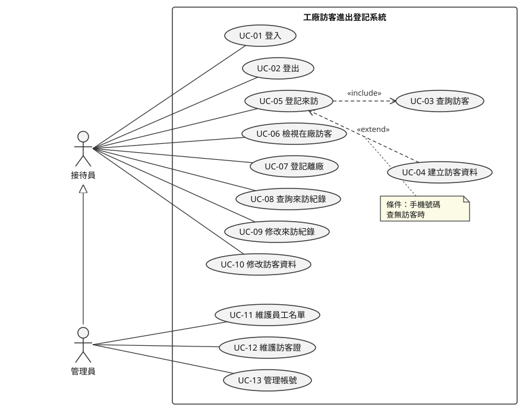

*本圖由作者自製*

管理員繼承接待員的全部能力。登記來訪一定先查詢訪客（UC-03 為包含關係）；查無訪客時才建立訪客資料（UC-04 為延伸關係）。

---

## 2. 現況流程

### 2.1 來訪登記與發證

> **主要角色**：接待員
> **觸發事件**：訪客抵達大門櫃台
> **例外情況**：查無訪客、欄位格式錯誤、訪客證已被使用、該訪客仍在廠內
> **完成後狀態**：建立一筆來訪紀錄，報到時間為送出當下，訪客證綁定這筆來訪

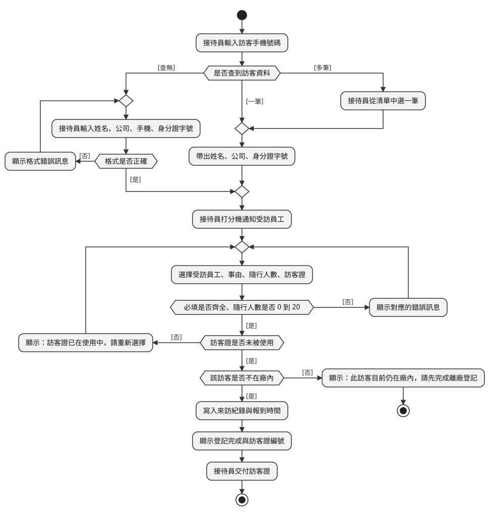

*本圖由作者自製*

A5「打分機通知」不經過系統，系統只顯示分機號碼。

### 2.2 離廠登記

> **主要角色**：接待員
> **觸發事件**：訪客交回訪客證
> **例外情況**：該筆已被其他接待員登記離廠
> **完成後狀態**：來訪紀錄的離廠時間有值，訪客證回到可用狀態

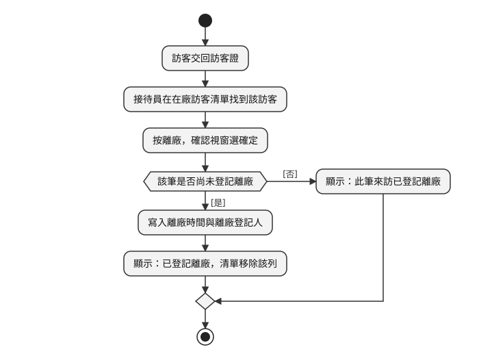

*本圖由作者自製*

訪客沒有交回訪客證就離開時，這條流程不會被觸發，該筆紀錄會一直留在在廠清單上。

---

## 3. 現況功能與需求

### 3.1 功能階層圖

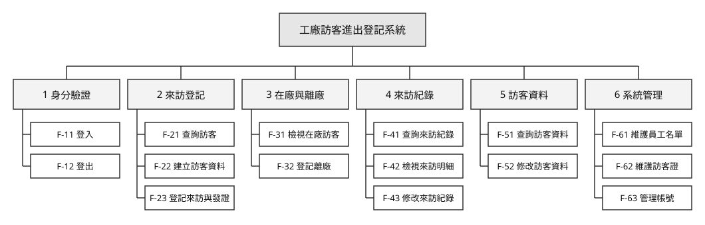

*本圖由作者自製*

### 3.2 功能需求

第二部分的變更需求以下表的編號為對照基準。

| 編號 | 功能需求 | 對應功能 |
|---|---|---|
| FR-01 | 系統應提供登入功能，以帳號與密碼驗證身分 | F-11 |
| FR-02 | 系統應阻擋已停用的帳號登入 | F-11 |
| FR-03 | 系統應提供登出功能，登出後回到登入頁 | F-12 |
| FR-04 | 登入後應進入在廠訪客清單，選單依角色顯示可用功能 | F-11 |
| FR-05 | 系統應能以手機號碼查詢訪客，查到多筆時列出讓接待員選擇 | F-21 |
| FR-06 | 查無訪客時，接待員可建立新訪客，姓名、公司、手機、身分證字號皆為必填 | F-22 |
| FR-07 | 接待員可登記來訪，填寫受訪員工、事由、隨行人數、車牌、備註並選擇訪客證，送出即記錄報到時間 | F-23 |
| FR-08 | 受訪員工只能從在職員工中選擇 | F-23 |
| FR-09 | 訪客證只能選擇啟用中且未被使用的證，送出時須再檢查一次 | F-23 |
| FR-10 | 同一筆訪客資料仍在廠內時，不得再登記新的來訪 | F-23 |
| FR-11 | 系統應列出所有在廠的訪客，並顯示在廠人數與隨行人數合計 | F-31 |
| FR-12 | 接待員可登記離廠，系統記錄離廠時間與登記人，並釋出訪客證 | F-32 |
| FR-13 | 系統應能依報到日期區間與關鍵字查詢來訪紀錄 | F-41、F-42 |
| FR-14 | 接待員可修改來訪紀錄的事由、受訪員工、隨行人數、車牌與備註，報到與離廠時間不可修改 | F-43 |
| FR-15 | 接待員可修改訪客的姓名、公司、手機與身分證字號 | F-51、F-52 |
| FR-16 | 管理員可新增與修改員工資料，並設為在職或離職 | F-61 |
| FR-17 | 管理員可新增訪客證，並停用或啟用 | F-62 |
| FR-18 | 管理員可新增帳號、設定角色、啟用或停用帳號，但不得停用自己或修改自己的角色 | F-63 |

### 3.3 非功能需求

只列與修改方向相關的四項。編號沿用規格書，因此不連續。

| 編號 | 非功能需求 | 與修改方向的關係 |
|---|---|---|
| NFR-02 | 系統在櫃台的一台電腦上執行，資料存在同一台電腦的資料庫檔 | CR-01 要讓受訪員工在座位上使用，這一條必須改 |
| NFR-03 | 來訪登記應在單一頁面完成，不換頁 | CR-01 從預約報到、CR-02 加填隨行人員姓名，都要維持這一條 |
| NFR-04 | 來訪紀錄不得刪除 | CR-02 處理忘記離廠的紀錄時，只能補登，不能刪掉重來 |
| NFR-05 | 時間一律記錄本機時間，精確到秒 | CR-02 補登的離廠時間與補登當下的時間要分開記錄 |

### 3.4 系統邊界

系統只處理訪客到廠後的現場登記、在廠與離廠，以及相關基本資料的維護。事前預約、通知受訪員工、訪客證實體的收發、隨行人員的個別資料、與人資系統同步、報表匯出都不在系統內：受訪員工由接待員打分機通知，訪客證由接待員親手收發，員工名單由管理員手動維護。系統沒有任何外部系統或設備介接。

---

## 4. 現況資料

### 4.1 實體關聯圖

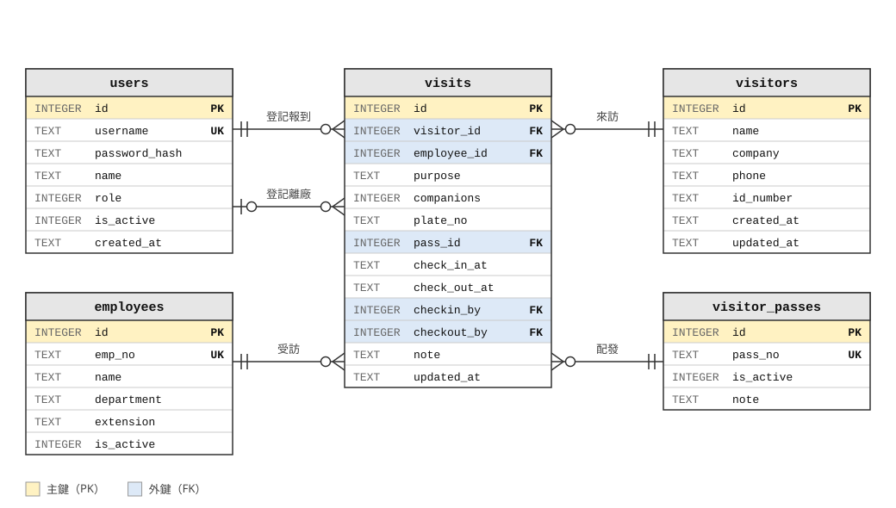

*本圖由作者自製*

「在廠」與「訪客證使用中」都沒有欄位，兩者都由 `visits.check_out_at` 是否為空推導。

### 4.2 資料表與鍵值

| 資料表 | 用途 | 主鍵 | 對外參照 | 其他約束 |
|---|---|---|---|---|
| `users` | 系統帳號 | `id` | 無 | `username` 唯一 |
| `employees` | 員工名單，供選擇受訪員工 | `id` | 無 | `emp_no` 唯一 |
| `visitors` | 訪客主檔 | `id` | 無 | 無；`phone` 與 `id_number` 都不唯一 |
| `visits` | 來訪紀錄 | `id` | `visitor_id` → `visitors.id`、`employee_id` → `employees.id`、`pass_id` → `visitor_passes.id`、`checkin_by` 與 `checkout_by` → `users.id` | 無 |
| `visitor_passes` | 訪客證 | `id` | 無 | `pass_no` 唯一 |

### 4.3 資料字典：`users`

| 欄位名稱 | 中文名稱 | 型別 | 必填 | 值域／格式 | 資料來源 |
|---|---|---|---|---|---|
| `id` | 帳號編號 | INTEGER | 是 | 主鍵，系統流水號 | 系統產生 |
| `username` | 帳號 | TEXT | 是 | 唯一；英數字 4–20 碼 | 管理員輸入 |
| `password_hash` | 密碼雜湊 | TEXT | 是 | 雜湊字串，非明文 | 系統產生 |
| `name` | 姓名 | TEXT | 是 | 1–20 字 | 管理員輸入 |
| `role` | 角色 | INTEGER | 是 | `0` 管理員、`1` 接待員；預設 1 | 管理員指定 |
| `is_active` | 是否啟用 | INTEGER | 是 | `1` 啟用、`0` 停用；預設 1 | 管理員切換 |
| `created_at` | 建立時間 | TEXT | 是 | `YYYY-MM-DD HH:MM:SS`，本機時間 | 系統產生 |

### 4.4 資料字典：`employees`

| 欄位名稱 | 中文名稱 | 型別 | 必填 | 值域／格式 | 資料來源 |
|---|---|---|---|---|---|
| `id` | 員工資料編號 | INTEGER | 是 | 主鍵，系統流水號 | 系統產生 |
| `emp_no` | 員工編號 | TEXT | 是 | 唯一；`E` 加 4 碼數字 | 管理員輸入 |
| `name` | 姓名 | TEXT | 是 | 1–20 字 | 管理員輸入 |
| `department` | 部門 | TEXT | 是 | 自由文字，1–20 字 | 管理員輸入 |
| `extension` | 分機 | TEXT | 否 | 4 碼數字 | 管理員輸入 |
| `is_active` | 是否在職 | INTEGER | 是 | `1` 在職、`0` 離職；預設 1 | 管理員切換 |

### 4.5 資料字典：`visitors`

| 欄位名稱 | 中文名稱 | 型別 | 必填 | 值域／格式 | 資料來源 |
|---|---|---|---|---|---|
| `id` | 訪客編號 | INTEGER | 是 | 主鍵，系統流水號 | 系統產生 |
| `name` | 姓名 | TEXT | 是 | 1–20 字 | 接待員輸入 |
| `company` | 公司 | TEXT | 是 | 1–40 字 | 接待員輸入 |
| `phone` | 手機 | TEXT | 是 | `09` 開頭的 10 碼數字；不唯一 | 接待員輸入 |
| `id_number` | 身分證字號 | TEXT | 是 | 1 個大寫英文字母加 9 個數字；不唯一 | 接待員輸入 |
| `created_at` | 建立時間 | TEXT | 是 | 同上 | 系統產生 |
| `updated_at` | 最後修改時間 | TEXT | 否 | 同上；從未修改為 NULL | 系統產生 |

### 4.6 資料字典：`visits`

| 欄位名稱 | 中文名稱 | 型別 | 必填 | 值域／格式 | 資料來源 |
|---|---|---|---|---|---|
| `id` | 來訪編號 | INTEGER | 是 | 主鍵，系統流水號 | 系統產生 |
| `visitor_id` | 訪客編號 | INTEGER | 是 | 對應 `visitors.id` | 登記時選定 |
| `employee_id` | 受訪員工 | INTEGER | 是 | 對應 `employees.id` | 接待員選擇 |
| `purpose` | 事由 | TEXT | 是 | `開會`、`送貨`、`維修`、`參觀`、`面試`、`其他` | 接待員選擇 |
| `companions` | 隨行人數 | INTEGER | 是 | 0–20；預設 0 | 接待員輸入 |
| `plate_no` | 車牌 | TEXT | 否 | 1–10 字 | 接待員輸入 |
| `pass_id` | 訪客證 | INTEGER | 是 | 對應 `visitor_passes.id` | 接待員選擇 |
| `check_in_at` | 報到時間 | TEXT | 是 | 同上 | 系統於送出登記時寫入 |
| `check_out_at` | 離廠時間 | TEXT | 否 | 同上；在廠時為 NULL | 系統於離廠登記時寫入 |
| `checkin_by` | 報到登記人 | INTEGER | 是 | 對應 `users.id` | 由登入狀態帶入 |
| `checkout_by` | 離廠登記人 | INTEGER | 否 | 對應 `users.id`；在廠時為 NULL | 由登入狀態帶入 |
| `note` | 備註 | TEXT | 否 | 0–200 字 | 接待員輸入 |
| `updated_at` | 最後修改時間 | TEXT | 否 | 同上；從未修改為 NULL | 系統於修改時寫入 |

### 4.7 資料字典：`visitor_passes`

| 欄位名稱 | 中文名稱 | 型別 | 必填 | 值域／格式 | 資料來源 |
|---|---|---|---|---|---|
| `id` | 訪客證資料編號 | INTEGER | 是 | 主鍵，系統流水號 | 系統產生 |
| `pass_no` | 訪客證編號 | TEXT | 是 | 唯一；`V-` 加 2 碼數字 | 管理員輸入 |
| `is_active` | 是否啟用 | INTEGER | 是 | `1` 啟用、`0` 停用；預設 1 | 管理員切換 |
| `note` | 備註 | TEXT | 否 | 例如停用原因 | 管理員輸入 |

---

# 第二部分：修改建議書

老師提供兩項修改方向：CR-01「事前來訪預約與受訪員工確認」（提出者：生產部經理）、CR-02「未離廠追蹤與疏散名單匯出」（提出者：工安課）。本部分把這兩項整理成正式的變更需求，再逐項寫出差異、影響、規格與驗收方式。

## 5. 變更申請

### 5.1 變更需求清單

| 編號 | 變更內容 | 理由 | 優先順序 |
|---|---|---|:--:|
| CR-01-1 | 受訪員工以自己的帳號登入，登錄、修改、取消自己的來訪預約 | 現在訪客到了才打分機找人，找不到人時訪客在門口等 | 高 |
| CR-01-2 | 接待員從「今日預約」清單直接報到，系統帶入預約的受訪員工、事由與訪客資料 | 早上尖峰時段櫃台壅塞，有預約的訪客不必再口述來意 | 高 |
| CR-01-3 | 沒有預約的訪客仍可現場登記 | 送貨、臨時維修不可能都事先預約 | 高 |
| CR-01-4 | 預約日已過、訪客沒有報到的預約，要看得出是「未到」 | 受訪員工與接待員要知道哪些預約落空 | 中 |
| CR-01-5 | 系統從櫃台電腦移到廠內伺服器，員工從自己座位的電腦用瀏覽器使用 | CR-01-1 的前提。系統只在櫃台一台電腦上，受訪員工用不到 | 高 |
| CR-02-1 | 在廠清單把「今天報到」與「不是今天報到」的訪客分開顯示 | 忘記登記離廠的訪客一直算在廠，看不出哪幾筆有問題（I-01） | 高 |
| CR-02-2 | 交班時核對未離廠紀錄，補登實際離廠時間與原因，系統記錄補登人 | 現在只能按「離廠」，離廠時間會變成補登當下，不是實際離開的時間 | 高 |
| CR-02-3 | 在廠名單可匯出成 CSV，供工安課疏散點名 | 疏散名單只在櫃台電腦的畫面上，工安課拿不到 | 高 |
| CR-02-4 | 登記來訪時記錄隨行人員姓名，疏散名單列出每一位隨行人員 | 隨行人員只記人數，疏散時不知道少了誰（I-07） | 中 |

CR-01-1 依賴 CR-01-5，CR-01-2 依賴 CR-01-1。CR-02 四項之間沒有依賴，可以先上線。

### 5.2 回應待小組決議的問題

這一節回應[工廠訪客進出登記系統：修改需求提案書](../05-Final-Project-Topics/Change-Proposals/Visitor-System-Change-Proposal.md)〈3.4 待小組決議的問題〉與〈4.4 待小組決議的問題〉。提案書把這些問題留給各組決定，兩節共 8 個問題，我們逐一討論後都做了決議。下表列出其中 6 個的決議與理由。

另外 2 個問題寫在別的地方：系統只裝在櫃台電腦上的問題，我們列成變更需求 CR-01-5（見〈5.1〉）；CSV 的欄位、匯出時機與匯出失敗時的處理，寫在〈11.7〉。

| 問題 | 決議 | 理由 |
|---|---|---|
| 預約與來訪紀錄是同一張表還是兩張 | 兩張：新增 `appointments`，`visits` 加一個欄位指向它 | 預約可能沒有變成來訪（訪客沒來），來訪也可能沒有預約（現場登記），兩者的生命週期不同。放同一張表會出現「報到時間為空的來訪紀錄」，在廠的推導規則就要跟著改 |
| 預約的狀態有幾個 | 存三個：已預約、已報到、已取消。「未到」不存，由「預約日期早於今天且仍為已預約」推導 | 未到只是時間過了，不是有人做了什麼動作。存成欄位就要有人或排程每天去改，與在廠的推導方式一致比較好維護 |
| 受訪員工的帳號放 `users` 還是 `employees` | 放 `users`，新增角色值 2「受訪員工」，並以 `users.employee_id` 綁定員工名單中的一位員工 | 登入與權限檢查維持一張表；員工名單仍是供人選擇的名冊，不是每位員工都需要帳號 |
| 預約要不要直接連到訪客主檔 | 不連。預約只記訪客的姓名、公司、手機，報到時才由接待員以手機查詢並連結 | 受訪員工不應看得到全部訪客的身分證字號；預約時訪客也可能還沒建檔 |
| 隨行人員要不要逐一建檔 | 只記姓名，不記手機與證件 | 疏散點名只需要姓名。多記證件會拖慢登記速度，也會增加個資 |
| 補登的離廠時間怎麼驗證 | 必須晚於報到時間，且不得晚於補登當下；原因必填 | 這兩個條件擋得住明顯錯誤。時間是否真實無法由系統判斷，因此要求寫原因並記錄補登人，事後可以追問 |

---

## 6. 差異分析

現況流程見〈2.1〉〈2.2〉。下列三張 To-Be 活動圖中，標【新增】的是現況沒有的步驟，標【改變】的是現況有但做法不同的步驟。

### 6.1 To-Be：受訪員工登錄預約（新流程）

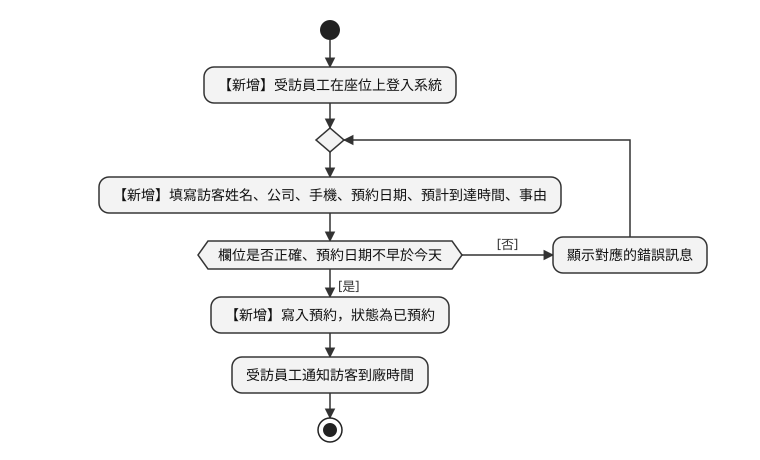

*本圖由作者自製*

### 6.2 To-Be：來訪登記與發證

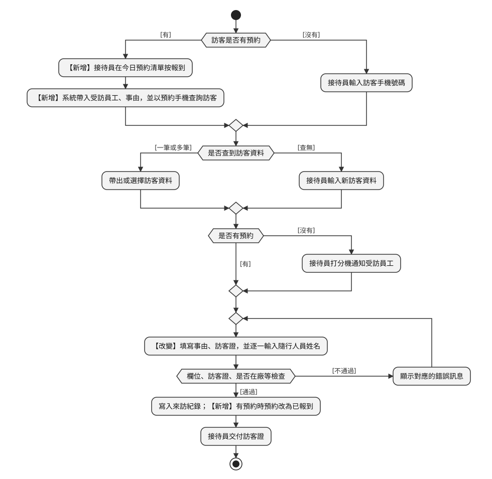

*本圖由作者自製*

有預約的訪客不必打分機：受訪員工已經知道訪客要來，也可以在自己的畫面看到「已報到」。

### 6.3 To-Be：離廠與交班核對

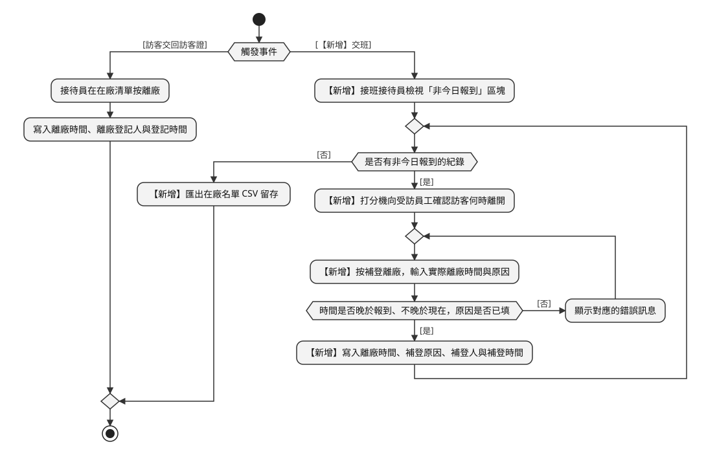

*本圖由作者自製*

### 6.4 差異對照

| 流程 | 新增 | 刪除 | 改變 |
|---|---|---|---|
| 預約 | 整條流程 | 無 | 無 |
| 來訪登記 | 從預約報到的分支；登記完成後更新預約狀態 | 無 | 隨行人數改為逐一輸入姓名；有預約時省略打分機 |
| 離廠 | 交班核對、補登離廠、交班時匯出 CSV | 無 | 離廠多記一個「登記時間」，與實際離廠時間分開 |

現況沒有任何步驟被刪除。CR-01-3 要求保留現場登記，因此舊流程整條保留為「沒有預約」的分支。

---

## 7. 影響分析

### 7.1 受影響的流程與角色

| 變更 | 流程 | 角色 |
|---|---|---|
| CR-01-1 | 新增預約流程（〈6.1〉） | **受訪員工從「不操作系統的人」變成使用者**，新增角色「受訪員工」 |
| CR-01-2、CR-01-3 | 來訪登記多一個分支（〈6.2〉） | 接待員的操作順序改變 |
| CR-01-4 | 無新流程，只改顯示 | 接待員、受訪員工 |
| CR-01-5 | 安裝位置改變 | 管理員要負責伺服器上的資料庫檔；需要資訊單位協助 |
| CR-02-1、CR-02-2 | 新增交班核對（〈6.3〉） | 接待員的交班工作變多 |
| CR-02-3 | 交班與疏散時匯出 | 工安課成為匯出檔的使用者，但不登入系統 |
| CR-02-4 | 來訪登記的填寫內容改變 | 接待員；隨行人員的姓名變成個資 |

### 7.2 受影響的需求

| 現況需求 | 影響 | 來自 |
|---|---|---|
| FR-04 | 修改：受訪員工登入後進入「我的預約」，不是在廠訪客清單 | CR-01-1 |
| FR-07 | 修改：隨行人數改為由隨行人員姓名筆數計算；從預約報到時連結預約 | CR-01-2、CR-02-4 |
| FR-11 | 修改：在廠清單分成今日與非今日兩區 | CR-02-1 |
| FR-12 | 修改：離廠多記錄登記時間 | CR-02-2 |
| FR-14 | 修改：隨行人數改為修改隨行人員姓名 | CR-02-4 |
| FR-18 | 修改：帳號多一種角色，受訪員工帳號要綁定員工 | CR-01-1 |
| NFR-02 | 修改：改為廠內伺服器 | CR-01-5 |
| 其餘 FR、NFR | 不變 | — |

### 7.3 受影響的畫面

| 畫面 | 影響 | 來自 |
|---|---|---|
| UI-02 在廠訪客清單 | 修改：分區顯示、補登離廠按鈕、匯出 CSV 按鈕 | CR-02-1、2、3 |
| UI-03 來訪登記頁 | 修改：可由預約帶入；隨行人數改為隨行人員姓名 | CR-01-2、CR-02-4 |
| UI-05 來訪明細與修改頁 | 修改：顯示隨行人員姓名、預約編號、補登資訊 | CR-01-2、CR-02-2、4 |
| UI-09 帳號管理頁 | 修改：角色多「受訪員工」，並選擇綁定的員工 | CR-01-1 |
| UI-10 預約清單（接待員） | 新增 | CR-01-2、4 |
| UI-11 我的預約（受訪員工） | 新增 | CR-01-1、4 |
| 選單列 | 修改：接待員多「預約清單」；受訪員工只看到「我的預約」 | CR-01-1、2 |

### 7.4 受影響的資料表與欄位

| 資料表 | 影響 | 欄位 | 來自 |
|---|---|---|---|
| `users` | 修改 | `role` 多一個值 `2`；新增 `employee_id` | CR-01-1 |
| `visits` | 修改 | 新增 `appointment_id`、`checkout_recorded_at`、`checkout_reason`；`companions` 的資料來源改變 | CR-01-2、CR-02-2、CR-02-4 |
| `appointments` | 新增 | 全部 | CR-01-1、2、4 |
| `visit_companions` | 新增 | 全部 | CR-02-4 |
| `employees`、`visitors`、`visitor_passes` | 不變 | — | — |

修改後共 7 張資料表。定義見〈10〉。

---

## 8. 效益評估

修改前的數字是本組 11/16–11/20 連續五個上班日 08:30–09:30 在大門櫃台觀察的估計值，樣本只有五個早上、共 63 位訪客，只能當作量級參考。

| 指標 | 怎麼量 | 修改前（估計） | 修改後目標 | 對應變更 |
|---|---|---|---|---|
| 尖峰時段每位訪客在櫃台停留的時間 | 從走到櫃台到拿到訪客證 | 平均約 6 分鐘 | 有預約者 3 分鐘以內 | CR-01-1、2 |
| 打分機找不到受訪員工的比例 | 打分機後 3 分鐘內聯絡不上的次數 ÷ 打分機次數 | 約 3 成（63 次中 19 次） | 有預約者不必打分機；整體 1 成以下 | CR-01-1、2 |
| 交班後在廠清單中非今日報到的筆數 | 每次交班核對完成後計算 | 無法得知；觀察期間至少有 1 筆（11/2 的陳俊宏）一直留著 | 0 筆 | CR-02-1、2 |
| 產生疏散名單所需時間 | 從工安課要求到拿到名單 | 接待員照畫面手抄，約 10 分鐘 | 1 分鐘以內 | CR-02-3 |
| 疏散名單中有姓名的人數比例 | 有姓名的人數 ÷ 在廠總人數（含隨行） | 隨行人員 0% | 上線後登記的來訪 100% | CR-02-4 |

代價：受訪員工要學一個新畫面；接待員每次交班多約 5 分鐘核對；登記時要多輸入隨行人員姓名，有隨行人員的訪客每人多約 10 秒。

---

## 9. 修改後的需求與功能規格

### 9.1 功能需求

新增需求接續現況的編號。修改的需求保留原編號，標「修改」。

| 編號 | 類型 | 功能需求 | 來自 |
|---|---|---|---|
| FR-04 | 修改 | 登入後依角色進入首頁：接待員與管理員進入在廠訪客清單，受訪員工進入「我的預約」；選單依角色顯示 | CR-01-1 |
| FR-07 | 修改 | 接待員可登記來訪，填寫受訪員工、事由、隨行人員姓名、車牌、備註並選擇訪客證，送出即記錄報到時間；隨行人數為隨行人員姓名的筆數 | CR-02-4 |
| FR-11 | 修改 | 在廠清單分成「今日報到」與「非今日報到」兩區，上方分別顯示人數，並顯示在廠隨行人數合計 | CR-02-1 |
| FR-12 | 修改 | 接待員可登記離廠，系統記錄離廠時間、離廠登記人與登記時間，並釋出訪客證 | CR-02-2 |
| FR-14 | 修改 | 接待員可修改來訪紀錄的事由、受訪員工、隨行人員姓名、車牌與備註；報到時間、離廠時間與補登原因不可修改 | CR-02-4 |
| FR-18 | 修改 | 管理員可新增帳號、設定角色、啟用或停用帳號；角色為受訪員工時須綁定一位在職且尚未綁定帳號的員工；不得停用自己或修改自己的角色 | CR-01-1 |
| FR-19 | 新增 | 受訪員工可登錄預約：訪客姓名、公司、手機、預約日期、預計到達時間、事由與備註。預約日期不得早於今天 | CR-01-1 |
| FR-20 | 新增 | 受訪員工只能查看、修改、取消自己的預約；只有「已預約」且預約日期不早於今天的預約可以修改或取消 | CR-01-1 |
| FR-21 | 新增 | 接待員可依日期查看所有預約，預設今天，依預計到達時間排序 | CR-01-2 |
| FR-22 | 新增 | 接待員在預約上按「報到」，系統開啟來訪登記頁並帶入受訪員工、事由，以預約的手機查詢訪客；查無訪客時新訪客表單帶入預約的姓名、公司、手機。登記完成後該預約改為「已報到」並連結這筆來訪 | CR-01-2 |
| FR-23 | 新增 | 預約日期早於今天且仍為「已預約」的預約，顯示為「未到」；未到的預約不能報到、修改或取消 | CR-01-4 |
| FR-24 | 新增 | 接待員可對在廠紀錄補登離廠：輸入實際離廠時間與原因，系統記錄補登人與補登當下的時間 | CR-02-2 |
| FR-25 | 新增 | 接待員可將目前在廠名單匯出成 CSV 檔，訪客與每一位隨行人員各占一列 | CR-02-3、CR-02-4 |

現場登記（CR-01-3）沿用 FR-05～FR-10，不另立需求。

### 9.2 業務規則

| 編號 | 規則 | 用在 |
|---|---|---|
| BR-01 | 預約的狀態只有「已預約」「已報到」「已取消」三個；「未到」由日期推導 | FR-19～FR-23 |
| BR-02 | 一筆預約最多連結一筆來訪；只有「已預約」且預約日期是今天的預約可以報到 | FR-22 |
| BR-03 | 補登的離廠時間必須晚於報到時間，且不得晚於補登當下 | FR-24 |
| BR-04 | 一筆來訪紀錄是「補登離廠」，若且唯若補登原因有值 | FR-24、UI-05 |
| BR-05 | 隨行人員最多 20 位，每位姓名 1–20 字 | FR-07、FR-14 |
| BR-06 | 受訪員工帳號綁定的員工若已離職，該帳號不得登入 | FR-04、FR-18 |
| BR-07 | 「在廠」與「訪客證使用中」的推導規則不變，仍由離廠時間是否為空判斷 | FR-11、FR-24 |

預約的狀態轉移：

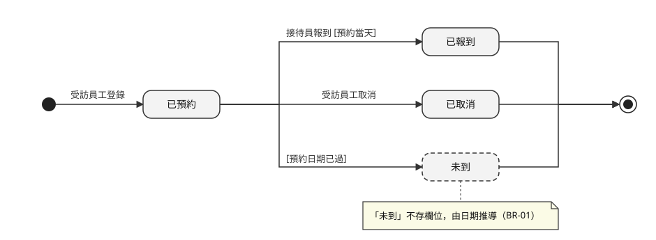

*本圖由作者自製*

### 9.3 非功能需求

| 編號 | 類型 | 非功能需求 | 來自 |
|---|---|---|---|
| NFR-02 | 修改 | 系統裝在廠內一台伺服器，櫃台與員工座位的電腦以瀏覽器連線使用；資料存在伺服器上的資料庫檔；不開放廠外連線 | CR-01-5 |
| NFR-03 | 不變 | 來訪登記在單一頁面完成；從預約報到也一樣 | CR-01-2 |
| NFR-07 | 新增 | 受訪員工帳號只能存取自己的預約，由伺服器端檢查，不靠畫面隱藏 | CR-01-1 |
| NFR-08 | 新增 | CSV 以 UTF-8（含 BOM）編碼，用 Excel 直接開啟不會出現亂碼 | CR-02-3 |

### 9.4 修改後的循序圖

#### 從預約報到（FR-22）

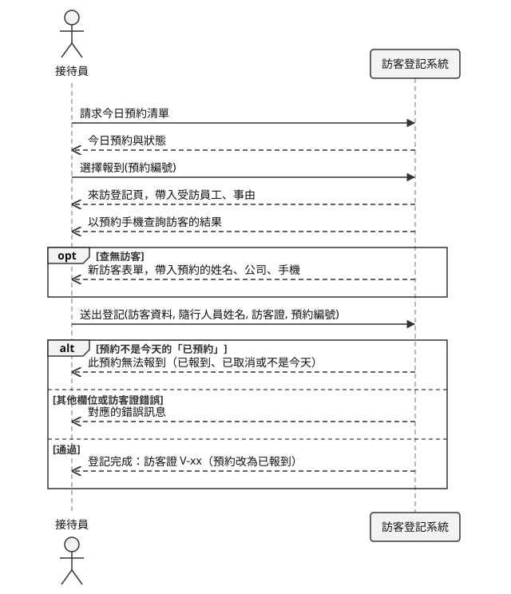

*本圖由作者自製*

#### 補登離廠（FR-24）

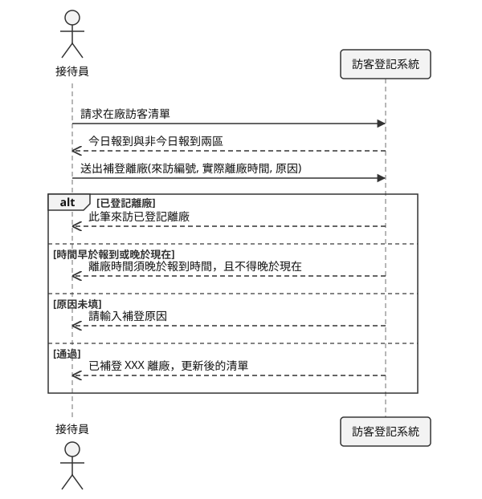

*本圖由作者自製*

---

## 10. 資料變更

### 10.1 修改後的實體關聯圖

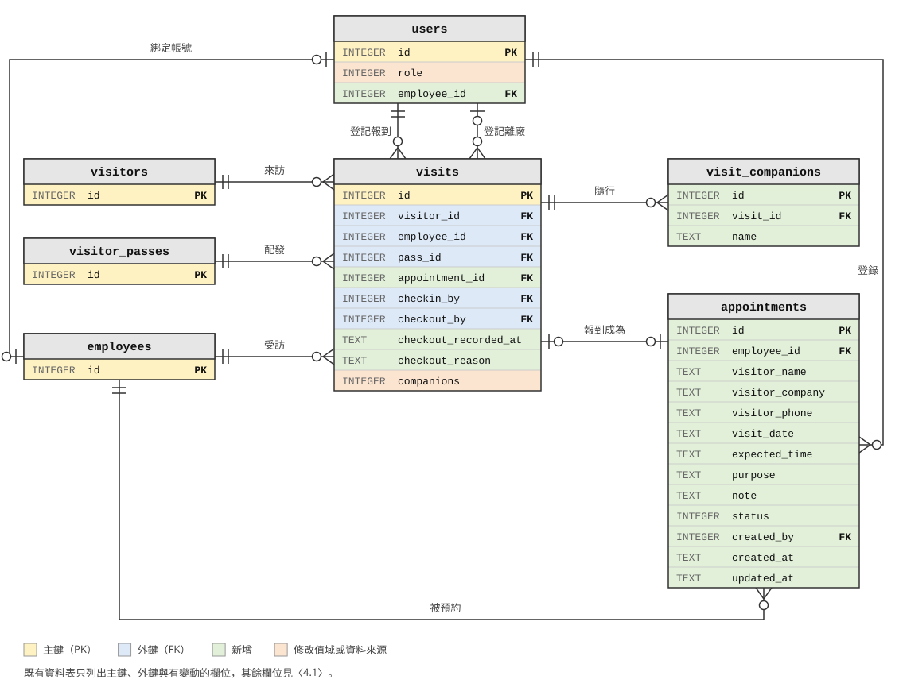

*本圖由作者自製*

圖中只畫出新增的資料表與變動的欄位，其餘欄位見〈4.1〉。

### 10.2 新增資料表：`appointments`

| 欄位名稱 | 中文名稱 | 型別 | 必填 | 值域／格式 | 資料來源 |
|---|---|---|---|---|---|
| `id` | 預約編號 | INTEGER | 是 | 主鍵，系統流水號 | 系統產生 |
| `employee_id` | 受訪員工 | INTEGER | 是 | 對應 `employees.id` | 由登入帳號綁定的員工帶入 |
| `visitor_name` | 訪客姓名 | TEXT | 是 | 1–20 字 | 受訪員工輸入 |
| `visitor_company` | 訪客公司 | TEXT | 是 | 1–40 字 | 受訪員工輸入 |
| `visitor_phone` | 訪客手機 | TEXT | 是 | `09` 開頭的 10 碼數字 | 受訪員工輸入；報到時用來查詢訪客 |
| `visit_date` | 預約日期 | TEXT | 是 | `YYYY-MM-DD`；登錄與修改時不得早於今天 | 受訪員工輸入 |
| `expected_time` | 預計到達時間 | TEXT | 是 | `HH:MM`，07:00–18:00 | 受訪員工輸入 |
| `purpose` | 事由 | TEXT | 是 | 同 `visits.purpose` | 受訪員工選擇 |
| `note` | 備註 | TEXT | 否 | 0–200 字 | 受訪員工輸入 |
| `status` | 狀態 | INTEGER | 是 | `0` 已預約、`1` 已報到、`2` 已取消；預設 0 | 系統依操作寫入 |
| `created_by` | 登錄人 | INTEGER | 是 | 對應 `users.id` | 由登入狀態帶入 |
| `created_at` | 登錄時間 | TEXT | 是 | `YYYY-MM-DD HH:MM:SS` | 系統產生 |
| `updated_at` | 最後修改時間 | TEXT | 否 | 同上；從未修改為 NULL | 系統於修改或取消時寫入 |

### 10.3 新增資料表：`visit_companions`

| 欄位名稱 | 中文名稱 | 型別 | 必填 | 值域／格式 | 資料來源 |
|---|---|---|---|---|---|
| `id` | 隨行人員編號 | INTEGER | 是 | 主鍵，系統流水號 | 系統產生 |
| `visit_id` | 來訪編號 | INTEGER | 是 | 對應 `visits.id` | 登記時帶入 |
| `name` | 隨行人員姓名 | TEXT | 是 | 1–20 字 | 接待員輸入 |

### 10.4 既有資料表的變更

| 資料表 | 欄位 | 變更 | 中文名稱 | 型別 | 必填 | 值域／格式 | 資料來源 |
|---|---|---|---|---|---|---|---|
| `users` | `role` | 修改值域 | 角色 | INTEGER | 是 | `0` 管理員、`1` 接待員、`2` 受訪員工 | 管理員指定 |
| `users` | `employee_id` | 新增 | 綁定員工 | INTEGER | 否 | 對應 `employees.id`；唯一；角色為 2 時必填，其他角色為 NULL | 管理員選擇 |
| `visits` | `appointment_id` | 新增 | 預約編號 | INTEGER | 否 | 對應 `appointments.id`；唯一；現場登記為 NULL | 從預約報到時寫入 |
| `visits` | `checkout_recorded_at` | 新增 | 離廠登記時間 | TEXT | 否 | `YYYY-MM-DD HH:MM:SS`；一般離廠與 `check_out_at` 相同，補登時為補登當下；在廠時為 NULL | 系統寫入 |
| `visits` | `checkout_reason` | 新增 | 補登原因 | TEXT | 否 | 1–100 字；一般離廠為 NULL | 接待員輸入 |
| `visits` | `check_out_at` | 修改意義 | 離廠時間 | TEXT | 否 | 改為「實際離廠時間」；補登時為接待員輸入的時間 | 系統寫入或接待員輸入 |
| `visits` | `companions` | 修改來源 | 隨行人數 | INTEGER | 是 | 0–20 | 改由系統依 `visit_companions` 的筆數寫入；舊資料保留原值 |

`companions` 沒有改成查詢時推導，因為上線前的舊紀錄只有人數、沒有姓名（見〈14〉）。

---

## 11. 畫面設計

修改前的畫面依現行系統的實際畫面重畫，修改後的畫面在同一個版面上標出差異：橘色虛線框加 `★` 的是新增或修改的欄位與按鈕。為了對照種子資料，修改後畫面中的「今天」一律是 2026-11-04。

### 11.1 UI-02 在廠訪客清單

**修改前**

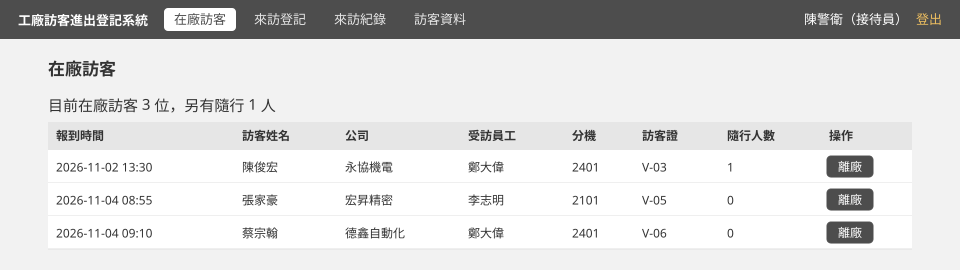

*本圖由作者自製*

**修改後**

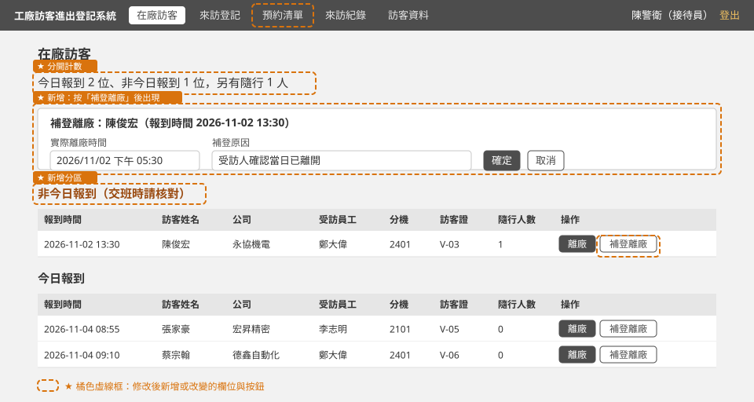

*本圖由作者自製*

| 畫面元素 | 對應資料 |
|---|---|
| 今日／非今日 | `visits.check_in_at` 的日期是否等於今天（推導） |
| 補登的實際離廠時間 | `visits.check_out_at` |
| 補登原因 | `visits.checkout_reason` |
| 補登人、補登時間 | `visits.checkout_by`、`visits.checkout_recorded_at`（系統寫入，不顯示在畫面上） |
| 匯出在廠名單 CSV | 格式見〈11.7〉 |

### 11.2 UI-03 來訪登記頁

**修改前**

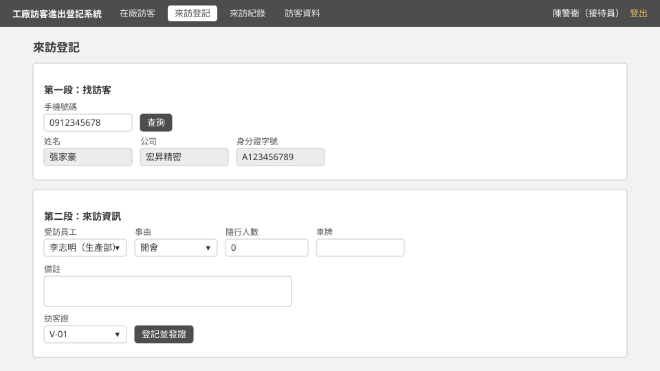

*本圖由作者自製*

**修改後**（從預約清單按「報到」進入，訪客手機尚未建檔的情況）

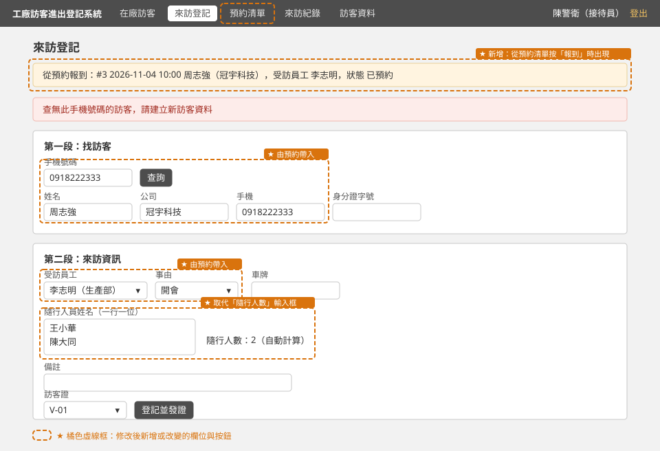

*本圖由作者自製*

| 畫面元素 | 對應資料 |
|---|---|
| 從預約報到的提示列 | `visits.appointment_id` → `appointments`；現場登記時不顯示 |
| 帶入的姓名、公司、手機 | `appointments.visitor_name`、`visitor_company`、`visitor_phone`，存入 `visitors` |
| 帶入的受訪員工、事由 | `appointments.employee_id`、`purpose`，存入 `visits` |
| 隨行人員姓名 | `visit_companions.name` |
| 隨行人數 | `visits.companions`（由姓名筆數計算） |

### 11.3 UI-05 來訪明細與修改頁

**修改前**

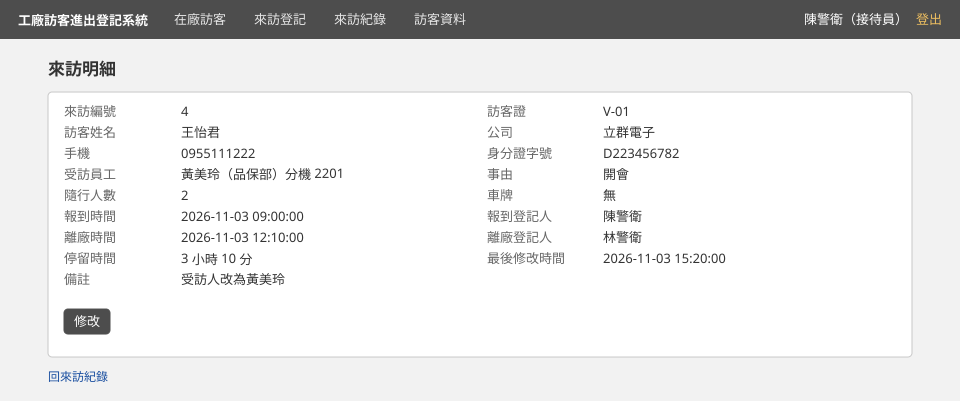

*本圖由作者自製*

**修改後**

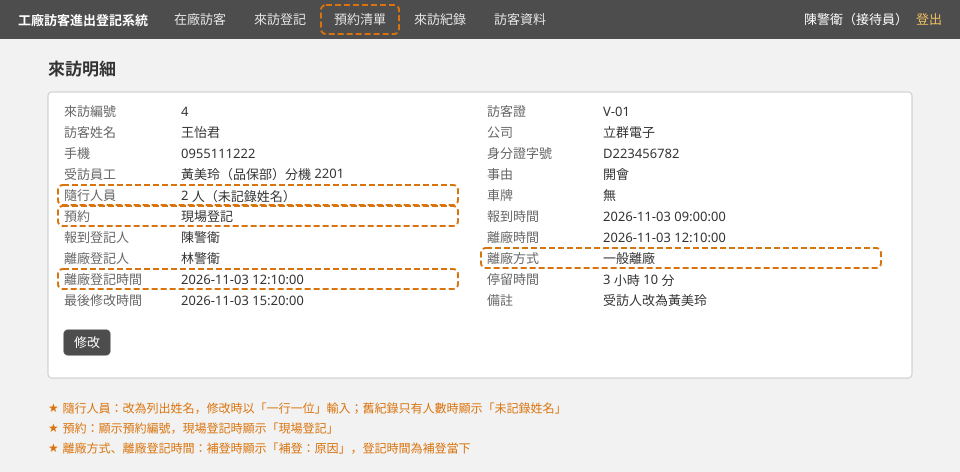

*本圖由作者自製*

| 畫面元素 | 對應資料 |
|---|---|
| 隨行人員 | `visits.companions` 與 `visit_companions.name` |
| 預約 | `visits.appointment_id` |
| 離廠方式 | `visits.checkout_reason` 有值為補登，否則為一般離廠（BR-04） |
| 離廠登記時間 | `visits.checkout_recorded_at` |

### 11.4 UI-09 帳號管理頁

**修改前**

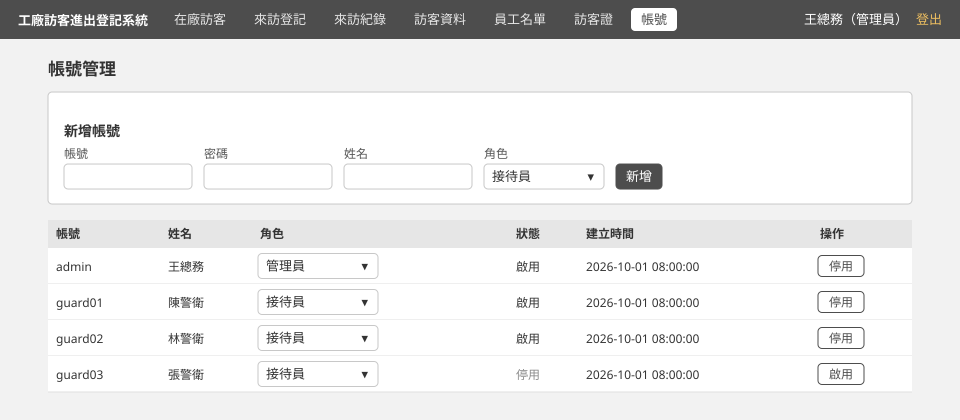

*本圖由作者自製*

**修改後**

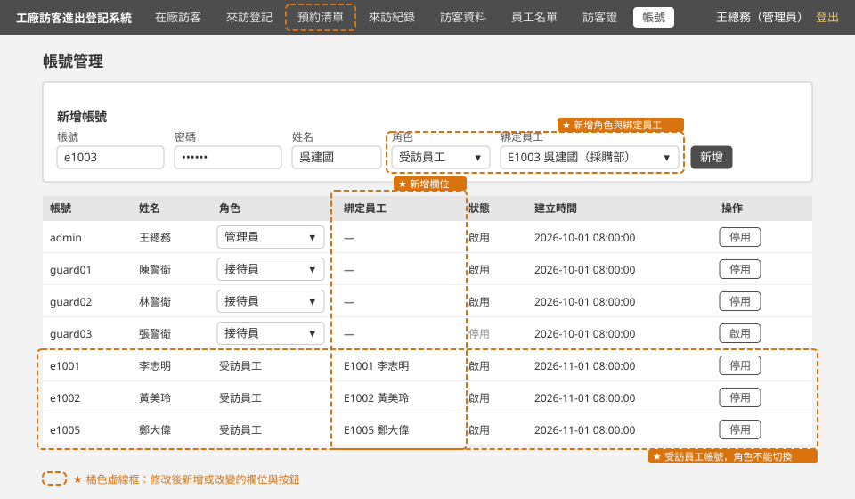

*本圖由作者自製*

選了「受訪員工」角色才出現「綁定員工」下拉，只列在職且尚未綁定帳號的員工，對應 `users.employee_id`。受訪員工帳號的角色以文字顯示，不能切換。

### 11.5 UI-10 預約清單（接待員，新增）

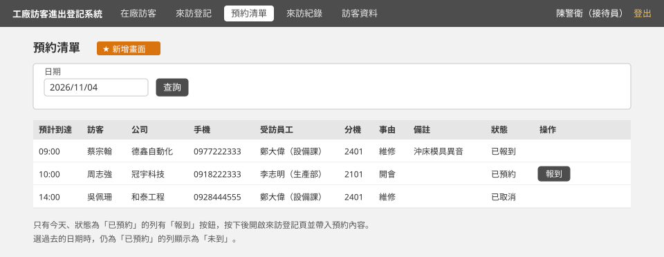

*本圖由作者自製*

欄位依序對應 `appointments` 的 `expected_time`、`visitor_name`、`visitor_company`、`visitor_phone`、`employee_id`（顯示員工姓名、部門與分機）、`purpose`、`note`、`status`。

### 11.6 UI-11 我的預約（受訪員工，新增）

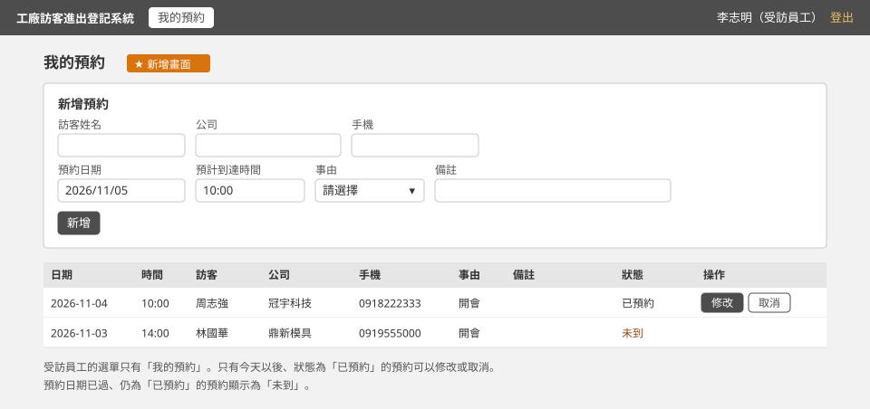

*本圖由作者自製*

新增預約的欄位對應 `appointments` 的 `visitor_name`、`visitor_company`、`visitor_phone`、`visit_date`、`expected_time`、`purpose`、`note`；`employee_id` 由登入帳號綁定的員工帶入，畫面上不必選。

### 11.7 CSV 匯出檔的格式

| 項目 | 內容 |
|---|---|
| 檔名 | `在廠名單_YYYYMMDD_HHMM.csv`，時間為匯出當下 |
| 編碼 | UTF-8，含 BOM（NFR-08） |
| 每一列 | 一個人。訪客一列，每位隨行人員各一列 |
| 欄位 | 類別（訪客／隨行）、姓名、公司、手機、受訪員工、部門、分機、訪客證、報到時間、今日報到（是／否） |
| 隨行人員的列 | 公司、受訪員工、部門、分機、訪客證、報到時間與所屬訪客相同；手機留空 |
| 舊紀錄只有人數 | 一列，類別「隨行」，姓名寫「（未記錄姓名，共 N 人）」 |
| 匯出時機 | 每次交班核對完成後；疏散演練與實際疏散時 |
| 匯出失敗時 | 改用瀏覽器列印在廠清單頁；伺服器連不上時，以最近一次交班匯出的檔案加上交班後的紙本暫記為準 |

---

## 12. 驗收標準與測試案例

測試資料以系統的種子資料為準，日期以「今天」表示執行測試的當天。

| 編號 | 驗證的變更 | 前置條件 | 操作步驟 | 預期結果 |
|---|---|---|---|---|
| TC-01 | CR-01-1 | 已有綁定李志明的受訪員工帳號 | 以該帳號登入，新增一筆明天 10:00 的預約 | 登入後進入「我的預約」；清單出現該筆，狀態「已預約」；選單只有「我的預約」 |
| TC-02 | CR-01-1 | 同上 | 新增預約日期為昨天的預約 | 顯示「預約日期不得早於今天」，未建立 |
| TC-03 | CR-01-1、NFR-07 | 以李志明帳號登入 | 直接呼叫修改黃美玲某筆預約的功能 | 被拒絕，資料不變 |
| TC-04 | CR-01-2 | 今天有一筆李志明的已預約，訪客手機已建檔 | 接待員在預約清單按「報到」，選訪客證後送出 | 登記頁已帶入受訪員工、事由與訪客資料；完成後預約變「已報到」，在廠清單出現該訪客 |
| TC-05 | CR-01-2 | 今天有一筆預約，訪客手機未建檔 | 按「報到」 | 新訪客表單已帶入預約的姓名、公司、手機，接待員只需補身分證字號 |
| TC-06 | CR-01-2 | TC-04 完成後 | 對同一筆預約再按一次「報到」並送出 | 顯示此預約無法報到，未建立第二筆來訪 |
| TC-07 | CR-01-3 | 無 | 不經預約，照現況流程登記一位訪客 | 登記成功，來訪紀錄的預約編號為空 |
| TC-08 | CR-01-4 | 有一筆預約日期早於今天、狀態仍為已預約 | 在預約清單選該日期；以該受訪員工登入看「我的預約」 | 兩處都顯示「未到」，沒有報到、修改、取消按鈕 |
| TC-09 | CR-01-5 | 系統裝在伺服器上 | 從另一台員工電腦的瀏覽器開啟系統網址 | 可以登入使用 |
| TC-10 | CR-02-1 | 種子資料（陳俊宏 11/2 報到未離廠） | 開啟在廠清單 | 陳俊宏出現在「非今日報到」區，上方人數分開顯示 |
| TC-11 | CR-02-2 | 同上 | 對陳俊宏補登離廠，時間 2026-11-02 17:30，原因「受訪人確認當日已離開」 | 陳俊宏離開清單；明細頁顯示離廠時間 11/2 17:30、補登原因、補登人與補登時間；V-03 回到可用 |
| TC-12 | CR-02-2 | 有一筆在廠紀錄 | 補登時間早於報到時間；再試晚於現在；再試原因空白 | 依序顯示對應的錯誤訊息，資料不變 |
| TC-13 | CR-02-3 | 種子資料 | 按「匯出在廠名單 CSV」，用 Excel 開啟 | 檔名符合格式；中文不亂碼；陳俊宏的隨行人員顯示「（未記錄姓名，共 1 人）」 |
| TC-14 | CR-02-4 | 無 | 登記一位訪客，隨行人員輸入兩個姓名 | 隨行人數自動為 2；明細頁列出兩個姓名；CSV 中該訪客之後有兩列「隨行」 |
| TC-15 | CR-02-4 | 無 | 隨行人員輸入 21 個姓名 | 顯示隨行人員上限的錯誤訊息，未建立 |

**允收條件**：TC-01～TC-15 全部通過才能上線。現況的既有功能（FR-01～FR-18 未修改的部分）以期中整理的操作步驟再跑一次，結果必須與修改前相同。

---

## 13. 作業與組織衝擊

### 13.1 要修訂的作業標準（SOP）

| SOP | 修訂內容 | 負責單位 |
|---|---|---|
| 大門訪客登記作業 | 新增「有預約先查預約清單」的步驟；隨行人員要逐一登記姓名 | 總務課 |
| 警衛交班作業 | 新增：交班時核對非今日報到的紀錄，逐筆打分機確認後補登離廠，最後匯出在廠名單留存 | 總務課 |
| 緊急疏散作業 | 疏散時由櫃台匯出在廠名單交給工安課點名，取代手抄名單 | 工安課 |
| 訪客接待作業（新） | 受訪員工在訪客來訪前一天以前登錄預約；訪客取消時自行取消預約 | 總務課發布，各部門遵守 |

### 13.2 教育訓練

| 對象 | 內容 | 時間 |
|---|---|---|
| 接待員（警衛） | 預約清單與從預約報到、補登離廠、匯出 CSV、交班核對 SOP | 上線前一次，30 分鐘，含實機操作 |
| 受訪員工 | 登入、新增與取消預約 | 一頁操作說明，隨帳號通知發送；各部門晨會宣導 |
| 管理員 | 建立受訪員工帳號、伺服器上資料庫檔的備份 | 上線前一次，30 分鐘 |
| 工安課 | 讀懂 CSV 欄位，納入疏散演練 | 下一次疏散演練時 |

### 13.3 跨部門協調

| 部門 | 要協調的事 |
|---|---|
| 資訊單位 | 提供廠內伺服器、開放廠內網路連線、資料庫檔的定期備份 |
| 人資部 | 提供需要開帳號的員工名單；員工離職時通知管理員 |
| 工安課 | 確認 CSV 欄位足夠疏散點名；把匯出步驟寫進疏散演練 |
| 各部門主管 | 要求同仁事先登錄預約 |

---

## 14. 資料轉換規則

| 舊資料 | 轉換規則 |
|---|---|
| 既有來訪紀錄 | `appointment_id` 一律為 NULL，視為現場登記 |
| 既有已離廠的紀錄 | `checkout_recorded_at` 設為與 `check_out_at` 相同；`checkout_reason` 為 NULL，視為一般離廠 |
| 既有在廠紀錄（種子資料第 3、6、7 筆） | 不轉換，上線後第一次交班核對時，依實際情況補登或正常離廠 |
| 既有隨行人數 | 保留人數，不補姓名，`visit_companions` 沒有對應資料。畫面與 CSV 顯示「未記錄姓名」 |
| 既有帳號 | `role` 0、1 不變，`employee_id` 為 NULL |
| 受訪員工帳號 | 上線前由管理員依人資部提供的名單建立 |

---

## 15. 上線切換與回復原則

**切換時機**：選一個週一，在早上 07:30 訪客進廠前切換。切換前一週，先用複製的資料庫在伺服器上演練 TC-01～TC-15。

**不並行**：新舊系統不同時使用。在廠名單只能有一份，兩套並行會讓同一位訪客在兩邊的狀態不一致。

**切換步驟**：停用櫃台舊系統 → 備份 `database.db` → 套用〈14〉的轉換 → 啟動伺服器 → 接待員以 TC-10 確認在廠清單與轉換前一致。

**回復條件**：上線當天出現下列任一狀況，就退回舊版：來訪登記或離廠無法使用超過 15 分鐘；在廠清單的人數與實際不符且當天無法修正。回復時用切換前的備份還原舊系統，新版期間的進出由接待員依紙本暫記補登進舊系統。

---

## 16. 需求追溯

| 變更 | 需求 | 流程 | 資料 | 畫面 | 驗收 |
|---|---|---|---|---|---|
| CR-01-1 | FR-04、FR-18、FR-19、FR-20、NFR-07 | 〈6.1〉 | `users.role`、`users.employee_id`、`appointments` | UI-09、UI-11 | TC-01、TC-02、TC-03 |
| CR-01-2 | FR-07、FR-21、FR-22、NFR-03 | 〈6.2〉、〈9.4〉從預約報到 | `appointments.status`、`visits.appointment_id` | UI-03、UI-10 | TC-04、TC-05、TC-06 |
| CR-01-3 | FR-05～FR-10（不變） | 〈6.2〉沒有預約的分支 | `visits.appointment_id` 為 NULL | UI-03 | TC-07 |
| CR-01-4 | FR-23、BR-01 | 〈9.2〉狀態轉移 | `appointments.visit_date`、`status`（推導未到） | UI-10、UI-11 | TC-08 |
| CR-01-5 | NFR-02 | — | — | — | TC-09 |
| CR-02-1 | FR-11 | 〈6.3〉交班 | `visits.check_in_at`（推導今日／非今日） | UI-02 | TC-10 |
| CR-02-2 | FR-12、FR-24、BR-03、BR-04 | 〈6.3〉補登、〈9.4〉補登離廠 | `visits.check_out_at`、`checkout_recorded_at`、`checkout_reason`、`checkout_by` | UI-02、UI-05 | TC-11、TC-12 |
| CR-02-3 | FR-25、NFR-08 | 〈6.3〉匯出 | 讀取 `visits`、`visitors`、`employees`、`visitor_passes`、`visit_companions` | UI-02、〈11.7〉 | TC-13 |
| CR-02-4 | FR-07、FR-14、FR-25、BR-05 | 〈6.2〉填寫隨行人員 | `visit_companions`、`visits.companions` | UI-03、UI-05、〈11.7〉 | TC-14、TC-15 |

每一項變更都追得到至少一條需求、一項資料與一個測試案例。CR-01-5 只改安裝位置，沒有對應的流程、資料與畫面。

---

## 附錄：分工紀錄

| 項目 | 負責人 | 完成週次 | 繳交位置 |
|---|---|---|---|
| 第一部分 1、2 系統背景與角色、現況流程 | 小明、阿花 | 第 11 週 | 報告〈1〉〈2〉 |
| 第一部分 3、4 現況功能與需求、現況資料 | 阿宏、小美 | 第 11 週 | 報告〈3〉〈4〉 |
| 變更申請、議題紀錄 | 全組討論，小明整理 | 第 12 週 | 報告〈5〉 |
| 差異分析、影響分析 | 阿花 | 第 13 週 | 報告〈6〉〈7〉 |
| 效益評估（含櫃台觀察） | 阿宏、小美 | 第 13 週 | 報告〈8〉 |
| 修改後的需求與循序圖 | 小明 | 第 14 週 | 報告〈9〉 |
| 資料變更 | 小美 | 第 14 週 | 報告〈10〉 |
| 畫面設計 | 阿宏 | 第 15 週 | 報告〈11〉 |
| 驗收標準與測試案例 | 阿花 | 第 15 週 | 報告〈12〉 |
| 作業與組織衝擊、資料轉換、上線切換 | 小美、阿宏 | 第 16 週 | 報告〈13〉～〈15〉 |
| 需求追溯、全文校對 | 小明 | 第 16 週 | 報告〈16〉 |
