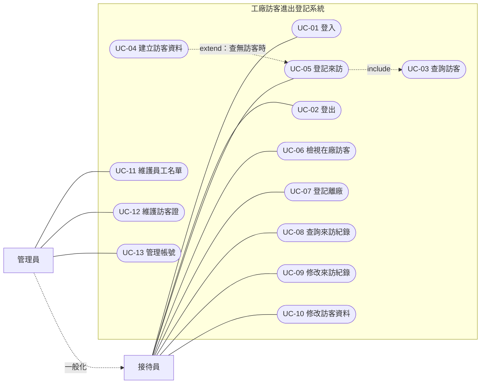
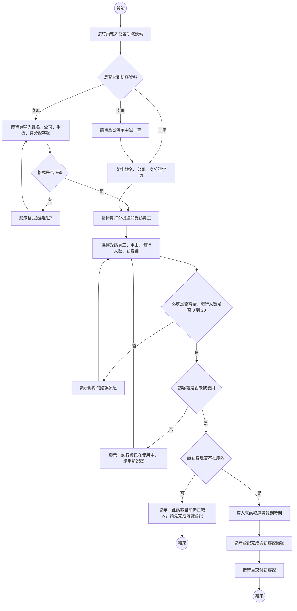
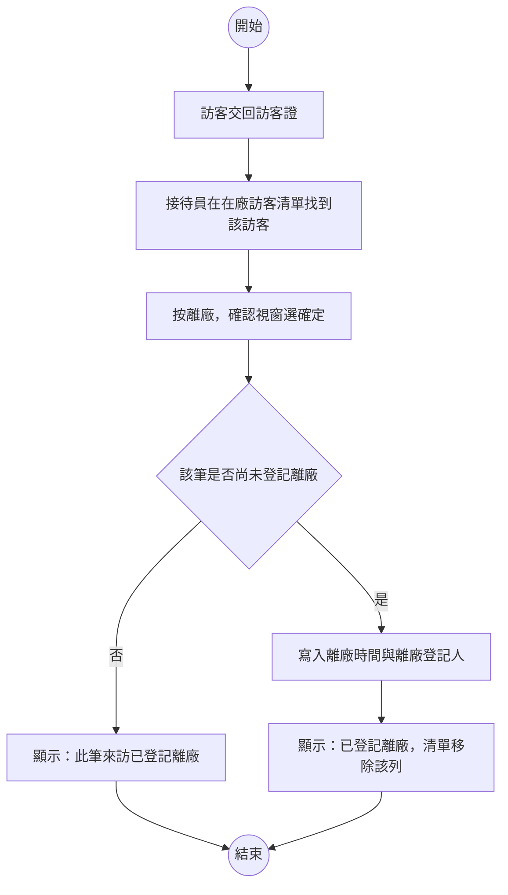
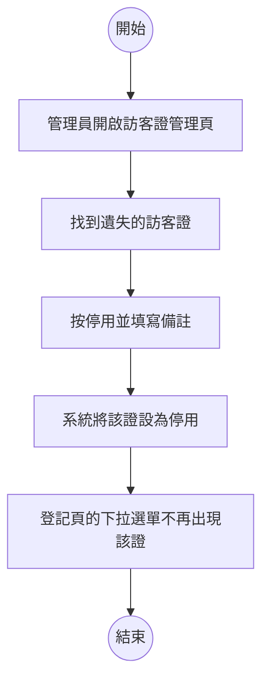
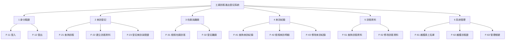
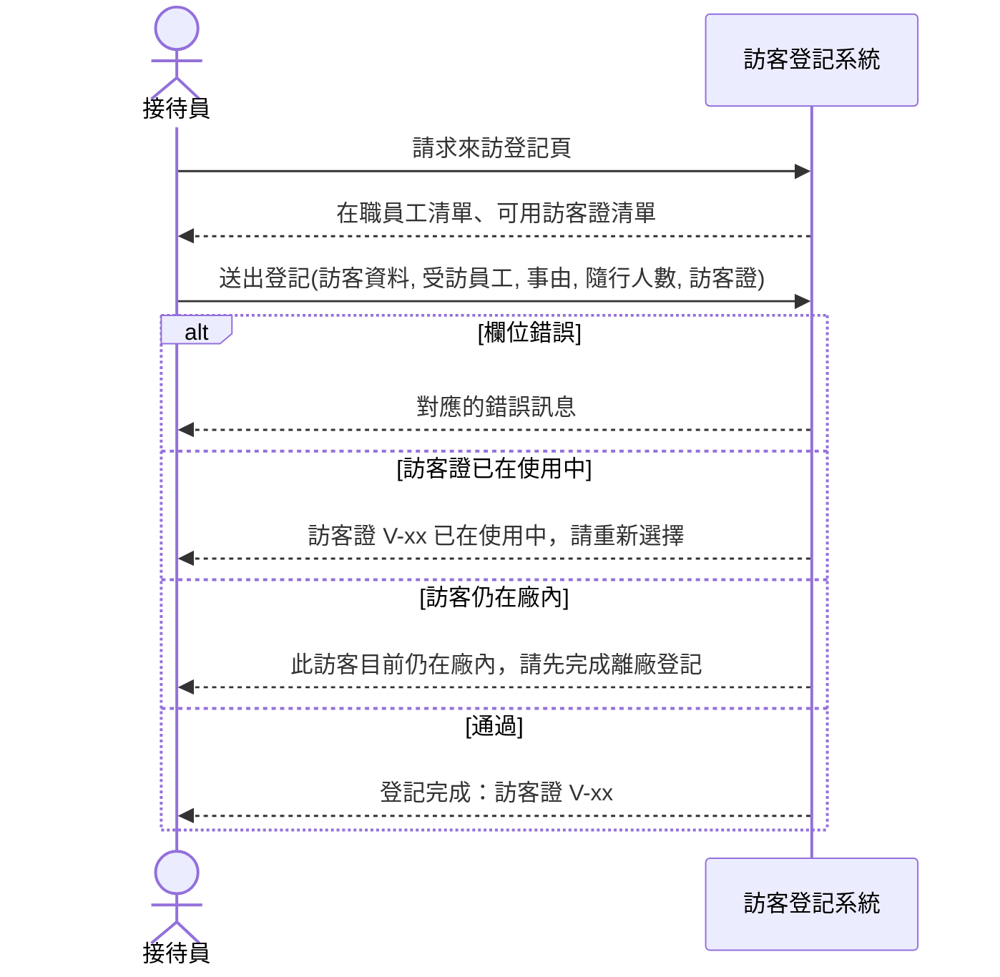
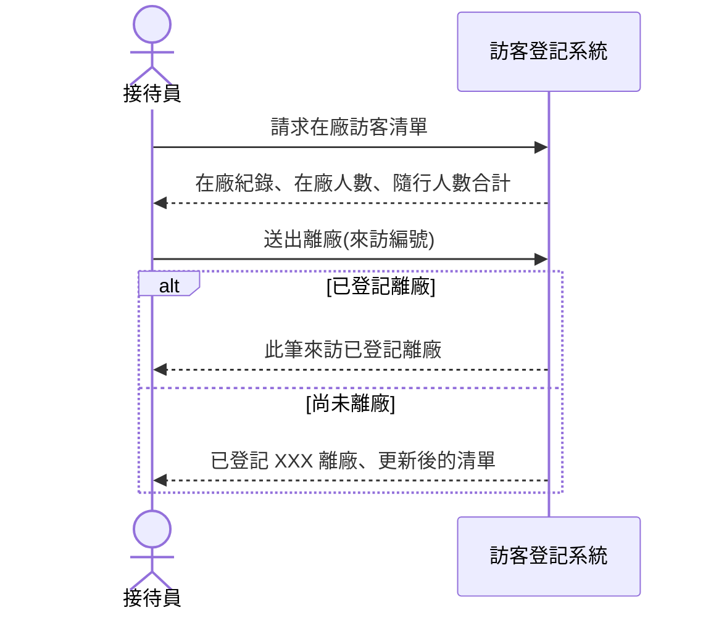
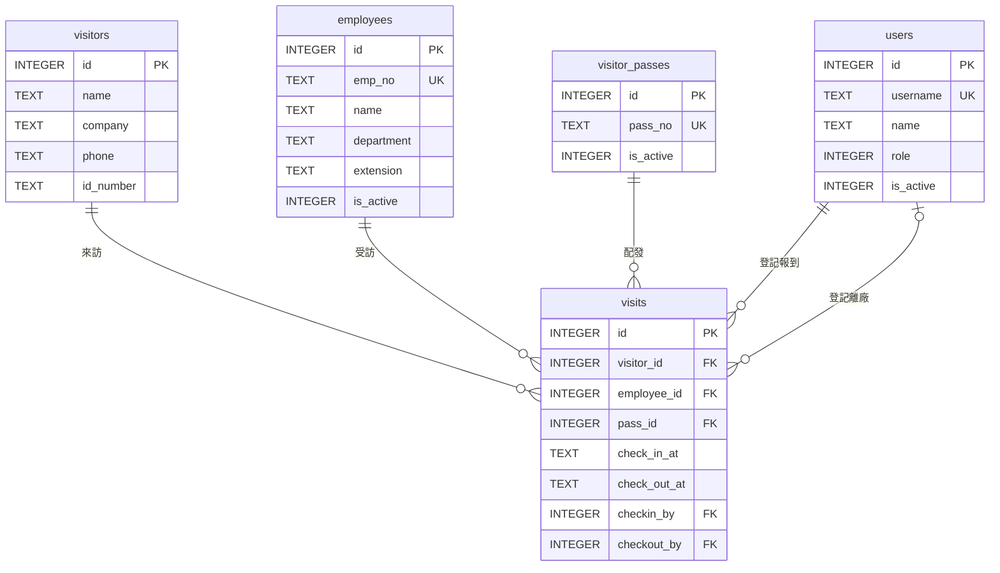
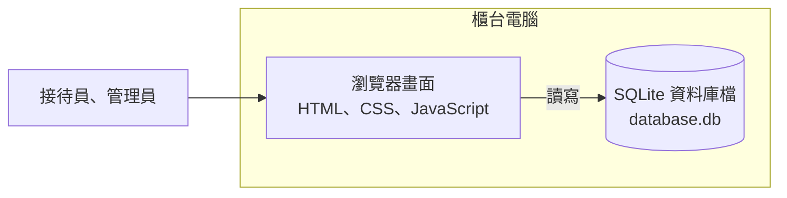

# 系統分析報告：工廠訪客進出登記系統

> 這是一份依期中報告規格寫成的完整系統分析報告，分析對象是期末示範用的既有系統「工廠訪客進出登記系統」，系統規格見[工廠訪客進出登記系統：系統規格書](Visitor-System-Spec.md)。
>
> 內容依[報告內容](../00-Course-Introduction/Report-Contents.md)〈一、期中小組報告〉的九項排列。期末報告第一部分是這份報告的簡要版，見[期末範例報告](Final-Phase-Sample-Report.md)，兩份對照看，可以看出簡要版保留了什麼、省略了什麼。

---

## 報告基本資料

| 項目 | 內容 |
|---|---|
| 課程 | 系統分析與設計（IE226）115-1 |
| 報告階段 | 系統分析（依期中報告規格撰寫的示範） |
| 分析對象 | 工廠訪客進出登記系統（現行版） |
| 組別 | 第 3 組 |
| 組員 | 小明（1130001）、阿花（1130002）、阿宏（1130003）、小美（1130004） |
| 書面繳交日 | — |
| 口頭報告日 | — |

各成員負責的章節與圖表見文末的〈附錄：分工紀錄〉。

---

## 1. 問題與系統背景

### 1.1 系統概述

本系統是一間中型電子零件廠大門接待櫃台使用的訪客登記系統。訪客到廠時，接待員在系統上登記並發給訪客證；訪客離開時，接待員登記離廠並收回訪客證。管理員負責維護員工名單、訪客證與系統帳號。

系統裝在櫃台的一台電腦上，畫面、程式與資料庫都在這台電腦裡，不連接其他系統。

| 面向 | 現況 |
|---|---|
| 子系統 | 6 個：身分驗證、來訪登記、在廠與離廠、來訪紀錄、訪客資料、系統管理 |
| 角色 | 2 種：接待員、管理員 |
| 資料表 | 5 張：`users`、`employees`、`visitors`、`visits`、`visitor_passes` |
| 對外介接 | 無 |

### 1.2 現況說明

訪客進出的作業分成系統內與系統外兩部分。

系統內：訪客到櫃台後，接待員輸入手機號碼查詢訪客資料，查不到就當場建檔。接待員選擇受訪員工、事由與一張訪客證，送出後系統記錄報到時間。訪客離開時交回訪客證，接待員在在廠訪客清單上按「離廠」。

系統外：訪客到了之後，接待員要打受訪員工的分機請他出來接人，系統只提供分機號碼。訪客的身分證件由接待員目視核對。訪客證是實體卡片，收發都靠接待員動手。

### 1.3 原本要解決的問題

| 系統上看到的 | 反推出的問題 |
|---|---|
| 來訪紀錄可依日期與關鍵字查詢 | 紙本登記簿要一頁一頁翻，查不到過去的來訪 |
| 首頁就是在廠訪客清單，上方顯示在廠人數 | 說不出廠內現在有哪些訪客 |
| 每筆來訪都綁一張訪客證，使用中的證不能再發 | 訪客證發出去後，不知道在誰身上 |
| 輸入手機就帶出姓名、公司與身分證字號 | 回頭訪客每次都要重寫一次資料 |

上表四列各歸納為一條問題：

| 編號 | 誰受影響 | 發生什麼 | 造成什麼後果 |
|---|---|---|---|
| P-01 | 接待員、管理員 | 來訪紀錄寫在紙本登記簿上 | 要查某位訪客何時來過，只能逐頁翻找 |
| P-02 | 廠方的安全管理人員 | 沒有即時的在廠訪客名單 | 發生緊急狀況時，無法確認廠內還有多少外人 |
| P-03 | 管理員 | 訪客證的去向沒有紀錄 | 訪客證遺失時查不出最後在誰手上 |
| P-04 | 訪客、接待員 | 每次來訪都要重填資料 | 尖峰時段訪客在櫃台排隊 |

推不出理由的部分：`employees.department` 是自由文字而非選單，看不出當初是刻意保留彈性，還是沒有考慮到部門名稱要統一，需訪談開發者才能確認。

### 1.4 系統處理了哪些、哪些仍靠人工

| 事項 | 系統處理的部分 | 仍靠人工或沒有 |
|---|---|---|
| 通知受訪員工 | 顯示受訪員工的分機 | 接待員打電話通知 |
| 事前預約 | 沒有這個功能 | 訪客到了才登記 |
| 核對身分 | 存下身分證字號 | 接待員目視核對證件 |
| 收發訪客證 | 記錄哪張證配給哪筆來訪 | 實體卡片的收發 |
| 隨行人員 | 只記人數 | 隨行人員是誰，系統不知道 |
| 訪客沒登記離廠就離開 | 沒有任何偵測 | 只能靠接待員自己發現 |

### 1.5 分析範圍

| 涵蓋 | 不涵蓋 | 理由 |
|---|---|---|
| 六個子系統的全部功能 | 系統的安裝與啟動方式 | 屬於維運，不影響使用者的作業方式 |
| 五張資料表的結構與欄位定義 | 版面樣式與色彩配置 | 不涉及功能與資料 |
| 兩種角色的權限與例外處理 | 密碼雜湊的演算法 | 屬於實作細節 |

### 1.6 判斷依據

| 判斷 | 依據 |
|---|---|
| P-01 | 來訪紀錄查詢頁提供日期區間與關鍵字兩種條件 |
| P-02 | 登入後的第一個畫面就是在廠訪客清單；清單上方的在廠人數摘要 |
| P-03 | `visits.pass_id` 欄位；登記時使用中的訪客證不出現在下拉選單 |
| P-04 | 來訪登記頁的第一步是輸入手機號碼查詢 |
| 「受訪員工靠電話通知」 | `employees.extension` 欄位顯示在在廠清單上；系統沒有任何通知功能，受訪員工也沒有帳號 |

---

## 2. 使用者與利害關係人分析

### 2.1 使用者

| 角色 | 使用目標 | 主要需求 | 權限範圍 | 最在意 |
|---|---|---|---|---|
| 接待員 | 讓訪客快速登記進廠，並掌握廠內有誰 | 查詢與建立訪客、登記來訪、登記離廠、查詢與修改來訪紀錄、修改訪客資料 | 不能維護員工名單、訪客證與帳號 | 尖峰時段要快，早上八點多常有好幾位訪客同時到 |
| 管理員 | 維護系統的基本資料 | 接待員的全部需求，加上員工名單、訪客證與帳號的維護 | 全部功能；不能停用自己或修改自己的角色 | 員工名單與訪客證的資料正確 |

### 2.2 利害關係人

| 利害關係人 | 是否操作系統 | 受影響的方式 |
|---|---|---|
| 訪客 | 否 | 姓名、手機與完整身分證字號被存進系統；持護照的外籍訪客，身分證字號欄位填不進去 |
| 受訪員工 | 否 | 訪客到了只能等接待員來電；查不到自己的來訪紀錄 |
| 工安與環安人員 | 否 | 緊急疏散時需要在廠訪客名單，但名單只在櫃台電腦上 |
| 總務人員（訪客證採購） | 由管理員兼任 | 訪客證遺失要補購，需要知道遺失前最後在誰手上 |

### 2.3 使用案例圖

管理員繼承接待員的全部能力，以一般化表示，不重複連線。登記來訪一定先查詢訪客，因此 UC-03 是 UC-05 的包含關係；建立訪客資料只在查無訪客時發生，因此 UC-04 是 UC-05 的延伸關係。

受訪員工與訪客不操作系統，不畫在圖上，列在〈2.2〉。

---

## 3. 現況流程分析

### 3.1 來訪登記與發證

> **主要角色**：接待員
> **次要角色**：訪客、受訪員工（皆不操作系統）
> **觸發事件**：訪客抵達大門櫃台
> **前置條件**：接待員已登入
> **主要步驟**：輸入手機查詢訪客 → 帶出或建立訪客資料 → 打分機通知受訪員工 → 選擇受訪員工、事由與訪客證 → 送出 → 發給訪客證
> **例外情況**：查無訪客、欄位格式錯誤、訪客證已被使用、該訪客仍在廠內
> **完成後狀態**：建立一筆來訪紀錄，報到時間為送出當下，訪客證綁定這筆來訪

這條流程跨三個角色，用泳道表呈現誰做什麼：

| 步驟 | 訪客 | 接待員 | 系統 | 受訪員工 |
|:--:|---|---|---|---|
| 1 | 告知手機號碼並出示證件 | | | |
| 2 | | 輸入手機號碼查詢 | | |
| 3 | | | 查到就帶出姓名、公司與身分證字號；查不到就顯示新訪客表單 | |
| 4 | | 核對證件；新訪客時輸入四項資料 | | |
| 5 | | 打分機通知受訪員工 | | 接電話，同意出來接人 |
| 6 | | 選擇受訪員工、事由、訪客證，送出 | | |
| 7 | | | 依序檢查欄位、訪客證、是否仍在廠內，寫入來訪紀錄 | |
| 8 | | 把訪客證交給訪客 | | |
| 9 | 掛上訪客證，等受訪員工來接 | | | 到櫃台接人 |

步驟 5「打分機通知」不經過系統，系統只在畫面上顯示分機號碼。受訪員工沒接電話時怎麼處理，系統沒有規範，由接待員自行判斷。

D5 擋下的情況，在實測中會遇到一個問題：11/2 進廠、沒有登記離廠的陳俊宏再來時，系統會擋住他，接待員必須先替 11/2 那筆補登離廠，但補登的離廠時間會是今天，不是他實際離開的時間。這一點列入〈9.1〉的 I-01。

### 3.2 離廠登記

> **主要角色**：接待員
> **觸發事件**：訪客交回訪客證
> **前置條件**：接待員已登入；該訪客在在廠訪客清單上
> **主要步驟**：開啟在廠訪客清單 → 找到該訪客 → 按「離廠」→ 確認 → 系統寫入離廠時間與登記人
> **例外情況**：該筆已被其他接待員登記離廠
> **完成後狀態**：來訪紀錄的離廠時間有值，訪客證回到可用狀態

訪客沒有交回訪客證就離開時，這條流程根本不會被觸發。在廠訪客清單不區分報到日期，11/2 報到的陳俊宏與今天報到的訪客排在一起，看不出哪一筆是「忘了登記離廠」。

### 3.3 管理員停用遺失的訪客證

> **主要角色**：管理員
> **觸發事件**：發現某張訪客證遺失
> **前置條件**：管理員已登入
> **主要步驟**：開啟訪客證管理頁 → 找到該證 → 按「停用」→ 填寫備註 → 系統更新狀態
> **例外情況**：無
> **完成後狀態**：該證的啟用旗標為 0，之後不出現在登記的下拉選單

這條流程沒有任何檢查。實測把使用中的 `V-05` 停用，系統沒有提示，在廠清單上張家豪的訪客證仍顯示 `V-05`，離廠時也照常登記。這一點列入〈9.1〉的 I-09。

---

## 4. 系統需求分析

### 4.1 功能需求

| 編號 | 功能需求 | 依據 |
|---|---|---|
| FR-01 | 系統應提供登入功能，以帳號與密碼驗證身分 | 登入頁的兩個欄位 |
| FR-02 | 系統應阻擋已停用的帳號登入 | 以停用的種子帳號 `guard03` 實測，顯示「此帳號已停用，請洽管理員」 |
| FR-03 | 系統應提供登出功能，登出後回到登入頁 | 各頁右上角的登出連結 |
| FR-04 | 登入後應進入在廠訪客清單，選單依角色顯示可用功能 | 接待員看到四項選單，管理員看到七項 |
| FR-05 | 系統應能以手機號碼查詢訪客，查到多筆時列出讓接待員選擇 | 來訪登記頁第一段；程式中的訊息「找到 N 筆訪客資料，請選擇」 |
| FR-06 | 查無訪客時，接待員可建立新訪客，姓名、公司、手機、身分證字號皆為必填 | 新訪客表單的四個欄位與格式錯誤訊息 |
| FR-07 | 接待員可登記來訪，填寫受訪員工、事由、隨行人數、車牌、備註並選擇訪客證，送出即記錄報到時間 | 來訪登記頁第二段；`visits.check_in_at` 欄位 |
| FR-08 | 受訪員工只能從在職員工中選擇 | 下拉選單中沒有已離職的許文傑 |
| FR-09 | 訪客證只能選擇啟用中且未被使用的證，送出時須再檢查一次 | 下拉選單中沒有 `V-03`、`V-05`、`V-06`、`V-07` |
| FR-10 | 同一筆訪客資料仍在廠內時，不得再登記新的來訪 | 以在廠的陳俊宏實測，顯示「此訪客目前仍在廠內」 |
| FR-11 | 系統應列出所有在廠的訪客，並顯示在廠人數與隨行人數合計 | 在廠訪客清單與上方摘要 |
| FR-12 | 接待員可登記離廠，系統記錄離廠時間與登記人，並釋出訪客證 | 清單上的「離廠」按鈕；`visits.check_out_at`、`checkout_by` 欄位 |
| FR-13 | 系統應能依報到日期區間與關鍵字查詢來訪紀錄 | 來訪紀錄查詢頁的兩種條件 |
| FR-14 | 接待員可修改來訪紀錄的事由、受訪員工、隨行人數、車牌與備註，報到與離廠時間不可修改 | 明細頁按「修改」後只有五個欄位可編輯 |
| FR-15 | 接待員可修改訪客的姓名、公司、手機與身分證字號 | 訪客資料頁的修改功能 |
| FR-16 | 管理員可新增與修改員工資料，並設為在職或離職 | 員工名單頁 |
| FR-17 | 管理員可新增訪客證，並停用或啟用 | 訪客證管理頁 |
| FR-18 | 管理員可新增帳號、設定角色、啟用或停用帳號，但不得停用自己或修改自己的角色 | 帳號管理頁；對自己操作時的兩則錯誤訊息 |

### 4.2 非功能需求

| 編號 | 非功能需求 | 依據 |
|---|---|---|
| NFR-01 | 密碼不得以明文儲存 | `users.password_hash` 存的是雜湊值 |
| NFR-02 | 系統在櫃台的一台電腦上執行，資料存在同一台電腦的資料庫檔 | 資料庫檔 `database.db` 與程式放在同一個資料夾；系統沒有任何網路設定 |
| NFR-03 | 來訪登記應在單一頁面完成，不換頁 | 來訪登記頁的兩段在同一頁 |
| NFR-04 | 來訪紀錄不得刪除 | 所有畫面都沒有刪除來訪紀錄的按鈕 |
| NFR-05 | 時間一律記錄本機時間，精確到秒 | 資料表中時間欄位的格式 |
| NFR-06 | 畫面以桌上型電腦螢幕為對象 | 以手機開啟時表格超出畫面 |

---

## 5. 功能分析與系統邊界

### 5.1 功能階層圖

分群依一位訪客的進出順序：先登記、在廠、離廠，之後才是查詢紀錄。「在廠與離廠」單獨成群，是因為它有自己的規則：在廠與否不存欄位，由離廠時間是否為空推導。

### 5.2 功能清單

| 代號 | 功能名稱 | 使用角色 | 對應需求 | 對應使用案例 |
|---|---|---|---|---|
| F-11 | 登入 | 接待員、管理員 | FR-01、FR-02、FR-04 | UC-01 |
| F-12 | 登出 | 接待員、管理員 | FR-03 | UC-02 |
| F-21 | 查詢訪客 | 接待員、管理員 | FR-05 | UC-03 |
| F-22 | 建立訪客資料 | 接待員、管理員 | FR-06 | UC-04 |
| F-23 | 登記來訪與發證 | 接待員、管理員 | FR-07、FR-08、FR-09、FR-10、NFR-03 | UC-05 |
| F-31 | 檢視在廠訪客 | 接待員、管理員 | FR-11 | UC-06 |
| F-32 | 登記離廠 | 接待員、管理員 | FR-12 | UC-07 |
| F-41 | 查詢來訪紀錄 | 接待員、管理員 | FR-13 | UC-08 |
| F-42 | 檢視來訪明細 | 接待員、管理員 | FR-13 | UC-08 |
| F-43 | 修改來訪紀錄 | 接待員、管理員 | FR-14、NFR-04 | UC-09 |
| F-51 | 查詢訪客資料 | 接待員、管理員 | FR-15 | UC-10 |
| F-52 | 修改訪客資料 | 接待員、管理員 | FR-15 | UC-10 |
| F-61 | 維護員工名單 | 管理員 | FR-16 | UC-11 |
| F-62 | 維護訪客證 | 管理員 | FR-17 | UC-12 |
| F-63 | 管理帳號 | 管理員 | FR-18 | UC-13 |

### 5.3 系統邊界

| 界內（本系統有） | 界外（本系統沒有） | 如何確認 |
|---|---|---|
| 訪客到廠後的現場登記 | 事前預約 | 沒有任何「預定來訪日」欄位；來訪紀錄一建立就有報到時間 |
| 顯示受訪員工的分機 | 通知受訪員工 | 受訪員工沒有帳號；系統沒有寄信或簡訊設定 |
| 訪客證與來訪紀錄的綁定 | 訪客證實體的收發 | 系統只記錄 `pass_id`，交付與收回由接待員動手 |
| 隨行人數 | 隨行人員的個別資料 | `visits.companions` 只是一個整數 |
| 員工名單的手動維護 | 與人資系統同步 | 員工名單只能由管理員在畫面上新增與修改 |
| 畫面上的查詢 | 報表匯出與列印 | 查詢頁沒有匯出或列印按鈕 |

本系統沒有任何外部系統或設備介接。經檢視畫面、程式與資料表後確認，所有資料都由櫃台人員在這台電腦上輸入。

---

## 6. 使用案例與系統互動分析

### 6.1 UC-05 登記來訪

| 欄位 | 內容 |
|---|---|
| 編號與名稱 | UC-05 登記來訪 |
| 主要參與者 | 接待員 |
| 前置條件 | 接待員已登入；已透過 UC-03 帶出訪客資料，或透過 UC-04 填好新訪客資料 |
| 觸發 | 接待員按「登記並發證」 |
| 主要流程 | 1. 接待員請求來訪登記頁 2. 系統回傳在職員工清單與可用訪客證清單 3. 接待員送出訪客資料與來訪資訊 4. 系統檢查欄位 5. 系統檢查訪客證未被使用 6. 系統檢查訪客不在廠內 7. 系統寫入來訪紀錄 8. 系統回傳登記完成與訪客證編號 |
| 例外流程 | 4a 必填未填或格式錯誤　5a 訪客證已在使用中　6a 訪客仍在廠內 |
| 後置條件 | 新增一筆來訪紀錄，離廠時間為空；該訪客證不再出現在可用清單 |
| 對應需求 | FR-06、FR-07、FR-08、FR-09、FR-10 |

### 6.2 UC-07 登記離廠

| 欄位 | 內容 |
|---|---|
| 編號與名稱 | UC-07 登記離廠 |
| 主要參與者 | 接待員 |
| 前置條件 | 接待員已登入；該來訪紀錄在在廠訪客清單上 |
| 觸發 | 接待員按「離廠」並確認 |
| 主要流程 | 1. 接待員請求在廠訪客清單 2. 系統回傳在廠紀錄與人數摘要 3. 接待員送出離廠 4. 系統檢查該筆尚未離廠 5. 系統寫入離廠時間與登記人 6. 系統回傳結果與更新後的清單 |
| 例外流程 | 4a 該筆已登記離廠 |
| 後置條件 | 該筆的離廠時間有值；訪客證回到可用 |
| 對應需求 | FR-11、FR-12 |

### 6.3 三者的對應關係

| 對照 | UC-05 的對應情形 |
|---|---|
| 敘述 → 活動圖 | 例外流程 `4a` 對應〈3.1〉活動圖的 D2 與 D3；`5a` 對應 D4；`6a` 對應 D5 |
| 活動圖 → 循序圖 | 活動圖的「選擇受訪員工、事由、隨行人數、訪客證」對應循序圖的 `送出登記(...)`；D4、D5 的兩個錯誤對應循序圖 `alt` 的兩個分支 |
| 循序圖 → 需求 | 回傳「在職員工清單」對應 FR-08；「可用訪客證清單」與「已在使用中」對應 FR-09；「仍在廠內」對應 FR-10 |

---

## 7. 資料需求分析

### 7.1 實體關聯圖

`visits` 是整張圖的中心，其他四張表都是它參照的對象。`users` 與 `visits` 之間有兩條關聯：一條是報到登記人（必有），一條是離廠登記人（在廠時沒有）。

**「在廠」與「訪客證使用中」都沒有欄位**，兩者都由 `visits.check_out_at` 是否為空推導。訪客證本身只存「有沒有停用」，不存「現在在誰身上」。

### 7.2 資料表與鍵值

| 資料表 | 用途 | 主鍵 | 對外參照 | 其他約束 |
|---|---|---|---|---|
| `users` | 系統帳號 | `id` | 無 | `username` 唯一 |
| `employees` | 員工名單，供選擇受訪員工 | `id` | 無 | `emp_no` 唯一 |
| `visitors` | 訪客主檔 | `id` | 無 | 無；`phone` 與 `id_number` 都不唯一 |
| `visits` | 來訪紀錄 | `id` | `visitor_id` → `visitors.id`、`employee_id` → `employees.id`、`pass_id` → `visitor_passes.id`、`checkin_by` 與 `checkout_by` → `users.id` | 無 |
| `visitor_passes` | 訪客證 | `id` | 無 | `pass_no` 唯一 |

### 7.3 資料字典：`users`

| 欄位名稱 | 中文名稱 | 型別 | 必填 | 值域／格式 | 資料來源 |
|---|---|---|---|---|---|
| `id` | 帳號編號 | INTEGER | 是 | 主鍵，系統流水號 | 系統產生 |
| `username` | 帳號 | TEXT | 是 | 唯一；英數字 4–20 碼 | 管理員輸入 |
| `password_hash` | 密碼雜湊 | TEXT | 是 | 雜湊字串，非明文 | 系統產生 |
| `name` | 姓名 | TEXT | 是 | 1–20 字 | 管理員輸入 |
| `role` | 角色 | INTEGER | 是 | `0` 管理員、`1` 接待員；預設 1 | 管理員指定 |
| `is_active` | 是否啟用 | INTEGER | 是 | `1` 啟用、`0` 停用；預設 1 | 管理員切換 |
| `created_at` | 建立時間 | TEXT | 是 | `YYYY-MM-DD HH:MM:SS`，本機時間 | 系統產生 |

### 7.4 資料字典：`employees`

| 欄位名稱 | 中文名稱 | 型別 | 必填 | 值域／格式 | 資料來源 |
|---|---|---|---|---|---|
| `id` | 員工資料編號 | INTEGER | 是 | 主鍵，系統流水號 | 系統產生 |
| `emp_no` | 員工編號 | TEXT | 是 | 唯一；`E` 加 4 碼數字 | 管理員輸入 |
| `name` | 姓名 | TEXT | 是 | 1–20 字 | 管理員輸入 |
| `department` | 部門 | TEXT | 是 | 自由文字，1–20 字 | 管理員輸入 |
| `extension` | 分機 | TEXT | 否 | 4 碼數字 | 管理員輸入 |
| `is_active` | 是否在職 | INTEGER | 是 | `1` 在職、`0` 離職；預設 1 | 管理員切換 |

種子資料中，黃美玲的部門是「品保部」，周雅婷是「品保課」。兩者是否為同一個單位，從資料上看不出來。

### 7.5 資料字典：`visitors`

| 欄位名稱 | 中文名稱 | 型別 | 必填 | 值域／格式 | 資料來源 |
|---|---|---|---|---|---|
| `id` | 訪客編號 | INTEGER | 是 | 主鍵，系統流水號 | 系統產生 |
| `name` | 姓名 | TEXT | 是 | 1–20 字 | 接待員輸入 |
| `company` | 公司 | TEXT | 是 | 1–40 字 | 接待員輸入 |
| `phone` | 手機 | TEXT | 是 | `09` 開頭的 10 碼數字；不唯一 | 接待員輸入 |
| `id_number` | 身分證字號 | TEXT | 是 | 1 個大寫英文字母加 9 個數字；不唯一 | 接待員輸入 |
| `created_at` | 建立時間 | TEXT | 是 | 同上 | 系統產生 |
| `updated_at` | 最後修改時間 | TEXT | 否 | 同上；從未修改為 NULL | 系統產生 |

### 7.6 資料字典：`visits`

| 欄位名稱 | 中文名稱 | 型別 | 必填 | 值域／格式 | 資料來源 |
|---|---|---|---|---|---|
| `id` | 來訪編號 | INTEGER | 是 | 主鍵，系統流水號 | 系統產生 |
| `visitor_id` | 訪客編號 | INTEGER | 是 | 對應 `visitors.id` | 登記時選定 |
| `employee_id` | 受訪員工 | INTEGER | 是 | 對應 `employees.id` | 接待員選擇 |
| `purpose` | 事由 | TEXT | 是 | `開會`、`送貨`、`維修`、`參觀`、`面試`、`其他` | 接待員選擇 |
| `companions` | 隨行人數 | INTEGER | 是 | 0–20；預設 0 | 接待員輸入 |
| `plate_no` | 車牌 | TEXT | 否 | 1–10 字 | 接待員輸入 |
| `pass_id` | 訪客證 | INTEGER | 是 | 對應 `visitor_passes.id` | 接待員選擇 |
| `check_in_at` | 報到時間 | TEXT | 是 | 同上 | 系統於送出登記時寫入 |
| `check_out_at` | 離廠時間 | TEXT | 否 | 同上；在廠時為 NULL | 系統於離廠登記時寫入 |
| `checkin_by` | 報到登記人 | INTEGER | 是 | 對應 `users.id` | 由登入狀態帶入 |
| `checkout_by` | 離廠登記人 | INTEGER | 否 | 對應 `users.id`；在廠時為 NULL | 由登入狀態帶入 |
| `note` | 備註 | TEXT | 否 | 0–200 字 | 接待員輸入 |
| `updated_at` | 最後修改時間 | TEXT | 否 | 同上；從未修改為 NULL | 系統於修改時寫入 |

`visits` 沒有存訪客的公司名稱。查詢頁顯示的公司，是查詢當下從 `visitors.company` 接合出來的。

### 7.7 資料字典：`visitor_passes`

| 欄位名稱 | 中文名稱 | 型別 | 必填 | 值域／格式 | 資料來源 |
|---|---|---|---|---|---|
| `id` | 訪客證資料編號 | INTEGER | 是 | 主鍵，系統流水號 | 系統產生 |
| `pass_no` | 訪客證編號 | TEXT | 是 | 唯一；`V-` 加 2 碼數字 | 管理員輸入 |
| `is_active` | 是否啟用 | INTEGER | 是 | `1` 啟用、`0` 停用；預設 1 | 管理員切換 |
| `note` | 備註 | TEXT | 否 | 例如停用原因 | 管理員輸入 |

一張訪客證的狀態由兩張表的資料組合而成：

| `visitor_passes.is_active` | 有無離廠時間為空的 `visits` | 狀態 | 可否選來登記 |
|:---:|:---:|---|---|
| 1 | 無 | 可用 | 可以 |
| 1 | 有 | 使用中 | 否 |
| 0 | 無 | 停用 | 否 |
| 0 | 有 | 停用但仍在訪客身上 | 否；系統沒有阻止這種組合出現 |

---

## 8. 系統環境與整體架構理解

### 8.1 架構圖

| 面向 | 現況 |
|---|---|
| 有哪些部分 | 瀏覽器畫面、程式、SQLite 資料庫檔；無外部系統 |
| 各部分在哪裡 | 全部在櫃台的一台電腦上 |
| 彼此怎麼連 | 畫面上的程式直接讀寫同一台電腦裡的資料庫檔，不經過網路 |
| 誰主動 | 一律由使用者在畫面上操作，系統不主動做任何事 |

### 8.2 使用環境

| 面向 | 現況 |
|---|---|
| 使用裝置 | 櫃台的一台桌上型電腦 |
| 使用地點 | 大門接待櫃台；其他地點無法使用 |
| 行動裝置 | 不支援 |
| 網路 | 不需要網路 |
| 資料備份 | 沒有備份機制 |

系統只存在於一台電腦上，帶來兩個後果：受訪員工在自己的座位上看不到誰來找他；緊急疏散時，在廠訪客名單也只在櫃台那台電腦上。

---

## 9. 現況問題與改善建議

### 9.1 從分析中找到的問題

| 編號 | 問題 | 來自哪一項分析 |
|---|---|---|
| I-01 | 沒有登記離廠的訪客會一直留在在廠清單上，在廠人數失真；補登離廠時，離廠時間只能是補登當下 | 第 3 項〈3.1〉D5 與〈3.2〉× 第 7 項「在廠」由離廠時間推導 |
| I-02 | 同一位訪客有兩筆訪客資料（張家豪，身分證字號相同、手機不同），兩筆的來訪紀錄被拆開 | 第 4 項 FR-05 以手機查詢 × 第 7 項 `phone`、`id_number` 皆不唯一 |
| I-03 | 完整身分證字號存在資料庫裡，並顯示在來訪紀錄查詢結果上 | 第 2 項利害關係人「訪客」× 第 7 項 `visitors.id_number` |
| I-04 | 修改來訪紀錄直接覆蓋原值，只留最後修改時間，查不出誰改的、原本是什麼 | 第 4 項 FR-14 × 第 7 項 `visits.updated_at`；種子第 4 筆的備註「受訪人改為黃美玲」，原本是誰已無從查起 |
| I-05 | 持護照的外籍訪客，身分證字號欄位的格式驗證不會通過，無法建檔 | 第 2 項利害關係人「訪客」× 第 4 項 FR-06 的格式規則 |
| I-06 | 部門是自由文字，同一個單位可能有不同寫法 | 第 7 項 `employees.department` 與種子資料 |
| I-07 | 隨行人員只記人數，緊急疏散時不知道是誰 | 第 1 項〈1.4〉× 第 2 項利害關係人「工安與環安人員」 |
| I-08 | 修改訪客的公司，過去所有來訪紀錄顯示的公司也跟著改變 | 第 7 項 `visits` 未存公司名稱 |
| I-09 | 管理員可以停用使用中的訪客證，系統沒有提示 | 第 3 項〈3.3〉× 第 7 項訪客證狀態表的第四列 |

### 9.2 改善建議

改善建議分流程、系統與組織三個層次。以下三條為影響較大且改法明確者。

#### 建議一：每天核對未離廠的訪客

| 項目 | 內容 |
|---|---|
| 建議 | 系統層次：在廠清單標示報到日期不是今天的紀錄，並允許補登離廠時填寫實際離開時間。流程層次：接待員交班時核對一次在廠清單。組織層次：訂定訪客未交回訪客證時由誰追蹤。 |
| 針對的問題 | I-01 |
| 依據 | 第 7 項顯示「在廠」只由 `check_out_at` 是否為空推導，沒有任何時間上限；第 3 項〈3.2〉顯示訪客沒交回訪客證時，離廠流程不會被觸發。兩者合起來，一筆忘了登記的紀錄會永遠算在廠。第 4 項 FR-14 規定離廠時間不可修改，所以補登時寫不進實際時間。 |
| 預期效果 | 在廠人數與實際相符，緊急疏散時的名單可以使用。 |

#### 建議二：身分證件只存末四碼，並區分證件類型

| 項目 | 內容 |
|---|---|
| 建議 | 系統層次：`visitors` 改存證件類型與證件末四碼，不存完整號碼；查詢結果不顯示證件號碼。組織層次：確認廠方對訪客個資的保存目的與期限。 |
| 針對的問題 | I-03、I-05 |
| 依據 | 第 7 項顯示 `id_number` 存完整號碼；系統沒有任何功能用到完整號碼，比對訪客是用手機（第 4 項 FR-05）。第 4 項 FR-06 的格式規則只接受本國身分證，與第 2 項利害關係人中的外籍訪客衝突。 |
| 預期效果 | 減少個資外洩的範圍；外籍訪客可以正常建檔。 |

#### 建議三：修改來訪紀錄要留下紀錄

| 項目 | 內容 |
|---|---|
| 建議 | 系統層次：新增修改紀錄，記下修改人、時間、欄位、原值與新值。組織層次：規定哪些情況可以修改、修改要寫原因。 |
| 針對的問題 | I-04 |
| 依據 | 第 7 項顯示 `visits` 只有 `updated_at` 一個欄位記錄修改；第 4 項 NFR-04 規定來訪紀錄不得刪除，可判斷原設計希望來訪紀錄可以追溯，但修改功能讓紀錄的內容可以被無痕改寫，與這個意圖矛盾。 |
| 預期效果 | 來訪紀錄可追溯，「不得刪除」這條規則真正發揮作用。 |

### 9.3 影響較小或改法待確認者

| 問題 | 處理方式 |
|---|---|
| I-02 重複的訪客資料 | 要先決定以什麼辨識同一個人；若採用建議二只存末四碼，就不能再用身分證字號比對，需要和建議二一起決定 |
| I-06 部門寫法不一 | 改法明確（改成部門選單），但要先取得正確的部門清單 |
| I-07 隨行人員 | 逐一建檔會拖慢登記，需先確認一次來訪的隨行人數通常是多少 |
| I-08 過去紀錄的公司跟著改 | 要先確認查詢時想看的是「當時的公司」還是「現在的公司」 |
| I-09 停用使用中的訪客證 | 改法明確（停用前檢查是否使用中），影響較小 |

本階段只提出改善方向，不進行新系統設計。

---

## 附錄：分工紀錄

| 工作項目 | 負責人 | 期間 | 產出與佐證 |
|---|---|---|---|
| 啟動系統、以種子帳號實測、整理系統速覽 | 小明 | 第 10 週 | 共筆〈實測紀錄〉頁 |
| 第 1 項 問題與系統背景 | 小明、阿花 | 第 10 週 | 報告第 1 章；反推討論紀錄 |
| 第 2 項 使用者與利害關係人分析、使用案例圖 | 阿花 | 第 10–11 週 | 報告第 2 章；使用案例圖，共 2 版 |
| 第 3 項 現況流程分析、三張活動圖 | 阿宏 | 第 11 週 | 報告第 3 章；泳道表與活動圖 |
| 第 4 項 系統需求分析 | 小美 | 第 11 週 | 報告第 4 章；需求編號對照表 |
| 第 5 項 功能分析與系統邊界 | 小美 | 第 11 週 | 報告第 5 章；功能階層圖、系統邊界表 |
| 第 6 項 使用案例與系統互動分析、兩張 SSD | 阿宏 | 第 11 週 | 報告第 6 章；兩張循序圖 |
| 第 7 項 資料需求分析、ERD 與五份資料字典 | 小美、小明 | 第 11 週 | 報告第 7 章；實體關聯圖 |
| 第 8 項 系統環境與整體架構理解 | 阿花 | 第 11 週 | 報告第 8 章；架構圖 |
| 第 9 項 現況問題與改善建議 | 小明、阿花 | 第 11 週 | 報告第 9 章；問題清單 I-01～I-09 的討論紀錄 |
| 全份一致性檢查與格式統一 | 小美 | 第 11 週 | 交件前檢查清單 |

（會議紀錄與截圖略，實際報告請貼上圖片。）

---

*本報告為課堂範例。各組題目不同，角色、流程、資料表與問題皆須依自己的題目重新推導。*
