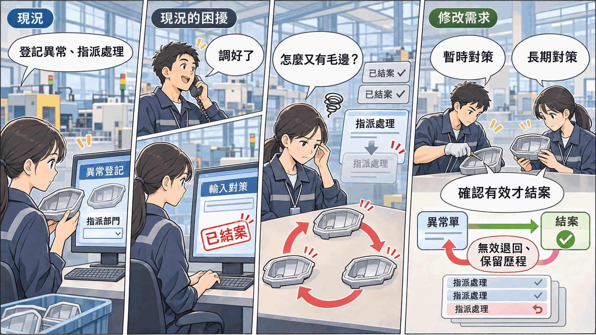

# 品質異常回報管理系統：修改需求提案書

> 老師提供一套已經在使用的[品質異常回報管理系統](../SAD-Quality/README.md)，現在工廠提出一項新需求。請先操作系統、讀懂它現在怎麼運作，再想清楚系統要怎麼改，寫成期末報告。

---

## 一、系統現況

某中型汽車零件射出成型廠的品保課，在 2026-09-01 用這套系統取代紙本異常單：品管人員登記異常、指派責任單位，責任單位回覆處理對策後，由品管人員登錄對策並結案。

| 項目 | 現況 |
|---|---|
| 使用者 | 品保課的主管與品管人員。現場班長與責任單位的人員不使用這套系統 |
| 使用地點 | 系統裝在品保課的一台電腦，廠內電腦以瀏覽器連線 |
| 規模 | 9 個畫面、5 張資料表、2 種角色 |
| 主要功能 | 未結案清單、登記異常單、指派與改派責任單位、登錄對策並結案、判定不成立、異常單查詢、產品與責任單位與異常類別維護、帳號維護 |

## 二、修改需求

| 編號 | 需求 | 提出者 | 一句話說明要解決的問題 |
|---|---|---|---|
| CR-01 | 對策確認與退回 | 品保課長 | 登錄對策就結案，對策沒效也沒人知道，同一個問題每個月都在發生 |

CR 是 Change Request（變更申請）的縮寫，實務上每一項系統修改都會編一個號碼，方便後續追蹤。

這一項是**新的需求**，不是修正錯誤。現行系統運作正常，只是當初沒有納入這個範圍。

---

## 三、CR-01 對策確認與退回

*本圖由 ChatGPT 生成，已由作者審核內容正確性*

### 3.1 原有系統的缺點

| 缺點 | 現場發生什麼事 |
|---|---|
| 登錄處理對策就直接結案 | 責任單位說「調好了」，品管人員寫進系統就結案。對策有沒有效，沒有人事後確認 |
| 結案後不能退回 | 對策沒效，只能另開一張新單。新單和舊單之間沒有關聯，看不出是同一個問題又發生 |
| 改派會蓋掉前一次的責任單位 | 責任單位說「這不是我們的問題」時，品管人員改派給別的單位，前一個單位查了什麼、花了幾天，系統裡看不到 |
| 處理對策只有一個欄位 | 先讓產線動起來的暫時處置，和讓問題不再發生的根本改善，混在同一段文字裡 |

用任一帳號登入，打開「異常單查詢」，關鍵字輸入「毛邊」：會列出三張單，都是 AP-1001 車燈外殼、射出一線射出機 #03。9 月與 10 月的兩張都已結案，對策都是調整射出參數，11 月又發生一次。再點 QI-2610-003：異常在 10-09 發現，指派時間卻是 10-15。這張單其實先派給製造一課，製造一課查出是原料問題才改派採購課，中間這 6 天在系統上沒有任何紀錄。

### 3.2 可以改進的內容

1. 責任單位處理完成與結案分成兩個動作，由不同的人執行
2. 確認對策沒效時可以退回，回到處理中，原本的處理紀錄保留
3. 每一次指派、改派、退回都留下紀錄，看得出一張單轉過幾手、每一手做了什麼
4. 暫時對策與長期對策分開登記

### 3.3 改完之後要解決的問題

| 改完要做到 | 對應的缺點 |
|---|---|
| 每一張結案的單都有人確認過對策有效 | 登錄處理對策就直接結案 |
| 對策沒效時退回原單繼續處理，同一個問題不會散成好幾張單 | 結案後不能退回 |
| 事後查得到一張單轉過哪些單位、各花了幾天 | 改派會蓋掉前一次的責任單位 |
| 查前例時分得出當時是暫時處置還是根本改善 | 處理對策只有一個欄位 |

### 3.4 待小組決議的問題（必須將答案放在報告裡）

- 誰有權確認結案：品管人員、回報人，還是主管？回報人現在不使用系統
- 確認要等多久？有些對策要觀察幾批產品才知道有沒有效。單子停在等待確認多久算卡住，要讓誰知道
- 退回時狀態回到哪裡？原本的處理對策要保留成一筆歷史，還是直接被新的對策蓋掉
- 責任單位要不要自己登入系統填對策？如果要，責任單位能不能自己說「這不是我們的問題」把單退回給品管
- 指派紀錄要一手一筆嗎？這個決定會改變資料表的結構
- 結案時暫時對策與長期對策都要填嗎？只有暫時對策的單能不能結案
- 判定不成立要不要也有人確認
- 上線以來已經結案的單，改版後要算「已確認」，還是另外標示

---

## 四、修改時的限制

| 限制 | 說明 |
|---|---|
| 技術不變 | 仍是 HTML + CSS + JavaScript，資料存在 SQLite 資料庫檔 |
| 可以新增 | 可以在既有資料表加欄位，也可以新增資料表 |
| 原有規則照舊 | 例如異常單不得刪除、異常單號的編碼方式不變 |
| 範圍只到這一項 | 現場直接回報與照片、不良品的後續處理（重工、報廢、挑選）、完整的 8D 報告、統計報表，這次不做 |
| 不必改程式 | 報告寫到需求、流程、資料與畫面為止。依你的修改建議實際改程式，是[額外投入加分](../../00-Course-Introduction/Bonus-Rules.md)的項目 |

## 五、你要交出什麼

期末報告分兩大部分：

| 部分 | 內容 |
|---|---|
| 第一部分：既有系統分析簡要報告 | 分析系統現在的樣子：背景與角色、現況流程、現況功能與需求、現況資料 |
| 第二部分：修改建議書 | 把這份提案書的修改需求，寫成正式的變更需求，再寫出修改前後的差異、會影響到哪裡、修改後的規格、資料與畫面怎麼改、怎麼驗收 |

這份提案書只說「要解決什麼問題」，不說「要怎麼改」。〈3.4〉的問題沒有標準答案，你的選擇與理由要寫進報告。每一項寫什麼、寫到多細，照[期末範例報告](../../04-Final-Project-Example-Reports/Final-Phase-Sample-Report.md)的結構。

## 六、名詞解釋

| 名詞 | 意思 |
|---|---|
| 品質異常 | 產品、材料或製程出現不符合標準的狀況，例如毛邊、尺寸超差、原料雜質 |
| 責任單位 | 被指派處理這件異常的部門，例如製造課、模具課、採購課 |
| 處理對策 | 針對這次異常實際做了什麼，例如調整機台參數、更換模具零件、退回供應商 |
| 暫時對策與長期對策 | 暫時對策是先讓產線動起來，例如全數挑選；長期對策是讓問題不再發生，例如修改模具。**兩者常由不同的人、在不同的時間完成** |
| 結案 | 確認這件異常不再追蹤。**「處理完了」與「可以結案了」不一定是同一件事** |
| 狀態 | 一張單目前走到哪一步，例如待處理、處理中、已結案。**狀態值有幾個、可以往哪裡轉、能不能往回走，是設計出來的，不是天生的** |
| 8D 報告 | 汽車業常用的問題解決報告格式，分 8 個步驟從成立小組寫到預防再發。這一題不做 |
