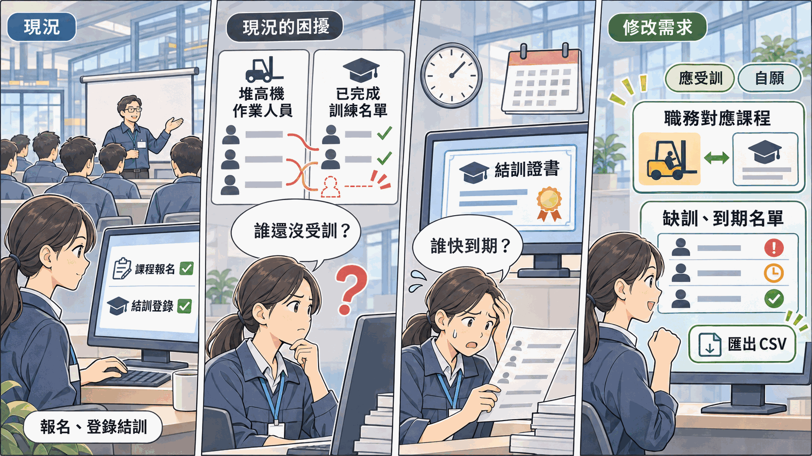

# 員工教育訓練紀錄系統：修改需求提案書

> 老師提供一套已經在使用的[員工教育訓練紀錄系統](../SAD-Training/README.md)，現在工廠提出一項新需求。請先操作系統、讀懂它現在怎麼運作，再想清楚系統要怎麼改，寫成期末報告。

---

## 一、系統現況

某中型金屬加工廠的管理部，在 2026-07-01 用這套系統取代紙本與 Excel：人資開設梯次，員工自己報名或由人資代為報名，課後由人資登錄每個人有沒有完成。

| 項目 | 現況 |
|---|---|
| 使用者 | 人資、員工。部門主管以員工身分登入，沒有額外權限 |
| 使用地點 | 系統裝在管理部的一台電腦，廠內電腦以瀏覽器連線 |
| 規模 | 8 個畫面、4 張資料表、2 種角色 |
| 主要功能 | 課程與梯次維護、員工報名與取消、人資代為報名、課後登錄結訓結果、訓練紀錄查詢、員工帳號維護 |

## 二、修改需求

| 編號 | 需求 | 提出者 | 一句話說明要解決的問題 |
|---|---|---|---|
| CR-01 | 應受訓與到期追蹤 | 工安課 | 不知道誰還缺哪一門訓練、誰的訓練已經過期 |

CR 是 Change Request（變更申請）的縮寫，實務上每一項系統修改都會編一個號碼，方便後續追蹤。

這一項是**新的需求**，不是修正錯誤。現行系統運作正常，只是當初沒有納入這個範圍。

---

## 三、CR-01 應受訓與到期追蹤

*本圖由 ChatGPT 生成，已由作者審核內容正確性*

### 3.1 原有系統的缺點

| 缺點 | 現場發生什麼事 |
|---|---|
| 系統不知道哪個職務應該上哪幾門課 | 工安課要查「哪些堆高機操作員還沒受過堆高機訓練」，人資只能先列出所有堆高機操作員，再逐一查每個人的履歷 |
| 課程沒有有效期限 | 依本廠規定，堆高機、急救、消防這幾門課完成後只在一段期間內有效。系統不知道誰過期了，通常是稽核前一個月臨時清查 |
| 查詢結果只能在畫面上看 | 各部門主管要自己部門的名單，人資只能截圖或手抄 |
| 報名不分應受訓與自願 | 法規課的名額有限，先報名的人先拿到。該上的人報不到，名單上也看不出誰是依職務該上的 |

用人資帳號 `E1001` 登入，打開訓練紀錄查詢，依課程查 TR-101「堆高機操作安全訓練」：畫面只列出完成過的人。同樣是堆高機操作員的黃俊傑還沒有完成，系統不會告訴你。再打開 TR-101 的第 6 梯次（2027-01-20）：3 個名額已經額滿，報名的是黃俊傑、蔡明哲與王建民。對照員工資料，只有黃俊傑是堆高機操作員，名單上卻看不出這一點。

### 3.2 可以改進的內容

1. 人資可以設定每一種職務應該完成哪幾門課
2. 課程可以設定有效期限，系統依完成日期算出到期日
3. 系統列出缺訓名單：依職務應該完成，但從來沒有完成、或已經過期的員工與課程
4. 系統列出指定天數內即將到期的名單，並可匯出成 CSV 檔交給各部門主管。CSV（Comma-Separated Values）是用逗號分隔欄位的純文字表格檔，Excel 可以直接開啟
5. 梯次名單上分得出誰是依職務應受訓、誰是自願報名

### 3.3 改完之後要解決的問題

| 改完要做到 | 對應的缺點 |
|---|---|
| 人資不必逐一對照職稱與履歷，系統直接列出誰缺哪一門 | 系統不知道哪個職務該上哪幾門課 |
| 到期之前就知道誰要排複訓，不必等稽核前臨時清查 | 課程沒有有效期限 |
| 各部門主管拿得到自己部門的缺訓與到期名單 | 查詢結果只能在畫面上看 |
| 名額有限的課，該上的人不會因為晚報名而上不到 | 報名不分應受訓與自願 |

### 3.4 待小組決議的問題（必須將答案放在報告裡）

- 「職務」要直接用員工資料上的職稱（自由文字）來對照，還是另外建一份職務清單讓人資選？前者不必改員工資料，但職稱只要寫法不同就對不上
- 有效期限要記在課程上，還是記在每一筆完成紀錄上？如果本廠規定的期限改了，以前完成的紀錄要照舊期限還是新期限算
- 到期日要存成欄位，還是每次查詢時用完成日期加有效期限算出來
- 複訓和初訓是不是同一門課？兩者的時數不同時，課程資料怎麼記
- 已經過期、還沒複訓的人，系統只列在名單上提醒，還是要擋下什麼（例如不能再報名其他課）？擋的話由誰解除
- 名額有限時，應受訓的人要不要優先？已經額滿的梯次，自願報名的人要不要讓出名額
- 員工換了職務，舊職務要求的課程還算不算缺訓
- 2026-07-01 以前的訓練紀錄不在系統裡。缺訓名單一上線，會把以前受過訓的人也列為缺訓，要怎麼處理
- CSV 檔要有哪些欄位、多久匯出一次、交給誰

---

## 四、修改時的限制

| 限制 | 說明 |
|---|---|
| 技術不變 | 仍是 HTML + CSS + JavaScript，資料存在 SQLite 資料庫檔 |
| 可以新增 | 可以在既有資料表加欄位，也可以新增資料表 |
| 原有規則照舊 | 例如員工報名在一個畫面內完成、上課日期已到的報名紀錄不得刪除 |
| 範圍只到這一項 | 上課簽到、出席時數與補考紀錄、線上課程、主管指派部屬受訓這類功能，這次不做 |
| 不必改程式 | 報告寫到需求、流程、資料與畫面為止。依你的修改建議實際改程式，是[額外投入加分](../../00-Course-Introduction/Bonus-Rules.md)的項目 |

## 五、你要交出什麼

期末報告分兩大部分：

| 部分 | 內容 |
|---|---|
| 第一部分：既有系統分析簡要報告 | 分析系統現在的樣子：背景與角色、現況流程、現況功能與需求、現況資料 |
| 第二部分：修改建議書 | 把這份提案書的修改需求，寫成正式的變更需求，再寫出修改前後的差異、會影響到哪裡、修改後的規格、資料與畫面怎麼改、怎麼驗收 |

這份提案書只說「要解決什麼問題」，不說「要怎麼改」。〈3.4〉的問題沒有標準答案，你的選擇與理由要寫進報告。每一項寫什麼、寫到多細，照[期末範例報告](../../04-Final-Project-Example-Reports/Final-Phase-Sample-Report.md)的結構。

## 六、名詞解釋

| 名詞 | 意思 |
|---|---|
| 現場 | 工廠裡實際生產的區域，與辦公室相對。「現場人員」指在產線上工作的人 |
| 單據（表單） | 一次作業的紀錄憑證，例如報名紀錄、簽到表。紙本時代是一張紙，系統化之後是資料庫裡的一筆紀錄 |
| 主檔與明細 | 一筆資料常拆成兩層：主檔記「這是什麼」，明細記「底下包含哪幾個項目」。課程與梯次就是這個結構：同一門課程可以開很多梯次 |
| 狀態 | 一筆紀錄目前走到哪一步，例如報名、出席、結訓。**狀態值有幾個、怎麼轉移，是設計出來的，不是天生的** |
| 初訓與複訓 | 第一次上某門課叫初訓；有效期限到了，再上一次讓資格延續叫複訓。複訓的時數常比初訓短 |
| 補考 | 測驗沒通過的人，在上課日之後另外再考一次 |
| 逾期（到期） | 超過應完成或有效的期限。**到期通常不是一個儲存的欄位，而是把期限與今天比較算出來的** |
| 追溯 | 事後查得出「這件事是誰、在什麼時候、怎麼做的」。稽核要查某人受過哪些訓練、上了幾小時，就靠它 |
