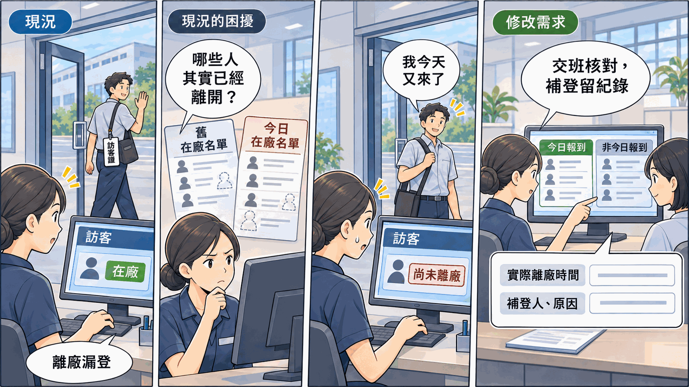
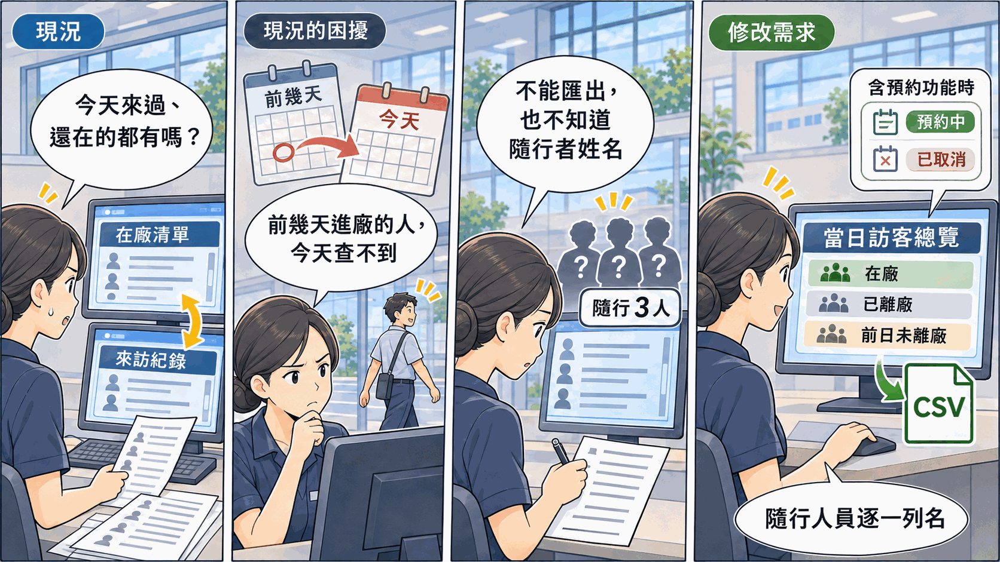

# 工廠訪客進出登記系統：修改需求提案書

> 老師提供一套已經在使用的[工廠訪客進出登記系統](../SAD-Visitor/README.md)，現在工廠提出三項新需求。請先操作系統、讀懂它現在怎麼運作，再想清楚系統要怎麼改，寫成期末報告。
>
> 這套系統是期末的示範對象，**不列入抽籤**。照這份提案書寫完的成品見[期末範例報告](../../04-Final-Project-Example-Reports/Final-Phase-Sample-Report.md)。並且有三項修改需求，這是為了用來當成上課範例講解之用，各組的期末報告均只有一項修改需求完成。

---

## 一、系統現況

某中型電子零件廠的大門櫃台，用這套系統取代紙本登記簿：訪客到廠時，接待員登記並發給訪客證；訪客離開時，接待員登記離廠並收回訪客證。

| 項目 | 現況 |
|---|---|
| 使用者 | 接待員（大門警衛）、管理員（總務人員）。受訪員工與訪客都不登入 |
| 使用地點 | 只裝在櫃台的一台電腦上 |
| 規模 | 9 個畫面、5 張資料表、2 種角色 |
| 主要功能 | 來訪登記與發證、在廠訪客清單、離廠登記、來訪紀錄查詢與修改、基本資料維護 |

## 二、三項修改需求

| 編號 | 需求 | 提出者 | 一句話說明要解決的問題 |
|---|---|---|---|
| CR-01 | 事前來訪預約與受訪員工確認 | 生產部經理（受訪員工代表） | 訪客到了才找人，找不到人就在門口等 |
| CR-02 | 未離廠追蹤 | 工安課 | 在廠名單不準，看不出哪些訪客其實已經離開 |
| CR-03 | 當日訪客總覽與匯出 | 總務課（管理員） | 今天有哪些外來人員要來、來過、還在，要在幾個畫面之間自己對照 |

CR 是 Change Request（變更申請）的縮寫，實務上每一項系統修改都會編一個號碼，方便後續追蹤。

---

## 三、CR-01 事前來訪預約與受訪員工確認

*本圖由 ChatGPT 生成，已由作者審核內容正確性*

### 3.1 原有系統的缺點

| 缺點 | 現場發生什麼事 |
|---|---|
| 沒有預約功能，訪客到了才登記 | 接待員要當場打分機找受訪員工。員工不在座位上，訪客就在門口等 |
| 受訪員工不使用系統 | 員工不知道訪客到了沒有，只能等櫃台的電話 |
| 每位訪客都要在櫃台口述受訪人與來意 | 早上上班時段，開會與送貨的訪客集中到廠，櫃台排隊 |
| 系統只裝在櫃台一台電腦上 | 就算想讓員工自己登錄預約，員工在座位上也用不到 |

用 `guard01` 登入，打開來訪登記頁就看得到：受訪員工只能從下拉選單選，系統只顯示分機號碼，通知受訪員工這件事完全不經過系統。

### 3.2 可以改進的內容

1. 受訪員工可以事先登錄預約：哪位訪客、哪一天、什麼時段、什麼事由
2. 訪客到廠時，接待員從「今日預約」直接報到，不必重新輸入
3. 沒有預約的訪客（送貨、臨時維修）仍可現場登記
4. 預約日過了訪客沒有來，要看得出來

### 3.3 改完之後要解決的問題

| 改完要做到 | 對應的缺點 |
|---|---|
| 有預約的訪客到廠時，受訪員工早就知道他要來，接待員不必打分機找人 | 訪客到了才找人 |
| 有預約的訪客報到時，接待員不必再問受訪人與來意 | 櫃台排隊 |
| 沒有預約的訪客，登記方式和現在一樣 | 現場登記不能因為加了預約而變慢 |
| 受訪員工與接待員都看得出哪些預約落空 | 預約後沒來的情況現在沒有任何紀錄 |

### 3.4 待小組決議的問題（必須將答案放在報告裡）

- 預約與來訪紀錄要放在同一張表，還是分成兩張
- 預約有幾種狀態；「訪客沒來」要存成一個狀態，還是由日期算出來
- 受訪員工的登入帳號要放在 `users` 還是 `employees`
- 受訪員工登錄預約時，要不要直接連到訪客資料？連了的話，受訪員工會不會因此看到訪客的身分證字號
- 受訪員工要在自己座位上使用，但系統只裝在櫃台一台電腦上，這件事要怎麼處理

---

## 四、CR-02 未離廠追蹤

*本圖由 ChatGPT 生成，已由作者審核內容正確性*

### 4.1 原有系統的缺點

| 缺點 | 現場發生什麼事 |
|---|---|
| 訪客忘了交回訪客證就離開，紀錄會一直留在在廠清單上 | 在廠人數比實際多。清單也不分報到日期，看不出哪幾筆是前幾天留下來的 |
| 離廠只有一個「離廠」按鈕，離廠時間就是按下的當下 | 事後才發現漏登，補上的離廠時間不是訪客實際離開的時間 |
| 仍在廠的訪客不能再登記新的來訪 | 漏登的訪客再來時會被擋下，接待員必須先替舊紀錄登記離廠 |

系統的種子資料裡就有這個狀況：陳俊宏 11/2 進廠後沒有登記離廠，啟動系統後他仍在在廠清單上。試著替他登記一次新的來訪，就會看到系統擋下來。

### 4.2 可以改進的內容

1. 在廠清單把「今天報到」與「不是今天報到」的訪客分開顯示
2. 接待員交班時核對未離廠的紀錄，補登實際離廠時間與原因

### 4.3 改完之後要解決的問題

| 改完要做到 | 對應的缺點 |
|---|---|
| 在廠清單上的人數，等於實際在廠內的人數 | 漏登離廠的紀錄一直算在廠 |
| 一眼看得出哪幾筆可能是漏登 | 清單不分報到日期 |
| 補登的紀錄看得出是補登的、誰補的、為什麼補 | 補登時間不是實際離廠時間 |

### 4.4 待小組決議的問題（必須將答案放在報告裡）

- 補登的離廠時間，系統要怎麼檢查才算合理

---

## 五、CR-03 當日訪客總覽與匯出

*本圖由 ChatGPT 生成，已由作者審核內容正確性*

### 5.1 原有系統的缺點

| 缺點 | 現場發生什麼事 |
|---|---|
| 在廠清單只列還在廠內的人 | 今天來過又離開的訪客，要到來訪紀錄查詢頁另外查 |
| 來訪紀錄查詢只依報到日期查 | 前幾天進廠、還沒登記離廠的人，不會出現在今天的查詢結果 |
| 沒有一個畫面列出今天所有的外來人員 | 管理員要掌握當天有誰來過、誰還在，只能在在廠清單與來訪紀錄查詢之間來回對照，自己整理 |
| 查到的資料無法匯出 | 要留存或交給主管時，只能照畫面手抄 |
| 隨行人員只記人數 | 清單上只知道多了幾個人，不知道是誰 |

用 `admin` 登入，分別打開在廠訪客清單與來訪紀錄查詢頁，比較兩邊列出的人，就看得到這個狀況。

### 5.2 可以改進的內容

1. 管理員有一個畫面，列出今天所有的外來人員與目前的狀態：在廠、已離廠，以及前幾天報到但還沒離廠的人
2. 如果同時做了 CR-01，今天預約但還沒到的人（預約中）與今天已取消的預約也要列出來
3. 這份清單可以匯出成 CSV 檔。CSV（Comma-Separated Values）是用逗號分隔欄位的純文字表格檔，Excel 可以直接開啟
4. 清單要列出每一位隨行人員的姓名

### 5.3 改完之後要解決的問題

| 改完要做到 | 對應的缺點 |
|---|---|
| 管理員打開一個畫面，就看得到今天所有外來人員的狀態 | 要在兩個畫面之間對照；前幾天進廠的人查不到 |
| 清單可以存成檔案留存，不必手抄 | 無法匯出 |
| 清單上看得到每一個人，包括隨行人員 | 隨行人員只有人數 |

### 5.4 待小組決議的問題（必須將答案放在報告裡）

- 隨行人員要記到多細？只記姓名，還是也記手機與證件？記得越多，登記越慢，存的個資也越多
- 有預約的訪客報到後，清單上要列成一列，還是預約與來訪各一列
- 清單上的各種狀態要怎麼判斷：哪些要存成欄位，哪些可以由其他欄位推導出來
- CSV 檔要有哪些欄位、什麼時候匯出、匯出失敗時怎麼辦

---

## 六、修改時的限制

| 限制 | 說明 |
|---|---|
| 技術不變 | 仍是 HTML + CSS + JavaScript，資料存在 SQLite 資料庫檔 |
| 可以新增 | 可以在既有資料表加欄位，也可以新增資料表 |
| 原有規則照舊 | 例如來訪登記要在單一頁面完成、來訪紀錄不得刪除。忘記離廠的紀錄只能補登，不能刪掉重來 |
| 範圍只到這三項 | 系統還有其他問題，這次不處理。改這三項時如果碰到其他問題，寫出影響即可 |
| 不必改程式 | 報告寫到需求、流程、資料與畫面為止。依你的修改建議實際改程式，是[額外投入加分](../../00-Course-Introduction/Bonus-Rules.md)的項目 |

## 七、你要交出什麼

期末報告分兩大部分：

| 部分 | 內容 |
|---|---|
| 第一部分：既有系統分析簡要報告 | 分析系統現在的樣子：背景與角色、現況流程、現況功能與需求、現況資料 |
| 第二部分：修改建議書 | 把這份提案書的三項需求，寫成正式的變更需求，再寫出修改前後的差異、會影響到哪裡、修改後的規格、資料與畫面怎麼改、怎麼驗收 |

這份提案書只說「要解決什麼問題」，不說「要怎麼改」。〈3.4〉〈4.4〉〈5.4〉的問題沒有標準答案，你的選擇與理由要寫進報告。每一項寫什麼、寫到多細，照[期末範例報告](../../04-Final-Project-Example-Reports/Final-Phase-Sample-Report.md)的結構。

## 八、名詞解釋

| 名詞 | 意思 |
|---|---|
| 現場 | 工廠裡實際生產的區域，與辦公室相對。訪客進入現場通常有額外的安全規定 |
| 單據（表單） | 一次作業的紀錄憑證，例如一筆來訪紀錄。紙本時代是登記簿上的一行，系統化之後是資料庫裡的一筆紀錄 |
| 狀態 | 一筆紀錄目前走到哪一步，例如預約、在廠、已離廠。**狀態值有幾個、怎麼轉移，是設計出來的，不是天生的**；「在廠」這類狀態也可以不存欄位，而是由其他欄位推導出來 |
| 追溯 | 事後查得出「這件事是誰、在什麼時候、怎麼做的」。補登離廠要記錄補登人與原因，就是為了追溯 |
